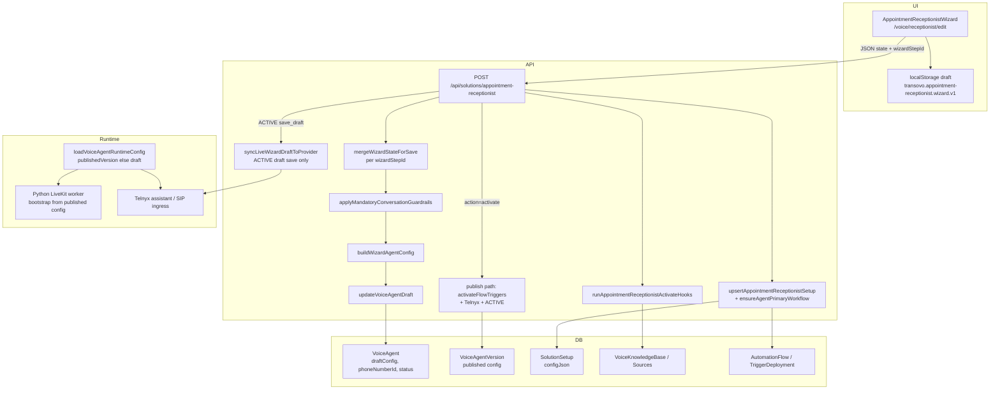

# AI Receptionist (Appointment Receptionist) — Wizard, Save, and Runtime Audit

**Audience:** Product / engineering review — “is the foundation wrong?”  
**Canonical UI (Opus):** `/voice/receptionist` (summary) · `/voice/receptionist/edit?step=…` (8-step wizard)  
**Primary API:** `POST/GET /api/solutions/appointment-receptionist`  
**Last reviewed against repo:** `master` (Oct 2026).  
**Lifecycle ADR (current target):** `docs/AI-RECEPTIONIST-CONFIG-LIFECYCLE-ADR.md` — **Save Draft** is DB-only (no live sync, hooks, or compile); **Activate** owns publish.

---

## 1. Executive summary

The AI Receptionist is **not** a single JSON blob in the browser. It is a **multi-store system**:

| Store | What it holds | Role |
|--------|----------------|------|
| **`VoiceAgent.draftConfig`** | Wizard snapshot under `advanced.appointmentReceptionistWizard` + `wizardConfigRevision`; full compile on **Activate** / test | **Authoritative editable config** on save; compiled fields updated on publish |
| **`VoiceAgentVersion.config`** (when ACTIVE) | Published snapshot used on **live calls** | What callers hear until next publish/live-sync |
| **`SolutionSetup.configJson.wizard`** | Copy of wizard fields for inventory / linking | Durability + catalog; merged on load with draft |
| **Platform rows (side effects)** | `VoiceKnowledgeBase`, `VoiceService`, transfer destinations, `AutomationFlow`, phone `settingsJson`, Company Brain, etc. | Created/updated by **activate hooks** on every save (with exceptions below) |

**Intended mental model:** Edit → **Save Draft** (merge + persist snapshot) → **Test** (compile isolated) → **Activate** (hooks + compile + workflow + Telnyx/LiveKit publish).

**Where teams often feel “the foundation is wrong”:**

1. **Per-step merge** — Saving step A must not wipe step B; only “owned fields” for that step apply from the client payload.
2. **Draft vs live** — **Save Draft** must not change live callers; published `VoiceAgentVersion` stays until **Activate** succeeds.
3. **Heavy work on save** — Historically KB crawl, workflow compile, and Telnyx sync ran on draft save; draft path now skips these (see ADR). Async KB and tracked publish are follow-ups.
4. **Duplicate surfaces** — `/voice/knowledge`, `/voice/call-handling`, and wizard steps overlap; wizard is canonical for setup, ops pages for day-2 edits (must use same API/state).
5. **Conversation “rules” toggles** — UI toggles were removed; **mandatory guardrails** are forced in API + hydrate (`conversation-guardrails.ts`).

---

## 2. Architecture diagram (save → runtime)

---

## 3. UI entry points and navigation

| Route | Component | Purpose |
|--------|-----------|---------|
| `/voice/receptionist` | `NewUiVoiceReceptionistPage` | Summary; loads `GET /api/voice/overview?hub=1` |
| `/voice/receptionist/edit` | `AppointmentReceptionistWizard` (presentation=`opus`) | 8-step wizard |
| `/voice/overview` | Voice overview dashboard | Ops KPIs; links to receptionist |
| `/voice/knowledge` | Business knowledge (can patch wizard via hooks) | Operational KB editor |
| `/voice/call-handling` | `useAppointmentReceptionistWizard` + save | Ops call-handling (overlaps wizard) |

**Hydrate on wizard open (Opus):** Always `GET /api/solutions/appointment-receptionist` (no agentId → resolves workspace receptionist). Then `router.replace` adds `agentId` + `step` query params.

**Client draft cache:** `localStorage` key `transovo.appointment-receptionist.wizard.v1` stores `{ stepIndex, state }` on every change — **secondary** to server; server wins when `agentId` exists.

**Wizard navigation:** `Save & continue` calls `persist("save_draft")` or `create_draft` on step 0, then advances. Dirty step jump asks confirm → save draft first.

---

## 4. Save pipeline (POST) — exact order

**Request body:** `{ action, state, wizardStepId }`  
**Actions:** `create_draft` | `save_draft` | `activate`

### 4.1 Merge and guardrails

1. If `state.agentId` + `wizardStepId` + not create/activate: **`mergeWizardStateForSave(server, incoming, stepId)`** — only fields listed for that step in `merge-wizard-state-on-save.ts` are taken from the client; all other keys stay from server draft.
2. **`applyMandatoryConversationGuardrails`** — forces `conversationBehaviors` (brief, one question, confirm details, never invent pricing/availability).

### 4.2 Lightweight saves (goals / phone only)

When `wizardStepId` is **`goals`** or **`phone`** and action is `save_draft` or `create_draft`:

- KB **processing** (`processKnowledgeSource` crawl/embed) is **skipped** (rows still updated).
- **Company Brain** sync skipped.
- **Live Telnyx sync** (`syncLiveWizardDraftToProvider`) skipped even for ACTIVE agents.

All other steps still run full hooks.

### 4.3 Agent row

- No `agentId` → **`createVoiceAgent`** (template `appointment_booking`, type from `outcomeSlugFromWizard`).
- **`buildWizardAgentConfig(state)`** → `VoiceAgentConfig` (prompt, tools, voice, transfers, `advanced.appointmentReceptionistWizard` snapshot).
- **`runAppointmentReceptionistActivateHooks`** — KB ensure, calendar services, transfer sync (rules vary by ACTIVE vs draft), insights on activate only, shared after-hours/overflow hooks.

### 4.4 Draft write

- **`updateVoiceAgentDraft`** — writes `draftConfig`, name, displayName, optional `phoneNumberId` (ACTIVE draft may **preserve** live phone until Activate).
- If **ACTIVE** + `save_draft` + not lightweight: **`syncLiveWizardDraftToProvider`** — updates published version row + Telnyx; failure → **422** with `liveSyncPending` (DB save still done).

### 4.5 Solution setup + workflow

- **`upsertAppointmentReceptionistSetup`** — links `SolutionSetup` ↔ agent, stores `configJson`, compiles **`ensureAgentPrimaryWorkflow`** (inbound trigger graph: answer-when → voice agent). Errors → `workflowCompileError` warning, not always blocking.

### 4.6 Activate only

- Checklist **`hasBlockingActivationIssues`**.
- **`activateFlowTriggers`** — must get **`telnyxPublished`** or activation fails.
- **`setActiveCallHandler`** — phone `settingsJson` → `ai_receptionist`.
- Agent → **ACTIVE**, flow → ACTIVE, health cleared.

**Response:** Returns **`authoritative.state`** from `loadAppointmentReceptionistSetup` (merged load path).

---

## 5. Load pipeline (GET) — what the UI sees

**`loadAppointmentReceptionistSetup`:**

1. Find `SolutionSetup` by `setupId` / `agentId` / `sourceSolutionSetupId`.
2. Read **`VoiceAgent.draftConfig.advanced.appointmentReceptionistWizard`** (`wizardSnap`).
3. Merge **`setup.configJson.wizard`** (`storedWizard`) under/over snap.
4. Phone: ACTIVE uses **`agent.phoneNumberId`**; draft prefers wizard snapshot.
5. Default capabilities if missing: `answer_questions`, `book_appointments`.

**Runtime reads (calls, tools):** **`loadVoiceAgentRuntimeConfig`** — **published version first**, else draft. Wizard snapshot for tools: **`loadWizardFromAgent`** reads same config’s `advanced.appointmentReceptionistWizard`.

---

## 6. How wizard state becomes a live call

1. **`buildWizardAgentConfig`** builds instructions, `enabledBuiltinTools`, voice/STT (ElevenLabs vs OpenAI realtime by **booking strategy**), transfers, messaging, `conversationFlow` sections.
2. **`recompileReceptionistFromDraft`** maps wizard → **`compileReceptionistConfig`** snapshot (generic receptionist compiler) while keeping full `appointmentReceptionistWizard` on `advanced`.
3. **Publish / live sync:** `publishVoiceAgent` or `syncLiveWizardDraftToProvider`:
   - `applyFlowToAgentDraft` (strict)
   - Recompile + **`attachPythonRuntimeBootstrapSnapshot`** (LiveKit worker payload)
   - **`enrichVoiceAgentConfigForCanonicalAiBooking`**
   - LiveKit publish asserts
   - **`syncAssistantToTelnyx`**
4. **Inbound call:** Telnyx/LiveKit → worker loads bootstrap from **published** config → tools hit Next.js tool webhooks / booking engines per strategy.

**Booking strategies** (`deriveBookingStrategyFromWizard`): `MICROSOFT_365`, `CALENDLY`, `SEND_LINK`, internal, etc. — drives calendar tools vs link SMS vs Graph.

---

## 7. Step-by-step wizard audit

Steps (order): **Goals → Phone → Information → Appointments → Call Handling → Voice → Test → Activate**

Ownership is defined in **`merge-wizard-state-on-save.ts`** (`STEP_OWNED_FIELDS`). If a field is missing from a step’s list, saving another step **cannot** change it via merge (server value kept).

---

### Step 1 — Goals (`goals`)

**UI:** `GoalsStep` — capabilities toggles, optional solution name, **answer when** (every call / overflow / after hours), preset side effects.

**Owned fields:** `capabilities`, `answerWhen`, `solutionName`, `preset`, `outcomeSlug`

**Runtime effect:**

- **Capabilities** → which tools and conversation flow sections are enabled in `buildWizardAgentConfig` (book, transfer, SMS, cancel, reschedule).
- **answerWhen** → `resolveWizardRoutingMode` → `callHandling.answerMode`, workflow trigger (`triggerBlockFromAnswerWhen`), automation routing mode.
- **outcomeSlug** → `agentType`, SolutionSetup labeling, workflow branches (booking/SMS).

**Hooks on save:** Lightweight — no KB process, no brain sync, no live sync.

**Common issues:**

- Zero capabilities → validation on continue.
- Changing capabilities without revisiting Appointments/Call Handling can leave **stale** booking/transfer config on server until those steps are saved.

---

### Step 2 — Phone (`phone`)

**UI:** `PhoneStep` — number picker (`/api/...` phone list), inbound number assignment, ring team seconds (non-CFNA), connection greeting (Transovo TTS / upload), call recording mode, outbound SMS number for confirmations.

**Owned fields:** `numberSource`, `phoneNumberId`, `phoneNumberE164`, outbound SMS ids, `ringBehavior`, `ringTeamSeconds`, `callRecording`, `connectionGreeting*`

**Runtime effect:**

- **`phoneNumberId`** — agent row + workflow trigger DID; **Activate** requires it.
- **Connection greeting** → `callHandling.startupGreeting` (pre-AI audio).
- **Ring** → human-first vs AI immediate in config + trigger.
- **Recording** → compliance + post-call.

**Hooks:** Lightweight save. **ACTIVE agent:** changing phone on draft save may be **blocked** (warning; keeps live assignment until Activate).

**Runtime ingress:** Separate from wizard — **LiveKit SIP provisioning** on phone `settingsJson`, **TriggerDeployment**, **call handling** `activeCallHandler: ai_receptionist`. Wizard does not alone provision carrier forwarding (MCTB CFNA is a different product path).

---

### Step 3 — Information (`information`)

**UI:** `InformationStep` + `InformationStepOperationalExtras` — business name, website, KB connect/upload, knowledge items, hours (operating maturity), timezone, agent name/role, tone, greeting, long-term memory, CRM flags. **No** editable conversation-rule toggles (guardrails forced).

**Owned fields:** Large set — KB, business identity, greeting, timezone, `conversationBehaviors` (overwritten by guardrails on save), `guardrails` text array, etc.

**Runtime effect:**

- **Prompt** — `compileVoiceAgentPromptFromWizard` + `buildBusinessKnowledgePromptSection` from `knowledgeItems`.
- **KB hooks** — `ensureWizardKnowledgeBase` creates/updates sources; **`processKnowledgeSource`** runs on save (unless lightweight step).
- **Website URL** → URL crawl source (can be slow).
- **`linkedKnowledgeBaseId`** — links extra KB to agent.
- **Timezone** → dynamic variables, booking, hours.

**Also:** `persistKnowledgeWizardStep` / knowledge page may save with `wizardStepId: "information"`.

**Common issues:**

- Save feels slow — KB processing.
- KB not linked — uploads require `linkedKnowledgeBaseId` / auto-ensure client paths.

---

### Step 4 — Appointments (`appointments`)

**UI:** `AppointmentsStep` + Opus collect-fields — calendar connection, booking strategy (Microsoft / Calendly / link), appointment types, collect fields, qualification rules, booking link URL.

**Owned fields:** Calendar fields, `appointmentTypes`, `bookingStrategy`, Calendly URIs, `bookingBehavior`, `collectFields`, qualification*.

**Runtime effect:**

- **Services** — `ensureWizardCalendarServices` upserts `VoiceService` rows per enabled type.
- **Tools** — book/reschedule/cancel/find slots per capabilities + strategy.
- **`bookingBehavior`** — confirm before book, SMS after book, etc. (also partially on call-handling step — **both** own `bookingBehavior`; last save wins per merge rules).

**Hooks:** Full calendar/service sync every save.

**Activate blocking:** Calendar/link/SMS requirements from `wizard-readiness` + `getWizardActivationIssues`.

---

### Step 5 — Call Handling (`call-handling`)

**UI:** `CallHandlingStep` — transfers (destinations, warm transfer, voicemail detect), callbacks, urgency, after-hours notifications, spam/solicitor policies, operating maturity (on-call, SLA), booking behavior duplicates, AI call recovery SMS (MCTB-adjacent flags).

**Owned fields:** Transfer*, callback*, urgency*, spam*, `operatingMaturity`, `bookingBehavior`, some `capabilities`/`callRecording` (overlap with other steps — **watch merge order**).

**Runtime effect:**

- **Transfers** — `syncWizardTransferDestinations` (draft/testing always; ACTIVE only on activate unless draft agent).
- **Routing** — `syncWizardRoutingRules` on **activate** only.
- **Config** — `transfers.*`, escalation instructions, tool `escalate_human`.

**Ops overlap:** `/voice/call-handling` uses same wizard state + `saveDraft("call-handling")`.

---

### Step 6 — Voice (`voice`)

**UI:** `VoiceStep` + `IdentityConversationStage` — voice picker (GPT-Live catalog), pace, interruption, opening greeting (again), identity fields duplicated from Information for UX.

**Owned fields:** Identity + voice tuning ids, `voiceId`, `voiceLabel`, `speakingSpeed`, responsiveness, etc.

**Runtime effect:**

- **Voice/STT path** — ElevenLabs vs OpenAI realtime (strategy-dependent).
- **Greeting** — `callHandling.greeting` with `{{businessName}}` interpolation.
- Merge owns identity fields here — saving Voice **overwrites** Information-owned identity fields **only when saving voice step** (Information save keeps them if you don’t re-save Voice).

**Risk:** Splitting identity across Information and Voice steps can confuse users; server merge is step-scoped, not field-scoped globally.

---

### Step 7 — Test (`test`)

**UI:** `TestStep` — browser WebRTC via `VoiceV3BrowserCall`, optional phone test after activate.

**Owned fields:** `testScenario`, `lastTestPassed`

**Runtime:** Calls `ensureAgentForTest` → `save_draft` then live test API (draft config probe). **Does not** publish. Failures (“Connecting…”) often infra: LiveKit, internal voice API, missing bootstrap, not wizard merge.

---

### Step 8 — Activate (`activate`)

**UI:** `ActivateStep` — readiness rows, checklist from `getWizardActivationIssues`, calendar probe, **Activate** → `persist("activate")`.

**Owned fields:** `activationMode`, `scheduledAt` (scheduled modes largely disabled; forced `activate_now`).

**Runtime:** Full publish path (§4.6). Redirects to `/voice/receptionist` on success (Opus).

---

## 8. Parallel systems (same data, different UI)

| Surface | Save mechanism | `wizardStepId` used |
|---------|----------------|---------------------|
| Wizard | POST appointment-receptionist | Current step id |
| `/voice/call-handling` | `useAppointmentReceptionistWizard.saveDraft("call-handling")` | call-handling |
| `/voice/knowledge` | `persistKnowledgeWizardStep` / scan-upload hooks | information |
| Receptionist editor (legacy) | `receptionist-editor-persist` grouped saves | varies |

**If ops pages save without merge**, they can still overwrite whole state when `agentId` missing or step id wrong — always pass correct `wizardStepId`.

---

## 9. Health, live sync, and status vocabulary

| Agent `status` | Meaning |
|----------------|---------|
| DRAFT | Not live; draftConfig authoritative for tests |
| ACTIVE | Published version exists; live calls use published config |
| TESTING | Intermediate (transfer hooks may mutate destinations) |

| `healthStatus` | UI |
|----------------|-----|
| Live sync pending | “Saved — pending live sync”; wizard may show error banner |
| OK | Cleared on successful activate |

**Suppressed vs failed** applies to MCTB SMS, not voice wizard directly.

---

## 10. Foundation assessment — is it “wrong”?

**What is sound:**

- Single **`VoiceAgent`** per workspace receptionist (resolve canonical → newest appointment-receptionist).
- Full wizard snapshot on **`advanced.appointmentReceptionistWizard`** for round-trip and promote.
- **Per-step merge** prevents the worst cross-page overwrites.
- **Activate** gated on Telnyx publish proof and checklist.
- **Compiler pipeline** (wizard → config → receptionist compile → Python bootstrap) is explicit.

**Structural risks (worth fixing or documenting for ops):**

1. **Triple persistence** (`draftConfig`, `SolutionSetup.configJson`, platform KB/services) can drift if hooks fail silently (warnings only).
2. **Heavy saves** on Information/Appointments/Call Handling still run KB + workflow compile — expect timeouts on slow networks (502 Bad Gateway).
3. **Field ownership overlap** (`bookingBehavior`, identity on Information vs Voice, `capabilities` on Goals vs Call Handling) — last writer wins per step, not per field priority.
4. **ACTIVE draft edits** — DB updates immediately; live calls lag until sync/activate; users interpret as “save didn’t work”.
5. **Test step** depends on LiveKit worker + internal APIs — orthogonal to wizard save correctness.
6. **Conversation behaviors** — UI removed but state still exists; always forced on save (good for compliance, confusing if old UI screenshots expected toggles).

**Not wrong, but easy to misconfigure:**

- Phone assigned but **call handling** still MCTB on same DID.
- Booking strategy Microsoft without calendar connection.
- Transfer enabled in Goals but numbers invalid — activate blocked.

---

## 11. Key files (code map)

| Concern | Path |
|---------|------|
| Wizard UI | `src/components/solutions/appointment-receptionist/wizard.tsx` |
| Step components | `src/components/solutions/appointment-receptionist/steps/*.tsx` |
| Step field ownership | `src/lib/solutions/appointment-receptionist/merge-wizard-state-on-save.ts` |
| Config build | `src/lib/solutions/appointment-receptionist/build-agent-config.ts` |
| API | `src/app/api/solutions/appointment-receptionist/route.ts` |
| Hooks / side effects | `src/lib/solutions/appointment-receptionist/activate-hooks.ts` |
| Setup + workflow | `src/lib/solutions/appointment-receptionist/save-setup.ts` |
| Load/hydrate | `loadAppointmentReceptionistSetup` in same file |
| Guardrails | `src/lib/solutions/appointment-receptionist/conversation-guardrails.ts` |
| Publish / live sync | `src/lib/voice/agent-service.ts` |
| Runtime config read | `src/lib/voice/load-agent-config.ts` |
| Wizard from agent | `src/lib/voice/runtime/load-wizard.ts` |
| Recompile | `src/lib/voice/receptionist/recompile.ts` |
| LiveKit bootstrap | `src/lib/voice/python-runtime-bridge/*` |
| Activation checklist | `src/lib/solutions/appointment-receptionist/capability-checklist.ts` |
| Summary hub | `src/lib/voice/overview-summary.ts` |

---

## 12. Suggested validation checklist (manual)

For each step: change one obvious field → Save draft → hard refresh → confirm field persists → place test call or browser test → confirm behavior matches (may require Activate for phone).

| Step | Quick proof |
|------|-------------|
| Goals | Disable transfer → activate tools list has no transfer |
| Phone | Assign DID → agent row `phoneNumberId` |
| Information | Business name → prompt / KB source text |
| Appointments | Enable type → `VoiceService` row |
| Call Handling | Transfer E.164 → destination sync (after activate) |
| Voice | Change voice id → published config voiceLanguage |
| Test | Browser call connects (infra) |
| Activate | Status ACTIVE + inbound answers |

---

## 13. Document history

- Generated for internal audit / copy-paste review.
- Reflects lightweight goals/phone save optimization and summary `hub=1` fast path.
- For MCTB bundled voice agent wizard, same engine with `presentation="mctb"` and different steps/routes (`/mctb/voice-agent`).

---

*End of audit.*
