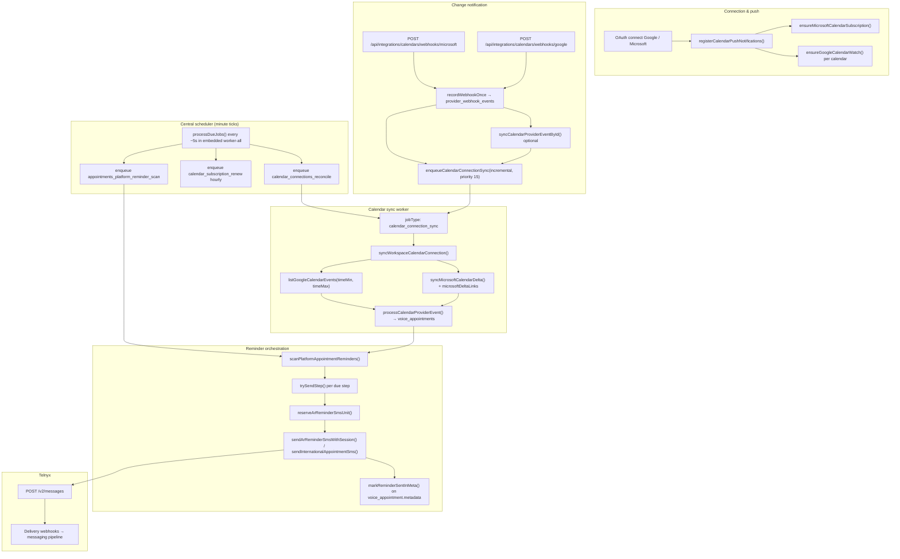

# Transovo Appointment Reminders — Production Architecture Audit

**Date:** 2026-10-09 (UTC)  
**Scope:** Read-only architecture and implementation audit (no code or infrastructure changes in this pass).  
**Goal:** Validate production readiness and scalability toward **100 → 10,000** connected calendars with reliable SMS reminders via Telnyx.

**Evidence types used in this report**

| Label | Meaning |
|--------|---------|
| **Code** | Traced in repository at audit time (`master` branch). |
| **Prod-verified** | Observed on production/staging with real Microsoft connection, deploy SHA, or live tests documented in related AR docs. |
| **Not prod-verified** | Implemented in code but not load-tested or not observed at scale in production. |

Related snapshots (not duplicated here unless noted): `docs/AR-MICROSOFT-GRAPH-WEBHOOK-DELTA-BACKSTOP-STATUS.md`, `docs/AR-MICROSOFT-GRAPH-CALENDAR-SYNC-AUDIT.md`, `docs/CURSOR-CLOUD-COOLIFY-DEPLOYMENT.md`.

---

## A. Current architecture (as implemented)

### A.1 End-to-end lifecycle (happy path)

### A.2 Production invocation of `processDueJobs()`

| Entry point | File | Behavior |
|-------------|------|----------|
| **Embedded job worker (primary prod path)** | `scripts/start-production.mjs` spawns `scripts/worker-all.ts` when `EMBEDDED_JOB_WORKER` is not `0` | BullMQ mode: `startBullmqWorkers()` + `setInterval` every `WORKER_POLL_MS` (default **5s**) calling `processDueJobs(40)` and `drainCalendarMaintenanceFromDb(8)`. |
| **HTTP cron (optional)** | `src/app/api/jobs/process/route.ts` | `processDueJobs(50)` when called with auth. |
| **DB-only mode** | `worker-all.ts` without BullMQ | Same tick polls and **claims** DB jobs locally. |

**Code:** `processDueJobs` enqueues global minute/hour/day ticks (including AR and calendar jobs) via `enqueueJob` + idempotency keys, then:

- If `QUEUE_DRIVER=bullmq` and `REDIS_URL`: returns after `syncDbOutboxToBullmq(50)` — **does not** claim DB jobs locally (avoids double processing with BullMQ workers).
- Else: claims and runs `handleJob` in-process (`claimDueJobs`).

**Prod-verified context:** Prior production gap (scheduler not calling full `processDueJobs` in BullMQ embedded worker) is documented in `docs/AR-MICROSOFT-GRAPH-WEBHOOK-DELTA-BACKSTOP-STATUS.md`; current `worker-all.ts` **does** call full `processDueJobs` in BullMQ mode (**Code**).

### A.3 Scheduler duplication and independence from user traffic

| Question | Finding | Evidence |
|----------|---------|----------|
| Multiple schedulers? | Each `processDueJobs` tick enqueues jobs with **minute-scoped idempotency keys** (e.g. `calendar-reconcile:${minuteKey}`). Re-enqueue updates/wakes existing row; does not create unbounded duplicates. | `src/lib/jobs/job-handlers.ts`, `src/lib/messaging/enqueue-advance.ts` |
| Runs without users on site? | **Yes**, as long as the Coolify web container + embedded `worker-all` process is up (not tied to HTTP sessions). | `scripts/start-production.mjs` |
| Multiple replicas? | **Risk:** N web containers ⇒ N embedded `worker-all` processes ⇒ N BullMQ worker pools on the same queues (increases concurrency; scheduler ticks still dedupe via DB idempotency). | **Engineering decision** — not forbidden by providers. |
| Calendar maintenance if Redis degraded | `calendar_connections_reconcile` and `calendar_subscription_renew` are **DB-only enqueue** (`isCalendarMaintenanceDbJob`) and drained by `drainCalendarMaintenanceFromDb` from embedded worker. | `src/lib/jobs/calendar-maintenance-db-job-types.ts`, `enqueue-advance.ts` |

### A.4 Calendar connection → database

| Step | Implementation | Tables / config |
|------|----------------|-----------------|
| Connection record | `voiceCalendarConnection` | `provider`, `status`, `config` JSON, `lastSyncAt` |
| Import enablement | `config.syncEnabled` + `config.importCalendarIds` | `shouldImportFromConnection()` |
| Microsoft delta checkpoint | `config.microsoftDeltaLinks[calendarId]` | `deltaLink`, `windowStart`, `windowEnd`, `updatedAt` |
| Microsoft subscription | `config.microsoftSubscription` | `id`, `expiresAt`, `resource` |
| Google watch | `config.googleWatchChannels[]` | per `calendarId` channel + expiry |
| Sync job | `calendar_connection_sync` on queue **`default`** | Idempotency: `calendar-sync-{connectionId}-{inc\|full}-{minuteBucket}` + optional `:chaser` |
| Event upsert | `upsertWorkspaceAppointmentByExternalId` | `voice_appointments` + metadata (`connectionId`, `providerEventId`, `reminderSmsEligible`, etc.) |

**Key files:** `src/lib/calendar/import-sync.ts`, `src/lib/calendar/microsoft-delta-sync.ts`, `src/lib/calendar/microsoft-sync-window.ts`, `src/lib/calendar/webhooks.ts`, `src/lib/calendar/reconcile.ts`, `src/lib/calendar/eligibility.ts`.

### A.5 Reminder → SMS → delivery state

| Step | Implementation |
|------|----------------|
| Due time | `resolveStepFireTime()` — `minutesBefore` or `timeOfDay` vs `startsAt` (`reminder-delivery.ts`) |
| Selection | `appointments_platform_reminder_scan` → `scanPlatformAppointmentReminders()` — queries up to **500** appointments with `startsAt` in a sliding window, ±**4 minutes** fire tolerance |
| Invalidation on reschedule/cancel | `resetAppointmentReminders()` bumps `reminderGeneration`; `suppressAppointmentReminders()` on cancel (`reminder-state.ts`); lifecycle hooks from calendar import (`applyImportedAppointmentLifecycle`) |
| Duplicate send guard (app layer) | `wasReminderSent()` checks `reminderSentKeys` + timeline; `reserveArReminderSmsUnit()` per appointment + timeline; platform path uses `arReminderOutboundIdempotencyKey` + `claimArReplySessionForOutbound` |
| SMS transport | Platform sender: `sendArReminderSmsWithSession` → `sendAppointmentSmsViaPlatformSender`; BYO: `sendInternationalAppointmentSms` |
| AR BullMQ queue | Queue `appointment_reminders` is used for **inbound/reply** jobs (`ar_process_inbound_sms`, etc.) — **scheduled reminder scan sends SMS inline inside `maintenance` job**, not via `appointment_reminders` queue (**Code**) |

### A.6 Failure and edge-path summary

| Scenario | Current behavior | Primary files |
|----------|------------------|---------------|
| Event created | Webhook → targeted sync + incremental connection sync; reconcile backstop if stale | `webhooks.ts`, `import-sync.ts`, `reconcile.ts` |
| Renamed / rescheduled | Targeted sync or full connection sync updates row; times change → `resetAppointmentReminders` | `import-sync.ts`, `reminder-state.ts` |
| Cancelled / deleted | `@removed` / cancelled status → cancel appointment + suppress reminders | `microsoft-delta-sync.ts`, `import-sync.ts` |
| Rapid edits | Minute-bucket sync dedupe + **chaser** job if sync `processing` | `enqueueCalendarConnectionSync()` |
| Missed webhook | `lastSyncAt` > 15 min → reconcile queues incremental sync; Microsoft `lifecycle: missed` enqueues sync | `reconcile.ts`, `webhooks.ts` |
| Connection auth failure | Token missing → `needs_reauth`, sync throws | `import-sync.ts` |
| Worker crash mid-sync | `reclaimStuckJobs()` after 10 min; job retries (BullMQ stalled job handling) | `enqueue-advance.ts`, BullMQ |
| Redis unavailable | BullMQ enqueue warns + `scheduleJobDrain`; calendar reconcile/renew still in Postgres | `enqueue-advance.ts`, `calendar-maintenance-db-drain.ts` |
| Reminder due during sync | Scan uses DB `startsAt` / metadata at scan time — **no mandatory pre-send Graph fetch** | `reminder-delivery.ts` |
| Telnyx accept then crash before DB mark | Reservation may exist; `wasReminderSent` may still be false → **duplicate SMS risk** on retry | `reminder-delivery.ts`, `ar-sms-usage.ts` |

---

## B. Official provider requirements and recommendations

For each item: **(R)** = official requirement, **(Rec)** = official recommendation, **(Eng)** = Transovo engineering decision not mandated by the vendor.

### B.1 Microsoft Graph

| Topic | Summary | Type | URL |
|-------|---------|------|-----|
| Change notifications overview | Subscriptions expire; renew or recreate; multiple delivery channels | R / Rec | https://learn.microsoft.com/en-us/graph/change-notifications-overview |
| Webhook delivery | Validate `notificationUrl`; respond to validation; renew using `expirationDateTime` | R / Rec | https://learn.microsoft.com/en-us/graph/change-notifications-delivery-webhooks |
| Subscription update | PATCH `expirationDateTime`; 404 ⇒ create new subscription | R | https://learn.microsoft.com/en-us/graph/api/subscription-update |
| Lifecycle notifications | Use `lifecycleNotificationUrl` for `reauthorizationRequired`, `subscriptionRemoved`, `missed` | Rec | https://learn.microsoft.com/en-us/graph/change-notifications-lifecycle-events |
| calendarView delta | Initial `GET .../calendarView/delta?startDateTime&endDateTime`; follow `@odata.nextLink`; store `@odata.deltaLink` | R / Rec | https://learn.microsoft.com/en-us/graph/delta-query-events |
| Event delta API | Same delta semantics for event collections | R | https://learn.microsoft.com/en-us/graph/api/event-delta |
| Throttling | 429 + `Retry-After` — clients should back off | Rec | https://learn.microsoft.com/en-us/graph/throttling |

**Our alignment (Code):**

- Subscriptions with `lifecycleNotificationUrl` and lifecycle handlers — `ensureMicrosoftCalendarSubscription`, `handleMicrosoftCalendarLifecycleWebhook` (`webhooks.ts`).
- Webhook dedupe — `provider_webhook_events` unique on provider event id (`recordWebhookOnce`).
- Delta persistence — `microsoftDeltaLinks` per calendar (`microsoft-delta-sync.ts`). **Prod-verified** for test connection after `$top` bootstrap fix (see status doc).
- 429 handling — `normalizeMicrosoftGraphFailure` / `MICROSOFT_RATE_LIMITED` (`graph-errors.ts`).

**(Eng)** Stable UTC-day sync window and stored `windowStart`/`windowEnd` — aligns with delta token scoping; not a Graph-mandated window size.

### B.2 Google Calendar

| Topic | Summary | Type | URL |
|-------|---------|------|-----|
| Incremental sync | Store `nextSyncToken`; incremental `events.list` with `syncToken`; 410 ⇒ full sync | Rec | https://developers.google.com/workspace/calendar/api/guides/sync |
| events.list | `syncToken`, pagination `pageToken`, `nextSyncToken` on last page | R / Rec | https://developers.google.com/workspace/calendar/api/v3/reference/events/list |
| Push notifications | Channels expire; `events.watch` + HTTPS callback | Rec | https://developers.google.com/workspace/calendar/api/guides/push |

**Our alignment (Code):**

- Push: `ensureGoogleCalendarWatch`, `handleGoogleCalendarWebhook` → enqueue connection sync (`webhooks.ts`).
- Sync: **windowed** `events.list` with `timeMin`/`timeMax`, **no persisted `syncToken`**, **no pagination loop** beyond first page (`listGoogleCalendarEvents` in `providers.ts`) — **gap vs Google Rec**.

### B.3 BullMQ

| Topic | Summary | Type | URL |
|-------|---------|------|-----|
| Production | Graceful shutdown on SIGTERM/SIGINT; close workers before exit | Rec | https://docs.bullmq.io/guide/going-to-production |
| Graceful shutdown | `worker.close()` waits for active jobs; no built-in timeout | Rec | https://docs.bullmq.io/guide/workers/graceful-shutdown |
| Stalled jobs | Long CPU work without yielding ⇒ stalled + retry | Rec | https://docs.bullmq.io/guide/workers/stalled-jobs |
| Job idempotency | **(Eng)** Use stable `jobId` / app-level dedupe — BullMQ does not provide business idempotency | Eng | https://docs.bullmq.io/guide/going-to-production |

**Our alignment (Code):**

- `toBullmqJobId()` + skip duplicate active jobs (`bullmq.ts`).
- Postgres `jobQueue.idempotencyKey` dual-write + `syncDbOutboxToBullmq` recovery.
- SIGTERM closes workers (`worker-all.ts`, `closeBullmqWorkers`).
- Default concurrency **2** per queue (5 for `*-send` queues).

### B.4 Telnyx Messaging

| Topic | Summary | Type | URL |
|-------|---------|------|-----|
| Rate limits / queue | Throughput per sender type; queue up to 4h; `40318` when queue full | R / Rec | https://developers.telnyx.com/docs/messaging/messages/rate-limiting |
| Webhooks | Respond **2xx within 2s**; dedupe on `data.id`; out-of-order via `occurred_at` | Rec | https://developers.telnyx.com/docs/messaging/messages/receiving-webhooks |
| API retries | Do not blindly retry timed-out POST sends; reconcile state | Rec | https://developers.telnyx.com/docs/development/api-fundamentals/reliability/command-retries |
| Send message API | Per-message `webhook_url` optional | R | https://developers.telnyx.com/api-reference/messages/send-a-message |

**Our alignment (Code):** Inbound webhook dedupe and fast ack patterns exist in messaging layer; AR outbound uses shared appointment SMS senders. **(Eng)** Reminder idempotency is application metadata + reservation, not Telnyx-native idempotency keys on send.

---

## C. Implementation matrix

| Component | Status | Evidence |
|-----------|--------|----------|
| OAuth calendar connect (Google, Microsoft) | Implemented; not prod-verified at scale | `src/lib/calendar/connections.ts`, providers |
| Microsoft Graph subscription + lifecycle | Implemented; prod-verified on test workspace | `webhooks.ts`, status doc |
| Microsoft webhook → targeted event sync | Implemented; prod-verified (deletes); updates sometimes webhook-missed | `handleMicrosoftCalendarWebhook` |
| Microsoft calendarView/delta + checkpoint | Implemented; **prod-verified** post `$top` fix | `microsoft-delta-sync.ts`, deploy `601e25f0b` per thread |
| Stable delta window / window reuse | Implemented; not prod-verified over multi-day window advance | `microsoft-sync-window.ts`, `import-sync.ts` |
| Reconcile backstop (15 min, limit 100) | Implemented; **scaling concern** | `reconcile.ts` |
| Google watch + webhook | Implemented; not prod-verified at scale | `webhooks.ts` |
| Google incremental sync (`syncToken`) | **Missing** — window list only | `listGoogleCalendarEvents` |
| Google events.list pagination | **Partial** — single page max 250 | `providers.ts` |
| Central `processDueJobs` scheduler | Implemented; prod-verified after worker-all fix | `job-handlers.ts`, `worker-all.ts` |
| Calendar maintenance DB drain | Implemented | `calendar-maintenance-db-drain.ts` |
| Sync dedupe + chaser | Implemented | `enqueueCalendarConnectionSync` |
| Import all mirror-eligible events | Implemented (mirror ≠ reminder eligibility) | `isEventEligibleForCalendarMirror` |
| Reminder eligibility (default external attendees) | Implemented; **product default may exclude solo events** | `eligibility.ts` `requireExternalAttendees: true` default |
| Reminder scan + fire window | Implemented; not load-tested | `scanPlatformAppointmentReminders` |
| Reminder generation on reschedule | Implemented | `reminder-state.ts` |
| AR SMS metering reservation | Implemented | `ar-sms-usage.ts` |
| Platform AR outbound idempotency key | Implemented for platform sender path | `outbound-reminder.ts` |
| AR queue isolation for inbound | Implemented | `appointment_reminders` queue |
| Scheduled reminders isolated from calendar sync queue | **Partial** — same `maintenance` worker concurrency as scans/sync backlog | `job-handlers.ts` |
| BullMQ + Postgres outbox | Implemented | `bullmq.ts`, `enqueue-advance.ts` |
| Stuck job reclaim | Implemented | `reclaimStuckJobs` |
| Telnyx delivery webhook idempotency | Implemented in shared messaging (not re-audited line-by-line here) | messaging ingress layer |
| Pre-send provider freshness check | **Not implemented** | N/A |

---

## D. Scaling assessment (100 / 1,000 / 5,000 / 10,000 calendars)

**Assumptions (explicit):**

- Average **1–2 imported calendars per connection** (multi-calendar accounts).
- Incremental Microsoft sync reuses delta when window stable; full bootstrap is heavier.
- Reconcile runs **once per minute**, enqueues at most **100** stale connections per run (`lastSyncAt` null or **> 15 minutes**).
- `processDueJobs` tick every **5s** but minute idempotency ⇒ **1 reconcile job/minute**.
- Embedded worker default **concurrency 2** on `default` and `maintenance` queues per process.
- Reminder scan processes **500** appointments per minute globally (not per workspace).
- **Not verified:** actual Graph/Telnyx latency distribution, Redis memory, Postgres pool limits under load.

### D.1 Scheduler and reconciliation

| Scale (connections) | Stale if webhook+sync fail | Time to queue all stale once (reconcile cap 100/min) | Fairness |
|---------------------|----------------------------|------------------------------------------------------|----------|
| 100 | ≤ few hundred | ~1–2 minutes | `orderBy: lastSyncAt asc` — oldest first |
| 1,000 | up to 1,000 | **~10 minutes** worst case | Same; connections beyond 100/min wait |
| 5,000 | up to 5,000 | **~50 minutes** | Starvation risk for "young stale" if always >100 older |
| 10,000 | up to 10,000 | **~100 minutes** | **P1** without cursor/fair scheduling |

**(Eng)** Subscription renewal scans **200 connections per hourly job** (`renewExpiringCalendarSubscriptions`) — at 10k connections, full pass needs **50 hours** unless sharded or paginated with cursor.

### D.2 Sync queue volume (order-of-magnitude)

- Webhook-driven: burst of `calendar_connection_sync` deduped to **1 per connection per minute** (+ chaser).
- Steady reconcile: up to **100 incremental syncs/minute** if all stale.
- Microsoft incremental: 1+ Graph requests per calendar per sync (delta pages if large).
- Google full window list: 1 request per calendar per sync today (should be more with pagination).

**Rough Graph load (reconcile only, worst case):** 100 connections/min × 1.5 calendars × 1–3 requests ≈ **150–450 requests/min** (before webhooks and user-driven syncs). Microsoft tenant throttling may require backoff (**Rec** throttling doc).

### D.3 Reminder delivery vs sync backlog

- `appointments_platform_reminder_scan` shares **`maintenance` queue** with reconcile, subscription renew, and many other scans (**Code**).
- Long-running `calendar_connection_sync` on **`default`** queue uses separate worker concurrency but same Node process pool in embedded `worker-all`.
- **Risk:** Heavy sync on `maintenance` (if jobs misclassified) or CPU starvation could delay reminder scan — mitigated partially because sync is on `default`, but reminder work is **synchronous Telnyx calls inside scan**.

**(Eng)** At 10k customers, consider **dedicated reminder tick** with higher priority or isolated queue/worker — not required by providers; capacity decision.

### D.4 Database

- Appointment scan: `findMany` 500 rows by `startsAt` — may miss due reminders if >500 fall in same 4-minute window globally (**Eng** risk at high volume).
- Per-sync writes: per event upsert + connection `lastSyncAt` update even if per-calendar errors occurred (**P1** — see risks).

### D.5 Simultaneous reminders + SMS

Telnyx throughput depends on sender type (e.g. long code **0.1 MPS** per number — **R** rate limit doc). **10k customers** with aligned reminder times ⇒ need pooled senders, pacing, and queue monitoring — **not prod-verified**.

---

## E. Production risks (ranked)

### P0 — Must fix before broad customer onboarding

| ID | Risk | Real failure scenario | Evidence |
|----|------|-------------------------|----------|
| P0-G1 | **Google sync not incremental** | Customer on Google: missed watch ⇒ full window re-list; no `syncToken`; large calendars miss events on page 2+; slow recovery | `listGoogleCalendarEvents` no `syncToken`/pagination |
| P0-R1 | **Reminder scan global `take: 500`** | Many appointments due in same 4-minute window ⇒ some never scanned in that minute | `scanPlatformAppointmentReminders` |
| P0-C1 | **`lastSyncAt` updated after partial calendar failures** | One bad calendar in connection marks connection fresh; reconcile skips for 15 min while other calendars drift | `syncWorkspaceCalendarConnection` updates `lastSyncAt` after loop even with `stats.errors` |

### P1 — Important for reliability and scaling

| ID | Risk | Real failure scenario | Evidence |
|----|------|-------------------------|----------|
| P1-S1 | **Reconcile `limit: 100`** | 1k–10k stale connections ⇒ multi-hour backstop; reminders use stale `startsAt` | `reconcile.ts` |
| P1-S2 | **Subscription renew `take: 200` hourly** | Subscriptions expire at scale before renew job visits connection | `renewExpiringCalendarSubscriptions` |
| P1-M1 | **Reminders run inside maintenance scan** | Maintenance backlog delays SMS; sync load correlates with reminder latency | `appointments_platform_reminder_scan` on `maintenance` |
| P1-D1 | **Telnyx success before metadata mark** | Worker crash after send ⇒ retry sends duplicate SMS | `trySendStep` order |
| P1-W1 | **Microsoft webhook does not guarantee every field change** | Rename/update not in notification ⇒ lag until reconcile/sync (observed in blind test) | Prod test in status doc |
| P1-E1 | **Default `requireExternalAttendees: true`** | Solo calendar blocks (no external attendee) import for reminders unless rules changed | `eligibility.ts` |
| P1-H1 | **Multiple Coolify replicas ⇒ multiple embedded workers** | Increased parallel sync/reminder scans; harder to reason about DB pool and Graph 429s | `start-production.mjs` |

### P2 — Future optimization

| ID | Risk | Notes |
|----|------|-------|
| P2-P1 | Pre-send Graph freshness near reminder | Cost/throttle tradeoff; policy decision after metrics |
| P2-D2 | Distribute reconcile with cursor / shard by `connectionId % N` | Fairness at 10k |
| P2-J1 | Job queue metrics dashboard | Ops visibility |
| P2-G2 | Google channel stop on disconnect | Resource hygiene |

---

## F. Minimal implementation plan (post-audit)

Preserve: Microsoft delta + webhook architecture, Postgres `jobQueue` + BullMQ, embedded `worker-all`, Telnyx stack, `reminderGeneration` invalidation.

| # | Change | Preserve | Modify | Why | Official support | Test | Migration / infra |
|---|--------|----------|--------|-----|------------------|------|-------------------|
| 1 | **Google `syncToken` + pagination** | Watch + webhook enqueue | `providers.ts`, `import-sync.ts`, store token in `config` | Parity with Microsoft reliability | Google sync guide | Unit + simulated 410 full resync | Config JSON only |
| 2 | **Reconcile fair scheduling** | 15 min stale rule | `reconcile.ts` — cursor or round-robin shard; raise limit with cap | P1-S1 | MS missed lifecycle **Rec** backstop | Load test 1k connections mock | None |
| 3 | **Subscription renew pagination** | Hourly tick | `renewExpiringCalendarSubscriptions` — cursor state in DB/Redis | P1-S2 | MS/Google renewal **R** | Expire-soon fixture | Optional small table |
| 4 | **`lastSyncAt` per calendar or partial failure flag** | Sync loop | `import-sync.ts` | P0-C1 | **Eng** | Inject per-calendar failure | Optional `lastSyncAtByCalendar` in config |
| 5 | **Reminder scan coverage** | 4-min window | Index-aware query or workspace-sharded scans | P0-R1 | **Eng** | Simulate 600 due appts | Maybe index on `(startsAt, status)` |
| 6 | **Isolate reminder dispatch** | `trySendStep` logic | Enqueue `ar_send_reminder` to `appointment_reminders` with idempotency | P1-M1 | BullMQ **Rec** | E2E with filled maintenance queue | None |
| 7 | **Outbound send idempotency hardening** | Reservation | Mark pending outbound before Telnyx; reconcile unknown | P1-D1 | Telnyx retry **Rec** | Kill worker after mock send | Metadata / message row |
| 8 | **Import rules product default** | Eligibility separation | Document/configure `requireExternalAttendees: false` where product requires all events | P1-E1 | **Eng** | Import solo event | None |
| 9 | **Monitoring** (see G) | — | Metrics exporter or SQL views | Ops | **Eng** | Alert drills | Dashboards |

**Do not implement automatically:** Pre-send Graph checks (section 5 of brief) — recommend **policy**: optional freshness check only for reminders within N minutes of send when `lastExternalSyncAt` older than threshold; measure Graph cost first.

---

## G. Production verification plan

### G.1 Essential launch monitoring

| Signal | Source | Why |
|--------|--------|-----|
| `lastSyncAt` age per connection | `voice_calendar_connections` | Detect stale calendars |
| `microsoftDeltaLinks.*.updatedAt` | connection `config` | Delta health |
| Count connections with `lastSyncAt` > 15 / 60 min | SQL | Backstop pressure |
| `job_queue` pending/processing by `jobType` | `job_queue` | Backlog |
| Oldest `calendar_connection_sync` `runAfter` | `job_queue` | Sync delay |
| `provider_webhook_events` rate + duplicates | DB | Webhook health |
| Graph 429 / retry-after logs | app logs | Throttling |
| Subscription `expiresAt` < 24h | config | Renewal risk |
| Reminder timeline `*_failed` / `*_suppressed` | appointment metadata | Customer impact |
| AR SMS reservation vs timeline sent mismatch | metadata audit | Duplicate / stuck send |
| BullMQ worker heartbeat / `bullmq_job_failed` logs | JSON logs | Worker health |
| Redis ping / memory | infra | Queue survival |
| Telnyx `40318` / send errors | API logs | SMS capacity |

### G.2 Enhancements (post-launch)

- Per-workspace SLO dashboard (sync delay p95, reminder lateness p95).
- Synthetic “canary” calendar connection in prod.
- Automatic reconcile limit auto-tune from backlog depth.

### G.3 Test matrix (no 10k real subscriptions)

| Test | Method |
|------|--------|
| Create / update / reschedule / delete | Staging Microsoft + Google sandboxes; assert `voice_appointments` + metadata |
| Missed webhook | Disable webhook delivery; wait >15 min; assert reconcile enqueues sync |
| Delta reuse | Script `scripts/verify-microsoft-delta-reuse.ts` / trace scripts; assert `usedFullSync: false` |
| Worker crash mid-sync | Kill worker during `calendar_connection_sync`; assert reclaim + retry |
| Redis down | Block Redis; assert DB maintenance drain + outbox recovery |
| Throttling | Mock 429 with `Retry-After` | 
| 1k–10k connections | **Simulate** DB rows + enqueue load generator; measure reconcile lag and queue depth |
| Concurrent edit + reminder | Reschedule in Outlook <4 min before fire; measure wrong-time SMS rate |
| Duplicate SMS | Force BullMQ retry after mock Telnyx 200; assert single customer message |
| Reminder under sync load | Flood `calendar_connection_sync` while reminders due; measure lateness |

---

## H. Microsoft vs Google synchronization correctness (detail)

### H.1 Microsoft (preserve)

| Check | Result |
|-------|--------|
| Per-calendar checkpoint | Yes — `microsoftDeltaLinks[calendarId]` |
| Pagination | `collectMicrosoftGraphCollection` |
| Checkpoint after persist | `persistDeltaLink` after full delta page set with `deltaLink` |
| 410/404 invalid token | Bootstrap path in delta sync |
| Deletes | `@removed` + `removedEventIds` path |
| Reschedule reminders | `applyImportedAppointmentLifecycle` + `resetAppointmentReminders` |
| Failed sync marks fresh | **Issue P0-C1** — connection-level `lastSyncAt` either way |
| Webhook + backstop | Implemented; **prod-verified** delta persistence on test connection |

### H.2 Google (gap analysis)

| Check | Result |
|-------|--------|
| Per-calendar checkpoint | **No `syncToken` stored** |
| Pagination | **First page only** (250) |
| Watch renewal | **Partial** — renew scans 200 connections/hour |
| Webhook | Enqueues full incremental sync (window list) |
| Comparable reliability to Microsoft | **No** — **P0-G1** |

---

## I. Reminder orchestration and SMS (detail)

| Question | Answer |
|----------|--------|
| Due time calculation | `resolveStepFireTime` from workspace reminder config + `startsAt` |
| Appointment changes after schedule | Generation bump + suppression on cancel; scanner uses current row |
| Outdated reminders | Prior generation keys ignored via `reminderGeneration` |
| Canceled appointment SMS | Blocked via status + `remindersSuppressed` |
| Duplicate workers same reminder | Minute idempotency on scan job reduces duplicate ticks; **row-level race** mitigated by `wasReminderSent` + reservation — not a DB unique constraint on send |
| BullMQ retry duplicate Telnyx | Possible if send succeeded but job failed before mark — **P1-D1** |
| Delivery webhooks idempotent | Telnyx **Rec**: dedupe `data.id`; app should mirror in messaging layer |
| Sync backlog delays reminders | **Possible** via shared worker CPU and maintenance queue — **P1-M1** |
| Race: Outlook changes before reminder | Stale `startsAt` until sync; **no pre-send Graph check** — recommend optional freshness policy (**Eng**) based on `metadata.lastExternalSyncAt` age |

---

## J. Worker and infrastructure reliability

| Area | Finding |
|------|---------|
| Scheduler ownership | Embedded single logical scheduler via DB idempotency; multiple replicas multiply consumers |
| Queue isolation | `default` (calendar sync) vs `maintenance` (scans) vs `appointment_reminders` (AR replies) |
| Graceful shutdown | SIGTERM → `closeBullmqWorkers` in `worker-all.ts` |
| Redis persistence | Upstash/TCP — **ops concern**; AOF failures historically per user context |
| Stuck jobs | `reclaimStuckJobs` 10 min |
| Coolify deploy | `start-production.mjs` kills sibling on exit — one container web + worker |
| Separate `worker:sms` | **Code** exists for dispatch-heavy queues; production map must confirm if second service runs (`npm run worker:sms`) |
| DB pool | Not audited numerically — **assumption**: default Prisma pool per process |

---

## K. Governing conclusions

1. **Architecture can scale toward 1,000–10,000 connections** only with **targeted fixes** (reconcile/renew fairness, Google parity, reminder scan coverage, failure semantics on `lastSyncAt`) — not a full platform rewrite.
2. **Microsoft path** is the most production-ready component (**prod-verified** delta after bootstrap fix).
3. **Google path** is the largest correctness gap for multi-customer launch.
4. **Reminders** are functionally rich (generation, reservation, platform session idempotency) but **operationally coupled** to maintenance scheduling and need **send-state hardening** for Telnyx ambiguous outcomes.
5. **No Kafka/K8s required** for first scaling tranche if Postgres + BullMQ backpressure and monitoring are improved per section F.

---

## L. Document control

| Version | Date | Author | Notes |
|---------|------|--------|-------|
| 1.0 | 2026-10-09 | Cursor Cloud Agent (read-only audit) | Initial production architecture audit per product brief |

**Next step (human):** Review P0/P1 list → approve coordinated implementation pass (section F) before code changes.
