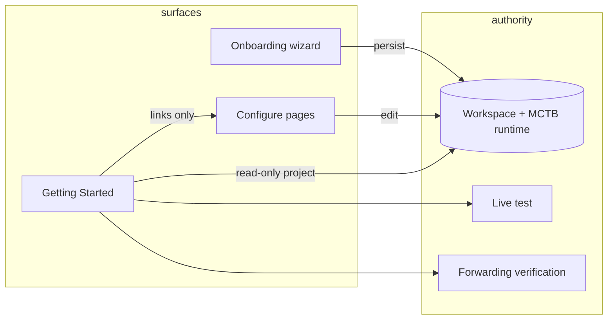

# MCTB Shell Density + Header Identity + Getting Started — Handoff

**Status:** Implementation complete on local `master` at commit `8483e7d0` (shell pass), built on onboarding pass `07f58fac`.  
**Remote:** As of last agent session, `origin/master` may still be at `07f58fac` until `8483e7d0` is pushed.  
**Spec source:** User-provided “MCTB SHELL DENSITY + HEADER IDENTITY + GETTING STARTED RECONCILIATION” (40-section brief).

---

## 1. Governing product rules (locked)

| Rule | Decision |
|------|----------|
| Wizard vs Configure vs Getting Started | **Wizard** = guided first-time activation. **Configure** routes (`/mctb/setup/*`, recovery hub, etc.) = permanent editors. **Getting Started** = read-only readiness checklist + navigation only — **no duplicate config model**. |
| Three number roles | **Business line** (public), **Transovo forwarding / ingress** (hidden toll-free), **Text-back sender** — never collapsed into “your number.” |
| Pure Opus shell | Approved product switcher + per-product nav — **do not redesign** shell architecture in this pass. |
| Frozen runtime | **Do not change** certified MCTB TeXML pipeline (`mctb_texml_final_v1`), Voice V3 booking freeze, or telephony/SMS send gates without explicit re-cert. |
| Help ≠ Getting Started | **Getting Started** = launch checklist. **Help** = support/docs surface at `/help`. |
| No “Setup 2.0” | One canonical MCTB configuration domain; Getting Started links into existing Configure pages. |

---

## 2. What shipped — shell pass (`8483e7d0`)

### 2.1 Sidebar density

- **Removed** the sidebar workspace card (including “Forwarding number not set” placeholder clutter).
- **Tightened** vertical rhythm in `app-sidebar.tsx` (less padding between nav groups).
- **Nav:** Added **Getting Started** under Overview (`/getting-started`). **Help** now points to `/help` (not Getting Started).

### 2.2 Header identity dropdown

- New **`MctbHeaderIdentity`** in the top bar (MCTB-primary workspaces).
- Shows workspace/business name + truncated **business line** on the trigger.
- Dropdown sections:
  - **Business line** — active / needs setup
  - **Transovo forwarding** — provisioning / ready / not configured (from shell context)
  - **Text-back sender** — platform vs workspace sender label
- Deep links into Phone & Forwarding / related Configure routes.
- Data: existing **`OpusWorkspaceDataProvider`** / `/api/mctb/shell-context` (no second identity API).

### 2.3 Getting Started page (MCTB-primary)

- **`/getting-started`** when `isMctbV1Primary()` — replaces legacy scheduling-oriented getting-started content for MCTB launch.
- **Server:** `projectMctbGettingStarted(workspaceId)` in `src/lib/mctb/getting-started/project-readiness.ts`.
- **API:** `GET /api/mctb/getting-started` (auth + workspace scoped).
- **Client:** `mctb-getting-started-page.tsx` — essentials progress, attention strip, capability rows, continue CTA.

### 2.4 Help page (MCTB-primary)

- **`/help`** — `help/page.tsx` branches to `mctb-help-page.tsx` for MCTB primary (distinct from Getting Started).
- Top bar Help icon links to **`/help`** (`topbar.tsx`, `account-nav.ts`).

### 2.5 Modest density

- Slight reduction in default **`Page` / `PageHeader`** vertical spacing in `kit.tsx` (Opus-wide, conservative).

### 2.6 Guard script

- `scripts/test-mctb-getting-started-shell.ts` — nav labels, sidebar card removed, header identity + Help href.
- Included in `scripts/run-mctb-commercial-launch-guards.sh` (agent run: **PASS**).

---

## 3. Files changed (shell pass)

| Path | Role |
|------|------|
| `src/newui-transplant/components/app/app-sidebar.tsx` | Remove workspace card; tighter nav |
| `src/newui-transplant/components/app/topbar.tsx` | `MctbHeaderIdentity`; Help → `/help` |
| `src/newui-transplant/components/app/mctb-header-identity.tsx` | Header dropdown UI |
| `src/newui-transplant/components/app/kit.tsx` | Page density spacing |
| `src/lib/products/mctb-nav.ts` | Getting Started + Help routes |
| `src/lib/products/account-nav.ts` | Account Help → `/help` |
| `src/lib/mctb/getting-started/types.ts` | Payload + row types |
| `src/lib/mctb/getting-started/project-readiness.ts` | Authoritative projection |
| `src/app/api/mctb/getting-started/route.ts` | GET handler |
| `src/app/(app)/getting-started/page.tsx` | MCTB vs legacy branch |
| `src/app/(app)/help/page.tsx` | MCTB help branch |
| `src/newui-transplant/connected/mctb/mctb-getting-started-page.tsx` | UI |
| `src/newui-transplant/connected/mctb/mctb-help-page.tsx` | UI |
| `scripts/test-mctb-getting-started-shell.ts` | Static guard |
| `scripts/run-mctb-commercial-launch-guards.sh` | Wire guard |

---

## 4. Getting Started — data contract

### 4.1 Payload shape (`MctbGettingStartedPayload`)

- `workspaceName`
- `essentialsComplete` / `essentialsTotal`
- `nextEssentialId` / `nextEssentialTitle` / `continueSetupHref`
- `operationalReady` — all essentials complete + forwarding verified + recovery not paused
- `recoveryPaused` / `recoveryLabel`
- `usageLine` — monthly recovery usage from `getMctbRecoveryUsageSnapshot`
- `essentials[]` — 8 rows (see below)
- `attention[]` — from `buildSetupAttentionItems` + pause banner
- `capabilities[]` — gated add-ons (existing consent cert, booking link, urgent alerts, AI recovery, own sender)

### 4.2 Essential rows (8)

| ID | Title | Complete when | Primary link |
|----|-------|---------------|--------------|
| `business` | Business information | `businessLineE164` resolved | `/settings/business` |
| `forwarding_number` | Transovo forwarding number | Production forward target E.164 exists | Phone & Forwarding |
| `connect_phone` | Connect your business phone | Forwarding verified (onboarding or verification API) | Phone & Forwarding |
| `consent` | Consent | Mode configured (always “Ready” once mode known) | Recovery → consent tab |
| `recovery_text` | Recovery text | Non-empty `messageTemplate` | Text Back |
| `voicemail` | Voicemail greeting | Treated complete (detail reflects custom vs default) | Voicemail → greeting tab |
| `notifications` | Reply notifications | At least one enabled `MctbNotificationRecipient` email | Notifications |
| `setup_test` | Test your setup | `getLiveTestStatus().passed` | Setup test |

### 4.3 Authoritative sources (single adapter)

`projectMctbGettingStarted` reads:

- Workspace name + `customFieldsConfig.mctb` + `resolveMctbWorkspaceBusinessLineE164`
- `getProductionMctbForwardTargetE164`
- `loadMctbOnboardingState`, `getForwardingVerificationStatus`
- `loadMissedCallTextConfig` (template, triggers, sender mode, phoneNumberId)
- `getLiveTestStatus`
- `resolveMctbCapabilities`
- `getMctbRecoveryUsageSnapshot`
- Schedule + `runtime.enabled` → pause
- `buildSetupAttentionItems` for needs-attention strip
- `VoicemailBox`, `MctbNotificationRecipient` where needed

**Not invented on the client** — UI renders API payload only.

### 4.4 Capability rows (informational / gated)

- Existing Consent certification
- Booking or request link
- Urgent lead alerts
- AI Recovery
- Use your own texting number

Locked vs available follows `resolveMctbCapabilities` entitlements.

---

## 5. Prior work — onboarding pass (`07f58fac`) (context)

Still relevant for “Test your setup” and launch truth:

- Persist **business line** on onboarding step 1 without falsely marking forwarding verified.
- **Live test** requires real forwarding evidence, consent path, SMS, and **reply** before pass.
- Wizard polish: Step 6 **“I've set up forwarding”**, Step 7 timeline, Step 5 notification copy, modal scroll.
- Screenshot script: mocks only if `MCTB_ONBOARDING_SCREENSHOT_MOCKS=1`.
- Guards: `test-mctb-live-test-forwarding-evidence.ts`, `test-mctb-onboarding-business-line-persist.ts`, `verify-mctb-production-no-dev-issue-badge.ts`.

---

## 6. Shell / page structure (after pass)

```
[Product switcher]
[Sidebar — no workspace card]
  Overview
  Getting Started  → /getting-started
  — Activity —
  Missed Calls | Conversations | Voicemail | Analytics
  — Configure —
  Missed-Call Recovery | Text Back | AI Recovery | Notifications | Phone & Forwarding
  Settings | Billing | Help → /help

[Top bar]
  [MctbHeaderIdentity ▼]  …  [Help → /help]
```

Getting Started page sections (typical):

1. Progress header (N/8 essentials)
2. Continue setup CTA → `continueSetupHref`
3. Essentials list (status pills + actions)
4. Needs attention (if any)
5. Capabilities (locked/available)
6. Recovery status + usage line

---

## 7. Verification commands

```bash
npx tsx scripts/test-mctb-getting-started-shell.ts
bash scripts/run-mctb-commercial-launch-guards.sh
```

After push to production (use your Coolify `COOLIFY_FQDN`):

```bash
curl -s "https://${COOLIFY_FQDN}/api/health"
```

---

## 8. Manual QA checklist (human)

- [ ] Cold load `/getting-started` — counts match real workspace (not fixture names/numbers).
- [ ] Each essential **Review/Continue** lands on correct Configure page; no duplicate editors on Getting Started.
- [ ] Header dropdown: three roles labeled correctly; links work.
- [ ] Sidebar at ~768px height laptop — no workspace card; nav scroll OK.
- [ ] `/help` ≠ `/getting-started`; Help icon in top bar goes to `/help`.
- [ ] Appointments-primary workspace still gets legacy getting-started (if applicable).
- [ ] **New workspace + real PSTN:** complete onboarding unmocked; live test pass; Getting Started shows 8/8 when true.
- [ ] Red “1 Issue” in screenshots = **Next.js dev overlay**, not product UI (`verify-mctb-production-no-dev-issue-badge.ts`).

---

## 9. Intentionally not done (spec optional / deferred)

- Nav badge **“Getting Started 6/8”** on sidebar item (optional in brief — not implemented).
- Richer compliance/sender rows if product wants parity with full setup API (capabilities-only for some gates today).
- Pushing `8483e7d0` from cloud agent VM failed once (token); **user push** may be required.
- **`docs/MCTB-COMMERCIAL-LAUNCH-SESSION-BRIEF.md`** — left untracked (avoid secret-scan noise); not part of commits.

---

## 10. Architecture diagram (mental model)



---

## 11. Related docs

- `docs/MCTB-FRONTEND-REBUILD-KICKOFF.md`
- `docs/TRANSOVO-MCTB-PAGE-BUILD-SPEC-07-SETUP.md` (wizard vs editors)
- `docs/MCTB_FINAL_PRODUCTION_PIPELINE.md` (frozen TeXML)
- Onboarding live test: `src/lib/mctb/onboarding/live-test.ts`

---

## 12. Completion statement (agent)

| Area | Status |
|------|--------|
| Sidebar workspace card removed | Done |
| Header identity dropdown (3 roles) | Done |
| Getting Started from authoritative state | Done |
| Help separated | Done |
| Modest density | Done |
| Static guards | Done |
| Production deploy of `8483e7d0` | **Verify after push** |
| Real PSTN launch certification | **User manual** |

**Commits:**

- `07f58fac` — `fix(mctb): real onboarding paths, live test evidence, wizard polish`
- `8483e7d0` — `feat(mctb): shell density, header identity, and Getting Started page`

---

*Generated for handoff / paste into Linear or PR description. Update commit SHAs after additional merges.*
