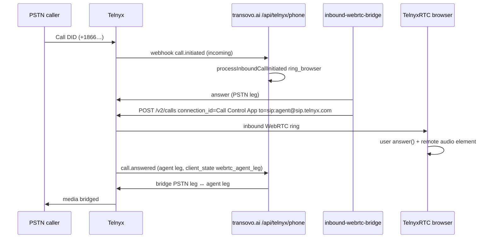

# New-app inbound PSTN → browser WebRTC (authoritative flow)

This document maps **Telnyx’s documented Call Control + WebRTC contact-center pattern** to **our code**. It exists so we do not confuse two different Telnyx IDs again.

## Two Telnyx IDs (do not swap)

| ID | Env | What it is | Used for |
|----|-----|------------|----------|
| **Call Control application** | `TELNYX_CONNECTION_ID` (alias `TELNYX_CALL_CONTROL_APP_ID`) | Voice API app with webhook URL → `/api/telnyx/phone` | Inbound DID attachment; **every** `POST /v2/calls` and `POST /v2/calls/{id}/actions/*` on server-originated legs |
| **Credential / SIP connection** | Parsed from telephony credential `resource_id` (`connection:301673…`) or `TELNYX_WEBRTC_CONNECTION_ID` | WebRTC credential’s SIP registration home | Browser `TelnyxRTC` login token only — **not** `connection_id` on Dial API |

Telnyx Dial API (required reading):

- [Dial](https://developers.telnyx.com/api-reference/call-commands/dial) — `connection_id` = **Call Control App ID**
- [Bridge](https://developers.telnyx.com/api-reference/call-commands/bridge-calls)
- [Answer](https://developers.telnyx.com/docs/voice/programmable-voice/sending-commands)
- [Contact center / WebRTC](https://developers.telnyx.com/docs/voice/webrtc/use-cases/contact-center) — backend dials registered agents via Call Control
- [Manage multiple calls (server-dialed consult leg)](https://developers.telnyx.com/docs/development/webrtc/js-sdk/how-to/manage-multiple-calls)

**Past mistake:** `POST /v2/calls` used the credential connection id → Telnyx **422 / 10015** (“Only Call Control Apps with valid webhook URL”). Logs showed `bridge_failed` and no `dialed_agent_leg`. The `to` field was always correct (`sip:<username>@sip.telnyx.com;secure=srtp`); only `connection_id` was wrong.

## End-to-end sequence (happy path)



### Step-by-step ↔ code

| Step | Telnyx / product | Code |
|------|------------------|------|
| 1 | DID on Call Control app | Provisioning: `scripts/configure-new-app-telnyx-phone-webhook.mjs`, audit `scripts/audit-new-app-phone-voice-provisioning.mjs` |
| 2 | `call.initiated` incoming | `new-app/app/api/telnyx/phone/route.ts` → `handleInboundCall` |
| 3 | Route = ring browser | `inbound-runtime.ts` `decideInboundRoute` → `ring_browser` |
| 4 | Answer PSTN (avoid first-command timeout) | `inbound-webrtc-bridge.ts` `telnyxCallAction(..., "answer")` |
| 5 | Dial agent SIP URI | `POST /calls` with `connection_id: TELNYX_CONNECTION_ID`, `to: buildWebRtcAgentSipUri(sipUsername)` |
| 6 | Browser registered | `workspace-provider.tsx` → `fetchWebRtcToken` → `TelnyxRTC.connect` → `telnyx.ready` |
| 7 | Inbound UI | `telnyx.notification` `callUpdate` inbound `ringing` → `inbound_ringing_ui` |
| 8 | User answers | `answerIncoming` → `call.answer({ remoteElement })` |
| 9 | Bridge on agent answer | `calls-service.ts` `processHumanCallWebhookEvent` `call.answered` + `kind: webrtc_agent_leg` → `completeWebRtcAgentLegAnswer` |
| 10 | Recording / CRM | `recording-runtime`, `registerInboundAnswer`, ring timeout `processDueInboundRingTimeouts` |

## Log checkpoints (production)

Success:

1. `inbound-webrtc-bridge` / `dialed_agent_leg`
2. Browser: `[phone] inbound_ringing_ui`
3. `agent_leg_answered_bridge` then `call.bridged`

Failure:

- `bridge_failed` + `telnyxBody` (422 → wrong `connection_id`)
- `webrtc_bridge_result` `ok: false` on `HumanCall.metadata.inboundBridgeError`

## Outbound (contrast)

Outbound browser calls use **client** `newCall()` after `outbound_register` — no server `POST /v2/calls`. Inbound **must** use server Dial + Bridge; that is why the Call Control app id matters only on the inbound bridge path.

## Verification commands

```bash
# Provisioning: DID on Call Control app + credential has sip_username
TELNYX_API_KEY=... TELNYX_CONNECTION_ID=... TELNYX_TELEPHONY_CREDENTIAL_ID=... \
  node scripts/audit-new-app-phone-voice-provisioning.mjs

# Optional: dry-run Dial body shape (does not place a call)
node scripts/verify-new-app-inbound-dial-params.mjs
```
