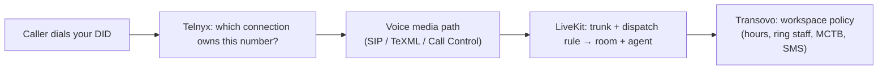

# New-app voice routing: Phone, AI Receptionist, and MCTB — explained

This document explains how inbound routing works in Transovo new-app, why **Phone**, **AI Receptionist (Voice V3)**, and **Missed Call Text Back (MCTB)** feel like one switchboard in the UI but are **three control planes** in production, what blocked the “Use this number” flow (LiveKit dispatch), and how the pieces are meant to fit together.

Related: `docs/NEW-APP-VOICE-NUMBER-SWITCH.md` (switch API sequence).

---

## 1. What happens when someone calls a number

An inbound call passes through **four checkpoints**:

| Checkpoint | Question it answers | “Owner” in production |
|------------|-------------------|------------------------|
| **Telnyx `connection_id`** | Where does **this DID’s inbound call** go first? | One value per number at a time |
| **Media path** | SIP to LiveKit? TeXML app? Call Control app? | Tied to that connection |
| **LiveKit trunk + dispatch** | Which **worker** (`transovo-voice-v3`) and which **job metadata** (workspace, agent, dialed number)? | SIP rules on LiveKit Cloud |
| **Transovo DB / policy** | Business hours, ring humans first, overflow to AI, MCTB on missed call, etc. | `workspaceCallRouting`, telephony record on the number |

The UI can show **Phone**, **AI Receptionist**, and **MCTB** on the same line because that’s the **logical product model**. The **carrier** does not automatically run all three in parallel on one inbound leg — something at Telnyx + LiveKit must be chosen first, then app logic runs on top.

### Two layers (do not conflate)

From `docs/NEW-APP-VOICE-NUMBER-SWITCH.md`:

| Layer | What it means |
|--------|----------------|
| **Carrier ingress** | One Telnyx `connection_id` per DID at a time (LiveKit FQDN, MCTB TeXML app, or Phone Call Control). |
| **Product bindings** | Transovo workspace policy: business hours, ring staff first, AI coverage, MCTB recovery — can reference the same DID. |

**Shared call handling (default):** Assigning a number to AI Receptionist uses `ingressStrategy: shared_voice`. LiveKit Voice V3 ingress is provisioned for the carrier path, but `workspaceCallRouting.policyJson` is **merged** (hours, ring strategy, overflow) — not wiped.

**Exclusive ingress:** Use `ingressStrategy: exclusive` when the customer intentionally moves the DID to a single-product carrier path (e.g. MCTB-only TeXML).

**Takeaway:** **one connection at the carrier**, **many knobs in the app** — but app knobs do not replace the carrier choice.

---

## 2. The three products — what each one needs on the wire

### AI Receptionist (Voice V3 / “Ava”)

- **Telnyx:** number pointed at the **LiveKit FQDN connection** (SIP into LiveKit).
- **LiveKit:** DID on an **inbound trunk**; a **dispatch rule** creates a room and dispatches **`transovo-voice-v3`** with metadata (`workspaceId`, `agentId`, `toE164`, etc.).
- **Transovo:** published agent config, knowledge, booking, etc.

Assigning a number in the receptionist UI runs roughly: prepare LiveKit (trunk + dispatch) → move Telnyx → verify → save `routingMode: livekit_sip` on the number (`prepareVoiceV3LiveKitDestination` / `activateVoiceV3TelnyxIngress` in `new-app/lib/server/telephony/v3-receptionist-provision.ts`).

### Phone (browser / Call Control)

- **Telnyx:** number on **Call Control** connection (WebRTC/softphone path in new-app).
- **LiveKit:** not the primary ingress for classic Phone product mode (`telnyx_call_control` in bindings).
- **Transovo:** ring groups, transfers, workspace routing policy.

### Missed Call Text Back (MCTB)

- **Different mental model:** customer keeps their **public business line**; **conditional forwarding** sends unanswered calls to a **hidden toll-free ingress**; MCTB runs **TeXML** (press-1 or existing consent) and then **SMS recovery** — not the same as “point this owned 571 DID at LiveKit.”
- **Telnyx:** often a **TeXML application** connection, certified pipeline — separate from “assign this inventory DID to Ava.”
- **SMS** is a third leg: sender registration, consent, eligibility — orthogonal to “who answers the live call.”

Bindings logic (`new-app/lib/server/telephony/bindings.ts`) ties **ingress mode** to product at the telephony layer:

- `livekit_sip` + active → AI Receptionist (Voice V3 LiveKit ingress)
- `mctb_texml` + active → MCTB (TeXML ingress)
- `telnyx_call_control` + active → Phone (Call Control)

When you ask “route from voice agent to MCTB to phone,” you’re really asking about:

1. **Live call path:** who answers (human ring → AI → voicemail) — mostly **one ingress** + policy.
2. **After the call:** MCTB texts on **missed** calls — needs **missed-call detection** on whatever path saw the call, plus **SMS** infrastructure.
3. **Phone product:** staff calling back / WebRTC — Call Control or shared inbox, not necessarily the same Telnyx connection as MCTB’s TeXML ingress.

Those can **share a business story** (“one line”) but they are **not three equal slots on the same Telnyx connection** without explicit engineering.

---

## 3. Why “shared Phone + Ava” is a design goal, not fully automatic

`ingressStrategy: shared_voice` (default when you assign receptionist) means:

- **Carrier:** still moves to **LiveKit** for Voice V3 when you provision receptionist on that DID.
- **App:** **merge** `workspaceCallRouting` (hours, ring strategy, `receptionistAgentId`, etc.) instead of wiping Phone settings.

What it does **not** magically do today:

- Run **Call Control ring-to-staff** and **LiveKit Ava** as two equal Telnyx connections on the **same DID** (Telnyx only has **one** `connection_id` per number).
- Implement full **“ring humans, then overflow to Ava on the same PSTN call”** purely in policy without the LiveKit ingress pipeline honoring that policy end-to-end (policy in DB ≠ certified call flow).

So the **product** says “integrated line”; the **platform** still has to pick **one inbound front door** per owned DID and then implement overflow inside that door.

---

## 4. What blocked “Use this number” (the dispatch error)

Example error:

> Dispatch rule for the same trunk, inbound number, number, and PIN combination already exists in dispatch rule `SDR_SbGq4QxWDGSx` `transovo-inbound-dispatch`

That’s **LiveKit (layer 3)**, not MCTB UI and not a generic Telnyx failure.

### Background

Production was set up with a **legacy shared** inbound rule `transovo-inbound-dispatch` — often a **trunk-wide** `dispatchRuleIndividual` rule (“everything on this trunk goes to one agent/worker”). Many numbers on the shared Telnyx→LiveKit trunk were effectively owned by that **one** rule.

### What new-app does on “Use this number” (canonical V3 — current)

1. Put the DID on the **shared** LiveKit inbound trunk (if needed).
2. Ensure **one** canonical dispatch rule (`transovo-inbound-dispatch`) → worker **`transovo-voice-v3`** with **no** per-tenant ids in LiveKit metadata.
3. Remove obsolete **`transovo-did-dispatch-*`** rules (greenfield cleanup).
4. Point Telnyx at LiveKit FQDN.
5. Persist DB assignment (`voiceAgentPhoneNumber`); **published** config is resolved at call time from **called DID**.

See **`docs/TRANSOVO-V3-CLEAN-LIVEKIT-ROUTING.md`**.

### Code direction (new-app)

- `new-app/lib/server/receptionist/livekit/canonical-dispatch.ts` — shared V3 dispatch only.
- `new-app/lib/server/voice-v3/resolve-livekit-session.ts` — called-DID → workspace → published version.

---

## 5. Why it feels “so hard” — summary table

| Factor | Effect |
|--------|--------|
| **One Telnyx connection per DID** | Receptionist vs MCTB TeXML vs Phone Call Control are **mutually exclusive** at the carrier unless you build a single combined app. |
| **LiveKit dispatch is global config** | Per-tenant assignment fights **legacy shared** `transovo-inbound-dispatch` on one trunk. |
| **MCTB is a different ingress story** | Forwarding to toll-free TeXML ≠ assigning an owned DID to LiveKit; mixing them on one number is a product design problem, not a toggle. |
| **Two code eras** | Monolith certified MCTB + legacy LiveKit; new-app switch API — same LiveKit project, same rules. |
| **`shared_voice` is partial** | DB policy merges; **ring-then-Ava** on one PSTN call through LiveKit is not fully certified in new-app yet. |
| **Safe switch sequence** | Read live Telnyx → park old config → prepare LiveKit → patch Telnyx → verify → rollback on failure — any LiveKit step fails and “Use this number” errors (what you saw). |

The **product vision** (“one business line, staff + AI + text-back”) is coherent. **Telnyx, LiveKit, and Transovo** each have **exclusivity rules**, and legacy LiveKit was built for **one shared inbound rule**, while new-app wants **per-DID rules per workspace/agent**.

---

## 6. Target picture — how pieces fit together

For a **single owned DID** used as the main line (simplified):

1. **Inbound:** Telnyx → LiveKit (Voice V3).
2. **LiveKit dispatch:** per-DID rule → `transovo-voice-v3` with metadata for **your** agent.
3. **Call logic:** worker + HTTP backend apply **workspace policy** — ring WebRTC staff if configured, else Ava, voicemail, etc.
4. **Missed call:** if the call ends as “missed” per MCTB rules, **eligibility engine** may send recovery SMS (consent, sender, cooldown) — **after** the voice path reported the outcome.
5. **MCTB on a forwarded business line** (classic product): call may never hit that owned DID’s LiveKit rule — it hits **MCTB ingress** on the toll-free forward target; SMS recovery is tied to **that** pipeline.

So “voice agent → MCTB → phone” is not one linear pipe; it’s **voice path first**, then **event-driven SMS**, with **phone** as either another ingress mode or staff outbound/inbound on Call Control.

---

## 7. What you were doing vs what was broken

- **You:** Picking an unassigned number for **AI Receptionist** — correct UX.
- **Broken:** Step “create per-DID LiveKit dispatch” collided with **legacy `transovo-inbound-dispatch`** still owning that number on the trunk.
- **Not necessarily broken:** Agent config, Telnyx account, or MCTB vs phone settings — the failure happened **before** Telnyx was repointed, during **LiveKit provision**.

After the dispatch split fix is deployed to production, retry “Use this number” and confirm `/api/health` shows the expected `commitSha`.

---

## 8. Two common setups (pick one mental model)

**A) Owned DID for Ava only**  
Inventory number (e.g. 571) → LiveKit only → per-DID dispatch → Voice V3. MCTB may still apply to **missed** outcomes if wired in policy/runtime, but ingress is LiveKit, not TeXML on that DID.

**B) Real business line + MCTB forward + maybe Ava later**  
Public business number → carrier conditional forward → toll-free MCTB TeXML ingress → consent + SMS. Different Telnyx connection and different LiveKit story than (A). Ava on the **same** public number without replacing forward/MCTB ingress is a deliberate architecture decision, not a single UI toggle.

Mixing (A) and (B) in one sentence in the UI is a common source of confusion.

---

## 9. Switch API reference (new-app)

`POST /api/numbers/[id]/switch-product`

1. Read live Telnyx `connection_id` and logical bindings (`GET …/bindings`).
2. Require `confirmSwitch` when bindings conflict.
3. **Park** prior telephony + optional workspace policy snapshot under `settingsJson.telephonyPark.snapshots[]`.
4. **Prepare** destination (LiveKit trunk + dispatch before Telnyx move for Receptionist).
5. **Patch** Telnyx `connection_id`, **verify**, **rollback** if verify fails.
6. **Commit** active telephony record and product links.

Implementation: `new-app/lib/server/telephony/switch-product.ts`.

---

## 10. Key file paths

| Area | Path |
|------|------|
| Switch orchestration | `new-app/lib/server/telephony/switch-product.ts` |
| V3 LiveKit prepare / Telnyx activate | `new-app/lib/server/telephony/v3-receptionist-provision.ts` |
| LiveKit canonical dispatch | `new-app/lib/server/receptionist/livekit/canonical-dispatch.ts` |
| Session resolver | `new-app/lib/server/voice-v3/resolve-livekit-session.ts` |
| Product bindings detection | `new-app/lib/server/telephony/bindings.ts` |
| Number switch doc | `docs/NEW-APP-VOICE-NUMBER-SWITCH.md` |
| MCTB product / ingress (monolith) | `docs/MCTB_FINAL_PRODUCTION_PIPELINE.md`, `AGENTS.md` (MCTB sections) |

---

*Generated for copy/paste and internal alignment. Update this doc when ingress or `shared_voice` runtime behavior changes.*
