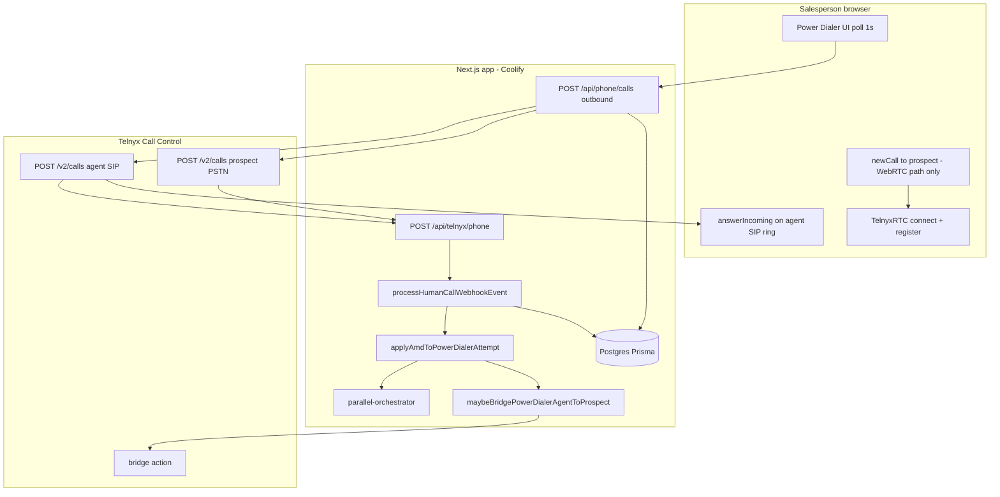

# Power Dialer — Telnyx ultra-low-latency audit (read-only)

**Date:** 2026-10-24  
**Scope:** Power, Preview, Parallel, Parallel + machine filter, Predictive  
**Primary metric:** Human prospect answer → first salesperson audio on the PSTN leg  
**Status:** Audit only — no architecture changes in this pass  

---

## Executive summary

Transovo today uses **two outbound architectures**, not a pre-established conference:

| Path | When | Agent media before prospect answers? | Connect mechanism |
|------|------|--------------------------------------|-----------------|
| **WebRTC browser leg** | Default when iOS server origination is off or ineligible | **Partial** — `TelnyxRTC.connect()` + registration; per-dial `newCall()` starts ICE toward prospect at dial time | **Single leg** — no Call Control bridge |
| **Server PSTN + agent SIP** | `POWER_DIALER_IOS_SCREENING_DIAL_ORIGINATION=1` + screening + Premium AMD | **Agent SIP leg dialed at session dial start** (one shared leg in parallel); browser must **answer inbound WebRTC** | **Call Control `bridge`** after confirmed human |

**Conferences are not used** anywhere under `new-app/lib/server/phone/` for Power Dialer.

**Largest latency risks (evidence-based):**

1. **iOS / server-PSTN path:** Bridge intentionally waits for **confirmed human** AMD (and blocks while `screeningPending`) — correct for compliance, adds seconds on screening/voicemail paths.
2. **iOS / server-PSTN path:** Agent audio requires **browser `answerIncoming()`** on the server-dialed SIP leg — not a persistent warm media session before dialing.
3. **Parallel (all paths):** Winner selection waits for **`classification === human`** before `onParallelHumanAnswered` — even standard parallel, not only `parallel_amd`.
4. **Webhook hot path:** Each Telnyx event runs through **Next.js + multiple Prisma round-trips** before `bridge`; no in-memory session coordinator.
5. **No production p50/p95/p99** answer-to-audio measurements exist yet (`PowerDialerDetectionEvent` stores events but not a full timeline).

Recommended next step (after this audit): **benchmark warm conference vs warm direct bridge** with instrumentation — do not assume conference wins.

---

## 1. Current architecture diagram



---

## 2. Per-mode call path (actual code)

### 2.1 Common browser setup (all modes)

| Step | What | Files |
|------|------|--------|
| 1 | Fetch WebRTC token, `ensureTelnyxWebRtcClient` → `client.connect()` | `workspace-provider.tsx`, `telnyx-webrtc-session.ts` |
| 2 | **Registration only** until a call starts — no standing media to a conference | SDK default; **no `prefetchIceCandidates` / trickle ICE** configured in app code |
| 3 | Session UI polls `fetchPowerSession` every **1s** | `power-dialer-session.tsx` |

### 2.2 Power & Preview

**Outbound registration:** `power-dialer-session.tsx` → `startCall` → `registerOutboundCall` → `createWebRtcOutboundCall` (`calls-service.ts`).

**Branch A — WebRTC (no server iOS):**

1. `humanCall` row created (`mediaMode: webrtc`).
2. Browser `client.newCall({ destinationNumber: prospect, ... })`.
3. `linkCallControl` → `startPowerDialerAmdOnCallControlLeg` (async) (`power-dialer-amd.ts`, `linkHumanCallControlId` in `calls-service.ts`).
4. Prospect answer: media is **the same WebRTC leg** — no server bridge.
5. AMD webhooks update classification; **bridge is not used** on this path.

**Branch B — Server iOS screening** (`resolvePowerDialerIosOrigination` + `startPowerDialerServerIosScreeningDial`):

1. `POST /v2/calls` prospect: `premium_ios_call_screening_detection`, `bridge_on_answer: false` (`power-dialer-server-pstn-dial.ts`).
2. `POST /v2/calls` agent → WebRTC SIP URI (`buildWebRtcAgentSipUri`); parallel reuses **shared** `sharedIosAgentCallControlId` (`ios-shared-agent-leg.ts`).
3. Browser: `server_pstn_ios` mode — **no** `newCall` to prospect; polls `GET /api/phone/calls/ringing-inbound`, rep **answers** (`workspace-provider.tsx`).
4. On `call.machine.premium.detection.ended` (human): `maybeBridgePowerDialerAgentToProspect` → `bridgeCalls(agent, prospect)` (`telnyx-call-control.ts`).

**Preview difference:** `preview_held` gate in session orchestration only — same telephony stack.

### 2.3 Parallel, Parallel + AMD filter, Predictive

**Orchestration:** `createAttemptForSession` allows multiple live attempts up to `resolveLinesForSession` (`session-runtime.ts`, `parallel-orchestrator.ts`, `predictive-pacing.ts`).

**Dial origination (client):** Multi-line auto-dial fills lines via `create_attempt` + `startCall` with `serverIosParallelLeg` when a server-iOS call is already active (`power-dialer-session.tsx`, `workspace-provider.tsx`).

**Per prospect leg (server iOS):** Same as §2.2 Branch B — separate PSTN control ID per attempt.

**Winner selection (after AMD):**

1. `applyAmdToPowerDialerAttempt` → `maybeParallelBridgeAfterClassification` (`amd-webhook-handler.ts`).
2. Only if `isConfirmedHumanClassification` → `onParallelHumanAnswered` (`parallel-orchestrator.ts`).
3. `assertParallelWinnerEligible` rejects `screening_pending`, non-human when `parallel_amd` / `amdFilter`, existing `winnerAttemptId`.
4. Winner: `cancelParallelLosers` (hangup prospect control IDs) + `maybeBridgePowerDialerAgentToProspect`.

**Parallel + machine filter:** `amdFilter` on attempt metadata + stricter `assertParallelWinnerEligible` — machines/screeners hung via `hangupNonHumanParallelLeg`.

**Predictive:** Line count from `computePredictiveLines`; same telephony and winner logic as parallel.

---

## 3. Answer-to-audio sequence (server iOS path — production flag on)

This is the path that **does not** connect two pre-warmed legs today.

```
Prospect answers (PSTN)
  → Telnyx webhook call.answered (prospect leg)     [network]
  → POST /api/telnyx/phone                          [dedup Prisma insert]
  → processHumanCallWebhookEvent                    [findHumanCall Prisma]
  → powerDialerAttempt status=answered              [Prisma update]
  → (later) call.machine.premium.detection.ended    [AMD / screening may take seconds]
  → applyAmdToPowerDialerAttempt                    [Prisma + screening policy + optional speak intro]
  → maybeParallelBridgeAfterClassification (if multi-line)
  → maybeBridgePowerDialerAgentToProspect           [Prisma reads; Telnyx bridge API]
  → call.bridged webhook (if observed)
  → Agent leg must already be answered in browser     [human: answerIncoming + getUserMedia]
  → Audio to prospect
```

**Frontend is not on the critical path for issuing bridge**, but **agent leg must be live** for bridge to carry salesperson audio.

---

## 4. Architecture comparison (A / B / C)

| | **A — Current** | **B — Warm WebRTC + pre-established conference** | **C — Warm WebRTC + direct bridge** |
|--|-----------------|--------------------------------------------------|-------------------------------------|
| **Implemented?** | Yes (variants above) | **No** | **Partially** (server iOS uses direct `bridge`, not warm) |
| **Agent before dial** | Register yes; **warm media no** (iOS: SIP ring at dial) | **Target:** agent in conference before PSTN | **Target:** agent leg answered before PSTN |
| **Prospect connect** | WebRTC single leg **or** bridge after AMD | Join conference on answer | Bridge on answer |
| **Telnyx docs** | Bridge documented on Call Control; conferences documented separately — **must verify join latency** | Same | Bridge is what we use today in `bridgeCalls` |
| **Change size** | — | **Large** (conference lifecycle, hold music, leg IDs) | **Medium** (warm agent + optional “fast connect” policy split) |

**Likely lowest p95 (hypothesis — must measure):**

- **WebRTC single-leg** (no iOS flag): best average for raw connect **if** AMD does not block audio — currently true for single-line.
- **Server iOS + AMD gate:** better screening compliance, **worse** answer-to-audio when classification is slow.
- **B vs C:** Unknown without benchmark; conference adds signaling, may simplify multi-leg mixing.

---

## 5. Latency contributors (ranked)

| Rank | Issue | Impact | Evidence |
|------|--------|--------|----------|
| 1 | **Bridge only after `human` AMD** (server iOS) | High | `power-dialer-leg-bridge.ts` `isConfirmedHumanClassification`; `amd-webhook-handler.ts` |
| 2 | **iOS screening lifecycle** (`screeningPending`, greeting, intro playback) | High on screened calls | `applyScreeningDetectedToAttempt`, `screening-executor.ts`, `screener-intro-playback` |
| 3 | **Parallel waits for human AMD for all modes** | High multi-line | `maybeParallelBridgeAfterClassification` requires human before `onParallelHumanAnswered` |
| 4 | **Agent SIP requires manual/auto answer** | Medium–High | `ringing-inbound/route.ts`, `answerIncoming` + `getUserMedia` |
| 5 | **Agent leg created at dial, not at session start** | Medium | `startPowerDialerServerIosScreeningDial` on each outbound registration (shared after first parallel leg) |
| 6 | **Webhook + Prisma on hot path** | Medium | `telnyx/phone/route.ts` dedup + `processHumanCallWebhookEvent` many awaits |
| 7 | **No in-memory coordinator** | Medium | State in Postgres `PowerDialerSession` / `parallelStateJson` |
| 8 | **Sequential Telnyx commands** | Medium | Dial prospect → dial agent → later bridge (2–3 command phases) |
| 9 | **ICE on WebRTC path at `newCall`** | Medium (WebRTC only) | `workspace-provider.tsx` — not persistent media |
| 10 | **1s UI polling** | Low for bridge | `power-dialer-session.tsx` — not gating bridge |
| 11 | **MCTB scheduler fire-and-forget on hangup** | Low | `calls-service.ts` after update |
| 12 | **No `prefetchIceCandidates` in app** | Low–Medium first call | `telnyx-webrtc-session.ts` uses SDK defaults only |

---

## 6. Parallel correctness (implemented)

| Scenario | Mechanism |
|----------|-----------|
| Two humans answer | `pickBridgeWinner` by `answeredAtMs`; loser cancelled + hangup |
| Winner already selected | `winnerAttemptId` in `parallelStateJson`; `assertParallelWinnerEligible` |
| Machine / screener (filtered) | `hangupNonHumanParallelLeg` / `classificationBlocksParallelWinner` |
| Screening pending | Not eligible as winner; bridge blocked |
| Duplicate webhooks | `telnyxWebhookDedup`, `PowerDialerDetectionEvent.idempotencyKey` |
| Shared agent (iOS parallel) | `sharedIosAgentCallControlId` on session |

**Gap to verify in load tests:** atomic winner under concurrent AMD webhooks (DB row locks not explicit).

---

## 7. Proposed instrumentation (not implemented)

Extend `recordPowerDialerDetectionEvent` / attempt metadata with **monotonic** `performance.now()` deltas per attempt:

| Event key | Source |
|-----------|--------|
| `prospect_answered_at` | `call.answered` prospect leg |
| `webhook_received_at` | First line of `processHumanCallWebhookEvent` |
| `amd_ended_at` | `call.machine.premium.detection.ended` |
| `winner_selected_at` | `onParallelHumanAnswered` |
| `bridge_command_at` | Before `bridgeCalls` |
| `bridge_completed_at` | `call.bridged` webhook |
| `agent_sdk_answer_at` | `phoneClientTrace` in `answerIncoming` |

**First-audio:** controlled test with recorded prompt on agent mic + line recorder on test PSTN — not webhook timestamps.

Report **p50 / p95 / p99 per mode** separately: WebRTC, server iOS human, server iOS screening, parallel_amd.

---

## 8. Prioritized implementation changes (for a future pass)

1. **Warm agent media at session start** — join conference or keep answered SIP leg before first `POST /v2/calls` prospect (addresses “connect two existing legs”).
2. **Split policies:** `fast_connect_human` (bridge on answer or early human hint) vs `machine_filtered_connect` (current AMD gate) — **do not** remove screening globally.
3. **Auto-answer agent SIP leg** when session active (remove rep click) — policy + UX tradeoff.
4. **In-memory dial coordinator** per `sessionId` (Redis or process-local) with attempt control IDs — webhook path: claim agent → bridge only.
5. **Benchmark B vs C** with identical AMD policy.
6. **Telnyx SDK:** evaluate `prefetchIceCandidates` / Trickle ICE on session start (WebRTC path).
7. **Trim hot-path Prisma** — cache attempt/session IDs in webhook client_state; defer CRM/analytics.

---

## 9. Test plan & acceptance criteria

| Test | Pass criteria |
|------|----------------|
| Instrumented staging dial (each mode) | Timeline rows for 20+ answered humans |
| Parallel simultaneous answer | Exactly one bridge; losers hung up < 2s |
| Screening call | No bridge until post-screening human; no false “connected” UI |
| Duplicate AMD webhooks | Single bridge (`agentProspectBridged`) |
| Agent not answered | Prospect does not hear agent after bridge command |
| **p95 answer-to-audio** | ≤ 500 ms stretch goal 250 ms — **measured**, not claimed from Telnyx docs |

---

## 10. Key file index

| Area | Path |
|------|------|
| Outbound API | `new-app/lib/server/phone/calls-service.ts` |
| iOS PSTN dial | `new-app/lib/server/phone/power-dialer/power-dialer-server-pstn-dial.ts` |
| Bridge | `new-app/lib/server/phone/power-dialer/power-dialer-leg-bridge.ts`, `routing/telnyx-call-control.ts` |
| AMD / screening | `amd-webhook-handler.ts`, `power-dialer-amd.ts`, `amd-policy.ts` |
| Parallel | `parallel-orchestrator.ts` |
| WebRTC UI | `components/providers/workspace-provider.tsx`, `components/phone/power-dialer-session.tsx` |
| Webhooks | `app/api/telnyx/phone/route.ts` |
| Detection audit log | `answer-detection-events.ts` → `PowerDialerDetectionEvent` |

---

*No architectural changes, builds, or deploys were performed for this document.*
