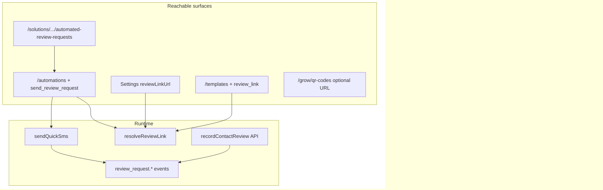

# Review / reputation — repo-wide code inventory (`703deuce/sms`)

**Purpose:** Answer “did we already bring review requests + review velocity over from another product into this SMS repo?” by listing **every** meaningful hit across the tree (not only `src/lib/mctb` or Campaigns).

**Companion:** `docs/REVIEW-REQUESTS-REPUTATION-PRODUCT-AUDIT.md` (product/routes answer).

**Date:** 2026-10-14

---

## What you likely remember (and where it lives here)

### Combined “Review Request Agent” (requests + setup + light analytics)

This repo **does** have a first-class **Review Request Agent** wired to the **Outcomes** product map — not the old `/businesses/{id}/reputation/...` hub.

| Concept | In `sms` repo? | Location |
|--------|----------------|----------|
| **Review Request Agent** (SMS, deterministic workflow) | Yes | `src/lib/agents/types.ts` — `id: "review_request"`, `outcomeSlug: "review-requests"`, `executionType: "workflow_agent"` in `src/lib/agents/workflows.ts` |
| **“Get More Reviews” outcome** (profiles, triggers, messages, reminders, negative routing, results) | Yes (registry + shells) | `src/lib/outcomes/registry.ts` slug `review-requests` (~lines 2246–2373) |
| Outcome UI renderer | Yes | `src/app/(app)/outcomes/[solution]/[[...section]]/page.tsx`, `src/components/outcomes/outcome-page.tsx` |
| Dashboard tiles pointing at reviews | Yes | `src/lib/outcomes/dashboard-data.ts`, `src/lib/solution-dashboard.ts` KPI `review-requests` + perf block `review-management` |
| **Send review SMS** (runtime) | Yes (plumbing) | `send_review_request` in `src/lib/automations/actions.ts` → `sendQuickSms` + events `review_request.*` |
| **Review link** merge | Yes | `src/lib/messaging/review-link.ts`, `Workspace.reviewLinkUrl`, `{{review_link}}` in templates |
| **Record review on contact** | Yes | `src/lib/automations/reviews.ts`, `POST /api/contacts/[id]/review` |
| **Appointment follow-up review ask** | Yes | `review_request` template + `send_review_link` in `src/lib/appointment-workflows/` |
| **Voice / receptionist “offer review after call”** | Yes (capability hook) | `src/lib/solutions/hooks/reviews.ts` |
| **Playbook / campaign category “review”** | Yes | `src/lib/campaigns/catalog.ts` |
| **Grow QR** (generic; can point at a URL) | Partial | `QrCode.targetType` includes `review` in `prisma/schema.prisma`; UI `/grow/qr-codes` — not reputation-specific scan analytics |
| **Surveys as proxy for “new reviews” on dashboard** | Partial | `surveyResponse` rows feed `solution-dashboard.ts` “New Reviews” / rating placeholder — not Google pull |

**Reachability today:** All `/outcomes/*` URLs redirect to `/dashboard` (`src/middleware.ts`). The agent/outcome **definitions and backends exist**; the **dedicated outcomes browser experience is turned off**.

### “Review velocity” and Google reputation analytics

| Concept | In `sms` repo? | Notes |
|--------|----------------|-------|
| Page or module named **review velocity** | **No** | Repo-wide search: zero matches except this audit doc |
| **Google Reviews feed**, reputation **insights**, **audit**, **alerts** pages | **No** | No routes under `/reputation`, `/businesses/`, or similar |
| **`/businesses/{id}/reputation/*`** tree (Send / Bulk / QR tabs hub) | **No** | Zero route files; inventory exists only in docs / user memory |
| **`/reputation/qr-campaigns`** | **No** | Grow has `/grow/qr-codes` only |
| **Bulk review batch history** (reputation product) | **No** | Mass texting broadcast history is a different product (`/api/mass-texting/campaigns`) |
| **Velocity** (unrelated) | Yes | `velocity_anomaly` in `src/lib/appointments/booking-protection-policy.ts` — booking abuse, not reviews |
| **“Review Management” dashboard stats** | Yes (heuristic) | `src/lib/solution-dashboard.ts` — counts automations/campaigns whose name/trigger/body matches `/review|reputation|google.?business/i` plus `surveyResponse` count; **not** a velocity chart |

**Conclusion:** Code that looks **ported or rebuilt** into `sms` is the **Outcomes + Agent + Automations + review link + contact review recording + solution dashboard heuristics** layer. The **multi-tenant reputation hub** (including **review velocity** as its own surface) is **not** present in this repository — likely still in another app or never merged under those URLs.

---

## Search methodology (whole repo)

Searches run across `src/`, `docs/`, `scripts/`, `prisma/`, `supabase/`, `voice-runtime/`, `.ui-agent/`, `src/newui-transplant/`, `src/kimi-drafts/`, etc.:

- `review velocity`, `reviewVelocity`, `Review Velocity` — **no code**
- `/businesses/`, `/reputation/` — **no app routes**
- `reputation` (product) — docs + `REVIEW_PATTERNS` in `solution-dashboard.ts` only
- `review_request`, `review-requests`, `send_review_request`, `send_review_link` — see table below
- `qr-campaigns` — **no** (only documented as missing)

**False positives (not reputation product):**

- Campaign **`/campaigns/new/review`** — broadcast pre-send launch review UI
- Kimi **`ReviewDetails.tsx` / `PhonePreview`** — campaign compose preview components
- MCTB **“first text” preview** — missed-call recovery copy
- Realtor **`workflow-preview.tsx`** — automation graph preview
- AR / calendar scripts with `review` = manual human review of connections/jobs

---

## Exhaustive path inventory (review / reputation product plumbing)

### Routes & UI

| Path | Role |
|------|------|
| `src/app/(app)/outcomes/page.tsx` | Outcomes index |
| `src/app/(app)/outcomes/[solution]/[[...section]]/page.tsx` | Renders registry pages (incl. `review-requests`) — **blocked by middleware** |
| `src/app/(app)/solutions/customer-growth/automated-review-requests` | Solutions catalog entry (marketing) |
| `src/app/(app)/grow/qr-codes/page.tsx` | Generic QR (can encode review URL manually) |
| `src/app/(app)/automations/**` | Flow builder; `send_review_request` block |
| `src/app/(app)/templates/**` | Shared templates with `{{review_link}}` |
| `src/app/(app)/contacts/**` | Contacts; review stored on `customFields` via API |
| `src/app/r/[trackingToken]/route.ts` | Short link / click tracking (used with quick SMS sends) |

### APIs

| Path | Role |
|------|------|
| `src/app/api/contacts/[id]/review/route.ts` | `recordContactReview` |
| `src/app/api/public/surveys/[slug]/route.ts` | Creates `surveyResponse` (feeds dashboard “reviews”) |
| `src/app/api/surveys/[id]/route.ts` | Lists survey responses |
| `src/app/api/growth/**` | Grow contests/widgets — not reputation-specific |

### Libraries

| Path | Role |
|------|------|
| `src/lib/agents/types.ts` | `review_request` agent type |
| `src/lib/agents/workflows.ts` | `workflow_agent` execution for review agent |
| `src/lib/outcomes/registry.ts` | Full `review-requests` outcome page map |
| `src/lib/outcomes/dashboard-data.ts` | Home/outcome links to review-requests |
| `src/lib/solution-dashboard.ts` | `REVIEW_PATTERNS`, `reviewSent`, Review Management perf block |
| `src/lib/automations/actions.ts` | `send_review_request` |
| `src/lib/automations/events.ts` | `review_request.created/sent/clicked`, `review.received`, etc. |
| `src/lib/automations/catalog.ts` | Block + trigger definitions |
| `src/lib/automations/reviews.ts` | Persist review on contact |
| `src/lib/automations/metadata.ts` | `review_request.clicked` |
| `src/lib/messaging/review-link.ts` | `resolveReviewLink` |
| `src/lib/appointment-workflows/templates.ts` | `review_request` workflow template |
| `src/lib/appointment-workflows/engine.ts` | `send_review_link` action |
| `src/lib/campaigns/catalog.ts` | `review` playbook category |
| `src/lib/solutions/hooks/reviews.ts` | Receptionist review capability |
| `src/lib/solutions-catalog.ts` | `automated-review-requests` solution |
| `src/lib/sms/send-quick.ts` | Quick SMS path used by automations (review sends) |
| `src/components/automations/builder/*` | UI for `send_review_request` node config |

### Data / schema

| Item | Role |
|------|------|
| `Workspace.reviewLinkUrl`, `WorkspaceMessagingSettings.reviewLinkUrl` | Review destination |
| `Suppression` → `@@map("review_request_suppression")` | Opt-out / suppression store (shared) |
| `QrCode.targetType` includes `review` | QR metadata enum |
| Contact `customFields`: `review_received`, `review_rating`, `positive_review`, `negative_feedback` | No dedicated Review table |

### Docs & inventory (reference only)

| Path | Role |
|------|------|
| `docs/REVIEW-REQUESTS-REPUTATION-PRODUCT-AUDIT.md` | Product answer |
| `docs/THREE-PRODUCT-MENU-AND-PAGES-COPY.md` §6 | Outcomes review-requests route list |
| `docs/FEATURE_INVENTORY.md` | Lists “Send review request” as blocked/partial in places — **stale vs** `send_review_request` implementation |
| `docs/GENERAL-APPOINTMENT-PARITY-AUDIT.md` | Appointment review requests PARTIAL |

### Tests / scripts touching review sends

| Path | Role |
|------|------|
| `scripts/test-automation-e2e.ts` | `send_review_request` node |
| `scripts/test-flow-builder-full-cert.ts` | `review_request_*` events |
| `scripts/test-appointment-workflows-hardening.ts` | `review_request` template |

---

## Architecture diagram (what *is* in this repo)

---

## Bottom line for “we had an agent with both”

| Your memory | Best match in **this** repo |
|-------------|----------------------------|
| One agent for review requests + setup | **Review Request Agent** (`review_request`) + **Get More Reviews** outcome (`review-requests`) |
| Review velocity / Google feed / reputation hub | **Not in repo** — only heuristic **Review Management** stats on `solution-dashboard.ts` |
| Code “brought over” | **Automations, agents, outcomes registry, review link, suppression table name, appointment workflow, voice hook, grow QR type** — **not** the eight-page `/businesses/.../reputation` product |

To restore the **combined UX** without rebuilding from scratch: re-enable `/outcomes/review-requests` (remove or narrow middleware redirect) and/or wire V1 nav to automations + settings; **velocity/Google pages would still need new implementation or import from the other codebase**.

---

*End of inventory.*
