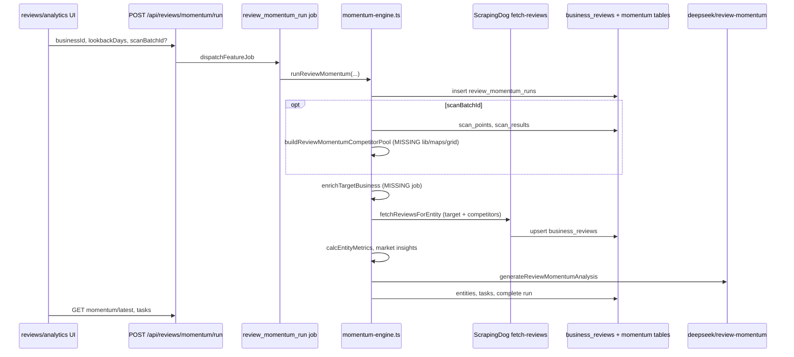

# Review Requests restoration + unified platform sender audit (read-only)

**Date:** 2026-10-14  
**Scope:** `master` @ `6d4d60955` vs `origin/cursor/reviews-platform-integration-5c36` @ `cd7f31e5e`  
**Instruction:** No merge, no implementation, no migrations, no deploy.

**Related:** `docs/REVIEW-REQUESTS-BRANCH-VS-MASTER-COMPARISON.md`, `docs/REVIEW-REPUTATION-CODE-INVENTORY.md`

---

## Executive answers (what you asked Cursor to establish)

### Can Review Requests plug into existing platform sending?

**Partially.** Transovo already has a **canonical outbound SMS path** (`sendQuickSms` → `sendViaRegistration` → Telnyx/Twilio adapter) used by MCTB, Appointment Reminders (platform mode), automations, drip, inbox quick send, etc. Review Requests **should** use that path.

**But** “platform sender” is **not one shared resolver today.** MCTB uses `resolveOutboundSmsRoute` + `mctb_platform_sender_assignments`; AR uses `ar-platform-sender-pool` + per-consumer assignments. Mass Texting uses **workspace-owned** numbers via `resolveMassTextSendingNumber` + `sendViaRegistration` (no `senderRoute`). The August Reviews branch uses a **fourth stack**: `lib/reputation/twilio.ts` + Supabase `review_request_messages` — **not plug-compatible** without a deliberate adapter.

### Review Velocity — find LSE dependencies before rewriting?

**Yes.** Missing modules were **left out of the port**, not renamed on `master`. They still exist in **`703deuce/lse`** (Local SEO Express). Smallest restoration: **copy/adapt specific LSE files** + add scan/grid schema from LSE migrations, or **repoint imports** to already-ported `src/lib/providers/maps-grid/*` and reimplement `buildReviewMomentumCompetitorPool` once (it lived in LSE `src/lib/maps/grid.ts`).

---

## PART 1 — Review Velocity dependency inventory

### 1.1 Known broken imports on integration branch (evidence)

| Import | Used by (branch) | On branch? | On `master`? | In LSE (`703deuce/lse`)? |
|--------|------------------|------------|--------------|---------------------------|
| `@/lib/maps/grid` (`buildReviewMomentumCompetitorPool`) | `momentum-engine.ts`, `reputation/engine.ts`, `reporting/build-single-scan.ts` | **Missing** | Missing | **`src/lib/maps/grid.ts`** (~13KB) |
| `@/lib/maps/grid-entity` | `reporting/*`, `metrics.ts` | **Missing** | Missing | **`src/lib/maps/grid-entity.ts`** |
| `@/lib/maps/grid-metrics` | `reporting/metrics.ts`, `render-html.ts` | **Missing** | Missing | **`src/lib/maps/grid-metrics.ts`** |
| `@/lib/scans/status` (`USABLE_SCAN_STATUSES`) | `momentum-engine.ts`, `reputation/engine.ts` | **Missing** | Missing | **`src/lib/scans/status.ts`** |
| `@/lib/jobs/enrich-competitors` (`enrichTargetBusiness`) | `momentum-engine.ts`, `reputation/engine.ts` | **Missing** | Missing | **`src/lib/jobs/enrich-competitors.ts`** |

`git ls-tree` on `53490afe1` confirms **`src/lib/maps/**` was never included** in the integration commit — imports were copied from LSE without the modules.

### 1.2 Partially ported LSE infrastructure (on branch, not the missing paths)

| Area | Branch path | Role |
|------|-------------|------|
| Maps grid **providers** | `src/lib/providers/maps-grid/*`, `src/lib/providers/scrapingdog/maps-grid.ts` | Rank/grid **scan execution** (Bright Data / ScrapingDog orchestration) |
| Review fetch | `src/lib/reviews/fetch-reviews.ts` | ScrapingDog pagination, velocity flags, incremental sync |
| Normalize/store | `src/lib/reviews/normalize.ts`, `review-store.ts` | `business_reviews` persistence |
| Metrics | `src/lib/reviews/metrics.ts` | **Real** velocity math (`calcEntityMetrics`, momentum labels) — no mocks |
| AI tasks | `src/lib/providers/deepseek/review-momentum.ts` | Post-metrics narrative + task list |
| Reporting (PDF/HTML) | `src/lib/reporting/*` | Depends on **missing** `lib/maps/*` for scan reports |

### 1.3 Database dependencies for Velocity

**In `reputation_platform.sql` (branch):** `business_reviews`, `review_sync_state`, `review_momentum_runs`, `review_momentum_entities`, `review_momentum_tasks` (see migration on branch).

**Referenced in code but not in that migration (LSE grid product):**

- `scan_batches`, `scan_points`, `scan_results`, `business_keywords`, `businesses` (extended) — used in `momentum-engine.ts` when `scanBatchId` is set (`supabase.from("scan_points")`, etc.).
- **No `CREATE TABLE` for scan_* in branch `supabase/migrations/`** (verified: `git grep scan_batches *.sql` → empty).
- LSE repo has scan migrations (e.g. `supabase/migrations/034_scan_batch_lease.sql` and related schema).

**Smallest restoration approaches:**

| Dependency | Approach |
|------------|----------|
| `lib/maps/grid.ts` + entity + metrics | **Port from LSE** (`703deuce/lse` paths above) or extract `buildReviewMomentumCompetitorPool` into `src/lib/reviews/competitor-pool.ts` using existing `providers/maps-grid` types |
| `lib/scans/status.ts` | Port small module from LSE |
| `lib/jobs/enrich-competitors.ts` | Port from LSE; depends on DataForSEO + ScrapingDog (`myBusinessInfo`, `placeDetails`) — branch already has `src/lib/providers/dataforseo` usage in scrapingdog stack |
| Scan tables | Port LSE Supabase migrations **or** run competitor-less velocity until grid scans exist |
| `lib/db/client.ts` | Branch-only Supabase service client — **do not** restore as primary; map to Prisma + existing `getPrisma()` on `master` |

### 1.4 Provider / env dependencies (Review Velocity)

| Provider | Env / config | Used for |
|----------|--------------|----------|
| **ScrapingDog** | `SCRAPINGDOG_API_KEY` or `SCRAPING_DOG_API_KEY` | `placeReviewsAll`, maps grid (`fetch-reviews.ts`, `scrapingdog/index.ts`) |
| **DataForSEO** | (via `lib/providers/dataforseo` on branch) | `enrichTargetBusiness` in LSE |
| **DeepSeek** | Provider config in `review-momentum.ts` | AI summary + recommended tasks |
| **Cost defaults** | `estimateProviderCost` in branch `fetch-with-timeout.ts` | Default ~**$0.001/unit** ScrapingDog, ~$0.002 DataForSEO, ~$0.0002 DeepSeek (override via `PROVIDER_COST_USD_*`) |

### 1.5 Jobs and APIs (Velocity)

| Piece | Path (branch) | On `master`? |
|-------|---------------|--------------|
| Queue job type | `review_momentum_run` in `src/lib/queue/job-handlers.ts` | **No** |
| HTTP trigger | `POST src/app/api/reviews/momentum/run/route.ts` → `dispatchFeatureJob` | **No** |
| Poll tasks | `src/app/api/reviews/momentum/tasks/[taskId]/route.ts` | **No** |
| Latest | `src/app/api/reviews/momentum/latest/route.ts` | **No** |
| Plan gate | `hasFeature(org, "review_momentum")` | Branch `lib/plans` — not on `master` |

### 1.6 Real vs preview data (do not confuse)

| Surface | Real runtime | Preview / demo |
|---------|--------------|----------------|
| `review-momentum-preview-data.ts` | — | **Hard-coded** market/competitor story (`REVIEW_MOMENTUM_PREVIEW_BUSINESS_ID`) |
| `review-requests-preview-data.ts` | — | Dashboard kit for dev |
| `review-analytics-preview-data.ts`, `reviews-preview-data.ts` | — | UI dev fixtures |
| `isDevPreviewBusiness()` in pages | — | Gates preview on requests page (`reviews/requests/page.tsx`) |
| `calcEntityMetrics` + `fetchReviewsForEntity` + DB `business_reviews` | **Real** | Requires providers + stored reviews |
| Competitor comparison | **Real only if** scan batch + `buildReviewMomentumCompetitorPool` | Optional path when `scanBatchId` null → target-only metrics still computable |

**Product requirement:** Day-one Velocity must use **real fetch + real metrics** for signed-in workspaces; public acquisition tool may use **one-shot fetch** (still real provider data, not random mocks).

### 1.7 Can Velocity run without full LSE architecture?

| Mode | Feasible? | Notes |
|------|-----------|-------|
| **Target-only velocity** (one Place ID, no competitors) | **Yes** after porting fetch + metrics + `business_reviews` tables | `momentum-engine` already fetches target reviews when business has `place_id` / `cid` in `reputation_workspace_profile` |
| **Target vs competitors** | **Requires** `buildReviewMomentumCompetitorPool` + scan results **or** manual competitor list + per-entity fetch | Grid scan DB optional if competitors entered by Place ID |
| **Full LSE grid rank product** | **No** without scan schema + maps grid port | Out of scope unless you want rank scans in Transovo |

### 1.8 Free public Review Velocity checker (plan only — not built)

**Goal:** Acquisition — user enters business (name + city or Google Place ID) → see velocity score / 30d pace → CTA to Transovo Review Requests.

| Aspect | Recommendation |
|--------|----------------|
| **Public without account** | One-shot: resolve Place ID (Places autocomplete API or ScrapingDog search) → **single** `fetchReviewsForEntity` with modest `lookbackDays` (e.g. 90) → `calcEntityMetrics` → show momentum label + 7d/30d counts + CTA. **No** DeepSeek tasks on free tier (cost control). |
| **Requires sign-in** | Save `business_reviews`, scheduled re-sync, competitor comparison, campaigns, SMS sends, alerts |
| **Rate limit** | Branch pattern: `assertRateLimit` on `/r/*` (120/min/IP) — reuse for public checker |
| **Cost per check (order of magnitude)** | ScrapingDog default **~$0.001 × pages**; review pagination depth drives cost (see `lookbackDays`, `depth` in `fetch-reviews.ts`). Budget **~$0.01–0.05** per deep check unless capped. Configure `PROVIDER_COST_USD_SCRAPINGDOG` for finance tracking. |
| **Legal/ToS** | ScrapingDog/Google data terms — marketing page must not imply Google partnership; show “estimated from public review data” |
| **Implementation steps** | (1) Port `fetch-reviews` + `normalize` + `metrics` only (2) Public API route with CAPTCHA + rate limit (3) Server-side job queue optional (4) Wire CTA to signup with `place_id` prefilled (5) After login, full `momentum-engine` with persistence |

---

## PART 2 — Review Velocity end-to-end flow (branch design)

**Historical velocity when only counts available:** `fetch-reviews` supports incremental sync (`knownIds`, `incrementalNoNew`); metrics use **dated** `NormalizedReview.reviewDate` — if provider returns undated rows, `date_precision` / `unparsedDateCount` degrades scores (`velocityWarning` in fetch result).

---

## PART 3 — Current Transovo sender architecture (master)

### 3.1 Canonical dispatch spine

| Layer | File | Role |
|-------|------|------|
| **Primary SMS API** | `src/lib/sms/send-quick.ts` | Credits, limits, idempotency, suppression gates, tracking token, optional `senderRoute` |
| **Registration send** | `src/lib/messaging/registration-processor.ts` `sendViaRegistration` | Workspace registration → `getMessagingProviderForRegistration` → Telnyx/Twilio |
| **Adapter entry** | `src/lib/sms/provider.ts` | Wraps `sendQuickSms` for generic callers |
| **Product registrations** | `prisma` `MessagingProductRegistration` | **`MCTB_CUSTOMER_CARE`** \| **`MASS_TEXT_MARKETING`** only (`schema.prisma` enum) |

### 3.2 Per-product dispatch paths (evidence)

| Product | Entry | Sender resolution | Dispatch | Tracking `/r/` | Suppression / consent |
|---------|-------|-----------------|----------|----------------|------------------------|
| **MCTB recovery** | `src/lib/agents/missed-call-text-back/send.ts` | `resolveOutboundSmsRoute` — `PLATFORM` vs `WORKSPACE` (`outbound-sms-route.ts`) | `sendQuickSms` + `senderRoute` + `omitConsumerTrackingLink: true` | Optional link only if in body; **no** auto `/r/` for MCTB | Press-1 / existing consent eligibility; platform assignment gate; MCTB suppression |
| **MCTB jobs** | `src/lib/mctb/messaging/send-customer-sms-job.ts` | Same family | `sendQuickSms` | Same | Same |
| **Appointment Reminders** | `src/lib/appointment-reminders/messaging/send-customer-sms-job.ts` | `sendAppointmentSmsViaPlatformSender` → `listArEligiblePlatformSenders` | `sendQuickSms` + `senderRoute` + `skipRecipientSuppressionGate: true` + `omitConsumerTrackingLink: true` | Same | Appointment/consent path; AR metering (`ar-sms-usage.ts`) |
| **AR workspace-owned** | `src/lib/appointments/sms-sender.ts` | Workspace numbers | `sendQuickSms` | Per template | Appointment rules |
| **Mass Texting / Campaigns** | `src/lib/campaigns/campaign-message-send.ts` | `resolveMassTextSendingNumber` (MASS_TEXT_MARKETING reg + tagged numbers) | **`sendViaRegistration` directly** (not `sendQuickSms`) for SMS | Campaign messages use `campaignMessage.trackingToken` → `/r/` | Contact `SUBSCRIBED`, list attestation, mass-text guards |
| **Legacy/automation sequences** | Same file, non-mass branch | `getRegistrationByWorkspace` + optional sender pool | `sendViaRegistration` | Campaign path | Automation enrollment |
| **Automations `send_review_request`** | `src/lib/automations/actions.ts` | Flow `from` / `phoneNumberId` | **`sendQuickSms`** (no dedicated review use case) | **Default** quick-send tracking unless body-only URL | Contact `SUBSCRIBED` |
| **Drip** | `src/lib/drip-campaigns/engine.ts` | — | `sendQuickSms` | — | — |

### 3.3 Platform sender — two pools today (not one)

| Pool | Config | Assignment |
|------|--------|------------|
| **MCTB platform** | `MCTB_PLATFORM_SENDER_PHONE_NUMBER_ID`, `platform-sender-config.ts` | `mctb_platform_sender_assignments`, collision gate `platform-outbound-gate.ts` |
| **AR platform** | `ar-platform-sender-pool.ts`, `ar_sms_consumer_platform_sender_assignments` | Per consumer phone collision avoidance |

Inbound: `src/lib/messaging/platform-sms-inbound-dispatch.ts` routes STOP/HELP on platform numbers.

**Conclusion:** Shared **provider wire** (`sendViaRegistration`), **not** shared **platform sender selection**. Review Requests needs a **third policy** (or generalized “transactional marketing / review solicitation” policy) — does not exist on `master`.

### 3.4 Reviews branch sender (what not to ship)

| Component | Path |
|-----------|------|
| Twilio send | `src/lib/reputation/twilio.ts` |
| Review SMS API | `src/app/api/reputation/review-requests/send-sms/route.ts` → `sendReviewRequestSms` |
| Campaign worker | `src/lib/reputation/campaign-message-send.ts` → `sendTwilioSms` |
| Suppression table | `review_request_suppression` keyed by **`business_id`** (Supabase), not Prisma `Suppression.workspaceId` |

---

## PART 4 — Platform sender eligibility matrix (technical vs approval)

**Critical:** Repository code proves **technical send paths**; **carrier-approved use case** is only partially modeled in `MessagingProductRegistration.useCaseDescription` / Telnyx campaign fields. **No code comment certifies review solicitation on platform sender.**

| Product | Technically can hit Telnyx/Twilio via shared stack? | Product registration enum | Platform sender path exists? | Consent model in code | Customer A2P alternative | Gap for platform mode |
|---------|---------------------------------------------------|---------------------------|------------------------------|----------------------|--------------------------|------------------------|
| **MCTB** | Yes | `MCTB_CUSTOMER_CARE` | Yes — dedicated platform sender + assignment | Press-1 / existing consent; recovery only | Workspace number + registration | Documented; not for marketing |
| **Appointment Reminders** | Yes | Uses workspace reg; platform pool separate | Yes — AR platform pool | Calendar/reminder consent; `skipRecipientSuppressionGate` | Workspace-owned sender | Reminder templates; platform post-process strips URLs (`reminder-platform-sms-postprocess.ts`) |
| **Campaigns / Mass Text** | Yes | `MASS_TEXT_MARKETING` | **No** — workspace/tagged numbers only | `SUBSCRIBED`, list attestation | Own number + MASS_TEXT registration | Platform blast not implemented |
| **Review Requests (branch)** | Yes (if rewired) | **None** | **None** on `master` | Branch: review opt-out table + org permissions | Would use workspace Twilio on branch | Need **`REVIEW_SOLICITATION`** (or similar) registration + TFV copy; **Press-1 ≠ review consent** |
| **Automations `send_review_request` on master** | Yes | Falls under workspace **generic** registration | Only if workspace number | Marketing `SUBSCRIBED` | Same | **No** review-specific compliance gate |

**Message category separation (required for approval):**

| Category | Master home | Platform sender realistic? |
|----------|-------------|----------------------------|
| Transactional / customer care (MCTB recovery) | MCTB | Already designed |
| Appointment reminders | AR | Already designed |
| Review solicitation | Automations only today | **Needs new approval narrative** — not Press-1 |
| Promotional campaigns | Mass Text | Workspace A2P today |
| Conversational replies | Inbox | Workspace / thread context |

---

## PART 5 — Proposed sender-selection architecture (design only)

**Recommendation:** Add a thin **`resolveOutboundSmsDelivery(input)`** in `src/lib/messaging/` (or extend `send-quick.ts` preflight) — **only if** review + future products need it; otherwise extend `sendQuickSms` options.

**Inputs:** `workspaceId`, `product: 'mctb' | 'ar' | 'mass_text' | 'review_requests'`, `mode: 'platform' | 'workspace'`, `to`, `messageClass`, `consumerE164?` (for platform collision).

**Outputs:** `{ sendQuickSms args including senderRoute }` or structured 4xx (`platform_not_eligible`, `registration_not_ready`, `consent_blocked`).

**Reuse:**

- MCTB → existing `resolveOutboundSmsRoute` + platform gate (unchanged).
- AR → existing `selectArOutboundPlatformSender` / workspace path (unchanged).
- Mass Text → keep `sendViaRegistration` in campaign processor **or** unify on `sendQuickSms` for consistent `Message` rows (larger change).
- Review Requests → **new** resolver: platform sender only when `MessagingProductRegistration` for review use case approved **and** recipient not suppressed; map `review_request_suppression` → workspace-scoped `Suppression` or shared store.

**Do not** resurrect `lib/reputation/twilio.ts` as parallel stack.

---

## PART 6 — Review Requests migration mapping (Twilio reputation → Transovo)

| Branch component | Transovo target |
|------------------|-----------------|
| `sendReviewRequestSms` / `sendTwilioSms` | `sendQuickSms` + review-specific idempotency key + template merge via `mergeTemplate` / `review-link.ts` |
| `review_request_messages` rows | `Message` + optional `Campaign`/`CampaignMessage` **or** dedicated `ReviewRequestSend` Prisma model — prefer **one** thread in Inbox |
| `review_request_suppression` | Consolidate with `Suppression` / STOP pipeline (`review_request_suppression` name already on master Prisma map) |
| `recordTrackingClick` (reputation) | Extend `/r/[trackingToken]/route.ts` with **third** resolver branch: review send tokens **without** breaking campaign + `Message` paths (master already chains campaign → message) |
| Branch `/r/` QR short codes | Add handler **after** existing campaign/message lookup; share rate limit |
| `requireBusinessAccess` / `businessId` | `workspaceId` session auth |
| `createServiceClient` Supabase | Prisma + existing APIs |
| `lib/plans` `review_sms_sent` | Mass-text-style credits or new SKU — align with Stripe |
| Brevo email sends | `src/lib/email/brevo.ts` (already on master) for email review requests |
| Campaign processor | Wire to `enqueueJob` / existing BullMQ patterns in `src/lib/jobs/job-handlers.ts` |

---

## PART 7 — Restore without breaking current Transovo

**Preserve (do not revert):** `business-messaging-nav.ts`, MCTB/AR/Campaigns routes, `resolve-product-nav.ts`, shared Inbox/Contacts, Opus shells, `sendQuickSms`, current `/r/` behavior for campaigns + automations.

**Copy/adapt from branch (module list):**

- UI: `src/app/(app)/reviews/**`, `src/components/reputation/**`, `src/components/reviews/**`
- APIs: `src/app/api/reputation/**`, `src/app/api/reviews/momentum/**`
- Lib: `src/lib/reputation/**`, `src/lib/reviews/**` (minus Supabase-only assumptions)
- SQL: `20260823000000_reputation_platform.sql` → Prisma migration
- **Plus LSE port:** `lib/maps/grid*.ts`, `lib/scans/status.ts`, `lib/jobs/enrich-competitors.ts`, scan schema from **`703deuce/lse`**

**Do not copy:** branch `sidebar.tsx` / unified Aug nav, `lib/db/client.ts` as authority, `lib/reputation/twilio.ts` as send path, duplicate queue system if `master` job-handlers suffice.

**DB overlap:**

| Branch table | Master overlap |
|--------------|----------------|
| `review_request_suppression` | Prisma `Suppression` @@map same table name — **schema shape must be reconciled** (workspace vs business_id) |
| `business_reviews` | None — new |
| `review_request_templates` | Overlaps conceptually with `/templates` — consider unify |
| Contacts | Prefer Transovo `Contact` vs `review_request_contacts` |

---

## PART 8 — Risk and effort assessment

| Workstream | Size | Risk |
|------------|------|------|
| Port SQL + Prisma models | Medium | Suppression column mismatch |
| Rewire review SMS to `sendQuickSms` | Medium | Wrong use case on platform sender → compliance |
| Restore Velocity core (target-only) | Medium | Provider keys, pagination cost |
| Restore competitor velocity | **Large** | LSE grid + scan migrations + missing `lib/maps/*` |
| Nav / fourth product flag | Medium | Must not disturb Business Messaging |
| Opus reskin all review pages | Large | UI-only but broad |
| Public velocity checker | Medium | Abuse + cost caps |
| Merge branch as-is | **Forbidden** | 2145 commits drift, 12 conflict files, Twilio fork |

**Verdict:** **Selective port is justified**; **merge is not**. Velocity day-one is feasible **target-first**; **full competitor grid parity** requires LSE dependency restoration.

---

## PART 9 — Certification checklist (post-implementation)

- [ ] Manual single review-request SMS (platform sender, eligible workspace)
- [ ] Same send on customer-owned A2P number
- [ ] Bulk CSV validate + batch send + per-recipient status
- [ ] Review campaign enroll → sequence → delivery callback
- [ ] QR scan → `/r/` → review URL redirect + analytics
- [ ] Review Velocity run (real ScrapingDog fetch) → dashboard metrics match DB
- [ ] Competitor comparison (if enabled) matches LSE behavior
- [ ] STOP on review traffic suppresses future review sends (not MCTB conflation)
- [ ] `/r/` campaign + MCTB + review tokens all work on one route
- [ ] Credits / `review_sms_sent` metering
- [ ] Public velocity checker rate limit + cost cap
- [ ] MCTB + AR + Campaigns regression smokes unchanged

---

## PART 10 — Implementation plan (ordered, no work started)

1. **Governance** — Add `REVIEW_SOLICITATION` (or equivalent) to `MessagingProductUseCase`; legal/TFV copy for platform sender.
2. **Schema** — Land review tables + LSE scan tables (if competitor velocity required); unify suppression.
3. **LSE dependency port** — `lib/maps/grid*`, `scans/status`, `enrich-competitors` from `703deuce/lse`; fix imports in `momentum-engine.ts`.
4. **Velocity vertical slice** — API run job on `master` job queue; real fetch; analytics page (Opus).
5. **Public checker** — Rate-limited API + marketing page.
6. **Send adapter** — `sendReviewRequestSms` → `sendQuickSms`; email → existing Brevo.
7. **Review UI port** — Requests, templates, campaigns, QR behind feature flag + fourth product nav entry.
8. **Tracking** — Extend `/r/[trackingToken]` with review-specific token table lookup.
9. **Billing** — Entitlements + Stripe SKU for Review Requests + velocity tiers.
10. **Cert** — Checklist above on staging with real Telnyx TFV-approved sender.

---

## Appendix — Key file evidence index

| Topic | Path |
|-------|------|
| Momentum engine | `origin/cursor/.../src/lib/reviews/momentum-engine.ts` |
| Missing grid import | `import { buildReviewMomentumCompetitorPool } from "@/lib/maps/grid"` (no file on branch) |
| LSE grid source | `https://github.com/703deuce/lse/blob/master/src/lib/maps/grid.ts` |
| ScrapingDog key | `origin/cursor/.../src/lib/providers/scrapingdog/index.ts` `getApiKey()` |
| Branch Twilio send | `origin/cursor/.../src/lib/reputation/twilio.ts` |
| Master send spine | `src/lib/sms/send-quick.ts`, `src/lib/messaging/registration-processor.ts` |
| MCTB platform | `src/lib/mctb/messaging/outbound-sms-route.ts`, `platform-sender-config.ts` |
| AR platform | `src/lib/appointment-reminders/messaging/send-via-assigned-sender.ts` |
| Mass text send | `src/lib/campaigns/campaign-message-send.ts` |
| Master `/r/` | `src/app/r/[trackingToken]/route.ts` |
| Branch `/r/` | `origin/cursor/.../src/app/r/[trackingToken]/route.ts` |
| Product use cases | `prisma/schema.prisma` `MessagingProductUseCase` |

---

*End of audit — read-only; no repository code or production settings were changed.*
