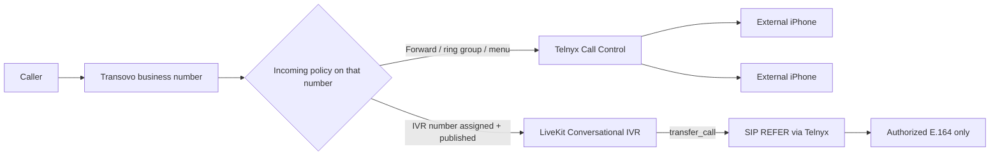

# Transovo: end-to-end setup and verification workflows

Use this guide to walk **Call Forwarding**, **Conversational IVR**, **Phone**, and **Power Dialer** from configuration through “how do I know it works?”

**Last aligned with product UI:** October 2026 (`new-app` routes under `/app/phone/*`, `/app/receptionist/*`, `/app/numbers`).

---

## Big picture (do not mix these up)

Transovo has **separate products** that share **phone numbers** and **forwarding destinations**, but they use **different call engines**:

| What you want | Product / UI | What actually handles the call |
|---------------|----------------|--------------------------------|
| Ring my team’s **iPhones** when someone calls the business line | **Phone → Call Forwarding** | **Telnyx Call Control** (forward / dial / bridge / ring groups) |
| **AI** answers and **transfers** by intent (“I need an estimate”) | **Conversational IVR** | **LiveKit SIP** agent + `transfer_call` → SIP REFER to a saved number |
| **Keypad menu** (“Press 1 for Sales”) | **Phone → Auto Attendant** | **Telnyx Call Control** menu executor |
| **Outbound** one-by-one from a list | **Phone → Power Dialer** | WebRTC + outbound PSTN (not inbound forwarding) |
| **Click-to-call** from the browser | **Phone → Dialer** | WebRTC softphone |

If **Phone → Incoming** is set to **“Forward to phone”** on a number, that number is **not** sending callers to the Conversational IVR. IVR needs its **own number connection + publish** under Conversational IVR.

---

## 1) Call Forwarding customer (three external iPhones)

**Goal:** Caller dials your **Transovo (or forwarded) business line** → one or more **external cellphones** ring. No AI required.

### Setup (step by step)

1. **Get a business line on Transovo**
   - **`/app/numbers`** — buy a number, port, or use the wizard.
   - Optional guided path: **`/app/phone/forwarding/setup`** (“Set up business line”) — especially **“Keep my carrier”** if your public number stays at AT&T/Verizon and **forwards into** Transovo.

2. **Add the three iPhones as destinations**
   - **`/app/phone/forwarding`** → **Add forwarding destination** (repeat 3×).
   - Each destination: **name** (e.g. “Sarah mobile”) + **external phone** (normalized to E.164).
   - These live in the **authorized Phone forwarding store** (the same store Conversational IVR reuses when you save a Call Routing destination).

3. **Choose how all three ring**
   - **Ring everyone at once or in order:** same page → **Ring groups** section.
     - Strategy: **simultaneous** (all 3 ring) or **sequential** (try 1, then 2, then 3).
     - Add all three destination IDs as members → **Save group** → **assign group** to the business number (sets `answeringMode: forward` + `forwardingGroupId`).
   - **One primary phone only:** skip the group; set **primary destination** on the number (first destination you add can auto-bind as primary).

4. **Turn forwarding on**
   - On **`/app/phone/forwarding`**: select the **business number**, ensure **Forwarding enabled** (not paused).
   - Use **“Forward to phone”** if the line was on browser / voicemail / menu.

5. **Optional: after-hours / no-answer**
   - Same workspace: **After-hours forwarding**, **No-answer fallback** panels — voicemail, another number, etc.

### How you know it works

| Check | Where | What “good” looks like |
|--------|--------|-------------------------|
| **Real call** | Your cell | Call the **business number**. At least one iPhone rings; two-way audio works. |
| **Call record** | **`/app/phone/calls`** | New **inbound** row; duration/outcome updated (answered, missed, voicemail). |
| **Overview** | **`/app/phone`** | Inbound count moves; missed/voicemail match what you experienced. |
| **Destination “Test”** | Forwarding table | Marks destination tested in UI — **not** a substitute for a real ring test. |

### Common gotchas

- Forwarding **paused**
- Wrong **business number** selected when you have multiple
- Only **one** destination set as primary while you expected a **ring group**
- iPhone **Do Not Disturb / silence unknown callers**
- Number not **Active** in **`/app/numbers`**

### Recommended path for “three iPhones, no AI”

1. Add **3 forwarding destinations** (the three iPhones).
2. Create a **simultaneous ring group** with all three members.
3. Assign that group to the **business number** with forwarding **active**.
4. Call the business number from another phone; confirm ringing behavior.
5. Confirm in **`/app/phone/calls`**.

---

## 2) Conversational IVR (AI answers + semantic transfer)

**Goal:** Caller talks to the AI → AI picks **Sales / Billing / Service** from **Call Routing** → `transfer_call(route_id)` → backend resolves **E.164** → **LiveKit SIP transfer** to that phone.

### Setup (step by step)

1. **Connect the line to the IVR (draft)**
   - **`/app/receptionist/call-handling`** (Conversational IVR — not Phone Call Forwarding).
   - **Change number** → owned Transovo number or **external** (carrier forwards to Transovo).
   - Complete **Test connection** / verification if shown.

2. **Business knowledge (optional but typical)**
   - **`/app/receptionist/knowledge`** — hours, services, policies.

3. **Call Routing (four fields in one form)**
   - **`/app/receptionist/call-routing`**
   - Per destination: **Name**, **Phone**, **Description**, **When to transfer**.
   - **Save destination** (syncs Phone forwarding store + `conversationalRoutes` in draft).
   - Example: Sales, Service, Office manager as separate cards.

4. **Voice & greeting**
   - **`/app/receptionist/agent`** — name, greeting, voice.

5. **Message taking (fallback)**
   - **`/app/receptionist/message-taking`** when no match or failed transfer should take a message.

6. **Make it live**
   - Sticky bar: **Save draft** → **`/app/receptionist/activate`** (Review & publish).
   - Fix blockers (number, greeting, routes, knowledge if required).
   - **Publish** — until then, live calls use the **last published** config.

7. **Sanity test**
   - **`/app/receptionist/test`** if available, then a **real PSTN call** to the connected number.

### How you know it works

| Check | Where | What “good” looks like |
|--------|--------|-------------------------|
| **Draft vs live** | Overview status bar | No unpublished routing changes; recent **published** timestamp. |
| **Transfer intent** | Live call | e.g. “I need an estimate” → connect language → **external phone rings**. |
| **Call history** | **`/app/receptionist/calls`** | Call logged; **transferred** filter when applicable. |
| **Wrong product** | Phone incoming mode | If the number is only **Forward to phone** in Phone settings, callers **won’t** hit IVR on that path. |

### Ring groups and IVR

Conversational IVR **does not** transfer to a ring-group ID as one target — only **one E.164 per transfer**. To ring all three iPhones at once, use **Phone Call Forwarding** (ring group) or **Auto Attendant**, not one IVR transfer to a group.

---

## 3) Phone (overall product)

**Goal:** Workspace can place/receive calls, see history, configure behavior per number.

### Setup (step by step)

1. **`/app/numbers`** — at least one **Active** number; note default caller ID on **`/app/phone`**.
2. **`/app/phone`** — overview shows **Lines active** (Telnyx/readiness), not “Needs Telnyx setup.”
3. **Per-number incoming** — **`/app/phone/forwarding`** and number detail / answering policy: browser, forward, auto attendant, voicemail, greeting then forward.
4. **Outbound** — **`/app/phone/dialer`**: allow mic, place test call, confirm in **`/app/phone/calls`**.
5. **Business hours / voicemail** — **`/app/phone/business-hours`**, **`/app/phone/voicemail`** as needed.

### How you know it works

- **Outbound:** two-way audio; call row in **Calls** (recording if enabled).
- **Inbound:** behavior matches policy (browser vs forward vs menu).
- **`/app/phone/analytics`** consistent with **Calls** for the same period.

**Note:** **`/app/phone/call-handling`** redirects to **`/app/phone/forwarding`** for the Phone product.

---

## 4) Power Dialer (outbound lists)

**Goal:** Import leads → campaign → session → dial through list → disposition.

### Setup (step by step)

1. **`/app/numbers`** — caller ID for the campaign.
2. **`/app/phone/power-dialer` → Lists** — create list, **import** rows (phones required).
3. **Campaigns** — create campaign, tie to list, set **caller ID E.164**, move status toward **active**.
4. **Session** — pick campaign → **Start session** → **Call** → **disposition** + notes → next lead.
5. Review session log; pause/complete campaign as needed.

### How you know it works

- Session advances **next lead** after disposition.
- **`/app/phone/calls`** shows **outbound** attempts.
- If session fails: mic permissions, WebRTC token, Telnyx readiness (same as **Dialer**).

Power Dialer does **not** configure inbound forwarding to external iPhones.

---

## 5) Auto Attendant (keypad IVR — Phone product)

**Goal:** “Press 1 for Sales” without conversational AI.

### Setup (step by step)

1. Create destinations in **`/app/phone/forwarding`** (or reuse existing).
2. **`/app/phone/auto-attendant`** — build menu; options can **forward** to a destination or **ring group**.
3. On the business number: answering mode **`auto_attendant`** and select the menu (**`/app/numbers`** detail or forwarding UI).

### How you know it works

- PSTN call → hear menu → press digit → correct phone rings.
- **`/app/phone/calls`** logs inbound + outcome.

---

## Adding a new number (shared)

1. **`/app/numbers`** — search, buy, port, or external-forward setup.
2. Decide **which product owns inbound** on that number:
   - **Team rings only** → Phone forwarding / ring group / menu.
   - **AI IVR** → **`/app/receptionist/call-handling`**, **`/app/receptionist/call-routing`**, **publish**.
   - **One public line, multiple behaviors** → usually carrier forward into one Transovo ingress + clear overflow/hours rules; avoid conflicting policies without a documented plan.

---

## Practical E2E certification order

1. **Phone forward + 3 iPhones (ring group)** — PSTN in, answer one phone, call log OK.
2. **Conversational IVR** — publish, PSTN in, semantic transfer to one phone, call log OK.
3. **Auto attendant** — one menu option to one destination.
4. **Dialer** — one outbound two-way audio.
5. **Power dialer** — one list row, one disposition, one outbound log.

---

## Route reference (quick links)

| Area | Path |
|------|------|
| Numbers | `/app/numbers` |
| Phone overview | `/app/phone` |
| Call Forwarding | `/app/phone/forwarding` |
| Forwarding setup wizard | `/app/phone/forwarding/setup` |
| Auto Attendant | `/app/phone/auto-attendant` |
| Dialer | `/app/phone/dialer` |
| Power Dialer | `/app/phone/power-dialer` |
| Phone calls | `/app/phone/calls` |
| Conversational IVR overview | `/app/receptionist` |
| IVR number connection | `/app/receptionist/call-handling` |
| IVR Call Routing | `/app/receptionist/call-routing` |
| IVR knowledge | `/app/receptionist/knowledge` |
| IVR voice & greeting | `/app/receptionist/agent` |
| Review & publish | `/app/receptionist/activate` |
| IVR calls | `/app/receptionist/calls` |

---

## Technical notes (for engineers)

- **Call Forwarding / ring groups / auto attendant:** Telnyx Call Control (`forward`, `dial`, `bridge`, menu executor).
- **Conversational IVR transfer:** `transfer_call` → authorize route → `LiveKitAPI.sip.transfer_sip_participant` (SIP REFER through Telnyx trunk). One E.164 per transfer.
- **Call Routing save** creates/updates rows in the Phone **forwarding destination** store and keeps `conversationalRoutes` in the agent draft; **publish** compiles routes into the live agent config.
