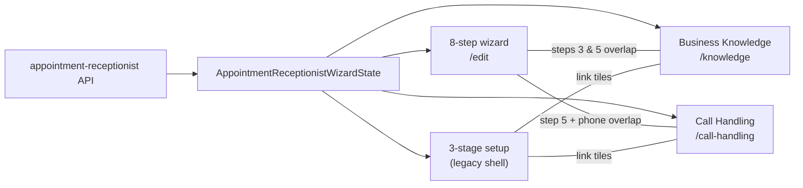

# Voice receptionist: 8-step wizard vs Business Knowledge vs Call Handling vs Setup (3-stage)

**Purpose:** Copy/paste inventory of **every control surface**, what is **shared**, what exists **only on the 8-step wizard**, and what exists **only on the three standalone pages** in the split IA flow.

**Last updated:** 2026-09-27

---

## How to read this doc

| Surface | Route | What it is today |
|---------|--------|------------------|
| **8-step wizard (Opus)** | `/voice/receptionist/edit` | Canonical editor when Stage 2 is on: `AppointmentReceptionistWizard` with `presentation="opus"` (all 8 steps). |
| **Business Knowledge** | `/voice/knowledge` | Permanent ops page; same wizard state, `wizardStepId: "information"` on save. |
| **Call Handling** | `/voice/call-handling` | Permanent ops page; saves `wizardStepId: "call-handling"`. |
| **Receptionist setup (3-stage)** | *Code only* — `ReceptionistEditorOpus` | **Not** mounted on `/voice/receptionist/edit` anymore (replaced by 8-step). Still the best description of the **“setup + link out to Knowledge / Call Handling”** flow you had in product IA. |
| **Receptionist summary** | `/voice/receptionist` | Read-only overview; links to edit wizard. |
| **`/voice/setup`** | Redirect | **Missed Call Text Back** (`MCTB_ROUTES.setup`) — **not** AI receptionist config. |

**Single source of truth for all of the above (except MCTB):** `AppointmentReceptionistWizardState` via `useAppointmentReceptionistWizard` / `POST /api/solutions/appointment-receptionist`.

**Deeper parity audit (209 compiler leaves):** `docs/VOICE-AGENT-EIGHT-STEP-WIZARD-TO-NEW-IA-PARITY-AUDIT.md`

---

## Architecture (one state, many surfaces)

---

# Part A — Full inventory: 8-step wizard (every step)

Step order from `WIZARD_STEPS` in `src/lib/solutions/appointment-receptionist/types.ts`.  
Components: `src/components/solutions/appointment-receptionist/steps/*.tsx`.

---

## Step 1 — Goals (`goals-step.tsx`)

| Section | Controls / state |
|---------|------------------|
| Solution naming | `solutionName` (hidden on Opus compact mode via `hideSolutionName`) |
| Operating mode | `answerWhen`: main / overflow / after-hours (+ preset-specific `ringBehavior` coupling) — **hidden on Opus when `hideAnswerWhen: true`** |
| Capabilities (8 toggles) | `capabilities[]`: answer questions, book appointments, reschedule, cancel, take messages, qualify callers, transfer calls, send SMS confirmations |
| Hire / Amy mode | Locks some capabilities; sets `agentName`, `role`, `solutionName` |
| Meta | `preset`, `outcomeSlug` |
| Chrome | Side panel “Recommended setup” / next steps (optional `hideSidePanel`) |

**Save-merge keys (`goals`):** `capabilities`, `answerWhen`, `solutionName`, `preset`, `outcomeSlug`

---

## Step 2 — Phone (`phone-step.tsx`)

| Section | Controls / state |
|---------|------------------|
| Readiness strip | Phone assigned, inbound calling, AI voice, recording status |
| Number source cards | `numberSource`: existing \| buy_new \| forward_existing \| connect_existing |
| Number picker | `phoneNumberId`, `phoneNumberE164` (workspace numbers API) |
| MCTB reuse | Auto-bind MCTB ingress line (MCTB presentation only) |
| Answering behavior | `ringBehavior` → also drives `answerWhen` |
| Settings | `ringTeamSeconds`, `callRecording` (`off` \| `all` \| `inbound_only`) |
| Connection greeting | `connectionGreeting`, `connectionGreetingText`, `connectionGreetingAudioUrl` (pre-AI mask) |
| Outbound SMS fields | On state for appointments send-link; **not primary UI on this step** |
| Chrome | Side panel “Phone setup” |

**Save-merge keys (`phone`):** `numberSource`, `phoneNumberId`, `phoneNumberE164`, `outboundSmsMode`, `outboundSmsPhoneNumberId`, `outboundSmsE164`, `ringBehavior`, `ringTeamSeconds`, `callRecording`, `connectionGreeting`, `connectionGreetingText`, `connectionGreetingAudioUrl`

---

## Step 3 — Information (`information-step.tsx`)

| Section | Controls / state |
|---------|------------------|
| Document RAG | `knowledgeBaseEnabled` |
| Source mode (4 cards) | `knowledgeSource`: website \| guided_profile \| upload_docs \| connect_data |
| Website | `websiteUrl`, scan/import → `knowledgeItems` |
| Guided profile | business name, address, hours prose, services, pricing, policies, FAQs → `knowledgeItems` |
| Upload docs | File upload → KB / items |
| Connect existing KB | `linkedKnowledgeBaseId` (`ConnectExistingKnowledge` → `/api/voice/knowledge`) |
| Knowledge item list | Per-item label, summary, status; edit/approve flows |
| Business schedule | `BusinessScheduleEditor` → `operatingMaturity.businessSchedule`, `timezone` |
| Identity fields on merge | `businessName`, `agentName`, `role`, `tone`, `speakingStyle`, `language`, `speaksFirst`, `openingGreeting`, `conversationBehaviors`, `guardrails`, `longTermMemory`, `crmEnabled` — **UI for identity/greeting is on Step 6 Voice; merge still attributes many to `information` on save** |
| Chrome | Side panel “Knowledge quality” |

**Save-merge keys (`information`):** see parity audit Appendix A

---

## Step 4 — Appointments (`appointments-step.tsx`)

| Section | Controls / state |
|---------|------------------|
| Calendar providers | Connect cards → `calendarProvider`, `calendarConnected`, `calendarEmail` (links to Integrations) |
| Booking strategy | `bookingStrategy`: Microsoft 365, request only, send link, none |
| Send link block | `bookingLinkUrl`, `bookingLinkLabel`, `bookingLinkSmsConsentRequired`, outbound SMS sender fields |
| Appointment types | Full CRUD list: name, duration, calendar, status, location, modality, hours, notice windows, `requiredFields`, `bookingPermission`, enabled; `selectedAppointmentTypeId` |
| Qualification | `qualificationEnabled`, rules builder, ZIP lists, match mode, fallbacks |
| Collect fields | `collectFields[]` enable/required/order/custom |
| Booking behavior (subset) | `bookingBehavior` flags (also repeated on step 5 when booking on) |
| Chrome | Side panel “Appointment tools” |

**Save-merge keys (`appointments`):** see parity audit Appendix A

---

## Step 5 — Call Handling (`call-handling-step.tsx`)

| Section | Controls / state |
|---------|------------------|
| Flow diagram | Booking vs message flow (legacy/mctb presentation) |
| Booking behavior | 4× `bookingBehavior` toggles when booking capability on |
| Emergency & human transfer | `EmergencyTransferEditor`: destinations, plan steps, `transferTriggers`, warm transfer, voicemail detect, caller-requested transfer, etc. |
| Urgency (MCTB) | `urgencyEnabled`, `UrgencyRulesEditor` |
| Sales solicitation (MCTB) | `salesSolicitationEnabled` |
| Messages & callbacks | `callbackRequestsEnabled`, `CallbackRequiredFieldsOpus` / editor |
| After-hours notifications | `AfterHoursNotificationsEditor` |
| AI Call Recovery | `aiCallRecoveryEnabled`, consent mode, continue over SMS, delay, sending number |
| Operating maturity | `AfterHoursBehaviorEditor`, `OnCallScheduleEditor`, `CallbackSlaEditor` |
| Related state | `spamLikelyPolicy`, `solicitorPolicy` (full editors on legacy operational page) |
| Chrome | Side panel “Call handling preview” (legacy; Opus may hide header diagram) |

**Save-merge keys (`call-handling`):** see parity audit Appendix A

---

## Step 6 — Voice (`voice-step.tsx`)

| Section | Controls / state |
|---------|------------------|
| Identity | `agentName`, `businessName`, `role`, `tone`, `speakingStyle`, `language` |
| Voice catalog | `voiceId`, `voiceLabel`, `voiceSource`, preview |
| Custom OpenAI voice | `openAiCustomVoiceId` (feature-flagged) |
| GPT-Live controls | `speakingPace`, `voiceAccent`, `backchannelLevel`, `callerPausePatience`, `interruptionStyle` |
| Greeting | `speaksFirst`, `openingGreeting` |
| Conversation rules | `conversationBehaviors.*` (boolean guardrails) |
| Chrome | Side panel “Voice settings” |

**Save-merge keys (`voice`):** `voiceId`, `voiceLabel`, `speakingPace`, `voiceAccent`, `backchannelLevel`, `callerPausePatience`, `interruptionStyle`, `voiceSource`, `openAiCustomVoiceId`

---

## Step 7 — Test (`test-step.tsx`)

| Section | Controls / state |
|---------|------------------|
| Browser test | `VoiceV3BrowserCall`, ensure agent / draft |
| Phone test guidance | Shows `phoneNumberE164` after activate path |
| Meta | `testScenario`, `lastTestPassed` |
| Chrome | Side panel “Test” (Opus uses dense panels; side panel optional) |

**Save-merge keys (`test`):** `testScenario`, `lastTestPassed`

---

## Step 8 — Activate (`activate-step.tsx`)

| Section | Controls / state |
|---------|------------------|
| Readiness grid | `buildWizardReadinessRows`, activation issues |
| Calendar probe | Sync calendar connection display |
| Activate | `activationMode: activate_now`, publish |
| Schedule activation | `scheduledAt` |
| Navigation | Link back to test |
| Chrome | Side panel “Activate” |

**Save-merge keys (`activate`):** `activationMode`, `scheduledAt`

---

# Part B — Full inventory: Business Knowledge (`/voice/knowledge`)

**Wiring:** `src/newui-transplant/connected/voice/knowledge-page.tsx` → mirror `TransplantVoiceKnowledgePage`.

| Section | What it does | State / APIs |
|---------|----------------|--------------|
| **Needs your review** | Knowledge gaps inbox | `/api/voice/knowledge-gaps`; dismiss/resolve → PATCH gaps |
| **Core business fields** | Name, description, services, website, timezone | `businessName`, `knowledgeItems`, `websiteUrl`; DOM merge on save |
| **Business hours (display)** | Read-only hour rows compiled from schedule + hours item | `operatingMaturity.businessSchedule`, hours `knowledgeItems` |
| **Edit hours** | Button routes away | `onEditHours` → **`/voice/setup`** (MCTB redirect — **not** inline schedule editor) |
| **FAQs** | List + add via prompt | `knowledgeItems` (`faq-*`) |
| **Sources** | Website crawl + uploads list | `linkedKnowledgeBaseId`, `/api/voice/knowledge/:id`, crawl latest |
| **Recrawl** | POST crawl | `websiteUrl`, KB id |
| **Upload** | Hidden file input | `/api/voice/knowledge/:id/upload` |
| **Save** | Persist knowledge step | `persistKnowledgeWizardStep`, `wizardStepId: "knowledge"` |

### Not on Business Knowledge page

- `knowledgeSource` mode picker (4 cards)
- `knowledgeBaseEnabled` RAG toggle (wizard step 3 has it)
- Inline `BusinessScheduleEditor` (wizard has it; Knowledge links out for hours)
- Guided profile **all** slices (only subset via form fields)
- Per-item knowledge editor UX from wizard (richer on step 3)
- Goals, phone, appointments, voice, test, activate (entire other steps)

---

# Part C — Full inventory: Call Handling (`/voice/call-handling`)

**Wiring:** `src/newui-transplant/connected/voice/call-handling-page.tsx` + `buildVoiceCallHandlingWired` + **`OpusCallRoutingIngressPanel`** (below page).

| Section | What it does | State / APIs |
|---------|----------------|--------------|
| **Current behavior** | During-hours / after-hours summary lines | Derived from maturity + transfer summary |
| **Transfers** | Ordered list; **Add target** | `transferDestinations`, `transferPlanSteps`; `addTransferDestination` |
| **Business hours & after hours** | Switches: ring team first, AI after hours, holiday schedule | `operatingMaturity.afterHoursBehavior.whenClosed`, `businessSchedule.holidays` |
| **On-call** | Description + **Edit** button | `onCallSchedule` — **Edit button not wired** to full editor in connected shell |
| **Emergency keywords** | Read-only chips + **+ Add** UI | `transferTriggers` — **Add not wired** in transplant |
| **Transfer notifications** | Whisper, text summary | `warmTransfer`, `afterHoursNotificationEvents` |
| **Caller protection** | Block spam, decline solicitors | `spamLikelyPolicy`, `salesSolicitationEnabled` |
| **Call recording** | Record switch; retention row | `callRecording`; retention copy only |
| **Recent transfers** | Ops table | `/api/voice/call-handling/recent-transfers` |
| **Ingress panel** | Routing / ingress diagnostics | Separate component under page |
| **Save** | Draft save | `saveDraft("call-handling")` |

### Not on Call Handling page (wizard step 5 has these)

- Full `EmergencyTransferEditor` (destinations editing beyond add stub)
- `AfterHoursNotificationsEditor` (full recipient editor — only one switch mapped)
- `AfterHoursBehaviorEditor`, `OnCallScheduleEditor`, `CallbackSlaEditor` (full forms)
- Booking behavior toggles
- AI Call Recovery block
- Callback required fields picker (on 3-stage / wizard)
- Urgency rules editor (MCTB)
- Messages/callbacks section as on wizard

---

# Part D — Full inventory: Receptionist setup (3-stage shell)

**Code:** `src/newui-transplant/connected/voice/receptionist-editor/receptionist-editor-opus.tsx`  
**Stages:** Identity → Responsibilities → Review & Test (`receptionist-editor-steps.tsx`)

### Stage 1 — Identity & conversation (`identity-conversation-stage.tsx`)

Reuses **`VoiceStep`** slices only:

| Panel | Content |
|-------|---------|
| Identity | Agent name, business name, role, tone, language |
| Voice | Voice catalog picks |
| Conversation style | GPT-Live pace / accent / backchannels / patience / interruptions |
| Greeting | Speaks first, opening greeting |
| Conversation rules | `conversationBehaviors` booleans |

≈ **Wizard step 6 (Voice)** only.

### Stage 2 — Responsibilities & call flow (`responsibilities-stage.tsx`)

| Panel | Content |
|-------|---------|
| Responsibilities | `GoalsStep` opus: capabilities grid; **hides** `answerWhen`, solution name, side panel |
| Link tiles | → `/voice/knowledge` (hours + knowledge), → `/voice/call-handling` (transfer status) |
| Caller information | `ReceptionistCollectFieldsOpus` |
| Messages & callbacks | Callback toggle + `CallbackRequiredFieldsOpus`; link “Manage” → Call Handling for notifications |
| Appointment handling | `ReceptionistBookingOpus` (strategy tiles + partial booking behavior) |

≈ **Parts of wizard steps 1, 4, 5** + **links** to Knowledge & Call Handling (no inline KB/transfer editors).

### Stage 3 — Review & test (`review-test-stage.tsx`)

| Panel | Content |
|-------|---------|
| Readiness checklist | Voice, greeting, collect fields, calendar, transfers |
| Summary rows | Capabilities, strategy, fields |
| Test | `TestStep` opus |
| Publish | Go live / publish CTA |

≈ **Wizard steps 7 + 8**.

### Not in 3-stage setup (only in 8-step or other routes)

- **Phone step** entirely (number source, connection greeting, ring seconds, etc.)
- **Information step** knowledge flows (uses Knowledge page instead)
- **Full appointments step** (types CRUD, qualification rules, send-link block)
- **Full call-handling step** editors (uses Call Handling page + partial callbacks on stage 2)
- **Goals `answerWhen`** (hidden)

---

# Part E — What is shared (together on multiple surfaces)

| Domain | 8-step wizard | Business Knowledge | Call Handling | 3-stage setup |
|--------|:-------------:|:------------------:|:-------------:|:-------------:|
| `knowledgeItems`, website, crawl, upload, FAQs | Step 3 | **Primary UI** | — | Link only |
| `knowledgeBaseEnabled`, source mode cards | Step 3 | Partial (no mode cards) | — | — |
| `operatingMaturity.businessSchedule` / timezone | Step 3 inline editor | Display + link out | Holiday switch only | Link to Knowledge |
| `businessName` | Steps 3, 6 | Form | — | Via Voice identity |
| Transfer destinations / order | Step 5 full editor | — | List + add | Link + partial |
| After-hours behavior switches | Step 5 editors | — | **Switches** | Link |
| `warmTransfer`, notifications, spam, solicitors, recording | Steps 2, 5 | — | **Switches** | Link / partial |
| Capabilities | Step 1 | — | — | Stage 2 |
| Collect fields | Step 4 | — | — | Stage 2 |
| Booking strategy / partial behavior | Steps 4–5 | — | — | Stage 2 |
| Callbacks + required fields | Step 5 | — | — | Stage 2 |
| Voice / identity / greeting | Step 6 | — | — | Stage 1 |
| Test + activate / publish | Steps 7–8 | — | — | Stage 3 |

---

# Part F — Only in the 8-step wizard (missing from Knowledge + Call Handling + 3-stage)

These are what you **gain** by using the full 8-step wizard instead of only the three-page split:

| # | Capability | Wizard step | Why absent from 3-page flow |
|---|------------|-------------|-----------------------------|
| 1 | **`answerWhen` / operating mode** (main vs overflow vs after-hours) with ring coupling | 1 (+ 2) | Hidden on 3-stage Goals (`hideAnswerWhen`) |
| 2 | **`solutionName` / preset / outcome** editing | 1 | Hidden on 3-stage |
| 3 | **Entire Phone step**: number source cards, DID picker, `ringTeamSeconds`, **connection greeting** (pre-AI) | 2 | No equivalent on Knowledge, CH, or 3-stage |
| 4 | **Knowledge source mode** (4-way picker) + full guided profile + item editor UX | 3 | Knowledge page is a **subset**; no mode cards |
| 5 | **Inline `BusinessScheduleEditor`** on same screen as KB setup | 3 | Knowledge shows hours + sends you to `/voice/setup` for edit |
| 6 | **Calendar connect + appointment types CRUD** + qualification **rules builder** | 4 | 3-stage has strategy + collect fields only; types/rules on legacy step |
| 7 | **Send booking link** block (URL, SMS sender, consent) | 4 | Not on 3-stage booking opus |
| 8 | **Full `EmergencyTransferEditor`** + transfer plan | 5 | CH page: list/add only; keywords add unwired |
| 9 | **Full after-hours notifications editor** (recipients/events) | 5 | CH: one switch; 3-stage: “Manage” link |
| 10 | **`AfterHoursBehaviorEditor` / `OnCallScheduleEditor` / `CallbackSlaEditor`** | 5 | CH: summary switches; on-call **Edit** unwired |
| 11 | **AI Call Recovery** (SMS after unresolved AI call) | 5 | Not on CH or 3-stage |
| 12 | **Booking behavior** (all toggles including service-first / new vs existing where present) | 4–5 | 3-stage: partial via `ReceptionistBookingOpus` |
| 13 | **Urgency rules** (MCTB presentation) | 5 | Not on Opus CH |
| 14 | **`testScenario`**, full test chrome | 7 | 3-stage uses TestStep but less step context |
| 15 | **Scheduled activation** (`scheduledAt`) | 8 | 3-stage: publish now focus |
| 16 | **State fields without dedicated UI anywhere** | 3 merge | `longTermMemory`, `crmEnabled`, `guardrails[]` — wizard state only unless legacy routes |

**Bottom line:** The 8-step wizard is still the **only place** that combines phone provisioning, full KB onboarding UX, full appointments/qualification, and full call-handling maturity editors in one guided path. The three-page model **depends on link-outs** and leaves Phone + most of Appointments + deep Call Handling + AI Recovery on the wizard or legacy routes.

---

# Part G — Only on the three pages (not covered by 8-step UX on those routes)

| Capability | Where | Notes |
|------------|--------|-------|
| **Knowledge gaps** workflow (open questions from live calls) | Business Knowledge only | Wizard step 3 does not show gaps inbox |
| **Sources list + crawl summary** strip | Business Knowledge | Wizard has crawl during setup, not ongoing ops view |
| **Recent transfers** table | Call Handling | Operational telemetry |
| **`OpusCallRoutingIngressPanel`** | Call Handling | Ingress/diagnostics |
| **Compact day-to-day switches** (spam, record, holidays, ring team, AI after hours) | Call Handling | Wizard spreads across steps 2 and 5 full editors |
| **Read-only receptionist summary** | `/voice/receptionist` | Not in wizard |
| **3-stage link tiles** (jump to Knowledge / CH with status blurbs) | 3-stage only | 8-step uses linear stepper instead |

**Note:** Data for gaps/recent transfers is **not** duplicated in wizard state — these are **extra APIs/views**, not separate config stores.

---

# Part H — Step ↔ page map (where to edit what)

| Wizard step | Primary standalone page overlap |
|-------------|----------------------------------|
| 1 Goals | 3-stage Responsibilities (capabilities only) |
| 2 Phone | Call Handling (recording); Numbers / ingress panel |
| 3 Information | **Business Knowledge** (partial); schedule editor **wizard only** |
| 4 Appointments | 3-stage Responsibilities (partial); **Integrations** for OAuth |
| 5 Call Handling | **Call Handling** (partial switches + transfers list) |
| 6 Voice | 3-stage Identity |
| 7 Test | 3-stage Review |
| 8 Activate | 3-stage Review (publish) |

---

# Part I — File index

| Surface | Files |
|---------|--------|
| 8-step shell | `wizard.tsx`, `appointment-receptionist-wizard-opus-page.tsx` |
| Steps | `steps/goals-step.tsx` … `activate-step.tsx` |
| Business Knowledge | `connected/voice/knowledge-page.tsx`, `mirror/routes/voice/knowledge/page.tsx` |
| Call Handling | `connected/voice/call-handling-page.tsx`, `adapters/voice-call-handling.ts`, `mirror/routes/voice/call-handling/page.tsx` |
| 3-stage setup | `receptionist-editor-opus.tsx`, `stages/*.tsx` |
| Save merge | `merge-wizard-state-on-save.ts` → `STEP_OWNED_FIELDS` |

---

# Part J — Quick answers

**Q: What does the 8-step wizard have that Business Knowledge + Call Handling + 3-stage setup did not give customers?**  
**A:** Part F — especially **Phone**, **full Information onboarding**, **appointment types & qualification**, **full transfer/maturity/AI recovery editors**, and **answerWhen** — plus activate scheduling.

**Q: What do the three pages have that the wizard does not surface on equivalent steps?**  
**A:** Part G — **gaps inbox**, **ops tables** (recent transfers), **ingress panel**, and **fast toggles** for day-2 ops.

**Q: Is `/voice/setup` the receptionist setup page?**  
**A:** No — it redirects to **MCTB** setup. Receptionist setup is **`/voice/receptionist/edit`** (8-step) today.

---

*Copy this entire file for onboarding, IA consolidation, or gap closure planning.*
