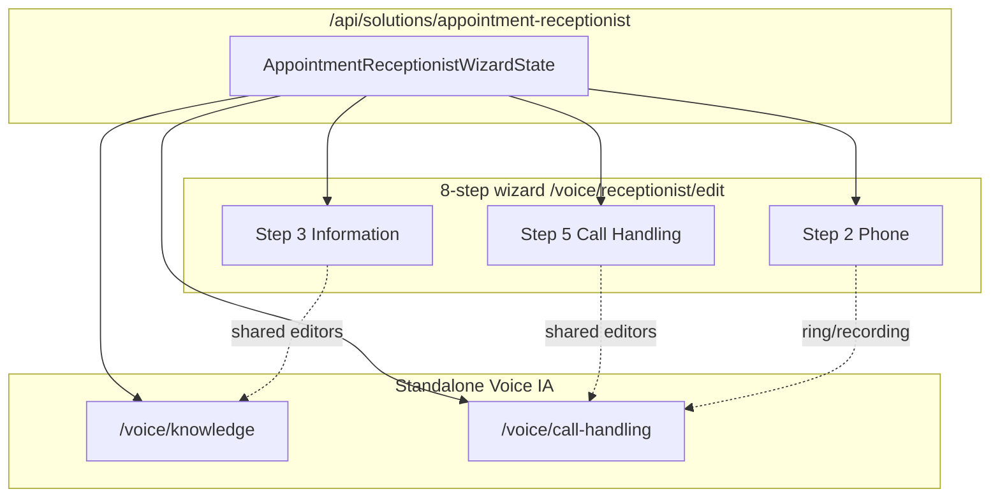

# Voice agent: wizard vs Business Knowledge vs Call Handling — overlap map

**Purpose:** Copy-paste reference for what overlaps between the 8-step receptionist wizard and the standalone Voice IA pages `/voice/knowledge` (Business Knowledge) and `/voice/call-handling` (Call Handling).

**Last updated:** 2026-09-27 (cloud agent session: Opus transplant + overlap audit)

---

## Single source of truth

All three surfaces read and write the same configuration domain:

| Layer | Location |
|-------|----------|
| React state | `AppointmentReceptionistWizardState` |
| Hook (Stage 2 pages) | `useAppointmentReceptionistWizard` — `src/lib/newui-transplant/hooks/use-appointment-receptionist.ts` |
| API | `/api/solutions/appointment-receptionist` (load/save draft) |
| Wizard shell | `AppointmentReceptionistWizard` — `src/components/solutions/appointment-receptionist/wizard.tsx` |
| Edit route (Opus 8-step) | `src/app/(app)/voice/receptionist/edit/page.tsx` → `NewUiVoiceReceptionistEditorPage` → `AppointmentReceptionistWizardOpusPage` → `presentation="opus"` |

**Implication:** Editing hours on Knowledge, toggles on Call Handling, or step 3/5 in the wizard all target the same persisted agent config (when saves run). Divergence is mostly **which controls are shown**, not separate databases.

---

## High-level diagram

---

## `/voice/knowledge` ↔ Wizard **Step 3 — Information**

| Concern | Wizard step 3 | Business Knowledge page | Notes |
|---------|---------------|-------------------------|-------|
| Business name, description, services | `knowledgeItems`, `businessName`, guided/website flows | DOM fields + `mergeDomIntoState` → same items | Knowledge page reads/writes via transplant wired props |
| Website URL + crawl | `websiteUrl`, `knowledgeSource: "website"`, crawl APIs | `onRecrawl` → `/api/voice/knowledge/crawl` | Same KB id |
| Upload documents | Upload flow in `information-step.tsx` | `onUploadClick` → `/api/voice/knowledge/:id/upload` | KB must exist (`linkedKnowledgeBaseId`) |
| Connect existing KB | `ConnectExistingKnowledge` → `/api/voice/knowledge` | Uses `state.linkedKnowledgeBaseId` + source list API | |
| Enable/disable KB for agent | `knowledgeBaseEnabled` | Implicit when saving knowledge step | |
| Knowledge source mode | `knowledgeSource` (`website`, `guided_profile`, `upload_docs`, `connect_data`) | Partially mirrored in UI actions (crawl, upload, FAQs) | Wizard is the full mode picker |
| FAQ / item list | `knowledgeItems` (incl. `faq-*`) | `onAddFaq`, FAQ section in mirror UI | |
| **Business hours / schedule** | **Inline `BusinessScheduleEditor`** on `operatingMaturity.businessSchedule` | **Display only** (`compileBusinessHoursAmyDisplay`); **`onEditHours` → `/voice/setup`** | **Not** inline on Knowledge page — hours edit is delegated to setup route, while wizard step 3 edits schedule in place |
| Knowledge gaps (runtime Q&A misses) | Not in wizard step 3 | `/api/voice/knowledge-gaps`, dismiss/resolve | **Knowledge-only** operational surface |
| Rich source manager / crawl summary | Basic in wizard | `loadSources`, crawl latest stats | **Knowledge-only** presentation |
| Persist helper | Wizard save on step advance | `persistKnowledgeWizardStep` (`knowledge-editor-persist.ts`), `wizardStepId: "knowledge"` | Same backend path |

### Shared components (both touch the same state fields)

- `BusinessScheduleEditor` — **wizard step 3 only** (not on Knowledge page UI)
- `information-step.tsx` — website, guided profile, upload, connect flows
- `src/newui-transplant/connected/voice/knowledge-page.tsx` — wires mirror page to wizard state

### Knowledge-only (not on wizard step 3)

- Open knowledge **gaps** inbox and resolution workflow
- Dedicated **sources** list with per-source status labels
- **Crawl summary** strip (pages indexed, last crawl time)
- Legacy path when Stage 2 off: `src/components/voice/knowledge/business-knowledge-editor.tsx`

### Wizard step 3-only (not on Knowledge page)

- Full **knowledge source** choice cards (website vs guided vs upload vs connect)
- **Side panel** / Opus dense panels for setup UX (presentation-dependent)
- Schedule editor **inline** with information gathering (vs Knowledge “edit hours” link away)

---

## `/voice/call-handling` ↔ Wizard **Step 5 — Call Handling**

| Concern | Wizard step 5 | Call Handling page | Notes |
|---------|---------------|-------------------|-------|
| Emergency / human transfer | `EmergencyTransferEditor`, `transferDestinations`, `transferTriggers` | `buildVoiceCallHandlingWired` + add target | Shared editor component |
| After-hours behavior | `AfterHoursBehaviorEditor` | Switches map into `operatingMaturity.afterHoursBehavior.whenClosed` | Same maturity object |
| On-call schedule | `OnCallScheduleEditor` | Partially via `aiAfterHours` / escalation switches | Wizard has full editor |
| After-hours notifications | `AfterHoursNotificationsEditor` | `textSummary` switch → `afterHoursNotificationEvents` | |
| Callback requests + required fields | `callbackRequestsEnabled`, `CallbackRequiredFieldsOpus` / `CallbackRequiredFieldsEditor` | May be absent or simplified on CH mirror | **Wizard-heavy** for field picker |
| Callback SLA | `CallbackSlaEditor` | Typically **wizard-only** | |
| Booking behavior toggles | `bookingBehavior.*` when `hasBookingCapability` | **Wizard-only** (ask day first, earliest 3, confirm, SMS) | |
| AI Call Recovery | `aiCallRecoveryEnabled`, consent mode, delay, continue over SMS | **Wizard-only** | |
| Urgency rules | `UrgencyRulesEditor` when `presentation === "mctb"` | `emergenciesOnly` switch on CH page | MCTB vs receptionist presentation differs |
| Sales / solicitation | `salesSolicitationEnabled` (mctb block) | `declineSolicitors` switch | Same field on receptionist CH |
| Spam policy | — | `blockSpam` → `spamLikelyPolicy` | **CH page** (not in standard wizard step 5 Opus grid) |
| Call recording | — | `recordCalls` → `callRecording` | Also on **wizard step 2 Phone** |
| Warm transfer whisper | `warmTransfer` | `whisper` switch | |
| Holiday schedule toggle | — | `holidaySchedule` mutates `businessSchedule.holidays` | CH convenience toggle |
| Ring team first / AI after hours | Partially in maturity editors | `ringTeamFirst`, `aiAfterHours` switches | |
| Recent transfers | — | `/api/voice/call-handling/recent-transfers` | **CH-only** ops/diagnostics |
| Ingress / routing panel | — | `OpusCallRoutingIngressPanel` below mirror | **CH-only** |
| Save | Wizard step save | `saveDraft("call-handling")` | Same API |

### Shared components

- `EmergencyTransferEditor`
- `AfterHoursBehaviorEditor`
- `OnCallScheduleEditor`
- `AfterHoursNotificationsEditor`
- Legacy when Stage 2 off: `src/components/voice/call-handling-operational-page.tsx`

### Wizard step 5-only

- Booking behavior matrix (when booking capability on)
- **AI Call Recovery** block
- **Callback SLA** editor
- Opus **CallbackRequiredFieldsOpus**
- Legacy/mctb: **UrgencyRulesEditor** block
- **SidePanel** “Call handling preview” (legacy presentation; Opus 8-step may hide or slim chrome)

### Call Handling page-only

- **Recent transfers** table
- **OpusCallRoutingIngressPanel** (ingress diagnostics)
- Aggregate **switches** UI (`onSwitchChange` in `call-handling-page.tsx`) for recording, spam, solicitors, holidays, ring team, etc.
- Operational copy tuned for “daily ops” not wizard stepper

---

## Wizard **Step 2 — Phone** overlap with Call Handling

| Field | Step 2 Phone | Call Handling page |
|-------|--------------|-------------------|
| `ringBehavior` / ring team seconds | Yes | `ringTeamFirst` switch (maturity) |
| `callRecording` | Yes | `recordCalls` switch |

Configure in either place only if both surfaces are shown to customers — otherwise prefer **one canonical home** per product IA (wizard for first-time setup; Call Handling for ongoing ops).

---

## Opus 8-step edit route (context)

- **Not** the 3-stage `ReceptionistEditorOpus` shell on `/voice/receptionist/edit`; that shell remains under `receptionist-editor/` for reuse.
- Hub components: `src/components/solutions/appointment-receptionist/wizard-opus-ui.tsx`
- Verify script: `node scripts/verify-opus-receptionist-wizard-components.mjs`
- Screenshots: `node scripts/capture-eight-step-opus-wizard.mjs` → `/opt/cursor/artifacts/eight-step-opus-wizard/01-goals.png` … `08-activate.png`

### Opus component map vs code (doc drift to fix separately)

See `docs/VOICE-AGENT-EIGHT-STEP-WIZARD-OPUS-COMPONENT-MAP.md` — update for:

- `OpusChoiceCard`, `OpusRadioRow`, `OpusVoicePickRow`, `OpusTableShell`, `OpusDividedList`, `OpusWarningPanel`, `OpusLinkTile`
- Goals step uses **FieldRow + Switch**, not choice-card grid on Opus 8-step
- Test step: **no SidePanel** on Opus path
- Shared sub-editors accept `presentation="opus"`

---

## File index (quick navigation)

| Surface | Primary files |
|---------|----------------|
| Wizard steps | `steps/information-step.tsx`, `steps/call-handling-step.tsx`, `steps/phone-step.tsx` |
| Stage 2 Knowledge | `src/newui-transplant/connected/voice/knowledge-page.tsx`, mirror `newui-transplant/mirror/routes/voice/knowledge/page` |
| Stage 2 Call Handling | `src/newui-transplant/connected/voice/call-handling-page.tsx`, `lib/newui-transplant/adapters/voice-call-handling.ts` |
| Shared maturity | `operating-maturity-editor.tsx` (`BusinessScheduleEditor`, `AfterHoursBehaviorEditor`, …) |
| Types | `src/lib/solutions/appointment-receptionist/types.ts` |

---

## Product / IA takeaway

1. **Do not build a second config store** for Knowledge or Call Handling — extend `AppointmentReceptionistWizardState` and shared editors.
2. **Hours inconsistency:** wizard step 3 edits schedule inline; Knowledge page links to `/voice/setup` for hours — intentional or consolidation candidate.
3. **Call Handling page** is a superset of **switches + ops** (spam, recording, recent transfers, ingress); wizard step 5 is a superset of **booking + AI recovery + SLA + callback field UX**.
4. For parity audits, use `docs/VOICE-AGENT-EIGHT-STEP-WIZARD-TO-NEW-IA-PARITY-AUDIT.md` alongside this doc.
