# Advanced Scheduling — Phase 2/3 UX Architecture & Screen Inventory

**Status:** Deliverable 1 (architecture only — **no UI implementation in this pass**)  
**Deliverable 2 layout + Opus binding:** `docs/audits/advanced-scheduling-new-ui2-opus-implementation-spec.md`  
**Wireframes:** `docs/audits/assets/advanced-scheduling-wireframes-reference.jpg`  
**Date:** 2026-10-13  
**Backend baseline:** PR **#657** (`cursor/ar-package-phase0-1a-f350`) — Phases 0, 1a, 1b, 1c integration-readiness (not merged; production app still on prior image)  
**Prerequisites:**  
- `docs/audits/advanced-scheduling-implementation-spec.md`  
- `docs/audits/advanced-scheduling-workflow-audit.md`  
- `docs/audits/advanced-scheduling-customer-acceptance.md`  
**Design system:** New UI2 Opus via `SchedulingPageGate` + `src/newui-transplant/connected/scheduling/*`  
**Primary acceptance scenario:** **IT Career Starter** (`ADV-CUST-IT-STARTER`, `ADV-BIZ-PKG-001`)

---

## 0. Purpose and boundaries

This document maps **every business and customer screen** required for Phase 2 (guided business setup) and Phase 3 (customer portal, passwordless access, mobile polish) while **preserving** advanced scheduling already built in Phases 0–1c.

| In scope (this deliverable) | Out of scope (this pass) |
|-----------------------------|---------------------------|
| Route/component inventory | UI code changes |
| Journey maps (9 flows) | Merge PR #657 |
| Screen-by-screen specifications | Coolify deploy |
| Navigation & interaction architecture | Live Stripe E2E on production |
| Gap analysis (honest readiness) | Redesign implementation |
| Coordinated implementation plan + acceptance criteria | Fixing unrelated CI (voice-agent-runtime, number-marketplace) |

**Release gates (separate workstream):** merge #657 → deploy → confirm `GET /api/health` commit SHA → Stripe **test-mode** purchase → fulfillment → enrollment → customer account journey with reload verification.

**UX rules (locked for Phase 2/3 build):**

- One dominant working area; progressive disclosure; contextual controls (avoid crowded three-column layouts and card walls).
- Opus decoration and polish **retained** — do not flatten to generic admin UI.
- Package creation must support **inline** creation of missing services/classes (side panel or embedded mini-wizard), not forced navigation away from the sell flow.
- Customers must **not** type package redemption codes when entitlements can be resolved by verified identity.
- **Email alone is not proof of entitlement ownership** — passwordless access requires verified channel (OTP/magic link to email **and** optional phone verification where policy requires).
- **UI exists ≠ feature complete** — each row in gap analysis states runtime truth.

---

## 1. Architecture overview

```mermaid
flowchart TB
  subgraph business [Business admin - Opus shell]
    SellHub["/appointments/sell (proposed)"]
    PkgWiz["/appointments/packages/new"]
    MemWiz["/appointments/memberships/new"]
    ClsWiz["/appointments/classes/new"]
    WksWiz["/appointments/workshops/new"]
    SvcWiz["/appointments/services/new"]
    Commerce["/appointments/commerce"]
    ClassesWS["/appointments/classes"]
    Clients["/appointments/clients"]
  end

  subgraph public [Customer public]
    Store["/book/slug/store"]
    Book["/book/slug"]
    ClassesPub["/book/slug/classes"]
    WorkshopsPub["/book/slug/workshops"]
    PayOK["/book/payment/success"]
  end

  subgraph portal [Customer account]
    Login["/client/slug"]
    PortalApp["/client"]
    TokenPortal["/portal/token"]
    ManageAppt["/appointments/manage/token"]
  end

  subgraph api [Authoritative APIs]
    SB["/api/appointments/service-booking/*"]
    PubBook["/api/public/book/slug/*"]
    PortalAPI["/api/client/portal/*"]
  end

  SellHub --> PkgWiz
  SellHub --> MemWiz
  SellHub --> ClsWiz
  PkgWiz --> SB
  Store --> PubBook
  ClassesPub --> PubBook
  Book --> PubBook
  Login --> PortalAPI
  PortalApp --> PortalAPI
  Clients --> SB
```



**Chrome pattern:** Almost all authenticated scheduling routes render through `SchedulingPageGate` (`src/lib/appointments/scheduling-page-gate.tsx`) choosing **Opus** vs **legacy** connected shells. Gates are centralized in `scheduling-unified-gates.tsx`.

**Bookable object IA:** Meetings, services, classes, workshops each have list / `new` / `[id]` routes (`bookable-workspace-routes.ts`, `bookable-object-ia.ts`). Legacy `/appointments/types` is redirect-only.

---

## 2. Route and component inventory

### 2.1 Business — primary scheduling routes (New UI2 Opus gate)

| Route | Page module | Opus surface | Legacy / connected | Primary APIs / lib |
|-------|-------------|--------------|-------------------|-------------------|
| `/appointments/commerce` | `commerce/page.tsx` | `CommerceHubOpus` | `ServiceBookingAdminClient` | Service-booking admin sections |
| `/appointments/service-booking` | `service-booking/page.tsx` | `CommerceHubOpus` | same | Categories, coupons, theme, reports |
| `/appointments/packages` | `packages/page.tsx` | `PackagesCatalogOpus` | `PackagesCatalogConnected` | `GET/POST /api/appointments/service-booking/packages` |
| `/appointments/packages/new` | `packages/new/page.tsx` | *(wizard uses pilot CSS)* | `CreatePackageWizard` | `package-form.ts`, `packages.ts` |
| `/appointments/packages/[id]` | *(catalog deep link)* | via catalog | `PackageEditorConnected` | Package CRUD, credit rules |
| `/appointments/memberships` | `memberships/page.tsx` | `MembershipsCatalogOpus` | `MembershipsCatalogConnected` | `memberships.ts` |
| `/appointments/memberships/new` | `memberships/new/page.tsx` | — | `CreateMembershipWizard` | Membership product + Stripe |
| `/appointments/classes` | `classes/page.tsx` | `ClassesWorkspaceOpus` | `ClassesWorkspaceConnected` | `classes.ts`, capacity, recovery panel |
| `/appointments/classes/new` | `classes/new/page.tsx` | — | Create class wizard | `ClassSeries`, occurrences |
| `/appointments/classes/[id]` | `classes/[id]/page.tsx` | Opus workspace | Connected + sections | Enrollment, payment mode metadata |
| `/appointments/workshops` | `workshops/page.tsx` | `WorkshopsWorkspaceOpus` | `WorkshopsWorkspaceConnected` | Same as classes (`metadata.kind`) |
| `/appointments/workshops/new` | `workshops/new/page.tsx` | — | Create workshop wizard | Same |
| `/appointments/services` | `services/page.tsx` | `ArServicesWorkspaceOpus` | `ServicesWorkspaceConnected` | Voice services / booking types |
| `/appointments/services/new` | `services/new/page.tsx` | — | `CreateServiceWizard` | Service config |
| `/appointments/meetings` | `meetings/page.tsx` | `ArMeetingsWorkspaceOpus` | `MeetingsWorkspaceConnected` | Meeting booking types |
| `/appointments/meetings/new` | `meetings/new/page.tsx` | `ArMeetingCreateOpus` | `CreateMeetingWizard` | Meeting config |
| `/appointments/clients` | `clients/page.tsx` | `ClientsDirectoryOpus` | `ClientsConnected` | Contacts |
| `/appointments/clients/[clientId]` | `clients/[clientId]/page.tsx` | `ClientDetailOpus` | Client detail | Packages, memberships, appointments |
| `/appointments/booking` | `booking/page.tsx` | `BookingSettingsOpus` | `AppointmentBookingSettingsClient` | Public book config |
| `/appointments/booking/share` | `booking/share/page.tsx` | `BookingShareOpus` | `BookingShareHubClient` | URLs, embed |
| `/appointments/booking/branding` | `booking/branding/page.tsx` | `ServiceBookingAdminOpus` theme | Admin client | Scheduler theme |
| `/appointments/pricing-payments` | `pricing-payments/page.tsx` | `PricingPaymentsOpus` | `PricingPaymentsClient` | Stripe Connect, Square |
| `/appointments/payments` | `payments/page.tsx` | `PaymentPlansGate` | Payment plans section | Plans |
| `/appointments/calendar` | `calendar/page.tsx` | Calendar connected (Kimi) | — | Operational calendar |
| `/appointments/scheduled` | `scheduled/page.tsx` | Scheduled list Opus | List connected | Appointments list |
| `/appointments/setup` | `setup/page.tsx` | `SetupOpus` | Setup client | Onboarding checklist |
| `/appointments/commerce/contact-merge` | `commerce/contact-merge/page.tsx` | `ContactMergeOpus` | `ContactMergeClient` | Contact merge |

**Proposed (Phase 2 — not in repo yet):**

| Route | Purpose | Reuses |
|-------|---------|--------|
| `/appointments/sell` or `/appointments/setup/sell` | Task-based “what do you want to sell?” orchestrator | All `create-*-wizard.tsx` components |
| `/appointments/sell/[taskId]` | Deep link resume for incomplete sell flows | Session state server-side |

### 2.2 Business — supporting routes (same Opus gate pattern)

Availability (`/appointments/availability`, staff, locations, resources, routing), waitlist, workflows, automations, analytics (`/appointments/analytics/*`), policies, forms, enterprise, POS, recalls, coupons, categories, restrictions — each mapped in `scheduling-unified-gates.tsx`. These remain **power-user** destinations; Phase 2 must not require visiting them for core “sell package / class / membership” journeys.

**Operator exception handling (post–#657):** `ClassRegistrationRecoveryPanel` in `classes-workspace-connected.tsx` → `GET/POST /api/appointments/service-booking/registration-recovery` (`registration-recovery.ts`). Surfaces paid-but-not-enrolled rows for manual retry (no auto-refund in UI).

### 2.3 Public customer routes

| Route | Component | APIs |
|-------|-----------|------|
| `/book/[slug]` | `PublicBookingConnected` → `public-booking-opus-view` | `/api/public/book/[slug]/*` |
| `/book/[slug]/[serviceId]` | `PublicBookingServiceConnected` | Slot find, book POST, entitlements |
| `/book/[slug]/store` | `public-store-checkout-client` | Store products, Stripe Checkout session |
| `/book/[slug]/classes` | `public-group-enrollment-client` | Classes list, enroll, checkout redirect |
| `/book/[slug]/workshops` | Workshop wrapper + same client | Workshops API |
| `/book/payment/success` | Payment return handler | Fulfillment by session id |
| `/book/payment/canceled` | Canceled checkout | — |
| `/embed/book/[slug]` | `public-embed-booking-connected` | Embed book |
| `/appointments/manage/[token]` | Manage appointment (AR) | Public manage API |
| `/portal/[token]` | `ClientPortalPublicClient` | Legacy token portal view |
| `/client` | `ClientPortalApp` | `/api/client/portal/*` (cookie session) |
| `/client/[slug]` | `ClientPortalLogin` | OTP login `/api/client/portal/auth/login/[slug]` |
| `/client/appointments/[appointmentId]` | `ClientPortalAppointmentDetail` | Portal appointment actions |

### 2.4 Key shared libraries (do not duplicate in UI)

| Domain | Module path |
|--------|-------------|
| Packages & ledger | `src/lib/appointments/service-booking/packages.ts`, `package-form.ts`, `entitlements.ts`, `booking-entitlements.ts`, `package-credit-redeem.ts` |
| Store checkout | `store-checkout.ts`, `store-fulfillment.ts` |
| Classes | `classes.ts`, `class-registration-capacity.ts`, `class-registration-checkout.ts`, `group-registration-entitlements.ts` |
| Memberships | `memberships.ts`, `membership-booking.ts`, `membership-stripe-webhook.ts` |
| Portal | `client-portal/workspace.ts`, `client-portal/auth.ts`, legacy `service-booking/client-portal.ts` |
| Public offerings | `public-group-offering.ts`, `public-class-registration-api.ts` |

---

## 3. Business and customer journey maps

### Journey 1 — Business publishes a prepaid appointment package (pooled sessions)

| Step | Actor | Screen | Exit |
|------|-------|--------|------|
| 1 | Business | Commerce hub or Packages catalog → **New package** | `/appointments/packages/new` |
| 2 | Business | Wizard step **What you sell** → template **Prepaid sessions** | Sets `packageKind: pooled` |
| 3 | Business | **What's included** → select services/meetings | If empty → **inline create service** (Phase 2) |
| 4 | Business | **Price & validity** + Stripe connected check | Block publish if price > 0 and no Stripe |
| 5 | Business | **Review** → save → active + `directPurchase` | Store URL |
| 6 | Business | Optional: client record after first sale | `/appointments/clients/[id]` entitlements |

**Acceptance:** `ADV-BIZ-PKG-001` (pooled variant), `ADV-PKG-001`.

### Journey 2 — Business publishes mixed itemized package (services + classes + courses)

| Step | Actor | Screen | Notes |
|------|-------|--------|-------|
| 1 | Business | Wizard template **Mix services and classes** or **Bundle classes & workshops** | `packageKind: itemized` |
| 2 | Business | Per-line quantity steppers (`itemizedQuantityKey`) | IT Career Starter: 1× cyber class, 1× Python course, 3× tutoring |
| 3 | Business | Ensure offerings exist | Inline **Create class** / **Create service** without leaving wizard |
| 4 | Business | Publish | `creditRules` mint `type:{id}` and `series:{id}` keys (#657) |
| 5 | Customer | (Journey 6) | Redeem per bucket |

**Acceptance:** `ADV-CUST-IT-STARTER`, `ADV-PKG-002`, `ADV-BIZ-PKG-001` (bundle template).

### Journey 3 — Business creates a paid class or workshop

| Step | Actor | Screen | Backend |
|------|-------|--------|---------|
| 1 | Business | `/appointments/classes/new` or workshops/new | `ClassSeries` + recurrence |
| 2 | Business | Editor: capacity, schedule, **payment mode** | `paymentMode: pay_at_registration` \| `free` \| `package_or_membership_only` |
| 3 | Business | Pricing, deposit if supported | `priceCents` in series metadata |
| 4 | Business | Publish / share link | `/book/[slug]/classes` |
| 5 | Customer | Paid path → Stripe Checkout → return `?checkout=success` | `class-registration-checkout.ts` (#657) |

**Acceptance:** `ADV-CLS-PAY-001`, `ADV-MOB-PKG-001` on class register path.

### Journey 4 — Business creates and sells a multi-session course

| Step | Actor | Screen | Backend |
|------|-------|--------|---------|
| 1 | Business | Class wizard + **require full series** | `enrollFullSeries` |
| 2 | Business | Option A: itemized package 1× `series:{id}` on store | Store fulfillment |
| 2b | Option B | `pay_at_registration` on series | Course checkout |
| 3 | Customer | Single **Enroll in full course** CTA | `enrollFullSeriesAtomic` (#657) |
| 4 | Business | Classes workspace → roster per occurrence | Enrollments list |

**Acceptance:** `ADV-CRS-001`, `ADV-CRS-002`.

### Journey 5 — Business creates recurring membership with service and class benefits

| Step | Actor | Screen | Backend |
|------|-------|--------|---------|
| 1 | Business | `/appointments/memberships/new` | `ServiceMembershipProduct` |
| 2 | Business | Benefits: included credits, discounts, member-only types **and class series** | `MembershipBenefits` JSON |
| 3 | Business | Publish to store | Subscription checkout |
| 4 | Customer | Store → Stripe subscription | Webhooks reset period usage |
| 5 | Customer | Book service / register for class | `membership-booking.ts` + class POST (#657 class credits) |

**Acceptance:** `ADV-MEM-CLS-001`, existing `APT-MEM` rows with reload.

### Journey 6 — Customer discovers, purchases, and books an offer

| Step | Channel | Screen | Entitlement resolution |
|------|---------|--------|------------------------|
| 1 | Marketing link | Store and/or book hub | — |
| 2 | Store | Package/membership/gift checkout | Contact created/linked |
| 3 | Success | `/book/payment/success` | Durable `ServiceBookingStoreFulfillment` (#657) |
| 4 | Book | `/book/[slug]` with contact hints (phone/email cookie or verified session) | `lookupBookingEntitlements` |
| 5 | Class | `/book/[slug]/classes` with package/membership picker | Combined prompt (#657) |
| 6 | Confirm | Booking confirmation + manage link | No manual codes |

**Acceptance:** `ADV-CUST-IT-STARTER` steps 1–5; **gate:** Stripe E2E on deployed app not yet certified.

### Journey 7 — Returning customer accesses benefits (passwordless)

| Step | Screen | Requirement |
|------|--------|-------------|
| 1 | `/client/[slug]` | Enter email |
| 2 | OTP / magic link | **Verify** possession of email (existing `ClientPortalLogin`) |
| 3 | `/client` | Cookie session `CLIENT_PORTAL_COOKIE` |
| 4 | **My access** section | Itemized remaining credits + memberships |
| 5 | Deep link to book | `bookUrlWithContact` — entitlements API scoped to **session contact** |

**Gap:** Post-login book flow must not trust email query param alone on public book; session or signed token must bind contact (#657 partial — entitlements by contact id).

**Phase 3:** Optional SMS OTP step for high-value bundles; rate limiting; device binding policy documented in security review.

### Journey 8 — Customer books, sees credits, manages upcoming sessions

| Area | Current UI | Target (Phase 3) |
|------|------------|------------------|
| Service appointments | `ClientPortalApp` appointments tabs | Keep; link to manage URL |
| Package balances | `access` section — summary from entitlements | **Per-line itemized** breakdown |
| Class enrollments | **Missing** in `buildClientPortalWorkspace` | New section: upcoming/past by series |
| Book more | Links to `/book/[slug]` | Pre-filter eligible offerings |
| Attendance | Not customer-facing | Optional “checked in” read-only when business enables |

**Acceptance:** `ADV-CUST-IT-STARTER` steps 6–7; portal reload shows correct balances after each redeem.

### Journey 9 — Business manages sales, enrollment, attendance, exceptions

| Task | Screen | Actions |
|------|--------|---------|
| Sales | Commerce hub, client detail, payments | View Stripe status, package purchases |
| Enrollment | Classes/workshops workspace | Roster, waitlist, capacity |
| Paid failure | **Registration recovery panel** | Retry fulfillment enrollment |
| Balances | Client detail + package editor | Adjust ledger (existing admin) |
| Attendance | Class occurrence detail (workspace section) | Mark attended / no-show |
| Exceptions | Recovery panel + support runbook | Manual retry; refund via Stripe dashboard (documented) |

**Acceptance:** Operator can clear `ADV-PAY-SEAT-001` failure mode with visible row + retry.

---

## 4. Screen-by-screen specifications

Format per screen: **Goal** | **Layout** | **Content** | **States** | **Container** | **Reuse / change**

### 4.1 Proposed — Sell orchestrator (`/appointments/sell`)

| Attribute | Specification |
|-----------|---------------|
| **Goal** | Choose commercial intent without learning commerce hub topology |
| **Layout** | Full page, single column, Opus hero + large choice cards (not 3-column grid) |
| **Content** | Cards: Prepaid sessions · Itemized bundle · Membership · Single class/workshop · Full course · *(optional)* Gift certificate |
| **Prerequisites** | Inline Stripe status chip; link to connect if disconnected |
| **States** | Loading workspace readiness; empty (new business); error retry |
| **Container** | Full page |
| **Reuse** | New thin orchestrator only; routes into existing wizards with `?template=` and `returnTo=` |

### 4.2 Package create wizard (`/appointments/packages/new`) — **exists**

| Step | Fields / controls | Interaction |
|------|-------------------|-------------|
| 0 What you sell | 3 templates (`SELL_TEMPLATES`) | Sets `packageKind` via `applyPackageSellTemplate` |
| 1 What's included | `PackageEligibilitySection` — services, meetings, classes, workshops | Multi-select lists; **add** inline create (Phase 2) |
| 1b Quantities | Per-offering steppers when itemized | Hidden for pooled |
| 2 Price & validity | Price, currency, expiration, tax flags | `NumberField`, date |
| 3 Review | Human-readable inclusion list + store preview | Publish → catalog |

| States | Empty offerings → CTA “Create your first service” opens **side panel** wizard; validation errors inline; saving spinner |
| Mobile | Single column; sticky footer **Back / Continue** |
| Must not lose | Advanced editor link “Open full package editor” after create |

### 4.3 Packages catalog (`/appointments/packages`) — **exists**

| Goal | List packages, status, store visibility, duplicate, archive |
| Primary table | Name, kind (pooled/itemized), price, active, purchases count, actions |
| Actions | Edit, copy store link, view sales |
| Empty | Illustration + **Create package** → wizard |

### 4.4 Package editor (catalog detail) — **exists**

| Sections | Basics, credit rules, eligibility, lifecycle policy, store settings |
| Power users | Raw credit rules view (read-only JSON) optional advanced accordion |

### 4.5 Membership create wizard — **exists**

| Steps | Plan basics → benefits (credits, discounts, member-only offerings) → billing interval → review |
| Phase 2 enhancement | Class series picker in benefits (parity with services) with clear period reset copy |

### 4.6 Classes / workshops workspace — **exists**

| Regions | List panel + detail editor (sections: schedule, capacity, pricing, registration, roster) |
| New (#657) | **Registration recovery** table: contact, series, Stripe session, status, **Retry enrollment** |
| Payment mode | Dropdown: free / pay at registration / package or membership only |
| Full course | Toggle `requireFullSeries` + copy explaining one enrollment action |

### 4.7 Commerce hub — **exists**

| Role | Matrix of commerce capabilities with deep links |
| Phase 2 | Reorder to match sell journeys; badge “ready to sell” vs “needs setup” per row |

### 4.8 Public store (`/book/[slug]/store`) — **exists**

| Goal | Browse SKUs (packages, memberships, gifts) |
| Content | Product cards with plain-language inclusions for itemized |
| Checkout | Stripe hosted checkout |
| Success | Redirect to success URL with session id; fulfillment idempotent |

### 4.9 Public book hub (`/book/[slug]`) — **exists**

| Goal | Pick offering type (service/meeting/class links) |
| Phase 3 | If verified portal session, show **Your benefits** strip with remaining counts |

### 4.10 Public class/workshop enrollment — **exists, enhanced #657**

| Goal | Register for occurrence or full series |
| Content | Occurrence list, price badge by `paymentMode`, capacity |
| Entitlement | Modal/sheet when multiple packages/memberships — **combined picker** |
| Paid | Redirect `checkoutUrl`; return handler enrolls on success |
| States | Sold out, waitlist, closed, payment required, entitlement required |
| Mobile | Single column list; sticky register CTA |

### 4.11 Client portal login (`/client/[slug]`) — **exists**

| Goal | Passwordless verify email |
| Flow | Email → OTP → cookie session |
| Security copy | Do not claim email proves purchase; only proves account access |
| Phase 3 | Rate limit UI; “resend code” cooldown |

### 4.12 Client portal home (`/client`) — **exists, extend**

| Sections | Home, Appointments, Forms, **My access**, Payments, Profile |
| My access — target | Table: Offering · Remaining · Expires · **Book** CTA per row |
| New | **Classes & courses** subsection: series name, next session, location |
| Empty | Link to store |

### 4.13 Client detail (business) (`/appointments/clients/[id]`) — **exists**

| Goal | Single pane: contact, appointments, packages, memberships, payments |
| Phase 2 | Highlight itemized balances; link to recovery issues if any |

---

## 5. Navigation and interaction architecture

### 5.1 Business IA (target)

| Tier | Items | Rationale |
|------|-------|-----------|
| **Primary** | Calendar, Appointments, **Sell** (new), Booking, Clients, Commerce (collapsed) | Daily ops + revenue |
| **Secondary** | Availability, Reminders, Workflows, Analytics | Power features |
| **Tertiary** | Settings, Integrations | Admin |

**Do not remove** existing nav entries — **feature-gate** or nest under Commerce until Phase 2 sell hub proves coverage.

### 5.2 Interaction container rules

| Pattern | Use when |
|---------|----------|
| **Full page** | Wizards, catalog lists, public book flows, portal |
| **Side panel (drawer)** | Inline create service/class from package wizard; quick edit from roster |
| **Modal** | Confirm destructive actions; entitlement picker when ≤3 choices can be radio modal |
| **Bottom sheet (mobile)** | Entitlement picker, register CTA |
| **Dropdown** | Row actions in tables; status filters |

### 5.3 Cross-links (required)

| From | To |
|------|-----|
| Package review | Store URL, test purchase (staging) |
| Class editor | Public class URL, related package SKU |
| Client detail | Portal invite (email OTP), book deep link |
| Recovery panel | Stripe session, client detail |
| Portal My access | `/book/[slug]/...` with session-bound entitlements |

### 5.4 Public ↔ portal identity binding

```text
Purchase (store) → contactId in fulfillment
       ↓
Optional: send portal invite email (OTP)
       ↓
Verified session (cookie) → entitlements API uses session.contactId
       ↓
Book / enroll POST includes session auth OR signed contact token
```

**Prohibited:** `?email=` alone unlocking entitlements on public book.

---

## 6. Gap analysis (honest readiness)

Legend: **Shipped** (in #657 branch) · **UI only** · **Partial** · **Missing** · **Prod unverified**

| Capability | UI | Backend (#657) | Production deploy | Notes |
|------------|----|----------------|-------------------|-------|
| Pooled package wizard | Shipped | Shipped | Unverified E2E | Works on cert DB |
| Itemized package mint/redeem | Shipped | Shipped | Unverified E2E | Key compat script PASS |
| Store Stripe checkout | Shipped | Shipped + durable fulfillment | **Stripe E2E not run on deploy** | Launch gate |
| Paid class checkout | Shipped | Shipped | Unverified | Cert 1b isolated PASS |
| Full course atomic enroll | Shipped | Shipped | Unverified | |
| Capacity / race safety | Shipped | Shipped (advisory locks) | Migration applied | App code not deployed |
| Membership class credits | Partial UI | Shipped hooks | Unverified | `ADV-MEM-CLS-001` |
| Public entitlement picker | Shipped | Shipped | Unverified | Package + membership |
| Operator recovery | Shipped | Shipped | Unverified | No refund button |
| Sell orchestrator `/appointments/sell` | Missing | N/A | — | Phase 2 |
| Inline create in package wizard | Missing | N/A | — | Phase 2 |
| Portal class enrollments | Missing | Data exists | — | Phase 3 |
| Portal itemized breakdown | Partial | API can return | — | Phase 3 presentation |
| Passwordless portal | Shipped OTP | Shipped | Unverified | Harden rate limits Phase 3 |
| Email-only entitlement on book | Partial risk | Session binding needed | — | Audit public book query params |
| Class reminder notifications | Partial | Events defined | — | APT-NOT gaps |
| AI rescheduler for classes | N/A | Appointments only | — | Out of scope |

**Workflow audit staleness:** `advanced-scheduling-workflow-audit.md` predates #657; treat **this section** as superseding readiness for paid class, itemized mint, idempotency, and capacity.

---

## 7. IT Career Starter — end-to-end screen trace

**Business setup (ADV-BIZ-PKG-001 + offerings):**

1. Create services: 3× tutoring (`/appointments/services/new`).
2. Create class: Cybersecurity workshop (`/appointments/classes/new`).
3. Create course: Python multi-session (`requireFullSeries`).
4. Create package (`/appointments/packages/new` → **Mix services and classes**): 1× cyber series, 1× Python series, 3× tutoring type; price; publish.
5. Copy store link from review (`/book/{slug}/store`).

**Customer (ADV-CUST-IT-STARTER):**

1. Store → buy package → payment success.
2. `/book/{slug}/classes` → enroll cyber (package picker if multiple).
3. Enroll Python full course (single action).
4. `/book/{slug}` → book tutoring until 3 credits consumed.
5. `/client/{slug}` → OTP login → **My access** shows remaining per line.
6. Return week later → balances persist; book remaining sessions.

**Business verification:**

- Client record shows purchase, ledger entries, enrollments, remaining credits.
- Recovery panel empty unless simulated failure.

---

## 8. Coordinated implementation plan (Deliverable 2 — not started)

### Phase 2 — Guided business setup (estimated work packages)

| WP | Deliverable | Depends on | Acceptance |
|----|-------------|------------|------------|
| 2.1 | `/appointments/sell` orchestrator + nav entry | #657 merged | Business completes ADV-BIZ-PKG-001 without visiting commerce hub |
| 2.2 | Inline offering creation side panels in package wizard | 2.1 | Create service/class without route change |
| 2.3 | Readiness chips (Stripe, offerings, store) on sell + commerce | 2.1 | Block publish with actionable fix links |
| 2.4 | Client detail entitlement UX for itemized | #657 | Operator sees same keys as customer portal will |

### Phase 3 — Customer self-service

| WP | Deliverable | Depends on | Acceptance |
|----|-------------|------------|------------|
| 3.1 | `buildClientPortalWorkspace` + UI: class enrollments | #657 | Portal lists next class session |
| 3.2 | Itemized **My access** table | 3.1 | ADV-CUST-IT-STARTER step 6 |
| 3.3 | Session-bound entitlements on public book (remove email trust) | 3.1 | Security review checklist |
| 3.4 | Mobile pass on store, classes, portal | 3.1–3.3 | ADV-MOB-PKG-001 |
| 3.5 | Post-purchase landing (“what to do next”) | Store success | Reduces support tickets |

### Release train (recommended order)

1. Merge **#657** + deploy + **Stripe test E2E** (gate).  
2. Phase **2.1–2.3** (sell hub + inline create).  
3. Phase **3.1–3.3** (portal truth).  
4. Phase **3.4–3.5** (mobile + polish).  

### Certification bundle (pre-launch marketing)

| Script / journey | When |
|------------------|------|
| `cert-advanced-scheduling-phase-1b.ts` | CI on isolated DB |
| `cert-advanced-scheduling-phase-1c.ts` | CI on isolated DB |
| `cert-advanced-scheduling-integration.ts` | CI on isolated DB |
| `cert-package-credit-keys-compat.ts` | Every PR touching redeem |
| **Manual** Stripe test checkout on staging/production | After deploy |
| `ADV-CUST-IT-STARTER` | QA with reload |
| `ADV-PAY-SEAT-001` | Staging load or manual |

### CI unrelated failures (track separately)

- **voice-agent-runtime** — assess whether release branch requires green; no AR code dependency assumed.  
- **number-marketplace** — same; document in release notes if blocking.

---

## 9. Acceptance criteria summary (Phase 2/3 program complete)

| ID | Criterion |
|----|-----------|
| ADV-BIZ-PKG-001 | Business publishes itemized IT-style bundle ≤4 customer-visible wizard steps |
| ADV-CUST-IT-STARTER | Full customer journey with portal balances and no codes |
| ADV-CLS-PAY-001 | Paid drop-in cannot enroll without payment proof |
| ADV-CRS-001 | One payment → all session enrollments |
| ADV-MEM-CLS-001 | Membership class credits enforce period limit |
| ADV-PAY-SEAT-001 | Last-seat race handled with recovery visible to operator |
| ADV-MOB-PKG-001 | IT starter steps 1–4 on 390px width |
| ADV-PORT-CLS-001 | *(new)* Portal shows class enrollments and next session |
| ADV-IDENT-001 | *(new)* Public book does not honor unverified email alone for entitlements |

---

## 10. Document maintenance

- Update this file when Deliverable 2 ships screens (append **As-built** column to §2 tables).  
- When production commit matches #657, change §6 production column from “not deployed” to verified SHA.  
- Link PR and Coolify health check in `docs/V1-PRODUCTION-CERTIFICATION.md` when Stripe E2E completes.

---

*Architecture pass complete. No application UI code was modified. Implementation awaits review of this blueprint and separate authorization to merge/deploy #657.*
