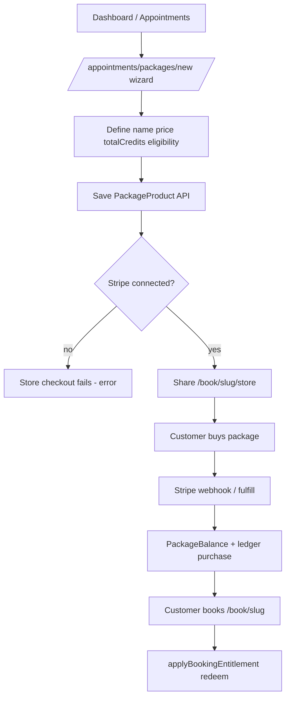

# Transovo — Advanced Scheduling Workflow Audit

**Date:** 2026-10-13  
**Scope:** Packages, memberships, classes, workshops, multi-session programs, and dependencies (services, public booking, payments, client accounts, notifications, recurring billing).  
**Mode:** Audit only — no product code changes in this pass.  
**Evidence:** Prisma models, `src/lib/appointments/service-booking/*`, public APIs under `src/app/api/public/book/[slug]/*`, admin UI (`src/components/appointments/*`, `src/newui-transplant/connected/scheduling/*`), certification matrices (`docs/ACUITY-PARITY-MATRIX.md`, `docs/SERVICE-BOOKING-COMPETITIVE-PARITY-MATRIX.md`).  
**Runtime verification:** Cloud agent environment has no `DATABASE_URL`; `scripts/cert-service-booking-entitlements.ts` could not run. Matrix `PASS` rows are **documented certification claims**, not re-verified in this audit run.

---

## A. Executive Summary

Transovo already ships a **substantial service-booking platform**: canonical Prisma models for packages (`PackageProduct`, `PackageBalance`, `PackageLedgerEntry`), memberships (`ServiceMembershipProduct`, `ServiceMembershipSubscription`), and group offerings (`ClassSeries`, `ClassOccurrence`, `ClassEnrollment`), plus server modules in `src/lib/appointments/service-booking/` and public routes for booking, store checkout, classes, and workshops.

**What appears operational (backend + wired UI, per repo and matrices):**

- **Pooled prepaid packages** tied to contacts (no redemption codes) with ledger redeem/restore on appointments.
- **Public store** for package, gift, and membership purchase via **Stripe Connect** (`store-checkout.ts`).
- **Membership subscriptions** with Stripe webhooks, period usage counters, discounts, and member-only gates.
- **Class/workshop series** with occurrences, capacity checks, full-series enrollment, waitlist fallback, seat maps, and **package credit** redemption (pooled credits only).
- **Create wizards** for services, packages, memberships, classes, and workshops (`/appointments/*/new`).
- **Client portal** showing appointments, package balances, and membership status (`buildClientPortalWorkspace`).

**Partially implemented or disconnected:**

- **Paid class/workshop registration without a package** — public enrollment UI posts to `/api/public/book/[slug]/classes|workshops` with **no payment step** (`public-group-enrollment-client.tsx`); price is display-only.
- **Itemized multi-service bundles** (e.g. “1 Python + 1 Cyber + 3 tutoring”) — `PackageCreditRule` supports multiple keys, but the **default package editor** builds one **pooled** `totalCredits` bucket plus eligibility rules with `quantity: 0` (`package-form.ts` `buildCreditRules`). `purchasePackageForContact` mints keys from `bookingTypeId | serviceName | default` only — **not `classSeriesId`** (`packages.ts`).
- **Class enrollments in client portal** — portal loads `voiceAppointment` only; `ClassEnrollment` is not surfaced.
- **Store idempotency** — `fulfilledSessions` is an in-process `Set` in `store-checkout.ts` (lost on restart; not durable across instances).
- **Capacity races** — `enrollInClass` checks capacity then inserts; no DB transaction/`FOR UPDATE` in `classes.ts`.
- **Square** — appointment payments can target Square (`types.ts`); **store checkout is Stripe-only** (`getMerchantConnection(..., "STRIPE")`).

**Confusing / UX-heavy for new customers:**

- Large **scheduling surface area** (commerce hub, many accordion routes) without a single **task-based** “sell packages / run classes” journey (wizards exist per object but prerequisites are scattered).
- **Two mental models for packages** (pooled credits vs per-type quantities) are easy to misconfigure; UI emphasizes pooled credits.
- **Purchase vs book** for classes: store sells packages; class page enrolls without payment — easy to assume “$75 class” is collectible on registration.
- Certification docs mark many rows `PASS` while competitive matrix marks the same flows `CODE` (runtime shipped, **UA pending**) — internal status language is inconsistent.

**Launch readiness (honest):**

| Market story | Ready for paid marketing? |
|--------------|---------------------------|
| Tutoring-style **pooled session packages** + book services | **Close** — needs UX polish + live Stripe UA, not greenfield build |
| **Memberships** with recurring Stripe + service benefits | **Close** — verify renewal credit reset and failed-payment UX |
| **Paid drop-in / paid classes** | **Not ready** — payment not on registration path |
| **Itemized training bundles** (distinct entitlements per offering) | **Not ready** — model partial, minting/redemption gaps for classes |
| **8-week course / workshop series** as one product | **Partial** — `enrollFullSeries` exists; payment + portal + notifications unverified |

**Closest to commercially usable today:** single-service prepaid packages on services/meetings, membership-backed service booking, free or package-covered class registration, public store checkout (Stripe).

---

## B. Existing Feature Inventory

| Feature | Frontend | Backend | Database | Public flow | Tested | Status |
|---------|----------|---------|----------|-------------|--------|--------|
| Package products (catalog) | Opus: `packages-catalog-opus.tsx`; legacy: `packages-catalog-connected.tsx` | `packages.ts`, `package-form.ts` | `package_products` | `/book/[slug]/store` | Matrix APT-PKG `PASS`; cert script not run here | **2** Implemented, UA not re-verified |
| Package balances & ledger | Package editor sections; commerce hub | `entitlements.ts`, `package-lifecycle.ts`, `booking-entitlements.ts` | `package_balances`, `package_ledger_entries` | Redeem on `/api/public/book/[slug]` POST | `cert-service-booking-entitlements.ts` (needs DB) | **2** |
| Pooled credits + eligibility rules | `package-form.ts` `buildCreditRules` | `lookupBookingEntitlements`, `applyBookingEntitlement` | JSON `creditRules`, `remainingCredits` | Book flow + entitlements API | APT-MEP-001 claimed PASS | **2** |
| Itemized per-type credits | Partial: API accepts arbitrary `creditRules` | Mint: `purchasePackageForContact` ignores `classSeriesId` keys | Same JSON | Class redeem uses pooled only | Not evidenced | **4** Partial |
| Gift certificates | Store + editor | `gift-certificates.ts` | `gift_certificate_*` | Store | APT-GFT PASS | **2** |
| Membership products | `memberships-catalog-opus.tsx` | `memberships.ts` | `service_membership_products` | Store | APT-MEM PASS | **2** |
| Membership subscriptions | Membership editor | `startMembershipSubscription`, `membership-stripe-webhook.ts` | `service_membership_subscriptions` | Stripe checkout session | Webhook handlers present | **2** |
| Membership booking benefits | Public book API | `membership-booking.ts`, `membership-lifecycle.ts` | `benefits` JSON, `metadata.usage` | Book POST | APT-MBF PASS | **2** |
| Class series (classes) | `/appointments/classes`, wizards | `classes.ts`, `class-recurrence.ts` | `class_series`, `class_occurrences` | `/book/[slug]/classes` | APT-CLS PASS | **2** |
| Workshops (same table, `metadata.kind`) | `/appointments/workshops` | `classes.ts` + `class-series-offering.ts` | Same | `/book/[slug]/workshops` | Same | **2** |
| Full-series enrollment | Class editor `requireFullSeries` | `enrollInClass` `enrollFullSeries` | `class_enrollments` | POST body `enrollFullSeries` | Code path verified | **2** |
| Class capacity / waitlist | Admin + public UI | `assertOccurrenceCapacity`, `joinClassWaitlist` | enrollments + waitlist | Public POST | APT-WLT PASS | **2** |
| Package redeem on class register | `public-group-enrollment-client.tsx` | `group-registration-entitlements.ts` | ledger `enrollmentId` | POST `packageBalanceId` | Pooled only | **2** |
| Paid class at registration | Price displayed | **No payment handler** on classes route | `metadata.priceCents` on series | Enroll only | — | **4** Partial |
| Store checkout (Stripe) | `public-store-checkout-client` | `store-checkout.ts` | contacts + balances | `/api/public/book/[slug]/store/*` | CODE in competitive matrix | **2** |
| Client portal | `client-portal-app.tsx` | `client-portal/workspace.ts` | contacts, appointments | `/portal/[token]` | APT-PRT PASS | **2** |
| Class list in portal | — | Not loaded | `class_enrollments` | — | — | **5** Missing UX |
| Staff/resources/availability | Opus scheduling dirs | `resources.ts`, `resource-availability.ts`, scheduling domain | various | Book slots | APT-RES PASS | **2** |
| Reminders (appointments) | AR reminders | `appointment-reminders/*` | reminder jobs | manage links | APT-RMD PASS | **2** |
| Class-specific reminder events | — | `types.ts` includes `class.enrolled` | — | — | APT-NOT partial FAIL | **4** |
| AI rescheduler | AR AI rescheduler UI | SMS policy mentions packages | appointments only | — | Not for class enrollments | **4** |
| New UI2 Opus admin | `scheduling-unified-gates.tsx` routes | Same APIs as legacy | — | Public book unchanged | Visual pass recent | **2** |

**Status legend:** 1 Verified E2E · 2 Implemented not re-verified · 3 Difficult UX · 4 Partial/disconnected · 5 Missing

---

## C. Workflow-by-Workflow Findings

### Workflow 1 — Packages & Memberships

#### Scenario A: Single-service prepaid package (5 sessions / $300)

| Dimension | Finding |
|-----------|---------|
| **Business setup** | `/appointments/packages/new` → `CreatePackageWizard`; edit via package editor (`package-editor-connected.tsx`). Service must exist (`/appointments/services/new`). Stripe connect under merchant payments. Publish: `active` + `directPurchase`; store lists active products (`listActiveStoreProducts`). |
| **Customer** | Buy at `/book/[slug]/store` → Stripe → `fulfillStorePurchase` → `purchasePackageForContact` mints credits (`packages.ts`). Book service at `/book/[slug]`; entitlements on POST (`booking-entitlements.ts`). |
| **Ongoing** | Ledger `redeem`/`restore`; cancel policy via `restorePackageCreditsForAppointment` (`package-lifecycle.ts`). |
| **Expected vs actual** | Matches **pooled** N-session package per eligible service type. |
| **Gaps** | No task-based “package launch” wizard tying service + payment + store link. Certification not re-run in audit environment. |
| **UX friction** | Commerce hub vs `/appointments/packages` duplication; eligibility vs credit count confusing. |
| **Code** | `purchasePackageForContact`, `applyBookingEntitlement`, `public-store-checkout-client` |
| **Verification** | **Implemented, not re-verified E2E** |

#### Scenario B: Multi-service package (itemized bundle)

| Dimension | Finding |
|-----------|---------|
| **Business setup** | UI can attach many eligible services/classes (`eligibleServiceIds`, `classSeriesId` rules with `quantity: 0`). **Per-item quantities** require manual/API `creditRules` with multiple `quantity > 0` entries — not the default form path. |
| **Customer** | Service redemption uses `bookingTypeId` keys in `remainingCredits`. **Class redemption** uses **pooled** bucket only (`group-registration-entitlements.ts` `pooledCreditKey`). |
| **Expected vs actual** | **Pooled credits across eligible types** ≈ supported. **Itemized** “1 enrollment each in three courses + 3 tutoring sessions” ≈ **not fully supported**: `purchasePackageForContact` does not allocate `classSeriesId` keys; class registration does not decrement per-series buckets. |
| **Gaps** | Scenario B as stated is **not** equivalent to current default product shape. |
| **Code** | `PackageCreditRule` in `types.ts`; `buildCreditRules` vs `purchasePackageForContact` |
| **Verification** | **Partial — architectural gap for itemized class lines** |

#### Scenario C: Recurring membership ($99/mo, credits, discounts)

| Dimension | Finding |
|-----------|---------|
| **Business setup** | `/appointments/memberships/new`; benefits JSON: `includedCredits`, discounts, `memberOnlyTypeIds`, `memberOnlyClassSeriesIds` (`types.ts` `MembershipBenefits`). |
| **Customer** | Store → Stripe subscription checkout (`createStoreCheckoutSession`); webhooks `membership-stripe-webhook.ts`. |
| **Ongoing** | `handleMembershipInvoicePaid` resets `metadata.usage` on renewal; `past_due` on failed invoice. Pause/cancel in `membership-lifecycle.ts`. Booking: `resolveMembershipPriceAdjustment` + `recordMembershipBookingUsage`. |
| **Gaps** | **Included class credits** per period not symmetric to service `bookingTypeId` usage (membership booking path is service-type-centric). **Rollover** not explicit. **Square** subscriptions not in store path. |
| **Verification** | **Implemented, Stripe path; E2E not re-verified** |

#### Scenario D: Multiple package products per customer

| Dimension | Finding |
|-----------|---------|
| **Actual** | Multiple `PackageBalance` rows per contact; `maxPurchasesPerCustomer` in product metadata. Booking suggests auto-pick if one package (`suggestAutoEntitlement`); public class UI prompts if multiple (`public-group-enrollment-client.tsx`). |
| **Gaps** | No documented **priority rules** when multiple packages cover same booking. |
| **Verification** | **Implemented; UX for disambiguation exists on classes; service book flow needs confirmation** |

### Workflow 2 — Classes, Workshops, Programs

#### Scenario A: Single scheduled class ($75, 20 seats)

| Step | Supported? | Evidence |
|------|------------|----------|
| Create class | Yes | `CreateClassWizard`, `upsertClassSeries` |
| Schedule / capacity / staff / location | Yes | `ClassSeries`, metadata, `public-group-offering.ts` |
| **Collect payment on register** | **No** | No payment in `classes/route.ts` or enrollment client |
| Publish | Yes | visibility in metadata; `/book/[slug]/classes` |
| Enroll / capacity | Yes | `assertOccurrenceCapacity` |
| Confirmations | Conditional | messaging if enabled; not traced here |
| Attendance | Partial | `ClassCheckIn`, `attendance` field |
| Refunds | Not on class path | — |

**Verification:** **Partial — blocker for paid drop-in classes**

#### Scenario B: Eight-week course (16 sessions, one purchase)

| Dimension | Finding |
|-----------|---------|
| **Model** | `ClassSeries` + many `ClassOccurrence`; `requireFullSeries` + `enrollFullSeries` creates one enrollment per occurrence (`enrollInClass`). |
| **Recurring generation** | `class-recurrence.ts` + `generateClassOccurrences` |
| **Single purchase for program** | **Not integrated** on public class page — no checkout for series price; would require store package or manual payment. |
| **Withdrawal / partial refund** | Not evidenced as unified workflow |
| **Verification** | **Partial — enrollment mechanics yes, commercial bundle + payment no** |

#### Scenario C: Workshop series (buy one or bundle)

| Dimension | Finding |
|-----------|---------|
| **Model** | Workshops = `ClassSeries` with `metadata.kind === "workshop"` (`classes.ts`). |
| **Individual vs series** | Per-occurrence enroll vs `enrollFullSeries`; separate public routes `/workshops`. |
| **Series product** | Would be package or membership; no dedicated “series SKU” beyond store products. |
| **Verification** | **Partial** |

#### Scenario D: Recurring open-enrollment (weekly lab + membership credits)

| Dimension | Finding |
|-----------|---------|
| **Recurring instances** | Yes — recurrence rules |
| **Membership redemption on class** | **Package pooled credits** yes; membership **member-only** gates yes; per-period **class credit counters** unclear on class POST |
| **Verification** | **Partial** |

---

## D. End-to-End Journey Maps (current behavior)

### Business: Create pooled package and sell



### Business: Create class and take registrations (paid)

```mermaid
flowchart TD
  A[/appointments/classes/new/] --> B[Series + occurrences + price in metadata]
  B --> C[/book/slug/classes public page]
  C --> D[Customer enters name phone]
  D --> E[POST /api/public/book/slug/classes]
  E --> F{packageBalanceId?}
  F -->|yes| G[enroll + redeem pooled credit]
  F -->|no| H[enroll without payment]
  H --> I[Gap: no Stripe charge for priceCents]
```

### Customer: Purchase membership

```mermaid
flowchart TD
  S[/book/slug/store] --> T[Select membership]
  T --> U[processStoreCheckout]
  U --> V[Stripe subscription session]
  V --> W[Webhook syncMembershipSubscriptionFromStripe]
  W --> X[ServiceMembershipSubscription active]
  X --> Y[Book service - membership-booking adjusts price]
```

**Prerequisite friction examples (observed in code structure):**

- Package eligibility references services/classes that must already exist (editors link via `togglePackageForOffering`).
- Stripe Connect required before any paid store action.
- Class paid registration does not route through store — business must sell a package or invoice offline.

---

## E. Payment and Data Integrity Findings

| Topic | Finding |
|-------|---------|
| **Providers** | Store: **Stripe Connect only** (`store-checkout.ts`). Appointment checkout: Stripe + Square types (`ExtendedPaymentRequirement`). |
| **Entitlement source of truth** | `PackageBalance.remainingCredits` + `PackageLedgerEntry`; membership benefits on product + `benefitsSnapshot` on subscription. |
| **Webhook idempotency** | Membership: Stripe subscription id dedupe on create. Store fulfill: **in-memory** `fulfilledSessions` — **risk** on multi-instance/restart. |
| **Payment succeeded, booking failed** | Class enroll wraps package redeem; on failure **cancels enrollment** (`classes/route.ts` try/catch around `applyGroupRegistrationEntitlement`) — good partial pattern. |
| **Booking succeeded, payment failed** | Paid classes can enroll without payment — **integrity gap**. |
| **Last seat / last credit** | Capacity check not transactional — **race risk**. Credit redeem is read-modify-write without serializable transaction. |
| **Refunds** | Gift/package restore paths exist for appointments; class payment refunds N/A (no payment). |
| **Subscription renewal credits** | `handleMembershipInvoicePaid` clears `usage` object — replenishes included **per-type** counters for services. |

---

## F. UX Friction Register

| ID | Workflow | Screen | Problem | User Impact | Evidence | Suggested Direction |
|----|----------|--------|---------|-------------|----------|---------------------|
| UX-01 | Package | Package editor | Pooled vs per-service quantities unclear | Misconfigured packages | `buildCreditRules` | Guided package type selector + examples |
| UX-02 | Class | Public classes | Price shown but not charged | Revenue leakage / confusion | `public-group-enrollment-client.tsx` | Add checkout step or require package |
| UX-03 | Onboarding | Appointments nav | Many peers (commerce, types, classes) | Slow time-to-first-sale | `ar-booking-admin-catalog.ts` | Task landing: “Sell sessions” / “Run classes” |
| UX-04 | Store | Store page | Stripe required message | Dead-end without payments | `processStoreCheckout` | Setup wizard gate with Stripe status |
| UX-05 | Portal | Client home | No class enrollments list | Customers call business | `client-portal/workspace.ts` | Surface `ClassEnrollment` + ICS |
| UX-06 | Package | Book flow | Multiple packages ambiguity | Wrong credit used | `suggestAutoEntitlement` | Always show picker when >1 |
| UX-07 | Membership | Benefits editor | JSON concepts (member-only vs credits) | Wrong access rules | `MembershipBenefits` | Templates + plain language |
| UX-08 | Waitlist | Waitlist admin | Types from mock module | Confusing if API empty | `waitlist-admin-opus.tsx` import | Type from API DTO only |
| UX-09 | Cert docs | Internal | PASS vs CODE mismatch | False launch confidence | parity matrices | Align status vocabulary |
| UX-10 | Mobile | Public book | Matrix marks mobile FAIL | Poor phone UX | APT-MOB FAIL | Measure and fix critical paths |

---

## G. Functional Gap Register

| ID | Workflow | Existing implementation | Missing / disconnected | Severity | Evidence |
|----|----------|----------------------|------------------------|----------|----------|
| FG-01 | Paid class | Series `priceCents` in public API | Payment on registration | **P0** | `classes/route.ts`, enrollment client |
| FG-02 | Itemized bundle | `PackageCreditRule` multi-key | Mint/redeem per `classSeriesId` | **P0** | `purchasePackageForContact`, `group-registration-entitlements.ts` |
| FG-03 | Store fulfill | `handleStoreCheckoutCompleted` | Durable idempotency | **P1** | `fulfilledSessions` Set |
| FG-04 | Class capacity | `assertOccurrenceCapacity` | Transactional seat hold | **P1** | `classes.ts` |
| FG-05 | Portal | Appointments in portal | Class enrollments + schedule | **P1** | `buildClientPortalWorkspace` |
| FG-06 | Membership class credits | Service usage counters | Class registration usage | **P2** | `membership-booking.ts` vs class POST |
| FG-07 | Square store | Square payments elsewhere | Membership/package store on Square | **P2** | `store-checkout.ts` |
| FG-08 | Notifications | Appointment reminders | Class session reminder coverage | **P2** | APT-NOT FAIL rows |
| FG-09 | AI reschedule | Appointment rescheduler | Class enrollment safety | **P2** | no class handler |
| FG-10 | Course product | `enrollFullSeries` | Single SKU + payment for program | **P1** | no series checkout |

---

## H. Competitor Comparison (workflow-level)

Sources: [Acuity packages overview](https://help.acuityscheduling.com/hc/en-us/articles/16676947677325-Packages-gift-certificates-and-subscriptions-overview), [Acuity creating packages](https://help.acuityscheduling.com/hc/en-us/articles/16676883484813-Creating-and-editing-packages), [Acuity redeeming codes](https://help.acuityscheduling.com/hc/en-us/articles/29268134579085-Redeeming-package-gift-certificate-or-subscription-codes), [SimplyBook classes](https://help.simplybook.me/wiki/Classes_custom_feature/en), [SimplyBook packages](https://help.simplybook.me/wiki/Packages_custom_feature/en), [SimplyBook memberships](https://help.simplybook.me/wiki/Membership_custom_feature/en).

| Workflow | Acuity | SimplyBook.me | Transovo (current) |
|----------|--------|---------------|-------------------|
| Prepaid session package | Code or account-linked; per-type appointment counts, minutes, or dollar value | Package credits; services/products/classes in one package | Contact-linked ledger; **pooled credits** + eligibility; **no codes** (advantage) |
| Itemized bundle | Per appointment type counts in package definition | Per-item limits in package builder | **Partial** — API can express; UI/minting favor pooled |
| Membership subscription | Stripe/Square subscriptions; redeem like packages | Recurring membership; services/classes attached | Stripe subscriptions; benefits JSON; service booking integration stronger than class |
| Class scheduling | Classes in catalog; redeem packages | Dedicated classes feature + memberships | `ClassSeries` + public pages; workshops parallel |
| Paid class at booking | Payment at checkout with code or card | Payments + login for packages | **Gap** — enroll without payment unless package |
| Customer self-service balance | Scheduler balance check | Logged-in client sees package credits | Portal shows **aggregate** package credits; not class schedule |
| Redemption UX | Enter code at checkout | Apply package credits when booking | Auto tied to phone/contact; class multi-package picker |

**Commoditized (Calendly/Cal.com):** simple paid events and single meetings — Transovo exceeds for ledger/memberships but must match **clarity** of checkout.

---

## I. Launch Readiness Assessment

| # | Workflow | Rating | Notes |
|---|----------|--------|-------|
| 1 | Single-service prepaid packages | **Implemented, needs UX improvement** | Runtime complete; wizard + store + redeem; certify Stripe E2E |
| 2 | Multi-service pooled-credit packages | **Implemented, needs UX improvement** | Eligibility rules + default bucket; document configuration |
| 3 | Itemized multi-service bundles | **Partially implemented** | Not default; class lines weak |
| 4 | Recurring memberships | **Implemented, needs UX improvement** | Stripe + webhooks; surface failed payment |
| 5 | Single classes | **Partially implemented** | Enroll/capacity yes; **paid path missing** |
| 6 | Recurring classes | **Implemented, needs UX improvement** | Recurrence engine; operator UX dense |
| 7 | Multi-session courses | **Partially implemented** | `enrollFullSeries`; payment/product shell weak |
| 8 | Workshop series | **Partially implemented** | Same as classes + kind filter |
| 9 | Package/membership redemption at booking | **Implemented, needs UX improvement** | Services strong; classes pooled packages only; membership on services |
| 10 | Customer self-service | **Partially implemented** | Portal for appointments/packages; **not** classes/enrollments |

---

## J. Prioritized Remediation Plan (proposal only — do not implement in this pass)

### P0 — Launch blockers

| Item | Exists | Change | Why | Touch | Verify |
|------|--------|--------|-----|-------|--------|
| Paid class registration | Price in metadata | Integrate merchant checkout on class/workshop POST or pre-pay gate | Sell $75 seats | `classes/route.ts`, `public-group-enrollment-client.tsx`, payment service | UA: pay + enroll + receipt |
| Itemized package minting | `PackageCreditRule` | Mint `classSeriesId` keys; redeem per series | Training bundles | `purchasePackageForContact`, `group-registration-entitlements.ts`, package editor | UA: buy bundle, enroll each line |
| Durable store fulfill | Stripe webhooks | Idempotency table keyed by `session.id` | Prevent double credits | `store-checkout.ts`, migration | Replay webhook test |

### P1 — Essential UX

- Task-based onboarding journeys (section K).
- Client portal: list class enrollments + link to manage/cancel policies.
- Package type selector (pooled vs itemized) with validation.
- Capacity: transactional enroll or reservation TTL.

### P2 — Competitive

- Membership class-session allowances per period on class POST.
- Class/workshop reminder event coverage aligned with `class.enrolled`.
- Mobile pass on public book + store.

### P3 — Optional

- Square parity for store subscriptions.
- Workshop series SKU as first-class product type.

---

## K. Recommended Onboarding and Wizard Flows (proposed — not current)

### Selling appointment packages (proposed)

1. Landing: “Sell prepaid sessions” → Stripe status check.  
2. Create or pick **service** (duration, price, availability).  
3. Define **package** (sessions, price, expiration, eligible services).  
4. Preview **store** and **booking** redemption.  
5. Publish + copy links (`/book/{slug}/store`, service book URL).  

**Reuse:** `CreateServiceWizard`, `CreatePackageWizard`, commerce Stripe indicators.

### Selling memberships (proposed)

1. Stripe + subscription readiness.  
2. Membership benefits template (credits / discount / member-only).  
3. Attach services/classes.  
4. Test purchase in sandbox → verify webhook + book once.  

**Reuse:** `CreateMembershipWizard`, `membership-stripe-webhook.ts`.

### Running classes (proposed)

1. Create class + schedule (recurrence or single).  
2. Capacity, staff, location, **payment policy** (free / pay at register / package only).  
3. Publish `/book/{slug}/classes`.  
4. Test enroll + waitlist + confirmation.  

**Reuse:** `CreateClassWizard`, `PublicGroupEnrollmentClient`.

### Multi-session course (proposed)

1. Class series with `requireFullSeries`.  
2. Linked **package or one-time product** covering all sessions.  
3. Customer buys then enrolls with `enrollFullSeries` OR combined checkout.  

**Gap to close:** FG-10.

---

## L. Open Questions (product owner)

1. **Itemized bundles:** Must Transovo support Acuity-style per-appointment-type counts in one SKU, or only pooled credits across eligibles?  
2. **Paid classes:** Card-at-registration vs mandatory package/membership vs invoice?  
3. **Course pricing:** One series checkout vs package with N session credits?  
4. **Membership class credits:** Same counter model as services, or unlimited member-only access?  
5. **Credit rollover:** Allowed across billing periods or strict reset (current webhook resets `usage`)?  
6. **Cancellation:** Restore package credit on class cancel/no-show same as appointments?  
7. **Launch tier:** Market packages + memberships first while classes remain “free/register only”?  
8. **Square:** Required for store subscriptions at launch or Stripe-only acceptable?  

---

## Appendix — Key code references

| Area | Path |
|------|------|
| Package mint/redeem | `src/lib/appointments/service-booking/packages.ts`, `entitlements.ts`, `booking-entitlements.ts` |
| Package form model | `src/lib/appointments/packages/package-form.ts` |
| Membership billing | `src/lib/appointments/service-booking/memberships.ts`, `membership-stripe-webhook.ts`, `membership-booking.ts` |
| Store | `src/lib/appointments/service-booking/store-checkout.ts`, `src/app/api/public/book/[slug]/store/*` |
| Classes | `src/lib/appointments/service-booking/classes.ts`, `src/app/api/public/book/[slug]/classes/route.ts` |
| Group package redeem | `src/lib/appointments/service-booking/group-registration-entitlements.ts` |
| Public UI | `src/components/appointments/public-group-enrollment-client.tsx` |
| Client portal | `src/lib/appointments/client-portal/workspace.ts` |
| Schema | `prisma/schema.prisma` (`PackageProduct`, `ServiceMembershipProduct`, `ClassSeries`, …) |
| Opus admin gates | `src/newui-transplant/connected/scheduling/scheduling-unified-gates.tsx` |

---

*End of audit document.*
