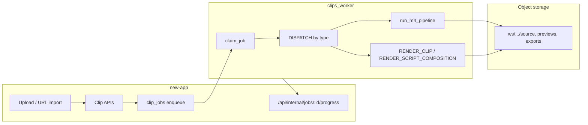

# Clipper — current production pipeline (Clipper-only)

**Scope:** Long-form → clips (`PROCESS_PROJECT`) and per-clip / script-composition export. **Out of scope here:** Streamer lane (`STREAM_*` job types) — same worker binary, different `WORKER_LANE`; see `docs/clips/STREAMER_BUILD_SPEC.md`.

**Last updated:** 2026-10-27 (post PR #751 share/auth/view fixes)

---

## Architecture overview

| Layer | Source of truth |
|-------|-----------------|
| Job queue | `clip_jobs` (Postgres), types in `worker/clips_worker/job_types.py` |
| Project state | `clip_projects.status`, transcript on project / `transcriptKey` |
| Clips | `clips` rows + keys under `ws/{workspaceId}/projects/{projectId}/clips/{clipId}/` |
| Script compositions | Prisma `ScriptComposition`, renders via `RENDER_SCRIPT_COMPOSITION` |
| Progress UI | Worker POSTs signed payloads to `new-app` progress handler |

**Not implemented (blocked):** `SOCIAL_PUBLISH_COMPOSITION` — see `docs/clips/BLOCKED.md` **BLK-007**.

---

## Job types (clipper-relevant)

Registered in `worker/clips_worker/job_types.py` and dispatched from `worker/clips_worker/main.py`:

| Type | Enqueued from (typical) | Worker handler |
|------|------------------------|----------------|
| `IMPORT_URL` | URL / link projects | `import_url.py` → then often `PROCESS_PROJECT` |
| `PROCESS_PROJECT` | New upload, retry, recording finalize | `process_job` → transcribe (if needed) → `pipeline.run_m4_pipeline` |
| `RENDER_CLIP` | Export popover, batch export, reframe follow-up | `render_job.run_render_clip_job` |
| `REFRAME_CROP` | Subject reframe / crop track rebuild | `reframe_crop.py` |
| `THUMBNAIL` | Thumbnail picker / regenerate | `thumbnail_job.py` |
| `MUSIC` | Music bed generation | `music_job.py` |
| `DUB` | ElevenLabs dub | `dub_job.py` |
| `RENDER_SCRIPT_COMPOSITION` | Script editor export, **publish playback** (owner/editor only) | `script_composition_render.py` |

Streamer-only types (`STREAM_IMPORT`, `STREAM_ANALYZE`, `STREAM_RENDER`, …) share the worker process when `WORKER_LANE=stream` (or default lane filter in `streamer/lanes.py`).

---

## `PROCESS_PROJECT` (M4 clip generation)

1. **Claim** — `claim_job` sets `RUNNING`, respects `priority`, `runAfter`, lane filter.
2. **Source** — Download `clip_projects` → `clip_uploads.key` to temp `source.mp4`.
3. **Transcribe** — If project has no words yet: `transcribe_source.transcribe_video_file` (Deepgram / env ASR). Progress: `TRANSCRIBING` → ~45%.
4. **Find clips** — `pipeline.run_m4_pipeline`:
   - Genre / mode from project settings (`picker` rubric, `pick_talking_clips` or `pick_anything_clips`).
   - For each candidate: cut preview (`render_clip.ffmpeg_cut`), speaker crop (`run_speakercrop`), poster, `words.json`, optional crop track.
   - **Persist** — `insert_clips_batch` + upload artifacts to object storage.
5. **Terminal** — Project status `READY` (or failure paths via progress + job `FAILED`).

**Recovery:** `new-app/lib/server/clips/recover-project.ts` re-enqueues `PROCESS_PROJECT` when transcript is ready but pipeline stalled (watchdog in `jobs.ts`).

---

## `RENDER_CLIP` (final export)

- **Enqueue:** `new-app/lib/server/clips/renders.ts` (`enqueueRenderClip`), batch via `export-batch.ts`.
- **Worker:** `render_job.py` loads clip + project source (or segment key for streamer-sourced clips), applies `edits` (captions ASS, broll filtergraph, brand, audio), uploads `exportKey`.
- **Preview reuse:** `lib/clips/export-preview-reuse.ts` — client may skip render when preview matches requested aspect/edits.

---

## Script editor & publish playback

- **Composition document** — Stored on `ScriptComposition` / versions; EDL derived in app (`deriveEdl`, worker `script_edl.py`).
- **Export job** — `composition-export.ts` inserts `clip_jobs` type `RENDER_SCRIPT_COMPOSITION` + `ScriptCompositionRender` row.
- **Worker** — `script_composition_render.py` builds timeline (captions, broll from `edits_render` / `broll_render`, zoom, brand concat) and writes output key linked on render row.
- **Public share** — Publish settings on `ScriptCompositionPublish`; playback URL from latest successful render. **Views** are recorded in `script_composition_publish_views` via client beacon (`/api/public/share/.../view`), not by rewriting publish JSON or polling. **Re-render enqueue** only for workspace owner/editor, rate-limited (~10 min per link); anonymous viewers never enqueue.

---

## Progress & reliability

- Worker signs body with `WORKER_SHARED_SECRET` → `POST /api/internal/jobs/{jobId}/progress`.
- Stale locks: `job_lock.requeue_stale_running_jobs` (~3 min, aligned with `job-reliability.ts`).
- Boot: `boot_recovery.requeue_running_lane_jobs_on_boot`.

---

## Key files (quick index)

| Area | Path |
|------|------|
| Worker entry | `worker/clips_worker/main.py` |
| Clip find/render core | `worker/clips_worker/pipeline.py`, `render_clip.py`, `render_job.py` |
| B-roll / edits | `worker/clips_worker/broll_render.py`, `edits_render.py`, `captions_ass.py` |
| Script render | `worker/clips_worker/script_composition_render.py` |
| Enqueue (app) | `new-app/lib/server/clips/projects.ts`, `renders.ts`, `composition-export.ts` |
| Job watchdog | `new-app/lib/server/clips/jobs.ts`, `recover-project.ts` |

---

## Related docs

- UI / product surfaces: `docs/clips/descript/ui-layouts.md`, `docs/clips/SCRIPT-EDITOR-BUILD.md`
- Streamer (separate lane): `docs/clips/STREAMER_BUILD_SPEC.md`
- Blocked external deps: `docs/clips/BLOCKED.md`
