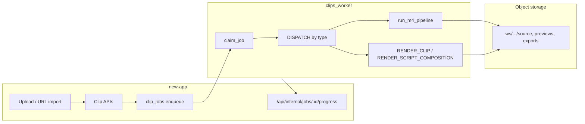

# Clipper — current production pipeline (Clipper-only)

**Scope:** Long-form → clips (`PROCESS_PROJECT`) and per-clip / script-composition export. **Out of scope here:** Streamer lane (`STREAM_*` job types) — same worker binary, different `WORKER_LANE`; see `docs/clips/STREAMER_BUILD_SPEC.md`.

**Last updated:** 2026-10-27 (rebased on `master`; vision/layout inventory below)

### Owner rule (binding)

1. **Do not rebuild** anything that already exists for face detection, tracking, multi-person follow, split layouts, facecam detection, layout presets, smoothing, or diarization.
2. **All clipper changes** must **extend or upgrade** the components listed in the inventory below — not replace them.
3. **Multiperson clipper (2026-10-27):** `worker/prototype/v3/tracking.py`, `director.py`, `multiperson_pipeline.py` extend `speakercrop.py` + `render_clip.layout_env` — crop_track **v2**, SFace re-ID, director Viterbi. Do **not** touch `streamer/layout/*`.
4. This document is the inventory source of truth; update it when wiring changes, not when rewriting stacks.

---

## Architecture overview



| Layer | Source of truth |
|-------|-----------------|
| Job queue | `clip_jobs` (Postgres), types in `worker/clips_worker/job_types.py` |
| Project state | `clip_projects.status`, transcript on project / `transcriptKey` |
| Clips | `clips` rows + keys under `ws/{workspaceId}/projects/{projectId}/clips/{clipId}/` |
| Script compositions | Prisma `ScriptComposition`, renders via `RENDER_SCRIPT_COMPOSITION` |
| Progress UI | Worker POSTs signed payloads to `new-app` progress handler |

**Not implemented (blocked):** `SOCIAL_PUBLISH_COMPOSITION` — see `docs/clips/BLOCKED.md` **BLK-007**.

---

## Job types (clipper-relevant)

Registered in `worker/clips_worker/job_types.py` and dispatched from `worker/clips_worker/main.py`:

| Type | Enqueued from (typical) | Worker handler |
|------|------------------------|----------------|
| `IMPORT_URL` | URL / link projects | `import_url.py` → then often `PROCESS_PROJECT` |
| `PROCESS_PROJECT` | New upload, retry, recording finalize | `process_job` → transcribe (if needed) → `pipeline.run_m4_pipeline` |
| `RENDER_CLIP` | Export popover, batch export, reframe follow-up | `render_job.run_render_clip_job` |
| `REFRAME_CROP` | Subject reframe / crop track rebuild | `reframe_crop.py` |
| `THUMBNAIL` | Thumbnail picker / regenerate | `thumbnail_job.py` |
| `MUSIC` | Music bed generation | `music_job.py` |
| `DUB` | ElevenLabs dub | `dub_job.py` |
| `RENDER_SCRIPT_COMPOSITION` | Script editor export, **publish playback** (owner/editor only) | `script_composition_render.py` |

Streamer-only types (`STREAM_IMPORT`, `STREAM_ANALYZE`, `STREAM_RENDER`, …) share the worker process when `WORKER_LANE=stream` (or default lane filter in `streamer/lanes.py`).

---

## `PROCESS_PROJECT` (M4 clip generation)

1. **Claim** — `claim_job` sets `RUNNING`, respects `priority`, `runAfter`, lane filter.
2. **Source** — Download `clip_projects` → `clip_uploads.key` to temp `source.mp4`.
3. **Transcribe** — If project has no words yet: `transcribe_source.transcribe_video_file` via `GPU_PROVIDER` / `GPU_PROVIDER_TRANSCRIBE` (`local` faster-whisper path or `modal` signed URL). Progress: `TRANSCRIBING` → ~45%.
4. **Find clips** — `pipeline.run_m4_pipeline`:
   - Genre / mode from project settings (`picker` rubric, `pick_talking_clips` or `pick_anything_clips`).
   - For each candidate: cut preview (`render_clip.ffmpeg_cut`), speaker crop (`run_speakercrop`), poster, `words.json`, optional crop track.
   - **Persist** — `insert_clips_batch` + upload artifacts to object storage.
5. **Terminal** — Project status `READY` (or failure paths via progress + job `FAILED`).

**Recovery:** `new-app/lib/server/clips/recover-project.ts` re-enqueues `PROCESS_PROJECT` when transcript is ready but pipeline stalled (watchdog in `jobs.ts`).

---

## `RENDER_CLIP` (final export)

- **Enqueue:** `new-app/lib/server/clips/renders.ts` (`enqueueRenderClip`), batch via `export-batch.ts`.
- **Worker:** `render_job.py` loads clip + project source (or segment key for streamer-sourced clips), applies `edits` (captions ASS, broll filtergraph, brand, audio), uploads `exportKey`.
- **Preview reuse:** `lib/clips/export-preview-reuse.ts` — client may skip render when preview matches requested aspect/edits.

---

## Script editor & publish playback

- **Composition document** — Stored on `ScriptComposition` / versions; EDL derived in app (`deriveEdl`, worker `script_edl.py`).
- **Export job** — `composition-export.ts` inserts `clip_jobs` type `RENDER_SCRIPT_COMPOSITION` + `ScriptCompositionRender` row.
- **Worker** — `script_composition_render.py` builds timeline (captions, broll from `edits_render` / `broll_render`, zoom, brand concat) and writes output key linked on render row.
- **Public share** — Publish settings on `ScriptCompositionPublish`; playback URL from latest successful render. **Views** are recorded in `script_composition_publish_views` via client beacon (`/api/public/share/.../view`), not by rewriting publish JSON or polling. **Re-render enqueue** only for workspace owner/editor, rate-limited (~10 min per link); anonymous viewers never enqueue.

---

## Progress & reliability

- Worker signs body with `WORKER_SHARED_SECRET` → `POST /api/internal/jobs/{jobId}/progress`.
- Stale locks: `job_lock.requeue_stale_running_jobs` (~3 min, aligned with `job-reliability.ts`).
- Boot: `boot_recovery.requeue_running_lane_jobs_on_boot`.

---

## Key files (quick index)

| Area | Path |
|------|------|
| Worker entry | `worker/clips_worker/main.py` |
| Clip find/render core | `worker/clips_worker/pipeline.py`, `render_clip.py`, `render_job.py` |
| B-roll / edits | `worker/clips_worker/broll_render.py`, `edits_render.py`, `captions_ass.py` |
| Script render | `worker/clips_worker/script_composition_render.py` |
| Enqueue (app) | `new-app/lib/server/clips/projects.ts`, `renders.ts`, `composition-export.ts` |
| Job watchdog | `new-app/lib/server/clips/jobs.ts`, `recover-project.ts` |

---

## Existing vision, layout, and diarization (inventory — do not rebuild)

Production clipper reframing is centered on **`worker/prototype/v3/speakercrop.py`** (runtime `/app/v3` via `SPEAKERCROP_DIR`). Entry point: **`render_clip.run_speakercrop`** → subprocess **`speakercrop.py`**. Called from **`pipeline.reframe_clip_preview`** (M4 previews), **`render_job.run_render_clip_job`** (export), **`reframe_crop.run_reframe_crop_job`** (crop-track rebuild).

### Face, tracking, layouts, smoothing (clipper hot path)

| Capability | File | Function / entry | Prod? |
|------------|------|------------------|-------|
| Face detection (YuNet) | `worker/prototype/v3/speakercrop.py` | `FaceDetectorYN.create` + per-frame `det.detect` loop | **Yes** — all clip/script reframes via `run_speakercrop` |
| Face landmarks / lip activity | `speakercrop.py` | `FaceLandmarker.detect` on face crops; `jawOpen` blendshape | **Yes** |
| Multi-person tracking (2-up legacy) | `speakercrop.py` | Left/right slot assignment (`pos[0]`, `pos[1]`); tracks `xpos`, `ypos`, `mouth` per speaker | **Yes** when `MULTIPERSON=0` or &lt;2 persons |
| Multiperson tracklets + re-ID (3–5) | `prototype/v3/tracking.py` | IoU association, SFace embed, agglomerative cluster | **Yes** when `MULTIPERSON=1` |
| Layout director | `prototype/v3/director.py` | Viterbi + overlap / MIN_SHOT / LEAD | **Yes** |
| Crop track v2 | `multiperson_pipeline.py`, `crop_format.py` | `version:2` segments + slots | **Yes** |
| Multiperson render | `clips_worker/multiperson_render.py` | ffmpeg filtergraphs (`filtergraph.py`) | **Yes** |
| Active speaker selection | `speakercrop.py` | Visual score + optional Resemblyzer (`VOICE`); `HYST` to switch | **Yes** |
| Split layout (stacked) | `speakercrop.py` | `SPLIT=1` / dual-speaker render branch | **Yes** when `layout_env` sets split / `speaker_follow` |
| Layout presets | `worker/clips_worker/render_clip.py` | `layout_env(layout)` → `LAYOUT_MODE`, `SPLIT`, `FORCE_SPLIT` env | **Yes** — `speaker_follow`, `split`, `fill`, `fit` |
| Smoothing / shots | `speakercrop.py` | `MIN_SEG`, `HYST`, `LEAD`, `EASE` (env from `render_clip.run_speakercrop`) | **Yes** |
| Speakercrop failure fallback | `render_clip.py` | `ffmpeg_fit_export` | **Yes** — sets `fit_fallback` on render meta |
| Face+speech gate | `subject_reframe.py` | `has_face_and_speech` | **Yes** — chooses speakercrop vs motion/fit in `reframe_clip_preview` |
| Motion / subject follow | `subject_reframe.py` | `write_motion_crop_track`, `motion_centroids_x` | **Yes** — ClipAnything when faces weak |
| Static fit-blur track | `pipeline.py` | `write_fit_blur_crop_track` | **Yes** |
| Manual reframe keyframes | `new-app` composition doc + `reframe_crop.py` | ops `set_reframe_keyframe` / `patch_reframe_keyframes`; worker `run_reframe_crop_job` | **Yes** — augments, does not replace speakercrop |
| Script export layout | `script_composition_render.py` | reads `reframeMode` → same `run_speakercrop` settings | **Yes** |
| Zoom / pan segments | `zoom_render.py` | used from script composition render | **Yes** |
| Model presence check | `main.py` | `log_models()` (yunet, face_landmarker, fonts) | **Yes** — worker boot log |

### Facecam detection & split (streamer — separate lane, same YuNet family)

| Capability | File | Function | Prod? |
|------------|------|----------|-------|
| Facecam box detect | `streamer/layout/detect_facecam.py` | `detect_facecam_layout` | **Streamer** `STREAM_RENDER` / layout state — **not** clipper `PROCESS_PROJECT` |
| Facecam + gameplay stack | `streamer/layout/render_stack.py` | `build_stack_filtergraph`, `stack_layout_from_state` | **Streamer** export layout |
| Caption anchor | `streamer/layout/caption_anchor.py` | seam between facecam/gameplay panels | **Streamer** |

Do not merge streamer facecam auto-detect into clipper speakercrop without the owner guide; clipper long-form uses speakercrop + `subject_reframe`, not `detect_facecam_layout`.

### Diarization & speaker identity

| Capability | File | Function | Prod? |
|------------|------|----------|-------|
| ASR speaker diarization (primary) | `deepgram_transcribe.py` | `transcribe_deepgram` (`diarize=true`, `speaker` on words → `spk`) | **Yes** when `TRANSCRIBE_PROVIDER=deepgram` (default if `DEEPGRAM_API_KEY` set) via `transcribe_provider.transcribe_audio_request` |
| Transcribe routing | `transcribe_provider.py` | `transcribe_audio_request` | **Yes** — Deepgram first, else `gpu.transcribe_with_fallback` |
| Project transcribe | `transcribe_source.py` | `transcribe_video_file` | **Yes** — every `PROCESS_PROJECT` without cached words |
| Picker speaker labels | `picker/sentences.py` | `_assign_speakers`, `segment_sentences` | **Yes** — gap-based labels for scoring (uses transcript, not a second diarizer) |
| Overlap / multi-speaker scoring | `picker/signals.py` | overlap detection between sentences | **Yes** — ranking only |
| Local Whisper (no diarize) | `gpu/local.py` | `LocalProvider.transcribe` | **Yes** — fallback when Deepgram/modal unavailable |

Words carry `speakerId` / `spk` into the editor (`to-editor-words`); speakercrop does **not** consume Deepgram diarization directly — it uses vision+audio in `speakercrop.py`.

### Modal GPU path

| Op | File | Function | Prod? |
|----|------|----------|-------|
| Provider select | `gpu/__init__.py` | `get_provider`, `transcribe_with_fallback` | **Yes** — env `GPU_PROVIDER`, `GPU_PROVIDER_TRANSCRIBE` |
| Modal transcribe client | `gpu/modal_provider.py` | `ModalProvider.transcribe`, `transcribe_many` | **Optional** — when provider name is `modal` |
| Modal remote class | `modal_app/transcribe.py` | `Transcriber.transcribe` | **Deployed** — faster-whisper on GPU; used only if worker configured for modal |
| Upload + signed URL | `transcribe_source.py` | `transcribe_video_file` (modal branch) | **Optional** — uploads `ws/.../audio.opus` then modal |
| Inflight limit | `gpu/modal_inflight.py` | `ModalInflight` | **Yes** when modal used |
| Usage metering | `gpu/usage.py` | `record_modal_transcribe` | **Yes** when modal transcribe succeeds |
| Modal face track (stub track) | `modal_app/face.py` | `FaceTracker.face_track` | **Not clipper prod** — `ModalProvider.face_track` exists; **no** `get_provider("face")` call sites in clipper pipeline; local `face_track` raises `NotImplementedError` |
| Modal render batch | `modal_provider.py` | `render_batch` | **Not** on clipper M4/export hot path today |

**Prod default today:** Deepgram diarized transcript when key present; GPU path is local Whisper fallback unless ops set `GPU_PROVIDER=modal`. Clip reframing stays **on-worker speakercrop**, not Modal `FaceTracker`.

**App-side reframe (no replacement for speakercrop):** `ScriptReframeCropOverlay`, API `clips/[id]/reframe`, composition ops — persist keyframes for export only.

### Git activity since 2026-10-24 (clipper + script editor + worker)

Regenerate when auditing:

```bash
git log --since=2026-10-24 --oneline -- worker/clips_worker worker/prototype/v3 new-app/lib/clips new-app/components/script-editor
```

Snapshot (2026-10-27, PR #751 branch rebased on `master`):

| Commit | Area | Touches tracking/layout? |
|--------|------|-------------------------|
| `242b82457` / `b7ab03cbc` | Docs, share auth, drive IA | **No** |
| `5c7c94e88`, `0ac28212d` | Descript surfaces, publish | **No** |
| `faf97d505`, `d31d7b147` | Markers, comments, share APIs | **No** |
| `415fdd883`, `d62de3607` | Storyboard/scenes ops | **No** (document model only) |
| `b682037fd` | M4.1 editor sync, reframe **UI** keyframes | **No** speakercrop changes |
| `8c5be6114`, `b18ed9409` | Script composition render dispatch | **No** |
| `3a152a37d`, `a5055e5d3`, `8dccb96ab` | Fillers, gaps, timeline, reframe pills | **No** |
| `bcfbe3dd9` | Parallel **reframe pool** in `pipeline.py` | **Orchestration only** — still calls `run_speakercrop` |

**Conclusion:** No commit since 2026-10-24 replaces `speakercrop.py`, YuNet, or `detect_facecam_layout`. Safe extension surface: app EDL, export/share, picker scoring, pool concurrency — not new face engines.

---

## Related docs

- UI / product surfaces: `docs/clips/descript/ui-layouts.md`, `docs/clips/SCRIPT-EDITOR-BUILD.md`
- Streamer (separate lane): `docs/clips/STREAMER_BUILD_SPEC.md`
- Blocked external deps: `docs/clips/BLOCKED.md`
