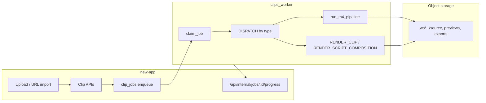

# Clipper — current production pipeline (Clipper-only)

**Scope:** Long-form → clips (`PROCESS_PROJECT`) and per-clip / script-composition export. **Out of scope here:** Streamer lane (`STREAM_*` job types) — same worker binary, different `WORKER_LANE`; see `docs/clips/STREAMER_BUILD_SPEC.md`.

**Last updated:** 2026-10-27 (rebased on `master`; vision/layout inventory below)

**Owner rule:** Extend or upgrade existing face/layout/diarization code — do **not** replace `speakercrop.py`, YuNet, or streamer layout detectors without an implementation guide.

---

## Architecture overview

| Layer | Source of truth |
|-------|-----------------|
| Job queue | `clip_jobs` (Postgres), types in `worker/clips_worker/job_types.py` |
| Project state | `clip_projects.status`, transcript on project / `transcriptKey` |
| Clips | `clips` rows + keys under `ws/{workspaceId}/projects/{projectId}/clips/{clipId}/` |
| Script compositions | Prisma `ScriptComposition`, renders via `RENDER_SCRIPT_COMPOSITION` |
| Progress UI | Worker POSTs signed payloads to `new-app` progress handler |

**Not implemented (blocked):** `SOCIAL_PUBLISH_COMPOSITION` — see `docs/clips/BLOCKED.md` **BLK-007**.

---

## Job types (clipper-relevant)

Registered in `worker/clips_worker/job_types.py` and dispatched from `worker/clips_worker/main.py`:

| Type | Enqueued from (typical) | Worker handler |
|------|------------------------|----------------|
| `IMPORT_URL` | URL / link projects | `import_url.py` → then often `PROCESS_PROJECT` |
| `PROCESS_PROJECT` | New upload, retry, recording finalize | `process_job` → transcribe (if needed) → `pipeline.run_m4_pipeline` |
| `RENDER_CLIP` | Export popover, batch export, reframe follow-up | `render_job.run_render_clip_job` |
| `REFRAME_CROP` | Subject reframe / crop track rebuild | `reframe_crop.py` |
| `THUMBNAIL` | Thumbnail picker / regenerate | `thumbnail_job.py` |
| `MUSIC` | Music bed generation | `music_job.py` |
| `DUB` | ElevenLabs dub | `dub_job.py` |
| `RENDER_SCRIPT_COMPOSITION` | Script editor export, **publish playback** (owner/editor only) | `script_composition_render.py` |

Streamer-only types (`STREAM_IMPORT`, `STREAM_ANALYZE`, `STREAM_RENDER`, …) share the worker process when `WORKER_LANE=stream` (or default lane filter in `streamer/lanes.py`).

---

## `PROCESS_PROJECT` (M4 clip generation)

1. **Claim** — `claim_job` sets `RUNNING`, respects `priority`, `runAfter`, lane filter.
2. **Source** — Download `clip_projects` → `clip_uploads.key` to temp `source.mp4`.
3. **Transcribe** — If project has no words yet: `transcribe_source.transcribe_video_file` via `GPU_PROVIDER` / `GPU_PROVIDER_TRANSCRIBE` (`local` faster-whisper path or `modal` signed URL). Progress: `TRANSCRIBING` → ~45%.
4. **Find clips** — `pipeline.run_m4_pipeline`:
   - Genre / mode from project settings (`picker` rubric, `pick_talking_clips` or `pick_anything_clips`).
   - For each candidate: cut preview (`render_clip.ffmpeg_cut`), speaker crop (`run_speakercrop`), poster, `words.json`, optional crop track.
   - **Persist** — `insert_clips_batch` + upload artifacts to object storage.
5. **Terminal** — Project status `READY` (or failure paths via progress + job `FAILED`).

**Recovery:** `new-app/lib/server/clips/recover-project.ts` re-enqueues `PROCESS_PROJECT` when transcript is ready but pipeline stalled (watchdog in `jobs.ts`).

---

## `RENDER_CLIP` (final export)

- **Enqueue:** `new-app/lib/server/clips/renders.ts` (`enqueueRenderClip`), batch via `export-batch.ts`.
- **Worker:** `render_job.py` loads clip + project source (or segment key for streamer-sourced clips), applies `edits` (captions ASS, broll filtergraph, brand, audio), uploads `exportKey`.
- **Preview reuse:** `lib/clips/export-preview-reuse.ts` — client may skip render when preview matches requested aspect/edits.

---

## Script editor & publish playback

- **Composition document** — Stored on `ScriptComposition` / versions; EDL derived in app (`deriveEdl`, worker `script_edl.py`).
- **Export job** — `composition-export.ts` inserts `clip_jobs` type `RENDER_SCRIPT_COMPOSITION` + `ScriptCompositionRender` row.
- **Worker** — `script_composition_render.py` builds timeline (captions, broll from `edits_render` / `broll_render`, zoom, brand concat) and writes output key linked on render row.
- **Public share** — Publish settings on `ScriptCompositionPublish`; playback URL from latest successful render. **Views** are recorded in `script_composition_publish_views` via client beacon (`/api/public/share/.../view`), not by rewriting publish JSON or polling. **Re-render enqueue** only for workspace owner/editor, rate-limited (~10 min per link); anonymous viewers never enqueue.

---

## Progress & reliability

- Worker signs body with `WORKER_SHARED_SECRET` → `POST /api/internal/jobs/{jobId}/progress`.
- Stale locks: `job_lock.requeue_stale_running_jobs` (~3 min, aligned with `job-reliability.ts`).
- Boot: `boot_recovery.requeue_running_lane_jobs_on_boot`.

---

## Key files (quick index)

| Area | Path |
|------|------|
| Worker entry | `worker/clips_worker/main.py` |
| Clip find/render core | `worker/clips_worker/pipeline.py`, `render_clip.py`, `render_job.py` |
| B-roll / edits | `worker/clips_worker/broll_render.py`, `edits_render.py`, `captions_ass.py` |
| Script render | `worker/clips_worker/script_composition_render.py` |
| Enqueue (app) | `new-app/lib/server/clips/projects.ts`, `renders.ts`, `composition-export.ts` |
| Job watchdog | `new-app/lib/server/clips/jobs.ts`, `recover-project.ts` |

---

## Existing vision, layout, and diarization (inventory — do not rebuild)

Production clipper reframing is centered on **`worker/prototype/v3/speakercrop.py`** (container path `/app/v3`, env `SPEAKERCROP_DIR`). The worker invokes it through `render_clip.run_speakercrop` — **used in prod** for every clip preview (`pipeline.reframe_clip_preview`) and final export (`render_job.py`, `reframe_crop.py`).

| Capability | Where | Prod? | Notes |
|------------|-------|-------|-------|
| **Face detection (YuNet)** | `speakercrop.py` (`yunet.onnx`), `main.log_models()` | **Yes** | OpenCV `FaceDetectorYN`; up to 2 faces; profile-friendly boxes |
| **Face landmarks / lip motion** | `speakercrop.py` (`face_landmarker.task`, MediaPipe) | **Yes** | Blendshapes + jawOpen for active-speaker scoring |
| **Multi-person follow + split** | `speakercrop.py` (`SPLIT`, `LAYOUT_MODE`, `FORCE_SPLIT` via `render_clip.layout_env`) | **Yes** | Stacked split when both talk; `speaker_follow` default |
| **Voice tie-break (Resemblyzer)** | `speakercrop.py` (`VOICE=1`, embeddings on 16 kHz audio) | **Yes** | Combined with visual score (`VIS_W`) |
| **Smoothing / shot logic** | `speakercrop.py` (`MIN_SEG`, `HYST`, `LEAD`, `EASE`) | **Yes** | Min shot length, hysteresis, look-ahead, eased crop center |
| **Layout presets** | `render_clip.layout_env` → env vars for speakercrop | **Yes** | `speaker_follow`, `split`, `fill`, `fit`; clip `edits.layout` / script `reframeMode` |
| **Fit-blur fallback** | `render_clip.ffmpeg_fit_export`, `pipeline.write_fit_blur_crop_track` | **Yes** | When speakercrop fails or no sustained face (`fit_fallback` on render meta) |
| **Subject / motion follow** | `subject_reframe.py` (`write_motion_crop_track`, `has_face_and_speech`) | **Yes** | ClipAnything path when face+speech weak; motion centroids @ 2 fps |
| **Crop track artifact** | `crop_track.json` on clip keys; `REFRAME_CROP` job | **Yes** | Editor reframe pills read/write keyframes; worker rebuilds via `reframe_crop.py` |
| **Script composition reframe** | `script_composition_render.py` (layout mode from doc settings) | **Yes** | Same speakercrop stack as clip export |
| **Zoom / pan on script timeline** | `zoom_render.py` (composition render) | **Yes** | Composited in script export path |
| **Speaker labels (picker)** | `picker/sentences.py` `_assign_speakers` | **Yes** | Heuristic from word gaps — **not** full diarization ASR |
| **Diarization overlap signals** | `picker/signals.py` | **Yes** | Scoring feature for clip ranking, not a separate diarization service |
| **Facecam + gameplay (streamer)** | `streamer/layout/detect_facecam.py`, `render_stack.py` | Streamer lane | YuNet on sample frames; **not** clipper `PROCESS_PROJECT` |
| **Modal GPU transcribe** | `transcribe_source.py`, `clips_worker/gpu/modal_provider.py`, `worker/modal_app/` | **Optional** | When `GPU_PROVIDER=modal`; uploads `audio.opus`, signed URL transcribe |
| **Modal face GPU** | `worker/modal_app/face.py` | Deployed app | Used by streamer/GPU experiments — **not** on hot speakercrop path |

**App-side reframe (no replacement for speakercrop):** manual keyframes in script doc (`reframeKeyframes`, ops `set_reframe_keyframe` / `patch_reframe_keyframes`) → persisted on composition → worker applies on export. UI: `ScriptReframeCropOverlay`, API `clips/[id]/reframe`.

### Git activity since 2026-10-24 (clipper + script editor + worker)

High-signal commits on this branch stack (newest first after rebase onto `master`):

- `b7ab03cbc` — PR #751 security, publish views migration, drive route split, pipeline doc
- `5c7c94e88` / `0ac28212d` — Descript surfaces: drive chrome, publish playback, share footer
- `faf97d505` / `d31d7b147` — Script editor drive, markers, comments, share APIs
- `415fdd883` / `d62de3607` — M8 storyboard/scenes ops + timeline view toggle
- `b682037fd` — M4.1 script sync, timeline fit, fillers, gaps, reframe, cuts (on `master`)
- `8c5be6114` / `b18ed9409` — `RENDER_SCRIPT_COMPOSITION` worker dispatch + handler fixes
- `3a152a37d` / `a5055e5d3` — M4.1 filler/gap/reframe/timeline cuts (worker + editor)
- `bcfbe3dd9` — Parallel reframe pool + upload ETA (worker `pipeline.py` concurrency)

No commit since Oct 24 replaces `speakercrop.py`; changes are orchestration, script EDL, UI, and export/share.

---

## Related docs

- UI / product surfaces: `docs/clips/descript/ui-layouts.md`, `docs/clips/SCRIPT-EDITOR-BUILD.md`
- Streamer (separate lane): `docs/clips/STREAMER_BUILD_SPEC.md`
- Blocked external deps: `docs/clips/BLOCKED.md`
