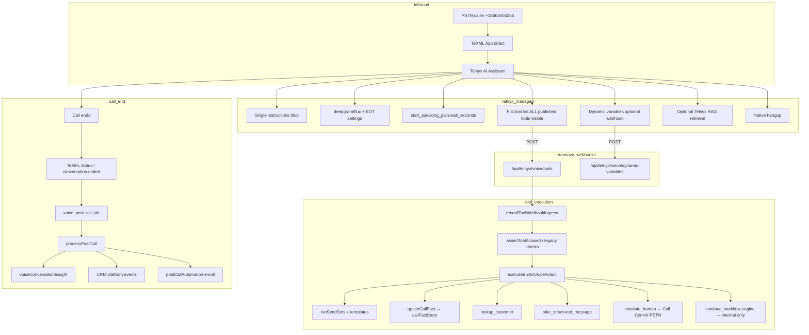

# Phase 1 — Telnyx AI Receptionist Inventory (Amy 866)

**Status:** Superseded by implementation — see `docs/TELNYX_AI_ASSISTANT_TOOL_ARCHITECTURE.md` for current architecture.  
**Production path:** +18663464256 → TeXML direct → Telnyx AI Assistant (not LiveKit).  
**Agent ID:** `cmshz2lc25c622c4i58303501`  
**Telnyx assistant:** `assistant-197f496d-d98a-4995-ad0e-a10aca90951d`  
**Published version:** v55+ (conversation workflow + Flux balanced)

---

## Executive summary

Transovo currently runs Caller Amy as a **single Telnyx AI Assistant** with one monolithic instruction block and a **flat tool list** (5 webhooks + native hangup). Orchestration that Telnyx Conversation Workflows would provide — per-node tool scoping, deterministic variable edges, soft capability modes — is implemented **in application code** (`workflow-engine`, publish filters, prompt constitution) or **not at all** (no Telnyx workflow graph).

**Key finding:** Telnyx **Conversation Workflows** (per-node instructions, per-node tools, LLM vs variable-comparison edges, webhook → dynamic variable mapping, Post-Conversation Processing) are **not integrated** anywhere in this repo. The `ai-client.ts` wrapper has no workflow CRUD APIs. Internal `workflow-runtime` / `workflow-engine` are Transovo-side state machines for LiveKit and legacy Caller Amy — not Telnyx native workflows.

**Strategic implication:** The user's proposed architecture (Telnyx Workflow → small scoped nodes → narrow Transovo webhooks) would **replace** much of our custom `workflow-engine` + flat tool surface on the 866 line, not add another layer on top.

---

## Current call graph



**What is missing from this graph (Telnyx-native):**

- No Conversation Workflow nodes (GENERAL / SEND_RESOURCE / …)
- No per-node tool scoping on Telnyx side
- No deterministic variable-comparison edges (`booking_enabled == true`)
- No webhook response → Telnyx dynamic variable assignment
- No Telnyx Post-Conversation Processing tools (CRM after hangup on Telnyx)

---

## 1. Publish & sync path

| Step | Location | Notes |
|------|----------|-------|
| Wizard → config | `build-agent-config.ts` → `applyAmyMinimumSideEffectConfig()` | GPT-5.4-mini, flux_b_balanced, minimal tools |
| Publish | `agent-service.ts` → `publishVoiceAgent` | Version row + Telnyx sync |
| Telnyx sync | `assistant-sync.ts` → `syncTelnyxAssistant` | Instructions, model, tools, enrich |
| Tool assembly | `assistant-tools.ts` → `buildAssistantTools` | Webhooks + native hangup/transfer/retrieval |
| Publish filter | `tool-publish.ts` → `filterToolsForCallerAmyPublish` | Server-side only; model still sees flat list |
| Republish script | `scripts/amy-minimum-side-effect-republish.ts` | Production 866 |
| Live audit | `scripts/audit-caller-amy-published-tools.mjs` | Smoke-login + fetch_live_assistant |

---

## 2. Base prompt composition

Built in `assistant-sync.ts` (concatenated sections, up to 100k chars):

| Section | Source |
|---------|--------|
| System / role / goals | Wizard `buildSystemPrompt` via `build-agent-config.ts` |
| Business knowledge block | `buildBusinessKnowledgePromptSection` — hours, services, FAQs, appointment types |
| Constitution | `caller-constitution.ts` — identity, tool behavior, failures |
| Minimum-side-effect rules | `amy-minimum-side-effect.ts` → `MINIMUM_SIDE_EFFECT_PROMPT` |
| Speech / latency guidance | `speech-prompt-guidance.ts`, `CONVERSATIONAL_PROMPT_GUIDANCE` |
| Knowledge digest | `buildShortKnowledgeDigest` — FAQ text sources |
| Tool playbook | `caller-tool-playbook.ts` — `MINIMUM_SIDE_EFFECT_AUTHORITY` |
| RAG hint | If buckets linked — when to use retrieval vs prompt |

**Tension for workflow migration:** Constitution still references `runtime_context`, `WORKFLOW_STATE`, `record_current_field` (legacy workflow mode). Minimum-side-effect mode injects text-first rules but shares the same constitution file.

---

## 3. Current model-visible tools (minimum-side-effect, v54)

### Webhook tools → `{APP_URL}/api/telnyx/voice/tools`

| Tool | Model schema highlight | Backend behavior |
|------|------------------------|------------------|
| `send_sms` | `template_id` enum | `runSendSms` → `resolveVoiceSmsTemplate` → `sendQuickSms` (sync) |
| `record_call_fact` | `fact_key`, `value`, `confirmed?` | `call-fact-store.ts` → `voiceCall.metadata` |
| `take_structured_message` | message fields | Contact upsert + staff notification |
| `lookup_customer` | name/phone/email | Read-only CRM + Transovo contact search |
| `escalate_human` | `target_name` | Call Control PSTN transfer (native `transfer` suppressed) |

### Native Telnyx tools

| Tool | When |
|------|------|
| `hangup` | Always last when enabled |
| `retrieval` | If Telnyx RAG `bucket_ids` linked |
| `transfer` | Suppressed when `escalate_human` + destinations exist |

### Internal-only (not published, still in codebase)

`continue_workflow`, `record_current_field`, `get_runtime_context`, `calendar_availability`, `book_appointment`, `resolve_datetime`, CRM writes (`upsert_crm_contact`, `create_crm_note`, …), `runtime_turn` (retired).

---

## 4. Webhook endpoints

| Endpoint | Purpose | Timeout pressure |
|----------|---------|------------------|
| `POST /api/telnyx/voice/tools` | **All** model tool calls (monolithic) | Tool-specific; `send_sms` sync |
| `POST /api/telnyx/voice/dynamic-variables` | Call-start variable hydration | 500ms (Flux) / 1500ms |
| `POST /api/telnyx/voice` | Call Control lifecycle | — |
| `POST /api/telnyx/voice/texml-status` | TeXML hangup → post-call job | — |
| `POST /api/telnyx/voice/insights` | Telnyx insight-group webhook | — |

**Gap vs proposed architecture:** No narrow capability endpoints (`/send-resource`, `/search-details`, `/capture-request`). One route dispatches on `X-Transovo-Tool-Type`.

---

## 5. Dynamic variables (call-start)

**Resolver:** `resolveCallDynamicVariables` in `dynamic-variables.ts`  
**Route:** `POST /api/telnyx/voice/dynamic-variables`

### Currently populated

| Category | Variables |
|----------|-----------|
| Business | `business_name`, `workspace_name`, `business_timezone` |
| Agent | `agent_name`, `agent_purpose`, config `dynamicVariables` map |
| Caller | `caller_phone`, `contact_name`, `first_name`, … |
| Clock | `current_date`, `current_time`, `current_iso_local`, `utc_offset` |
| Legacy workflow | `workflow_state`, `workflow_complete`, `allowed_tools_json`, `runtime_context_json`, `workflow_field_manifest_json` |

### Not populated (candidates for workflow edges)

`booking_enabled`, `booking_url`, `quote_url`, `financing_url`, `sms_allowed`, `transfer_available`, `business_open_now`, `after_hours`, `resource_send_status`, `customer_found`, `resource_configured`

### Flux note

`shouldSkipDynamicVariablesWebhook` — Flux profiles may **omit** the init webhook entirely; clock then depends on prompt or `resolve_datetime` (internal).

---

## 6. CRM & side effects — during call vs post-call

| Action | When | Mechanism |
|--------|------|-----------|
| FAQ answers | During call | Prompt only — no tool |
| Call facts | During call | `record_call_fact` → metadata |
| SMS link | During call | `send_sms` sync |
| Contact lookup | During call | `lookup_customer` read-only |
| Structured message | During call | `take_structured_message` — may upsert contact |
| CRM write / notes / tags | **Not published** in minimum mode | Internal tools + post-call events |
| Lead / summary / CRM sync | Post-call | `processPostCall` → insights + `crm/events.ts` |
| CallFactStore → CRM | Post-call (partial) | Merged into `voiceConversationInsight.customFields.call_facts` |

**Gap:** No Telnyx Post-Conversation Processing integration. Post-call is Transovo job queue only.

---

## 7. Transfer logic

1. Model calls `escalate_human` (webhook).
2. Resolve `voiceTransferDestination` by `target_name`.
3. `initiateTransfer` via Telnyx Call Control (cold/warm).
4. Native Telnyx `transfer` disabled when Call Control path active (dual-dial race prevention).

**Workflow target:** TRANSFER node with native Telnyx Transfer tool only.

---

## 8. SMS / resources

| Today | Proposed |
|-------|----------|
| `send_sms({ template_id })` | `send_resource({ resource_type })` |
| Templates: `booking_link`, `quote_link`, `financing_link`, `directions`, `callback_confirmation` | Enum: `booking`, `quote`, `financing`, `directions`, `photo_upload` |
| Idempotency: `{callId}:sms:{id}:v1` | Same pattern, semantic `already_completed` response |

Model still sees `template_id` — backend should derive URLs, sender, workspace from call context.

---

## 9. Knowledge / retrieval

| Layer | Mechanism |
|-------|-----------|
| Base prompt | Wizard knowledge items, business description, hours, services |
| Telnyx RAG | Native `retrieval` tool if buckets linked |
| Internal | `resolve-business-answer.ts` — not on minimum-side-effect publish surface |

**Workflow target:** GENERAL = zero tools; DETAILED_LOOKUP = `search_business_details` or retrieval only.

---

## 10. Internal orchestration (not Telnyx Conversation Workflows)

| System | Path | Used on 866 today? |
|--------|------|-------------------|
| `workflow-engine` | `src/lib/voice/workflow-engine/` | Legacy mode only; retired from publish |
| `workflow-runtime` | `src/lib/voice/workflow-runtime/` | LiveKit / architect paths |
| `field-runtime` | `src/lib/voice/field-runtime/` | Legacy `record_current_field` |
| Publish guard | `workflow-engine/guard.ts` | Server-side `assertToolAllowed` |

States (legacy): `INTENT_DISCOVERY` → `COLLECTING_FIELDS` → `CHECKING_AVAILABILITY` → `SELECTING_SLOT` → `READY_TO_BOOK` → `COMPLETE`.

---

## 11. Observability

| Capability | Status |
|------------|--------|
| `voiceToolExecution` rows | Yes — tool args/results in DB |
| `providerWebhookEvent` ingress | Yes — `tool-webhook-ingress.ts` |
| Telnyx Langfuse observability | **Not enabled** (`capability-registry.ts` notes deferred) |
| Telnyx instruction-following / satisfaction evals | **Not integrated** |
| Five-gate report | `scripts/caller-amy-five-gate-report.mjs` |

---

## Phase 2 preview — capability classification (every current behavior)

| ID | Capability | Class | Notes |
|----|------------|-------|-------|
| A1 | Company description, hours, services, FAQs | **A — Base knowledge** | In prompt; constitution says no tool |
| A2 | Service area, policies, pricing ranges | **A — Base knowledge** | Wizard knowledge items |
| A3 | Appointment process overview | **A — Base knowledge** | Prompt + text-first booking policy |
| B1 | Caller name if known | **B — Dynamic context** | `contact_name` dynamic var |
| B2 | Current time / timezone | **B — Dynamic context** | Clock vars (when webhook runs) |
| B3 | Booking/quote URLs configured | **B — Dynamic context** | **Missing** — only in env/template resolver |
| B4 | Transfer destinations available | **B — Dynamic context** | Partial — escalation prompt text |
| B5 | Open/after-hours | **B — Dynamic context** | **Missing** as variable |
| C1 | Send booking/quote SMS | **C — Live tool** | `send_sms` → should become `send_resource` |
| C2 | Capture caller facts | **C — Live tool** | `record_call_fact` |
| C3 | Take message | **C — Live tool** | `take_structured_message` |
| C4 | Lookup customer | **C — Live tool** | `lookup_customer` — maybe DETAILED_LOOKUP only |
| C5 | Transfer to human | **C — Live tool** | `escalate_human` → native Transfer node |
| C6 | Live calendar book | **Retire** | Not published; text-first instead |
| D1 | PDF / long doc questions | **D — Retrieval** | Telnyx RAG `retrieval` tool |
| D2 | Obscure product specs | **D — Retrieval** | Candidate `search_business_details` |
| E1 | CRM contact create/update | **E — Post-call** | `processPostCall` + events |
| E2 | Lead extraction / summary | **E — Post-call** | Insights + LLM on transcript |
| E3 | Tags, notes, tasks | **E — Post-call** | Not live in minimum mode |
| E4 | Analytics / scoring | **E — Post-call** | Platform events |
| E5 | Automation enroll | **E — Post-call** | `postCallAutomationId` |

---

## Gap analysis — Telnyx Conversation Workflows vs today

| Telnyx capability | Transovo today | Migration action |
|-------------------|----------------|------------------|
| Workflow graph on assistant | None | Create workflow; attach to assistant |
| Per-node tool scoping | Flat list + server guard | **Primary win** — move scoping to Telnyx nodes |
| Append/replace node instructions | Single blob | Base prompt + small node addenda |
| LLM-condition edges | Prompt-only intent | Semantic routing at node boundaries |
| Variable-comparison edges | Not used | Add `booking_enabled`, `sms_allowed`, etc. |
| Webhook → dynamic variable mapping | Manual in our responses | Map `resource_send_status`, `customer_found` |
| Post-Conversation Processing | Transovo `voice_post_call` job | Evaluate Telnyx native post-call tools + keep Transovo worker |
| Async tools + Add Messages | `ASYNC_TOOL_TYPES` mostly cleared | Classify per tool; SMS stays sync |
| Initialization webhook 1s budget | Partially skipped on Flux | Fast local preload only |

---

## Proposed target workflow (for Phase 3+ — not implemented)

```
FRONT_DESK (implicit entry)
├── GENERAL          → tools: none (prompt only)
├── SEND_RESOURCE    → tools: send_resource
├── DETAILED_LOOKUP  → tools: search_business_details | retrieval
├── CAPTURE_REQUEST  → tools: capture_request (optional)
├── HUMAN_TRANSFER   → tools: transfer (native)
├── RECOVERY         → tools: take_structured_message
└── CLOSING          → tools: hangup
```

Routing policy:

- **Deterministic:** `booking_enabled`, `resource_configured`, `transfer_available`, `resource_send_status`, `customer_found`
- **LLM:** “caller wants to schedule”, “detailed technical question”, “wants a human”
- **Tool outcome:** `status: not_configured` → RECOVERY node

---

## Files to touch in future phases (reference only)

| Area | Files |
|------|-------|
| Telnyx workflow API | `ai-client.ts` (new), `assistant-sync.ts` |
| Narrow webhooks | New routes under `src/app/api/voice/tools/` or `telnyx/voice/` |
| Dynamic vars | `dynamic-variables.ts`, wizard config |
| Tool contracts | `catalog.ts`, `caller-tool-playbook.ts`, `tool-publish.ts` |
| Post-call | `post-call.ts`, Telnyx post-conversation config |
| Deprecate | `workflow-engine` on 866 path (keep for legacy tenants) |
| Tests | `audit-caller-amy-published-tools.mjs`, new scenario suite Phase 15 |
| Docs | This file + `telnyx-assistant-optimization-surface.md` |

---

## Phase 1 exit criteria

- [x] Current Telnyx assistant documented
- [x] Current tools, webhooks, dynamic vars inventoried
- [x] CRM during-call vs post-call mapped
- [x] Internal vs Telnyx workflow distinction clear
- [x] Call graph produced
- [x] Phase 2 classification draft included
- [ ] **No code changes** (this document only)

**Next step (Phase 2):** Formalize capability classification and sign off before any Telnyx Workflow API integration.
