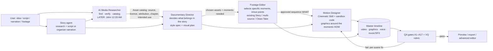

# Motion Studio — full build spec (v1: documentaries)
*(File name kept as `transovo-studio-build.md`. The product is **Motion Studio**: John, 15 Nov 2026, 12:53 AM ET.)*

> **Vision (John, verbatim, relayed by the CoS, 14 Nov 2026, 11:56 PM ET):** *"Give Transovo an idea. It researches the subject, finds usable media, writes the story, designs professional motion graphics, assembles real footage, and produces an editable documentary."*

**Status:** **BUILD APPROVED.** The Gate passed at 11:51 PM ET on 14 Nov 2026 (relayed by the CoS). John's words: *"that looks way better... The from in and out looks like it's a part of the actual documentary... yeah, I think this is something we gonna, we need to build. I've already told you and gave you what we should build and how it should be, the UI and how the workflow should be. Now, I hope you gave it everything we gave it and not just some condensed version, so it's gonna give me like a shell of what I told it to be built."*
**This file is the build spec.** The 62 issues were filed in `703deuce/sms` as #1198–#1259 on 15 Nov 2026, with John's direct approval at 12:57 AM ET ("Yes, file the Motion Studio tickets now"). BE-21 was dropped (bake-off cancelled, 12:58 AM). The number map is in `drafts/filing/filed.json`.
**Scope (John, 15 Nov 2026, 12:02 AM ET, relayed by the CoS):** *"Now we gonna start with the documentary because we gotta get the blocks and everything working right, but this is what we gonna, this is what we're actually building. We're not building the rest of it yet, but we're starting with the documentaries..."* → **This build covers documentaries only**, with a multi-format-ready architecture (ST-ENG-005/006). The long-term vision is in `specs/motion-studio-vision.md` (§10, PLANNED-LATER, not in this build).
**v1 media scope (John, 15 Nov 2026, 12:33 AM ET, relayed by the CoS):** *"on this first version the user's gonna provide pictures, and if they got pictures and if they got footage. That's the difference. Eventually, we're gonna add something on top of that where we're gonna do even the first step, where it even will find the pictures and stuff for you, but right now, we're gonna start from user provides pictures, images, you know, video clips, and then we take it from there. We do, you know, they can ask what they want it be about, and then they can do the research, we could do the research... we could put it together from there."*
- **v1 media = user uploads only** (photos, images, video clips).
- **Stays in v1:** topic/fact research (incl. real-data sourcing for charts), AI scriptwriting (idea- and script-to-documentary), voiceover, motion graphics, Cinematic Media Handoff, assembly, transcription of **uploaded** clips.
- **Later (status "later (John 12:33 AM)", fully specced, not deleted):** the AI Media Researcher agent, automatic photo/video finding (Commons, Pixabay, Pexels, YouTube, yt-dlp), licensing automation, the media-source choice, clip sourcing, transcribing **found** clips.
**Two-part build (John, 15 Nov 2026, 12:38 AM ET, relayed by the CoS; replaces the CoS "promote to library" proposal, D36):** *"let's build the whole thing, but just do it in two separate parts... the parts that is in every single motion graphic versus the ones that gotta get made... even if we do a map... we don't want the map to be the same thing as far as, like, keeping it in a library... maybe the map looks a little different for each customer, cause we don't want each customers to look exactly the same... use Luna for the main parts, like the easy parts... but I also wanna start by trying to use Luna for the second part, the custom part, to see where it breaks, and then... switch it to Sol... we're gonna need to be able to write the new ones."*
- The **whole thing** is in scope, built as **Part 1, shared core** (the blocks used in every video; model GPT-6 Luna) and **Part 2, custom per video** (worlds and scene code generated fresh per customer/video; Luna first, escalating per step to GPT-6.1 Sol). See §2.15.
- **The engine stays Cinematic Skill.**
**Product name and build go-ahead (John, 15 Nov 2026, 12:53 AM ET, relayed by the CoS):** *"let's create this... let's go ahead and build everything now... you need to build this from front to end. You don't need to ask me about anything. You just keep going... This should be a completely premium front end, just like the rest of the app... we gonna call it Motion Studio. That's what this product is... It's not AI Studio, it's Motion Studio. but yeah, so go ahead and build everything."*
- The product is **Motion Studio**. It is the product and the long-term umbrella; **v1 = documentaries** (the first director).
- UI at **`/app/motion-studio`** (v1 entry `/app/motion-studio/new?type=documentary`); API at **`/api/motion-studio/*`**. This is distinct from the existing **AI Studio** (`/app/studio`, `/api/studio/*`) and Ad Studio. It supersedes D3's `/app/motion-studio`.
- A premium front end, consistent with the existing app design system (ST-UI-108).
- **Build phase (John 12:54 AM, to save credits):** only Backend (New) and Frontend build; Render engine counts as Backend. QA, VQ and Security issues come after the build.
- Filing: John approved filing directly at 12:57 AM ET ("Yes, file the Motion Studio tickets now").

**Build workflow (every issue; John 12:53 AM + 12:54 AM, reconciled with TEAM.md):** build fast and push early. Use build/deploy plus worker logs as the test loop. John: *"don't spend 20–40 minutes self-testing locally."* During the build phase, testing is done from the **live front end plus build/deploy and worker logs**, with **no QA/VQ/Security handoffs in this phase**. The TEAM.md hard rules still hold:
- branch → PR → CI → normal merge; no force-push;
- additive migrations only;
- don't break working modes (upload clipping, stream clipping, the editor, Story, multi-source Story, Clean Take, live B0.5 motion graphics);
- never deploy or modify the SMS worker or Coolify app3;
- no `$` in the UI; no automatic paid retries; no secrets in logs;
- report code written / tests passed / deployed / verified separately.

**Upload analysis, research, data and rights (John, 15 Nov 2026, 12:42 AM ET, relayed by the CoS):**
- **Understanding uploads reuses the existing clipper analysis.** John: *"that's not anything new."* That covers vision, audio, transcription and faces; extend only where a named gap exists (§2.16 ST-UPA).
- **D5 resolved:** web research uses **Gemini grounded search**, only when model knowledge isn't enough or the information is new or recent (ST-RES).
- **D26 dropped:** the product doesn't fetch market data itself. Charts come from user input or grounded research, with citations.
- **D29 dropped:** uploads are the user's responsibility under the normal ToS. Internal test films aren't product.

**Music, voice, rights guidance and model prices (John, 15 Nov 2026, 12:44 AM and 12:45 AM ET, relayed by the CoS):**
- **D27 resolved:** the default music is the **code-generated GameStop-style bed** (reference implementation `/workspace/round2_cinematic/gme/music.py`). It is generated per video (Part 2) from the script's beat table, so no two scores sound the same. Users may upload their own music, which is cut and ducked to the story beats. An optional **ElevenLabs-generated music tier** costs more; its spend is unauthorized until John's OK (D37) and its price goes to John under D2.
- **D28 resolved:** no Edge or free TTS voices. **ElevenLabs only**, and the format fallback stays within ElevenLabs.
- **Standing guidance on user-supplied media and music:** John: *"Has nothing to do with you or us, the customers uploading their stuff."* The normal ToS covers it, so there are no licensing gates on user uploads. Licensing applies only to what we ship or fetch: engine fonts and voices (SEC-2) and the later found media (SEC-5/BE-4).
- **Model prices** were verified by the CoS on OpenAI's pricing page (`developers.openai.com/api/docs/pricing`) at 12:36 AM ET. They are internal cost inputs only and never shown in the UI (§0.1 D35).

**Director derives the look from the story (John, 15 Nov 2026, 12:49 AM ET, relayed by the CoS):** *"from whatever the story is and whatever we're trying to make, it needs to decide... and change it, so it's not all the same. Just like how the stock market one wasn't the Chief Keef one... the other one you used the ticker, because that's what it was about."* → headline requirement **ST-DIR-001** (§2.15).
**Author:** Product Manager · **Date:** Sat 14 Nov 2026, America/New_York (ET)
**Binding inputs:**
1. `specs/documentary-studio-ux-concept.md`, John's concept, **binding line by line**. Its lines are numbered 1–182 (non-empty lines) in Appendix T.
2. John's decisions tonight, relayed by the CoS (decision log in `specs/documentary-director.md` §0, plus the 11:56 PM decisions below).
3. `specs/documentary-director.md`, the engine/director spec (MGD): style spec, master timeline, return rules, QA A1–A17, data-model appendix.
4. Research: `research/documentary-director.md` **[R]** and `research/motion-graphics-style-variety.md` **[SV]**.
5. `specs/studio-reference-workflow.md`, reverse-engineered from the Keef and GameStop productions John called "exactly what I want it to be able to do" (CoS 12:27 AM). Its gap stages are §2.13 (ST-RW), its blocks §2.14 (ST-BLK), and its style fields ST-STY-005. Its Appendix A briefs are reconstructions and are **not binding**.

**Repo baseline:** `703deuce/sms` master `05ac1600` (committed 14 Nov 2026, 3:22 PM ET). Checked read-only through the GitHub API.
**Status vocabulary (used everywhere):**
- **PLANNED:** specified here, not built.
- **IMPLEMENTED:** code merged on master (Motion Studio-level). A reusable component that already exists in the repo is marked *exists (reuse)*.
- **VALIDATED IN RENDERED OUTPUT:** seen working in an actual rendered file on disk. Today, almost every Motion Studio requirement is **PLANNED**.

**Hard rules (TEAM.md), binding for every requirement:**
- Credits only, **never `$` in the product UI**.
- Additive migrations only.
- No automatic paid retries or duplicate paid runs.
- Never deploy or modify the SMS worker or Coolify app3.
- Never expose secrets, keys, tokens, cookies or signed URLs.
- Don't break upload clipping, stream clipping, the editor, Story, multi-source Story or Clean Take.
- Separate "code written / tests passed / deployed / verified in production".
- **Motion Studio-scoped exception (John, 11:56 PM ET):** the "don't assign story angles in AI editorial prompts" rule does **not** apply to Motion Studio's Idea-to-documentary and script workflows, where John wants the AI to research and write the story (ST-WF-004). It still applies everywhere else.

---

## 0. Decision list for John

Already-decided items are not re-asked (see §0.2). My recommendations never set prices or authorize spend.

### 0.1 Decision list (John approved the PM recommendations at 12:16 AM ET on 15 Nov 2026, except D5 and D6; D5, D26–D29 resolved 12:42–12:44 AM; D37 added 12:45 AM)
**Summary (updated 15 Nov 2026, 12:49 AM ET):**
- **Open and blocking:**
  - D37 (new): spend on the ElevenLabs music tier (BE-22).
- **Approved, with an action still blocking:**
  - D17: benchmark footage and reviewer (release gate).
  - D23: SEC-1 sandbox review, before production custom code.
  - D2: credit integers, including the price of the ElevenLabs music tier (paid launch only).
- **Open, not blocking:**
  - D32 and D34: awaiting John.
  - D30, D31 and D33: confirmations, not on the CoS's 12:44 AM open list (PM note: CoS to confirm whether they're answered).
- **Approved, with an open but non-blocking part:** D21 (naming and voice), D22 (SEC-3 review in parallel).
- **Resolved tonight:**
  - D5: Gemini grounded search (12:42 AM).
  - D26 and D29: dropped (12:42 AM).
  - D27 and D28 (12:44 AM).
  - D36: superseded (12:38 AM).
  - D6: ElevenLabs narration spend approved (John 12:57 AM).
  - D35: Luna is the default for both parts; the bake-off is cancelled (John 12:58 AM).
- **No longer v1:** D4 (automatic media finding is later).
- **All other items:** approved per recommendation.

| # | Decision needed | PM recommendation | Status (15 Nov 2026, updated 12:49 AM ET) | Blocks first release? |
|---|---|---|---|---|
| D1 (Q14) | **Allowance display** (concept line 175 wants "estimated production cost") | Show only an **estimated credit/minute allowance before full render**: which operations are included, and which may use paid third-party media or voice. Code-rendered revisions are shown as included, not as expensive generation. **No `$`** (hard rule). | **APPROVED per recommendation** (John via CoS relay, Nov 15, 12:16 AM ET: "Most of that is right") | N |
| D2 (Q1) | Credits per finished minute / per scene regenerate / per research run | John sets the integers. Until then config placeholders show "Credits TBD" (Ad Studio pattern, `new-app/lib/ad-studio/costs.ts`). Inputs: [R §4.2–4.3] (internal math only). | **Approved in principle; action still required** (John via CoS relay, Nov 15, 12:16 AM ET: "Most of that is right"). Open: John sets the credit integers. | N for first release build; Y for paid launch |
| D3 (Q2 + new) | **Name, route, nav.** The existing **AI Studio** is live at `/app/studio` (renders `AiStudioPage`) with `/api/studio/*` routes, and Ad Studio is at `/app/ad-studio`. | Previously: brand "Transovo Studio", route `/app/documentary`, API `/api/documentary/*`. | **SUPERSEDED by John 12:53 AM** (relayed by the CoS): the product is **Motion Studio**, with UI at `/app/motion-studio` (v1 `/app/motion-studio/new?type=documentary`) and API at `/api/motion-studio/*`. It is distinct from AI Studio (`/app/studio`) and Ad Studio. Own outcome card on `/app`, a nav link and a landing page (PRODUCT_V1 §1b), as approved at 12:16 AM. | N |
| D4 (Q7) | Pixabay/Pexels terms and Security review of stock use, `BrollSearchCache` and the new **asset catalog** | Approve a John + Security review **before** the Media Researcher auto-imports from Pixabay. Pixabay's terms ban compiling a competing index without written permission **[R §4.4]**. Pexels isn't issuing new keys. Uploads, Wikimedia Commons (with recorded licences) and user-confirmed sources work in the meantime. | **Approved in principle; action still required** (John via CoS relay, Nov 15, 12:16 AM ET: "Most of that is right"). **No longer blocks v1:** automatic media finding (Pixabay/Pexels/Commons) is later (John 12:33 AM). The SEC-5 review is needed before that later feature ships. | N (later feature only) |
| D5 (new) | **Web research provider** for story research. | — | **RESOLVED** (John, 15 Nov 2026, 12:42 AM ET, relayed by the CoS): research uses **Gemini grounded search**, only when model knowledge isn't enough or the information is new or recent. Every query logs a trigger decision; sources are captured into the provenance ledger; use is frugal, with no automatic paid retries (ST-RES-001…003). Media finding stays later (D4). | N |
| D6 (Q11) | **ElevenLabs narration spend** for the documentary voice preset ("Brian", speed ~0.85, longer pauses) | John decides. ElevenLabs TTS already exists (`new-app/lib/server/ai/elevenlabs-tts.ts`, used by T2V, which is flag-off). Brian is configured as a preset; no new spend is assumed until John OKs it. | **RESOLVED: APPROVED** (John, 15 Nov 2026, 12:57 AM ET, his direct answer passed back verbatim by the CoS: "ElevenLabs narration spend is approved."). The preset may be turned on; the TEAM.md rules still apply (no automatic paid retries, idempotency keys). | N |
| D7 (Q13 / PM) | **Footage mode (a)** (a clip plays with its own audio and **adds runtime**) as a WHAT decision | The Director proposes it. It's accepted at the checkpoint, or in **fully automatic** mode only while total runtime stays within the selected length (proposed tolerance ±10%, VQ to tune). Otherwise the clip falls back to mode (b). | **APPROVED per recommendation** (John via CoS relay, Nov 15, 12:16 AM ET: "Most of that is right"). ±10% runtime tolerance (VQ may tune). | N |
| D8 (PM) | **Approved inserts into a user's edit** ("Edit my footage": stills or clips the Director adds so a return is possible) | The Director proposes and the user accepts. In fully automatic mode, inserts drawn from the user's own uploads may be auto-accepted; Researcher-found media needs licence status `cleared` (ST-MR-006). | **APPROVED per recommendation** (John via CoS relay, Nov 15, 12:16 AM ET: "Most of that is right"). PM note: the CoS listed D8 among the "no concrete recommendation" items, but it had a concrete rule, so it is recorded as approved per recommendation; CoS/John to correct if not. | N |
| D9 (PM, frame-grab consequence) | **No hard-cut fallback for packaged clips** (logos, lower thirds, tickers). Under the 11:48 PM frame-exact rule, cuts are allowed only on an exact alignment. | Order: clean in/out frames → crop or reframe → choose a different clip → flag for review. In fully automatic mode an unresolvable clip is **dropped** and logged rather than hard-cut. John to confirm. | **APPROVED per recommendation** (John via CoS relay, Nov 15, 12:16 AM ET: "Most of that is right"). Crop/reframe, then another clip, then flag; drop in fully automatic mode. | N |
| D10 (PM, frame-grab consequence) | Talking-head returns require an **inserted clip** (a lone photo can't provide frame-exact seams; it becomes a photo hold) | Accept as specified. | **APPROVED per recommendation** (John via CoS relay, Nov 15, 12:16 AM ET: "Most of that is right") | N |
| D11 (CoS relay, 11:53 PM ET) | **Hard-cut rule conflict.** The 11:48 PM rule (John): *hard cut only "if it's perfect, if it can line up exactly for that picture"* → "hard cut only on exact frame alignment". The 11:53 PM Media Handoff relay (John endorsed): *"Hard audiovisual cuts remain allowed when the director justifies one."* These conflict when a justified cut isn't frame-aligned. | **Interim rule (ST-TR-006, ST-CMH-012):** every hard cut needs a **logged justification**. When the cut's purpose is a **seamless continuation** (the same shot, screen or world on both sides), the frame alignment must also be **exact**. Other justified hard cuts (e.g. a deliberate shock cut, scene change, chapter break) are allowed without alignment. John confirms. | **APPROVED per recommendation** (John via CoS relay, Nov 15, 12:16 AM ET: "Most of that is right"). **Interim rule is now final** (ST-TR-006, ST-CMH-012). | N |
| D12 (PM) | **≥ 80% decision-quality target** (VQ agreement on exceptions) before the Director's transition choices run without VQ review | Adopt 80% as the autonomy graduation bar. VQ reviews every exception until then. | **APPROVED per recommendation** (John via CoS relay, Nov 15, 12:16 AM ET: "Most of that is right") | N |
| D13 (new) | **Length options vs the 5-minute first release.** The concept lists 3 / 5 / 10 / 15 min, and the first release targets 5 min (concept line 174). | Show all four options as specified. 10 and 15 min stay **selectable but marked "Beta"**, gated by a config flag until VQ validates them. No silent removal. | **APPROVED per recommendation** (John via CoS relay, Nov 15, 12:16 AM ET: "Most of that is right"). 10/15 min: selectable, "Beta" badge, config-gated. | N |
| D14 (new) | **"3D technical" visual direction** on a Skia (2D/2.5D) engine | Keep the option. Deliver it with 2.5D camera, perspective and lighting primitives, plus sandboxed custom code (ST-SBX) for true 3D needs. VQ judges whether it reads as 3D. | **APPROVED per recommendation** (John via CoS relay, Nov 15, 12:16 AM ET: "Most of that is right") | N |
| D15 (new) | **"Example project"** (concept line 28) | Ship one seeded example project built **only from licensed or owned material**. The GameStop and Keef tests used copyrighted clips (internal only) and **can't** be the shipped example. | **APPROVED per recommendation** (John via CoS relay, Nov 15, 12:16 AM ET: "Most of that is right"). Build action: seed the example from licensed/owned material only. | N |
| D16 (Q10) | Formally retire PRODUCT_V1 §8 "Not planned" entries (script-to-video, AI motion-graphics packs) and the B0.5 "no phase-2 engine" note **for Motion Studio only** | Confirm. PM updates PRODUCT_V1 after confirmation. B0.5 stays live and unchanged. | **APPROVED per recommendation** (John via CoS relay, Nov 15, 12:16 AM ET: "Most of that is right"). Action: PM updates PRODUCT_V1 (Motion Studio-only). | N |
| D17 (Q9) | Authorized benchmark footage and a human reviewer for Motion Studio VQ release gates | John supplies or approves 3–5 authorized sources (interviews and talking heads with a spoken figure; one idea-only topic) and names one reviewer. | **Approved in principle; action still required** (John via CoS relay, Nov 15, 12:16 AM ET: "Most of that is right"). Open action: John supplies or approves 3–5 authorized sources and names a reviewer. | **Y** (release gate; action) |
| D18 (Q12) | Series look lock vs a new world per episode | First release: a new world per video with house constants. Series lock comes later. | **APPROVED per recommendation** (John via CoS relay, Nov 15, 12:16 AM ET: "Most of that is right") | N |
| D19 (Q8) | Verify competitor pricing gaps (Fliki, InVideo Max, AutoShorts) **[R §6]** | Do it before D2 numbers are set. | **APPROVED per recommendation** (John via CoS relay, Nov 15, 12:16 AM ET: "Most of that is right"). Action: verify before D2 numbers are set. | N |
| D20 (Q5) | Headcount (Remotion licence) | Moot for now (engine = Cinematic Skill). Keep for the record. | **APPROVED per recommendation** (John via CoS relay, Nov 15, 12:16 AM ET: "Most of that is right") (moot). | N |
| D21 (new) | **"Grok Bot experience lives inside Transovo"** (John): which assistant identity and model power the in-product AI Director chat | Build the AI Director chat on Transovo's existing server LLM clients (`new-app/lib/server/ai/*`) under the Transovo product name. John confirms naming and voice. | **Approved in principle; action still required** (John via CoS relay, Nov 15, 12:16 AM ET: "Most of that is right"). Build on existing LLM clients under the Transovo name. Open: John confirms the assistant naming and voice. | N |
| D22 (Security, flagged, not blocking per John) | Biometric/face data handling (BIPA/GDPR): consent, retention, deletion | Run the Security review in parallel (SEC-3). Ship with the conservative defaults in ST-FACE-006. | **Approved in principle; action still required** (John via CoS relay, Nov 15, 12:16 AM ET: "Most of that is right"). Action: SEC-3 review in parallel (flagged, not blocking). | N |
| D23 (Security) | Review of the **custom-code sandbox** before agent-written code runs in production | Required before production. The capability itself is decided (ST-SBX). | **Approved in principle; action still required** (John via CoS relay, Nov 15, 12:16 AM ET: "Most of that is right"). Action: SEC-1 sandbox review before custom code runs in production. | **Y** for production custom code (action); N for build |
| D24 (new, 12:02 AM scope) | **Tutorials moved to later Motion Studio formats.** MGD §2.2 had them in scope. The binding concept file doesn't mention tutorials, so nothing binding is dropped. | Confirm the move. Documentary "Edit my footage" (interviews / talking heads inside a documentary) stays in scope. Non-documentary talking-head enhancement and tutorials go to Motion Studio (§10). | **APPROVED per recommendation** (John via CoS relay, Nov 15, 12:16 AM ET: "Most of that is right"). Tutorials and non-documentary talking-head enhancement go to later Motion Studio formats. | N |
| D25 (new) | Phase order: P1 proves blocks, composition, the whole-frame check and Media Handoff on documentary renders **before** the UI and automation (12:02 AM priority). Is the P1 exit bar (VQ rubric ≥ 4.0 on 3 proof segments, signed off by John) right? | Adopt it. John watches the P1 proof renders before P3 UI work starts in earnest. | **APPROVED per recommendation** (John via CoS relay, Nov 15, 12:16 AM ET: "Most of that is right"). P1 exit bar: VQ ≥ 4.0 on 3 proof segments + John sign-off. | N |
| D26 (ref. workflow) | **Real market-data source.** The reference GME film used the Yahoo Finance chart API. | — | **RESOLVED, DROPPED** (John, 15 Nov 2026, 12:42 AM ET, relayed by the CoS): the product doesn't fetch market data itself. Charts come from **user input or grounded research (with citations)**. The market-price adapter and the Yahoo dependency are removed from v1 (ST-RW-003, BE-15). | N (no longer a release blocker) |
| D27 (ref. workflow) | **Music source.** | — | **RESOLVED** (John, 15 Nov 2026, 12:44 AM ET, relayed by the CoS; additions at 12:45 AM): the default is the **code-generated GameStop-style bed**, as built in `/workspace/round2_cinematic/gme/music.py`. It is generated per video (Part 2) from the beat table, with per-video variety (ST-MUS-001/002). Users may upload their own music, cut and ducked to the beats with no licensing gate (ST-MUS-003). The optional ElevenLabs music tier is ST-MUS-004 (spend D37, price D2). | N |
| D28 (ref. workflow) | **edge-tts vs ElevenLabs.** | — | **RESOLVED** (John, 15 Nov 2026, 12:44 AM ET, relayed by the CoS): no Edge or free TTS voices; **ElevenLabs only**. The edge-tts fallback is removed, and the format fallback stays within ElevenLabs (ST-RW-002). Product voice spend is still D6. PM flag: ST-ENG-002 also lists the engine's bundled **Piper** voices (free TTS). Under D28 they aren't used for product narration. John's 12:44 AM note keeps "Piper (SEC-2)" in the licence review, so the PM keeps that review for whatever the vendored engine still ships, but no product path uses Piper. The CoS should confirm whether Piper should be stripped from the vendored engine instead. | N |
| D29 (ref. workflow) | **Copyrighted test material and download tools.** | — | **RESOLVED, DROPPED** (John, 15 Nov 2026, 12:42 AM ET, relayed by the CoS): uploads are the user's responsibility under the normal ToS, and internal test films aren't product. What remains is one line: the upload flow relies on the standard ToS rights clause (ST-RULE-007, no new feature). Download tooling for found media stays with SEC-5 (later). | N |
| D30 (new, TEAM.md check) | **Fix loop vs "no automatic paid retries".** | The automatic fix loop (ST-RW-010) is local code re-render only. Paid steps (TTS regeneration, paid media) need an explicit user-confirmed budget line. No duplicate paid runs. | **NEW, OPEN** (CoS 12:27 AM input; awaiting John); consistent with TEAM.md, confirmation only | N |
| D31 (new, TEAM.md check) | **TTS format fallback vs "no automatic paid retries".** R2 re-requested at 128 kbps after a 403. | Probe first. A single re-request is allowed only after a provider rejection that generated nothing and billed nothing. Never after a billed generation (ST-RW-002). | **NEW, OPEN** (CoS 12:27 AM input; awaiting John); confirmation only | N (feature also waits on D6) |
| D32 (new) | **"VQ findings feed house defaults": automatic vs approved.** | Findings are proposed automatically and applied after VQ approval, versioned with rollback (ST-RW-011). | **NEW, OPEN** (CoS 12:27 AM input; awaiting John) | N |
| D33 (new) | **Brief standard text.** Reference workflow Appendix A briefs are reconstructions. | ST-RW-017 fixes the **field list** from §4.2. The CoS supplies the real brief texts, and the PM updates the schema examples. | **NEW, OPEN** (CoS 12:27 AM input; awaiting John); action: CoS supplies the real briefs | N |
| D34 (new) | **Loudness and pace defaults.** The spec said "±1 LU of the chosen target"; the reference films used **−15 LUFS / TP −1.5** and ~120–125 wpm. | House defaults: −15 LUFS integrated, TP ≤ −1.5 dBTP, LRA 11; pace 120–125 wpm (VQ may tune; config). | **NEW, OPEN** (CoS 12:27 AM input; awaiting John) | N |
| D35 (CoS, model split) | **Model split and the Luna bake-off.** Which model runs which step; whether to spend on a Luna vs Sol bake-off. (PM note: the original CoS D35 text and the CoS-reported model prices weren't received by the PM. **Prices verified by the CoS at 12:36 AM ET** on `developers.openai.com/api/docs/pricing`; internal cost inputs only, never in the UI. Per 1M tokens, input/output: **gpt-6-luna $0.10 / $0.50**; **gpt-6-sol** and **gpt-6.1-sol $2 / $10** (cached input: 6.1 $0.10 vs $0.20); **gpt-5.6-sol $4 / $20**; Batch/Flex 50% off.) | **Luna is the default for both Part 1 and Part 2**, with per-step model config. Sol is available through config or escalation, only if needed (§2.15). | **RESOLVED** (John, 12:38 AM: split approved in principle; **12:58 AM ET, relayed by the CoS: the Luna vs Sol bake-off is CANCELLED. "Just put Luna for both right now"; switch the custom step to Sol only if needed.**) The bake-off issue (BE-21) is dropped. (At 12:57 AM John had approved the test runs; the 12:58 AM decision supersedes that.) | N |
| D36 (CoS, "promote to library") | **Promote generated worlds into a reusable library.** (PM note: the original CoS D36 text wasn't received by the PM.) | — | **RESOLVED: superseded** by John (12:38 AM): "even if we do a map... we don't want the map to be the same thing as far as, like, keeping it in a library... maybe the map looks a little different for each customer, cause we don't want each customers to look exactly the same." No library promotion of worlds. Part 2 is generated fresh per video (ST-PART-002). | N |
| D37 (new, John 12:45 AM) | **ElevenLabs-generated music tier spend.** It is an optional, higher-priced option (ST-MUS-004). | No spend is assumed. The tier stays flag-off until John OKs the spend, and John sets its credit price under D2. | **OPEN**. The spend is unauthorized until John's OK. | **Y for the music tier** (BE-22 blocked). N for everything else. |

### 0.2 Resolved (recorded, not re-asked)

| Item | John's decision (relayed by the CoS unless noted) |
|---|---|
| Q3 Max length | First release = 5-minute documentaries; 10–30 min later (concept §9). |
| Q4 TTS in scope | Yes. The concept offers "AI voice / Upload own", and John set the narration voice preset (Brian, ~0.85, longer pauses). Spend is still D6. |
| **Q6 / Q17 Unrestricted code — RESOLVED, non-negotiable** | "Cinematic Skill is a foundation, not a limitation." The AI **must** be able to write custom animation code when a documentary needs something the framework lacks, sandboxed under the hybrid model (ST-SBX). |
| **Q15 Idea-only AI scripts — RESOLVED, YES** | Two first-class workflows: Idea-to-documentary and Script-to-documentary. Script review is available but **not mandatory** in fully automatic mode. This is a Motion Studio-scoped exception to the TEAM.md story-angle rule. |
| **Q16 Faces — RESOLVED** | Detect, track and group faces. Labels are optional. Gemini visual analysis organizes footage. The AI only **suggests** identities, verified against credible sources before being stated as fact. Never attach identity automatically. Security privacy review is flagged (D22). |
| Engine | Cinematic Skill (MIT, Python + skia-python) is the base; custom-canvas touches may be borrowed (11:27 PM). |
| Composition | Three-layer scenes, procedural backgrounds, whole-frame check, composition first (11:27 PM). Plus 11:56 PM: no empty Parallax-style scenes; **Cinematic Media Handoff** is a reusable capability. |
| Transitions | RETURN (push in / pull out) is the default; both options stay available; frame-exact first and last frame grabs (10:47 PM, ~11:45 PM, 11:48 PM). Cinematic Media Handoff mechanics (11:53 PM, §2.8a). Hard-cut rule final per D11 (approved 12:16 AM ET): logged justification always; exact alignment when the purpose is a seamless continuation. |
| Master timeline | Insert / overlay / return on one timeline; footage modes (a)/(b); WHAT/HOW boundary (10:43 PM). |
| Style variety | Per-video style spec and distance checks (evening, 14 Nov). |
| UI | **Full concept, no unapproved cuts** (11:56 PM). The Create-screen media picker, Production Activity and Media Library additions (11:56 PM). |
| Own product | Yes; the Gate passed at 11:51 PM. |

---

## 1. Overview

### 1.1 Problem
- Creators who want a documentary today either hire an editor and motion designer, or use stock-footage prompt tools that produce generic, mismatched results **[R §2.3]**.
- John's direction is **delegation**: the user hands over the whole production (idea or script or footage in, editable documentary out) instead of managing tasks.
- The differentiator is motion-graphics quality, with graphics that flow into and out of real footage (concept lines 182, 137–146).

### 1.2 Personas
- **P1, idea-only creator:** a sentence-long topic, no media.
- **P2, script/narration owner:** a script or recorded narration, maybe some photos.
- **P3, footage owner:** interviews and a script, up to hours of footage (concept line 3).
- **P4, experienced editor:** wants full timeline control (concept line 180).
- **Scope is documentaries only** (John, 15 Nov 2026, 12:02 AM ET). Tutorials and talking-head enhancement of non-documentary videos (earlier MGD §2.2 use cases) are moved to **later Motion Studio formats** (§10). The concept file doesn't mention tutorials, so nothing binding is dropped; D24 records the move.

### 1.3 Workflows
- **WF-A, Idea-to-documentary:** topic → research → story/script → media research → direction → graphics → assembly → review/export.
- **WF-B, Script-to-documentary:** user script, narration or footage → (organize) → media research (optional) → direction → graphics → assembly → review/export.
- **Both run in one project** through the six stages (concept §4), with an optional checkpoint after story + visual plan, or fully automatic (concept line 111).

### 1.4 Agent separation (binding, 11:56 PM)

**v1 (John 12:33 AM):** the Media Researcher is **later**. In v1 the user's uploads go straight into the asset catalog (analysis, faces, transcription), and the Director works from that catalog.

**Contract:**
- **Found ≠ used.** A cataloged interview isn't in the film until the Director selects it and the Footage Editor picks its moments (ST-AG-002).
- Every handoff is a typed record with ids, and every agent logs its decisions with a `reason`.

---

## 2. Requirements

**Format:** each requirement has an ID, the requirement, acceptance criteria (AC), release status (**FR** = first release, **L** = later, **JD** = needs John decision, see §0), source, and repo grounding (*exists (reuse)* vs *new*). All are **PLANNED** unless §8 says otherwise.

### 2.1 UX requirements derived from John's concept (ST-UX, binding)
Exact labels are in quotes and must appear verbatim in the UI. "Lines" refers to the concept-line numbering in Appendix T.

#### 2.1.1 First screen: "Create a documentary" (concept §1)
| ID | Requirement | Acceptance criteria | Rel | Lines |
|---|---|---|---|---|
| ST-UX-001 | The first screen is **extremely simple**: no timeline, no panels, no complicated settings. It feels like "a combination of ChatGPT, a documentary production studio, and an intelligent video editor", not a traditional editor. | The first screen renders with zero timeline, inspector or panel components. Its only controls are those in ST-UX-002…011 plus the media picker (ST-UI-101…103). Snapshot test. | FR | 1, 2, 6, 7, 19 |
| ST-UX-002 | Title "Motion Studio" (renamed from the concept's "Transovo Studio" by John, 12:53 AM). | Visible text "Motion Studio" on the first screen. | FR | 8 |
| ST-UX-003 | Link "My projects" to the user's Motion Studio projects. | Clicking "My projects" lists the workspace's Motion Studio projects (newest first); an empty state if none. | FR | 9 |
| ST-UX-004 | Headline "What are we creating today?" | Exact text present. | FR | 10 |
| ST-UX-005 | Subhead "Turn an idea, script, or footage into a cinematic documentary." | Exact text present. | FR | 11 |
| ST-UX-006 | One free-text prompt box with the example placeholder "Make a documentary about the GameStop short squeeze in 2021." It accepts long natural-language briefs including length and look (e.g. "Make a 10-minute documentary… Netflix-style financial documentary"). | The placeholder text is exact. A ≥ 2,000-character prompt is accepted. Length and look phrases in the prompt pre-fill setup (ST-UX-024/025) and feed the style spec (ST-STY-001). | FR | 12, 21 |
| ST-UX-007 | Attach control "Add photos, footage, script or audio". It accepts files **and folders** (interviews, photos, charts, narration). | Exact label. Multi-file and folder upload of video, image, audio and text/doc scripts works; uploads use the existing upload path and limits (`new-app/lib/server/clips/upload-limits.ts`). | FR | 13, 22 |
| ST-UX-008 | Primary button "Start". **Start creates a planning request, not a video-generation job.** | Clicking Start creates a Motion Studio project plus a planning run. No paid generation or render is queued until the plan exists, and then only per ST-UX-071. Asserted by a job-queue test. | FR | 14, 18 |
| ST-UX-009 | Mode tile "Start with idea" → WF-A. | Exact label. Selecting it sets the workflow to Idea-to-documentary and updates the "Selected workflow" line (ST-UI-103). | FR | 15 |
| ST-UX-010 | Mode tile "Use a script" → WF-B with a script or narration. | Exact label. Accepts pasted text or an uploaded script/audio. | FR | 16 |
| ST-UX-011 | Mode tile "Edit my footage" → WF-B footage-first (uses the existing footage editor for WHAT, ST-BND). | Exact label. Accepts footage uploads; analysis starts (ST-UX-063). | FR | 17 |
| ST-UX-012 | The same product serves someone with **nothing but an idea** and someone with **a script and three hours of footage**. | E2E: an idea-only run and a script + 3h footage run both reach review/export in the same UI (with stubs for heavy steps in CI). | FR | 3 |
| ST-UX-013 | Once a project starts, the user can **see what the AI is making, control the story, inspect the motion graphics, and change anything**. | From the workspace the user can view Production Activity (ST-UI-104), edit the story (ST-UX-062), inspect any graphic (ST-UX-046) and change any element (ST-UX-085/101/102). | FR | 4 |
| ST-UX-014 | Users never pick animation templates, transitions, camera angles or per-visual prompts; **that's the AI Director's job**. | No template/transition/camera picker appears in create, setup or the default flow. (The inspector allows optional overrides after generation, ST-UX-050.) | FR | 23, 47, 48, 49 |

#### 2.1.2 Second screen: "Project setup" (concept §2)
| ID | Requirement | Acceptance criteria | Rel | Lines |
|---|---|---|---|---|
| ST-UX-020 | After submitting, the user enters the project workspace's setup step. | Start → setup is shown inside the project (same project id). | FR | 24, 25 |
| ST-UX-021 | Ask **only** settings that materially affect production: the five below. | Setup shows exactly: Documentary length, Visual direction, Voiceover, Format, Media. No others. | FR | 26, 47 |
| ST-UX-022 | Project title auto-generated from the brief (e.g. "GameStop: The Short Squeeze") and editable. | The title is created by the Story agent at planning, shown in the header and editable inline. | FR | 27, 54 |
| ST-UX-023 | "Example project" label on the seeded example project. | A seeded example is visible in My projects with the "Example project" badge. Assets are licensed or owned only (D15 approved). | FR | 28 |
| ST-UX-024 | "Documentary length": "3 min", "5 min", "10 min", "15 min". | All four options are present with exact labels. 3 and 5 are fully supported in the first release; 10 and 15 are selectable with a "Beta" badge and config-gated (D13 approved). The final runtime is within ±10% of the selection (D7 approved; VQ may tune) unless the user approves otherwise. | FR (10/15 as Beta) | 29–33 |
| ST-UX-025 | "Visual direction": "Cinematic documentary", "Modern explainer", "Investigative", "3D technical". It is an **intent input** to the style spec, never a fixed look. | Exact labels. The chosen value appears in the style-spec rationale. Two projects with the same direction still pass the distance check (ST-STY-003). "3D technical" per D14. | FR | 34–38 |
| ST-UX-026 | "Voiceover": "AI voice / Upload own". | Exact label(s). AI voice uses the documentary preset (ST-AUD-005). Upload own accepts audio and aligns words (ST-AUD-007). | FR | 39, 40 |
| ST-UX-027 | "Format": "16:9 · 1080p". | Exact label. Output is 1920×1080 at a 16:9 aspect. | FR | 41, 42 |
| ST-UX-028 | "Media": "Use uploads + licensed assets". This mirrors the Create-screen media choice (ST-UI-101); the two must agree. | Exact label for the combined option. Changing it in setup updates the project's media policy. **v1: the Media row is shown read-only with the already-specced label "Use only my uploaded media" (ST-UI-101/107).** | L (John 12:33 AM) | 43, 44 |
| ST-UX-029 | Button "Next: Create production plan" with the helper "Review the story, chapters, visuals and proposed motion graphics before full production." | Exact texts. Clicking it runs planning (story, chapters, visual plan, proposed graphics) without a full render. | FR | 45, 46 |
| ST-UX-030 | "The AI should handle the actual design." Setup never asks for transitions, camera angles or visual prompts. | Same check as ST-UX-014. | FR | 47, 48, 49 |

#### 2.1.3 Main workspace (concept §3)
| ID | Requirement | Acceptance criteria | Rel | Lines |
|---|---|---|---|---|
| ST-UX-040 | **One workspace** that changes with the production stage, instead of five editors. | All stages (ST-UX-060) render in the same route and shell; the stage changes the panel contents only. | FR | 50, 51, 52, 87 |
| ST-UX-041 | Header shows the project title and the preview time "mm:ss / mm:ss" (e.g. "02:14 / 10:00"). | The time display updates on playback and seek. | FR | 54, 63 |
| ST-UX-042 | **Left panel "PROJECT"** with sections "Story", "Media", "Scenes", "Graphics", "Audio". The user can open the story, uploaded media, scenes, graphics and audio. | Exact labels. Each opens its view (Media = Media Library, ST-UI-105). | FR | 55–60, 88 |
| ST-UX-043 | **Left panel "AI Director"** chat with a free-text input (example "Make the stock chart more dramatic."), for conversational changes. | Exact heading. Messages produce proposed changes (ST-UX-101). | FR | 61, 62, 88 |
| ST-UX-044 | **Center: video preview, the largest area.** The user sees the actual documentary, plays and pauses it, and selects graphics or clips in the frame. | The preview area is the largest panel at ≥ 1280 px wide. Play/pause works. Clicking a graphic or clip selects it and loads the inspector. | FR | 89 |
| ST-UX-045 | **"Current scene"** card under or over the preview: scene title (e.g. "The stock explodes from $20 to $483"), "Visual treatment: …", "Camera: … · Source: …". | Exact field labels "Current scene", "Visual treatment:", "Camera:", "Source:". The values come from the scene record. (A `$` inside user/story content is content, not product pricing.) | FR | 64–67 |
| ST-UX-046 | **Right panel "INSPECTOR"**, contextual to the selection. | Exact heading. The contents change by selection type (chart / photo / clip / text / scene). | FR | 68, 90 |
| ST-UX-047 | Inspector "Scene graphics" section naming the selected graphic (e.g. "Chart animation"). | Exact label. Shows the block or composition name. | FR | 69, 70 |
| ST-UX-048 | Inspector "Timing" (start–end, e.g. "2:12–2:25"), editable. | Editing timing updates the master timeline and re-renders only that segment (ST-RR-001). | FR | 71 |
| ST-UX-049 | Inspector "Style" (e.g. "Financial cinematic"): the scene's style within the video's style spec. | Changing it within the allowed episode-world variants re-renders the scene; house constants are untouched. | FR | 72, 73 |
| ST-UX-050 | Inspector "Camera movement" (e.g. "Push in / orbit"). | Options come from the engine's camera grammar for this world; a change re-renders the scene. | FR | 74, 75 |
| ST-UX-051 | Inspector "Text" (e.g. "$483"). | Editing text re-renders the scene; text-source verification (ST-QA-A9) re-runs. | FR | 76, 77 |
| ST-UX-052 | Inspector button "Regenerate graphic". | Exact label. Regenerates **only** the selected scene's graphic (ST-RR-002). | FR | 78 |
| ST-UX-053 | Inspector button "Edit timeline". | Exact label. Opens the bottom timeline (ST-UX-055) focused on the scene, or the advanced editor (ST-UX-070). | FR | 79 |
| ST-UX-054 | Per-type inspector controls: **chart** → chart controls; **photograph** → crop, depth, animation; **video clip** → trim, sound settings. | Selecting each type shows exactly that control group. Trim and sound changes respect the WHAT/HOW boundary (clip trims are Footage Editor actions, ST-BND-002). | FR | 90 |
| ST-UX-055 | **Bottom: "Storyboard" / "Timeline" toggle.** Beginners use the storyboard; advanced users expand the full timeline. | Exact toggle labels. The storyboard is the default; the timeline expands to full height. | FR | 80, 81, 91 |
| ST-UX-056 | Timeline tracks labeled "VIDEO", "GRAPHICS", "VOICE", "MUSIC" (SFX shown within MUSIC or as a sub-lane). | Exact labels. Tracks map to the master timeline tracks (ST-TL-002). | FR | 82–85 |
| ST-UX-057 | Users never have to touch the timeline to generate their first documentary. | E2E: create → export without opening the timeline. | FR | 92 |
| ST-UX-058 | A compact layout for small screens (see ST-UX-131 for mobile tabs). | At < 768 px the workspace switches to the tab layout. | FR | 86 |

#### 2.1.4 Production workflow: six stages (concept §4)
| ID | Requirement | Acceptance criteria | Rel | Lines |
|---|---|---|---|---|
| ST-UX-060 | **Six stages inside one project**: Develop the story → Prepare the footage and assets → Direct the documentary → Generate motion graphics → Assemble and mix → Review and export. | Stage names are shown in Production Activity and the stage indicator. Each stage has a status (pending / running / done / needs review / failed). | FR | 93, 94 |
| ST-UX-061 | **Develop the story:** the AI researches the subject, writes a script (WF-A) or organizes the user's existing narration (WF-B), and proposes chapters. | The output is a story record with chapters and a script/narration map. For WF-B, the user's words are preserved verbatim, with no rewrite unless asked. | FR | 95, 96 |
| ST-UX-062 | The user can **approve the story or request changes**. **Research-backed claims retain source links.** | Every factual claim from research carries ≥ 1 source URL in the story record, viewable in Story. Approve and request-changes actions exist. | FR | 97 |
| ST-UX-063 | **Prepare the footage and assets:** catalog all uploads, identify people (per ST-FACE) and objects, transcribe interviews, find relevant footage (ST-MR), list missing visuals. | After this stage the Media Library shows every upload cataloged, with transcripts with word timestamps, face groups, detected objects and scenes, and a "missing visuals" list per chapter. **The analysis reuses the existing clipper analysis** (ST-UPA-001, John 12:42 AM: "that's not anything new"). | FR (catalog, people/objects, transcribe uploads, missing-visuals list) / L (find relevant footage, John 12:33 AM) | 98, 99 |
| ST-UX-064 | Users can add media or choose from properly licensed sources. **The system never silently treats an arbitrary online clip as cleared for reuse.** | Any non-upload asset without licence status `cleared` is blocked from final export, with a visible flag (ST-MR-006). | FR (add media) / L (choose from licensed sources, John 12:33 AM) | 100 |
| ST-UX-065 | **Direct the documentary:** the AI decides which story moments need actual video, photographs, diagrams, maps, charts or cinematic sequences. | Every scene has a `visualType` from {footage, photo, diagram, map, chart, cinematic, interview, none} plus a `reason`. | FR | 101, 102 |
| ST-UX-066 | It creates a **master visual plan** including **transitions into and out of real footage**. | The plan lists every footage entry and exit with its transition choice (ST-TR). | FR | 103 |
| ST-UX-067 | **Generate motion graphics:** a coding agent uses the framework (Cinematic Skill) to create subject-specific graphics, and **can invent** new ones (e.g. a neural-network animation, stock-market visualization, historical timeline). | Framework blocks are used where they fit. Custom code is written in the sandbox when they don't (ST-SBX). Both kinds go through the same QA. | FR | 104, 105 |
| ST-UX-068 | It **renders frames, checks readability and motion, and fixes problems** before finalizing each scene. | Per scene: sample frames, then QA A1–A17, then a capped self-fix (≤ 2 rounds, logged), then final. | FR | 106 |
| ST-UX-069 | **Assemble and mix:** footage, graphics, narration, sound effects, music and transitions combine into **one coherent timeline**. | Assembly writes the master timeline (ST-TL-001). The audio mix follows ST-AUD rules. | FR | 107, 108 |
| ST-UX-070 | **Review and export:** watch, request changes, approve, **export an MP4** or **open the project in the advanced editor**. | Export produces an MP4 (1080p). "Open in advanced editor" opens the full editor (`/app/video-editor/...`) with the timeline (Ad Studio handoff pattern). | FR | 109, 110 |
| ST-UX-071 | A **useful checkpoint after the story and visual plan**, never forced per chapter or graphic. The user can select **fully automatic production** instead. | Setup or plan offers "Checkpoint" vs "Fully automatic". With the checkpoint, the run pauses after story + visual plan for approval. Fully automatic runs to review with no stops. Per-chapter approval is never required. | FR | 111 |

#### 2.1.5 Visual storyboard (concept §5)
| ID | Requirement | Acceptance criteria | Rel | Lines |
|---|---|---|---|---|
| ST-UX-080 | The storyboard shows **one card per major visual moment** instead of hundreds of timeline clips. | Card count equals the scene count. No raw clip-level items. | FR | 112, 113 |
| ST-UX-081 | Header "Visual Storyboard" with chapter navigation "Chapter N of M" (e.g. "Chapter 2 of 5"). | Exact texts. Prev/next chapter works. | FR | 115, 116 |
| ST-UX-082 | **Card fields**: timestamp + title ("01:12 — The setup"); treatment ("Documentary photo reveal" / "Animated interface" / "Custom motion graphic"); one-line description; technique tags (e.g. "Photo • Code-rendered camera", "Graphic • Original composition", "Code animation • Word-synced"). Plus a thumbnail. | Each card renders all four fields from the scene record. The tags reflect real scene properties (source type, framework vs custom code, word-sync). | FR | 117–128 |
| ST-UX-083 | Hint "Select a scene to edit or regenerate." | Exact text. | FR | 129 |
| ST-UX-084 | Selecting a scene opens **controls specific to that visual** (inspector, ST-UX-054). | Card select → preview seeks to the scene, and the inspector shows that type's controls. | FR | 130 |
| ST-UX-085 | Scene-level conversational request (e.g. "This chart looks too basic. Make it cinematic…"): the AI **rewrites that one graphic, checks the new render, and replaces the original. It never regenerates the whole documentary.** | One render job for that scene's segment only. Other segments are byte-identical (ST-RR-001). The old version is kept for undo. | FR | 131–134 |

#### 2.1.6 Real footage (concept §6)
| ID | Requirement | Acceptance criteria | Rel | Lines |
|---|---|---|---|---|
| ST-UX-090 | **Approach → Play footage → Return**: the camera enters the photo, the original excerpt plays, and the camera resumes its journey in the same world. This is a headline feature. | Steps "1. Approach / Camera enters photo", "2. Play footage / Original video excerpt", "3. Return / Camera resumes journey" are implemented per ST-TR-001…008 and the Cinematic Media Handoff (ST-CMH-001…018). | FR | 136–144 |
| ST-UX-091 | Footage and motion-graphics sequences are **linked by the master timeline**, never assembled and patched separately. | One timeline record links the world segments and footage segment (ST-TL-003). | FR | 145 |
| ST-UX-092 | **Ordinary cuts when more appropriate**; never force a zoom-through on every transition. | Reconciled with John's later rules: RETURN is the default, and a hard cut is used **when the frames line up exactly** (ST-TR-006). Both options are always available. | FR | 146 |

#### 2.1.7 Revisions (concept §7)
| ID | Requirement | Acceptance criteria | Rel | Lines |
|---|---|---|---|---|
| ST-UX-100 | **Conversational editing is the default** revision method. Professionals still get direct controls. | AI Director chat is available on every stage. Inspector and timeline controls are available too. | FR | 147, 148, 156 |
| ST-UX-101 | The AI Director answers with **"Proposed changes"**: a list of concrete edits (e.g. "Shorten opening camera travel by 3 seconds.", "Increase financial chart label sizes.", "Adjust the opening impact and music timing.") that the user **accepts or rejects**, individually or all. **Nothing applies until accepted.** | Exact heading "Proposed changes". Each item has Accept and Reject; the project is unchanged until Accept. Accepted items apply as a diff with undo (registry pattern, `new-app/lib/clips/editor-commands/*` *exists (reuse)*). | FR | 149–155 |
| ST-UX-102 | Direct editing controls stay available for professionals. | Inspector, timeline and advanced editor (ST-UX-046/055/070). | FR | 156 |

#### 2.1.8 No footage (concept §8)
| ID | Requirement | Acceptance criteria | Rel | Lines |
|---|---|---|---|---|
| ST-UX-110 | With only an idea (e.g. "Make a documentary about the history of artificial intelligence"), the system researches, writes a script, offers narration, identifies missing visual assets and builds code-generated graphics. | An idea-only E2E run reaches review with a script, narration (AI voice) and graphics, and a missing-assets list. | FR | 157, 158, 159 |
| ST-UX-111 | It **never pretends** to access every historical image or clip. Without licensed footage it uses verified archival photos, custom illustrations, diagrams, maps and typography. (v1: the "archival photos" are the user's uploads; finding them comes later, John 12:33 AM.) | No **found or fetched** asset without `cleared` status appears in an export (none exist in v1). **User uploads are never licence-gated** (ToS, ST-RULE-007; John 12:44 AM). Gaps are filled by framework or sandbox graphics and logged. | FR | 160 |
| ST-UX-112 | Two production styles in the same product: **"Documentary from an idea"** (more research, narration, code-generated storytelling) and **"Documentary from uploaded media"** (more footage, interviews, editorial assembly, graphics where they improve the story). | The Director's footage-vs-graphics ratio follows the workflow. Both are reachable from the same Create screen. | FR | 161, 162, 163 |

#### 2.1.9 First release (concept §9)
| ID | Requirement | Acceptance criteria | Rel | Lines |
|---|---|---|---|---|
| ST-UX-120 | First release = **one working production workflow**, building on the existing Transovo editor and the custom/Cinematic Skill experiments. | The items in ST-UX-121…128 all pass. | FR | 164, 165, 166, 167 |
| ST-UX-121 | Start with a script, narration, or documentary idea. | WF-A and WF-B both start. | FR | 168 |
| ST-UX-122 | Upload photos and video clips. | Upload works (ST-UX-007). | FR | 169 |
| ST-UX-123 | AI creates a chapter plan and visual storyboard. | ST-UX-061/080. | FR | 170 |
| ST-UX-124 | The cinematic engine generates **maps, animated text, diagrams, charts and document treatments**. | Each of the 5 kinds has ≥ 1 framework block passing QA in a rendered test. | FR | 171 |
| ST-UX-125 | The AI assembles graphics and real footage into **one timeline**. | ST-TL-001. | FR | 172 |
| ST-UX-126 | Preview, request conversational changes, and export. | ST-UX-044/101/070. | FR | 173 |
| ST-UX-127 | Target **five-minute documentaries first**; fully automated 30-minute productions come later. | A 5-min E2E passes the release gates. 30 min is L. | FR (5 min) / L (30 min) | 174 |
| ST-UX-128 | **Allowance display before full render:** which operations are included, which may use paid third-party media or voice, and routine code-rendered revisions not presented as expensive generation. **Credits/minutes only, no `$`** (D1). | Before full render a panel shows the estimated credit/minute allowance and itemized included vs third-party operations. A grep/DOM test finds no `$` currency strings. | FR | 175 |

#### 2.1.10 Design principles (concept closing)
| ID | Requirement | Acceptance criteria | Rel | Lines |
|---|---|---|---|---|
| ST-UX-130 | Neither the AI chat nor the timeline is the entire interface. Chat = intent, storyboard = understand and control the story, preview = evaluate, timeline = precise editing. | All four surfaces are present in the workspace with those roles. No flow forces chat-only or timeline-only. | FR | 176, 177, 178 |
| ST-UX-131 | **Mobile: separate tabs in the same project** (Chat, Storyboard, Preview, Timeline); desktop shows them together. | At < 768 px the four tabs exist and switch without reload; the project state is shared. | FR | 179 |
| ST-UX-132 | A beginner generates a documentary without touching the timeline; an experienced creator opens the complete edit and controls every detail. | ST-UX-057 plus the advanced-editor handoff (ST-UX-070). | FR | 180, 181 |
| ST-UX-133 | **Motion-graphics quality is the strongest selling point** and the release quality bar. | The VQ rubric (ST-QA-RUB) "pro, not PowerPoint" and whole-frame items average ≥ 4.0 on the release benchmark. | FR | 182 |

### 2.2 Vision, delegation and workflows (CoS relay of John's 11:56 PM decisions)
| ID | Requirement | Acceptance criteria | Rel | Grounding |
|---|---|---|---|---|
| ST-VIS-001 | The spec header and the Motion Studio landing page carry the vision statement **verbatim**: "Give Transovo an idea. It researches the subject, finds usable media, writes the story, designs professional motion graphics, assembles real footage, and produces an editable documentary." | String test on the landing page copy. | FR | new |
| ST-VIS-002 | **Delegation is foundational.** The user delegates the whole production; they never manage individual tasks (searches, render jobs, per-graphic prompts). | An idea-only fully automatic run reaches review with **zero** required user actions after "Start" (except sign-in and any allowance confirmation). | FR | new |
| ST-VIS-003 | **The assistant experience lives inside Transovo** (the AI Director panel). There's no separate bot. | All conversational control happens in the Motion Studio UI. No external chat channel is required. Naming per D21. | FR | new; LLM clients `new-app/lib/server/ai/*` exist (reuse) |
| ST-WF-001 | **Idea-to-documentary** (Q15 YES): from a topic, even one sentence, the AI researches, develops the story, writes the script, plans visuals and produces. Research uses model knowledge plus **Gemini grounded search when needed** (D5 resolved, ST-RES-001…003). | An E2E with "Make a documentary about the history of artificial intelligence" produces a chapter plan, sourced script, visual plan and render. | FR | new. T2V `story-agent.ts` / `scene-planner.ts` (flag-off) exist; reuse patterns. |
| ST-WF-002 | **Script-to-documentary**: from the user's script, narration or footage, the AI directs and assembles **without rewriting the user's words** unless asked. | User script text equals the narration text (diff = 0) by default. | FR | new |
| ST-WF-003 | **Script review is available but not mandatory** in fully automatic mode. | In fully automatic mode no pause occurs; the script is viewable in Story at any time. With the checkpoint, the review is shown. | FR | new |
| ST-WF-004 | **Motion Studio-scoped editorial exception**: Motion Studio's story agent may choose story angles and structure. Prompts outside Motion Studio keep the TEAM.md no-story-angle rule. Removes the old "not planned" conflict (PRODUCT_V1 §8) **for Motion Studio only** (D16). | Code review: story-angle prompts live only under `lib/server/motion-studio/*`. A unit test asserts existing Story / Clean Take prompts are unchanged. | FR | new |
| ST-WF-005 | **Documentaries only** in this build (John, 12:02 AM). No other video format (tutorial, demo, ad, explainer) is offered in the UI. | The Create screen offers only documentary modes. No format picker. | FR | — |

### 2.3 UI additions (CoS relay of John's 11:56 PM decisions)
| ID | Requirement | Acceptance criteria | Rel | Grounding |
|---|---|---|---|---|
| ST-UI-101 | Create screen question **"Where should we get the media?"** with exactly three options: **"Find media automatically + use my uploads"**, **"Find photos and videos automatically"**, **"Use only my uploaded media"**. | Exact labels. Exactly one is selected; the default is "Find media automatically + use my uploads". The choice sets `mediaPolicy` ∈ {auto_plus_uploads, auto_only, uploads_only}. "Use only my uploaded media" ⇒ the Media Researcher performs **no** external searches (asserted by a test). Reconciled with setup "Media: Use uploads + licensed assets" (ST-UX-028): that label is shown in setup for `auto_plus_uploads`, and setup shows the other two options' labels for the other policies. **v1 (ST-UI-107): this control is hidden.** | L (John 12:33 AM) | new |
| ST-UI-102 | Optional uploads on the Create screen for **footage, images, script and narration**. None is required. | Start works with zero uploads. Each type is accepted and routed (script → Story, narration → audio + alignment, footage/images → catalog). | FR | upload infra exists (reuse) |
| ST-UI-103 | A **"Selected workflow"** description line that states in plain words what will happen for the current mode + media choice (e.g. "Selected workflow: Transovo will research the topic, find licensed media, write the script and produce a 5-minute documentary."). | The line updates on every mode or media change. **v1:** a snapshot test covers the 3 modes × `uploads_only`; the 3×3 snapshot comes later with the picker. | FR | new |
| ST-UI-104 | **Production Activity** view (not a spinner) with the steps: **story research**, **media candidates discovered and cataloged**, **uploads analyzed**, **storyboard**, **motion graphics**, **assembly/review**. Each shows status, counts (e.g. "42 candidates · 18 cataloged · 3 flagged") and the latest action. | No indeterminate spinner is the only feedback for > 3 s. Each step shows live status from run events (ST-OBS-002). **v1:** the "media candidates discovered and cataloged" step is hidden (later, John 12:33 AM); "uploads analyzed" covers v1 media. | FR | new |
| ST-UI-105 | The **Media Library** can be opened **mid-production** to inspect sources (URL, attribution, licence status, intended use, chapter) and **replace** assets. **v1:** it shows the user's uploads and their analysis, and Replace swaps in another upload. Found-media fields come later (John 12:33 AM). | While a run is active, the Media Library opens, shows catalog rows, and "Replace" swaps an asset. Only affected scenes re-render (ST-RR-001). | FR | new |
| ST-UI-106 | The user **never has to supervise searches**. Activity is visible but optional. | No search step requires user confirmation in fully automatic mode. | L (John 12:33 AM) | new |
| ST-UI-107 | **v1 media policy (John 12:33 AM):** `mediaPolicy` is fixed to `uploads_only`, and the "Where should we get the media?" control is **hidden** in v1 (chosen over showing a one-option control, which would look like a broken choice). The "Selected workflow" line states that Transovo will use the user's uploaded photos, images and clips. **Architecture stays ready:** the `mediaPolicy` enum keeps all three values, and enabling the picker later is a config change plus the Media Researcher, not a rebuild. | <ul><li>No media-source control renders in v1.</li><li>Every v1 project stores `mediaPolicy=uploads_only`.</li><li>No external media search or download call can occur (test).</li><li>A flag-on test renders the later picker with its three exact labels.</li></ul> | FR | new |
| ST-UI-108 | **Premium front end, consistent with the existing app** (John 12:53 AM: "a completely premium front end, just like the rest of the app"). Reuse the existing design system: shadcn components in `new-app/components/ui/*` (`components.json`, style `base-nova`), theme tokens and CSS variables in `new-app/app/globals.css`, and the existing app shell and nav. No new parallel component library or ad-hoc colors. **Frontend owns it.** | <ul><li>Every Motion Studio screen uses `@/components/ui/*` primitives and the theme tokens; no hard-coded hex colors in Motion Studio pages (lint/grep test).</li><li>Light and dark themes match the rest of the app.</li><li>Visual review against existing premium pages (e.g. Ad Studio) before release.</li></ul> | FR | reuse `new-app/components/ui/*`, `app/globals.css` |

### 2.4 AI Media Researcher (ST-MR, a dedicated agent; CoS relay of John's 11:56 PM decisions): **LATER (John 12:33 AM)**
Per John at 12:33 AM, v1 media is **user uploads only**, so this whole agent is moved to later. It stays fully specced so it can be added without a rebuild. One piece stays in v1 because uploads need it: the **asset catalog model** (ST-MR-011), which catalogs uploads. The **licence status enum + export gate** (ST-MR-006) applies only to found media (later). User uploads carry no licence gate (John 12:44 AM, ST-RULE-007). Topic/fact research for the story stays in v1 under the Story agent (ST-UX-061/062, ST-WF-001). AI-performed research uses Gemini grounded search when needed (D5 resolved, ST-RES).
| ID | Requirement | Acceptance criteria | Rel | Grounding |
|---|---|---|---|---|
| ST-MR-001 | A **dedicated agent, separate from the Director**. From an idea it researches **people, events, places and dates**. | Run log shows a distinct `media_researcher` agent with its own inputs and outputs. The research record lists entities with types {person, event, place, date, organization} and sources. | L (John 12:33 AM) | new |
| ST-MR-002 | Searches **photos, interviews, archival footage, articles and documents**. | Each search records query, provider, result count and cost class. Providers are per D4/D5. Existing: Pixabay `new-app/lib/server/ai/pixabay.ts` + `BrollSearchCache`, Pexels `new-app/lib/server/ai/pexels.ts` (key availability limited), Wikimedia Commons via Cinematic Skill `fetch_commons.py`. | L (John 12:33 AM) | partial exists (reuse) |
| ST-MR-003 | **Previews candidates with visual analysis**, not just titles: a description, detected people/objects/text, quality (resolution, watermark, blur) and relevance to the chapter. | Every cataloged visual asset has a `visualAnalysis` object from Gemini vision (`new-app/lib/server/ai/gemini.ts`, worker `gemini_vision.py` *exists (reuse)*). Watermarked assets are flagged. | L (John 12:33 AM) | reuse + new |
| ST-MR-004 | **Records source URL, attribution and licence** for every candidate. | Catalog rows without `sourceUrl` and `licenceStatus` can't be saved (DB constraint or validation). | L (John 12:33 AM) | new |
| ST-MR-005 | **Downloads or imports only where permitted** by the recorded licence and provider terms. | Download is blocked when `licenceStatus` ∈ {restricted, unknown} unless the user uploads or confirms rights. A test covers each enum value. | L (John 12:33 AM) | new |
| ST-MR-006 | **Licence status enum for found media**: `cleared`, `attribution_required`, `user_confirmed`, `restricted`, `unknown`. Only `cleared`, `attribution_required` and `user_confirmed` may appear in an export. **User uploads carry no licence status and no gate** (John 12:44 AM: "Has nothing to do with you or us, the customers uploading their stuff"; normal ToS, ST-RULE-007). | For found media, the export gate refuses other statuses with a visible flag. User uploads always pass, with no licence prompt (test). **Nothing found online is assumed republishable.** | L (John 12:33 AM; found media only; uploads exempt per John 12:44 AM) | new |
| ST-MR-007 | **Restricted, copyrighted or unsuitable media is flagged, and licensed alternatives are found** where possible. | For each flagged asset the catalog holds ≥ 0 alternatives with `alternativeOf`, and the flag reason is shown in the Media Library. | L (John 12:33 AM) | new |
| ST-MR-008 | **Organizes by chapter, person, event and intended use** (e.g. "establishing", "evidence", "reaction", "return target"). | The Media Library filters by each. Every asset has ≥ 1 chapter and an intended use. | L (John 12:33 AM) | new |
| ST-MR-009 | **Hands off to the Director and editor** through the asset catalog; it never places assets on the timeline itself. | No timeline write permission for the Researcher (ST-AG-002). | L (John 12:33 AM) | new |
| ST-MR-010 | **The user can supply only an idea.** The Researcher works with zero uploads. | Covered by the ST-WF-001 E2E. | L (John 12:33 AM) | new |
| ST-MR-011 | **Asset catalog data model**: `StudioAsset {id, projectId, kind(photo/video/audio/document/article), title, storageKey, durationS?, width?, height?, chapterIds[], personGroupIds[], eventIds[], intendedUse[], visualAnalysis(json), provenanceLog(json[]: {at, actor, action, detail}), createdAt}`. Optional metadata (never required for uploads): `sourceUrl?, provider?, providerAssetId?, attribution?, licenceName?, licenceUrl?, licenceStatus?, usageRights?, alternativeOf?`. | An additive Prisma migration creates the table. An upload saves with **no** licence or source fields (test). Every state change appends to `provenanceLog`. | FR (catalog of uploads in v1) / L (found-media fields in use, John 12:33 AM) | new (StockAsset at `prisma/schema.prisma` ~L10013 exists; keep, link via `stockAssetId?`) |
| ST-MR-012 | **Failure handling**: a provider error, timeout or empty result is recorded per query. The Researcher continues with other providers or flags "missing visual" for the chapter. A run never fails because one search failed. | Fault-injection test: a provider returns 500, and the run completes with a gap list. | L (John 12:33 AM) | new |
| ST-MR-013 | **Frugal search budgets**: per-project caps on queries, page fetches and media previews (config). Cached results are reused (`BrollSearchCache` for Pixabay; a new cache for other providers). **No automatic paid retries.** | The cap is enforced (test). Exceeding it stops searching and logs it. Paid calls are never retried automatically. A cache hit makes no provider call. | L (John 12:33 AM) | reuse + new |
| ST-MR-014 | **Pixabay/Pexels tie-in** under the terms review (D4): store only what the terms allow; no persistent index unless permitted **[R §4.4]**. | The Security sign-off (SEC-2) is recorded before auto-import is enabled for Pixabay. | L (John 12:33 AM) | exists (reuse) + gate |
| ST-MR-015 | **Identity rules apply to found media**: people in found media are grouped and **suggested** only (ST-FACE-004). | Same tests as ST-FACE. | L (John 12:33 AM) | new |

### 2.5 Agent separation and contract (ST-AG; CoS relay of John's 11:56 PM decisions)
| ID | Requirement | Acceptance criteria | Rel |
|---|---|---|---|
| ST-AG-001 | Five roles with distinct responsibilities (v1 runs four; the Media Researcher is later, John 12:33 AM): **Media Researcher** finds/verifies/catalogs; **Documentary Director** decides what belongs in the story; **Footage Editor** selects specific moments; **Motion Designer** creates graphics; the **master timeline** connects everything (diagram §1.4). The Story agent produces the story/script for both. | Each role is a separate module with a typed input/output schema. The run log attributes every decision to one role. |
| ST-AG-002 | **Finding ≠ using.** Finding an interview never automatically puts it in the film. Only the Director's selection plus the Footage Editor's moment choice places media on the timeline. | Test: a cataloged asset with no Director selection never appears in the timeline. The Researcher has no write path to the timeline. |
| ST-AG-003 | **Handoff contracts** (v1: `Uploads → AssetCatalog`; `ResearchBrief → AssetCatalog` later): `ResearchBrief → AssetCatalog`; `Story + AssetCatalog → DirectorPlan(scenes, visualType, assetsNeeded, transitions, footageMode)`; `DirectorPlan → FootageSelection(in/out word ids, frame indices)`; `DirectorPlan + FootageSelection → MotionSpecs`; all → `MasterTimeline`. | JSON schemas are versioned (`docs/contracts/documentary-studio-v1.md`, new). Contract tests validate every handoff. |
| ST-AG-004 | Every agent decision carries a human-readable `reason` (shown in the inspector and used by VQ review). | 100% of plan entries have a non-empty reason. |

### 2.6 Faces and visual understanding (ST-FACE; Q16 resolved)
| ID | Requirement | Acceptance criteria | Rel | Grounding |
|---|---|---|---|---|
| ST-FACE-001 | **Detect, track and group faces of the same person** across clips and photos. **Reuse** the clipper face stack: `worker/clips_worker/reframe_core.py` (`detect_shots`, `detect_faces_scaled`, `track_faces`, re-ID `assign_people`, speaker fusion), `t6_cv.py` (`detect_faces`, `active_speaker`), ONNX models listed in `reframe_models.py`. **Gaps (extend only these):** (1) grouping **across uploads** (several clips plus stills; the existing re-ID groups people inside one video); (2) running on **still images**; (3) project-scoped persistence of groups to the catalog (ST-FACE-005). | On a test set with known identities (internal), grouping precision is ≥ 0.9 and recall ≥ 0.8 (VQ to tune). Groups are shown in the Media Library. Existing reframe and facecam outputs are unchanged on the clipper fixtures (ST-UPA-002). | FR | reuse + extend (`reframe_core.py`, `t6_cv.py`; `reframe_v2.py` gate, `streamer/layout/detect_facecam.py` untouched) |
| ST-FACE-002 | **The user is never required to identify anyone.** Labels are optional (e.g. "main interviewee"). | No step blocks on labeling. Label edits propagate to all clips in the group. | FR | new |
| ST-FACE-003 | **Gemini visual analysis** understands footage: the same person across clips, a person at a podium, a chart on a monitor, crowd reactions, events relevant to the narration. It **organizes footage and suggests edits**. **Reuse** the Gemini video watch already used by Story and Clean Take (ST-UPA-001); extend only for the named gaps. | Each clip gets scene tags and moment descriptions with timestamps. The Director receives suggestions as candidates (not auto-placed). | FR | reuse (`ai_producer_agent/finder/watch.py`, `lib/ai-producer-agent/visual-evidence.ts`) + named gaps |
| ST-FACE-004 | The AI may **only suggest** a real-world identity, and **must verify it against credible sources before stating it as fact** (narration, captions, lower thirds). **Never attach real-world identity automatically.** | A suggested identity has the state `suggested` → `verified` (≥ 1 credible source URL recorded, or user-confirmed). Unverified names never render in on-screen text or narration (QA check; test). | FR | new |
| ST-FACE-005 | Face data (embeddings) is project-scoped, never used across users, and deleted with the project. | Deletion test: no embeddings remain after project delete. | FR | new |
| ST-FACE-006 | **Flag, don't block**: Security reviews privacy/consent/biometrics (BIPA/GDPR) (D22, SEC-3). Interim defaults: no cross-project matching, no identity databases, embeddings retained ≤ project lifetime. | The SEC-3 issue exists. Defaults are enforced in code. | FR (review in parallel) | new |

### 2.7 Engine and custom-code sandbox (ST-ENG, ST-SBX; Q6/Q17 resolved, non-negotiable)
| ID | Requirement | Acceptance criteria | Rel | Grounding |
|---|---|---|---|---|
| ST-ENG-001 | The render engine is **Cinematic Skill** (`Moh4696/cinematic-skill`, MIT): Python 3, skia-python ≥ 87.6, numpy, pillow, ffmpeg/ffprobe, vendored at a pinned commit (box copy `bf435561`, 9 Nov 2026). | Pinned commit plus licence file vendored. Render boxes pass `check_setup.py`. | FR | new (box only; not in repo) |
| ST-ENG-002 | **Licence checks** for the bundled fonts (`get_fonts.py`) and Piper voices (`tts_say.py`) before commercial use. Disallowed fonts or voices are replaced. **Piper is never used for product narration** (D28: ElevenLabs only); see the D28 PM flag. | SEC-2 records the outcome per asset. | FR | new |
| ST-ENG-003 | The engine runs as a **render service on render boxes**, never on the SMS worker or Coolify app3. | Deploy config targets only the render pool (DevOps). A CI check prevents an app3/SMS-worker target. | FR | new |
| ST-ENG-004 | Scene timing anchors to **word ids** (`doc.W(line,"word")` equivalent bound to ClipWord `idx`). | QA A4 ±1 frame passes on the test set. | FR | `new-app/lib/clips/edits.ts` ClipWord exists (reuse) |
| ST-ENG-005 | **Multi-format-ready architecture (John, 12:02 AM)**: the engine, blocks, Cinematic Media Handoff, master timeline, audio mix and QA are **shared modules with no documentary-specific logic**. | A lint/import rule fails CI if any shared module (`render-engine/*`, `blocks/*`, `handoff/*`, `timeline/*`, `qa/*`) imports from `directors/documentary/*` or references documentary-only types. Code review checklist item. | FR | new |
| ST-ENG-006 | **Director interface + registry**: the Documentary Director is the first plug-in implementing `Director { id, inputs: ProjectBrief+Story+AssetCatalog, outputs: DirectorPlan+MotionSpecs, capabilitiesUsed: string[] (e.g. blocks.chart, handoff.return, overlay.lower_third) }`, registered in `directorRegistry`. A future format = a new director + capabilities, not a rebuild. **No other director is built now.** | The registry has exactly one entry (`documentary`). A contract test runs the Documentary Director through the interface only. The engine rejects a capability not declared in `capabilitiesUsed`. | FR | new |
| ST-SBX-001 | **The AI must be able to write custom animation code** when the framework lacks what a documentary needs (hybrid model: constrained JSON API first, sandboxed Python against engine primitives when needed). | The test set includes ≥ 1 scene that requires custom code, renders and passes QA. | FR | new |
| ST-SBX-002 | **Isolation**: separate process/container, read-only engine, write-only scratch directory, no host filesystem access. | Security test: attempts to read `/etc`, env or other projects fail. | FR | new |
| ST-SBX-003 | **No network and no secrets**: network disabled; environment stripped of keys, tokens, cookies and signed URLs. | Test: outbound socket fails, and env holds no keys. | FR | new |
| ST-SBX-004 | **Resource and time limits**: CPU, memory, disk and wall-clock caps per scene (config; initial proposal: 2 vCPU, 2 GB, 10 min, VQ/DevOps to tune). | Over-limit code is killed and logged as `sandbox_limit`. | FR | new |
| ST-SBX-005 | **Deterministic output**: seeded randomness, fixed fonts and assets. The same code + inputs give byte-identical frames. | Two renders produce the same frame hashes. | FR | new |
| ST-SBX-006 | **Fallback to framework components** when custom code fails or limits are hit: the scene re-plans with framework blocks, and the failure is logged. **No paid retry.** | Fault-injection test: crash → framework fallback → QA pass. | FR | new |
| ST-SBX-007 | **Logging**: the code, its hash, inputs, limits, exit status, duration and QA outcome are stored per scene for audit and reuse. | The log row exists for every sandbox execution. | FR | new |

### 2.8 Composition and Cinematic Media Handoff (ST-COMP; 11:27 PM + 11:56 PM)
| ID | Requirement | Acceptance criteria | Rel |
|---|---|---|---|
| ST-COMP-001 | **Three-layer scene model** for every graphics scene (the layer model is Part 1; each layer's content is generated per video in Part 2, ST-PART-002): foreground hero, midground context, procedural background system per subject (e.g. trading floor / ticker field for finance). **No per-scene image generation.** | The scene spec has three layer entries. The renderer refuses a scene missing a layer unless `deliberateMinimal=true` with a reason. |
| ST-COMP-002 | **Visual-quality check: no empty Parallax-style scenes** (a hero floating on a flat or empty field). | A14 flags a background coverage/detail score below threshold (VQ to tune). A flagged scene can't finalize. |
| ST-COMP-003 | **Design rule**: no filler; simplicity must feel deliberate. | VQ rubric item, scored on every release benchmark. |
| ST-COMP-004 | **Whole-frame composition check** (A14: balance, hero scale, negative space vs emptiness, layer separation, lighting coherence, type hierarchy). | A14 runs on sampled frames of every scene and stores scores. |
| ST-COMP-005 | **Cinematic Media Handoff is a reusable rendering capability.** Agents call it and never reimplement it. **Fully specified in §2.8a (ST-CMH-001…018)**; this row is the cross-reference. | See ST-CMH-001 (single module) and ST-CMH-018. |
| ST-COMP-006 | **Composition first**: build order = composition → blocks/overlays → RETURN (MGD §2 scope order). | Reflected in phase P1 (§6). |

### 2.8a Cinematic Media Handoff: core engine capability (ST-CMH; source: CoS relay 11:53 PM, John endorsed)
**What it is:** the reusable engine capability that moves the viewer from the graphics world **into** real footage, plays it, and moves **back out** without a visible seam.
- **The framework owns the mechanics** (this section).
- **The AI Director chooses the creative presentation:** which surface, where in the world, and whether the exit mirrors the entrance.

It is shared (ST-ENG-005), exposed as the capabilities `handoff.enter`, `handoff.playback`, `handoff.exit` and `handoff.continuity` (ST-ENG-006), and built in **P1**.

**Cross-references (not duplicated here):**
- ST-COMP-005: reusable, single implementation.
- ST-TR-001: RETURN default.
- ST-TR-002: both options.
- ST-TR-003/004: frame-exact grabs and indexing.
- ST-TR-005: avoid blur, blinks, logos and lower thirds.
- ST-TR-006: hard-cut rule.
- ST-TR-007: packaged clips.
- ST-TR-008: talking-head returns need a clip.
- ST-TL-003: world state on the master timeline.
- ST-QA-A15/A16/A17: seam, resolution, grade checks.

| ID | Requirement | Acceptance criteria | Rel |
|---|---|---|---|
| ST-CMH-001 | **Four phases**, implemented as one handoff segment type: **ENTER → PLAYBACK → EXIT**, with **CONTINUITY** spanning all three. | One module (`handoff/*`) produces all four. The handoff segment record (ST-CMH-017) holds the phase boundaries in frames. Code search finds no second implementation (ST-COMP-005). | FR |
| ST-CMH-002 | **ENTER**: the camera animates into the clip's **exact first frame** (the in-point frame), placed on a **surface** in the world. On the last ENTER frame, the surface fills the output frame and shows exactly that source frame. | The seam check (ST-CMH-014) between the last ENTER output frame and the first PLAYBACK output frame passes. The in-frame index and PTS are recorded. | FR |
| ST-CMH-003 | **PLAYBACK**: the source footage plays **normally** (native speed, its own audio per footage mode a/b, ST-AUD-001/002). The graphics world is **hidden but its state is preserved** (camera pose, objects, clocks/timers, style spec, random seeds). | PLAYBACK frames equal the source frames after the shared crop/aspect/grade transform (frame-hash test on sampled frames). A world-state snapshot is written at ENTER end and is byte-identical at EXIT start. | FR |
| ST-CMH-004 | **EXIT**: **freeze the exact last frame** (the out-point frame) and animate away into the world. | The seam check between the last PLAYBACK frame and the first EXIT frame passes. The out-frame index and PTS are recorded. | FR |
| ST-CMH-005 | **CONTINUITY**: camera path, world and timing continue as if the world kept existing during PLAYBACK. Animated world elements resume at `t_exit = t_enter + playback duration` unless the Director logs a deliberate time jump. | Restored state = saved state + elapsed time (unit test). VQ review confirms no visible "reset". | FR |
| ST-CMH-006 | **Surfaces are not only photos.** Supported surface kinds: **printed photo, TV, phone, cinema screen, monitor, moving newspaper page, billboard, floating 3D panel**. A new kind is added by implementing the surface interface (ST-CMH-007), never by editing the handoff core. | Each kind has a golden-render test that passes the seam check. **P1 proves at least printed photo, TV/monitor and moving newspaper page**; the rest are built in P2 on the same interface. | FR (3 kinds in P1; all 8 by first release) |
| ST-CMH-007 | **Surface interface** (framework-owned): `placement` (world transform, size, timing); `geometryMapping` (perspective/homography, or a mesh for curved or moving surfaces such as a waving newspaper page; bezel/glass layers for screens); `applyTexture(frame)` that maps the source frame **without resampling artifacts at the seam**. At seam frames the mapping is **pixel-aligned 1:1** (identity transform, no filtering), so the seam frame *is* the source frame. Optional `surfaceEffects` (glare, scanlines, paper grain, bezel reflections) fade to zero by the seam frame. | An interface conformance test runs for every surface kind. It asserts an identity transform and zero effects at seam frames. | FR |
| ST-CMH-008 | **The AI Director chooses the creative presentation**: surface kind, its place in the world, the camera approach and the exit style, each with a logged `presentationReason`. The Director never implements mechanics. | Every handoff segment has `surfaceKind`, `presentationReason` and `exitStyle`. An import rule prevents rendering code in the Director module. | FR |
| ST-CMH-009 | **Deterministic seams**: the **same source frame on both sides** of each seam, with identical crop, aspect, color treatment and pixel geometry. **Frame-accurate decode** of the exact boundary frame, **not the nearest keyframe** (seek to the preceding keyframe, decode forward to the target presentation timestamp; VFR is addressed by timestamp, not frame count). One shared transform (crop → reframe → grade, `transformId`) is applied to both the playback stream and the grabs. | The decode-accuracy matrix (ST-CMH-015) passes. The same `transformId` is recorded on the grabs and the playback. Re-rendering gives identical seam hashes. | FR |
| ST-CMH-010 | **Asymmetric exit**: the exit need **not** reverse the entrance (e.g. enter through a TV, exit into a different room, timeline or section). It is **intentional and logged** (`exitStyle=asymmetric` + reason). Continuity (ST-CMH-005) applies to wherever the exit lands. | An asymmetric fixture renders and passes the seam check on both sides. A12 flags an asymmetric exit without a reason. | FR |
| ST-CMH-011 | **Video-handle overlap, with and without handles**:<ul><li>**With handles** (source video/audio exists beyond the out point; ≥ 0.5 s proposed): the picture **eases** into the paused out-point frame (settling over ~6–12 frames, no stutter). The **audio trails naturally** into the handle and fades under the camera pull-back (300–800 ms proposed). Example: the interviewee finishes, the audio trails, the image freezes, the camera pulls back. ENTER mirrors this: the audio may lead in from the in-point handle.</li><li>**Without handles**: the image freezes on the exact out frame. The clip audio ends at a word or phrase boundary with a fade (≥ 150 ms proposed, never mid-word). Optionally a short room-tone/ambience tail from the clip's own audio. Music and SFX carry the pull-out.</li></ul>**No abrupt stops** in either case. | The audio-tail checks (ST-CMH-016) pass in both cases. `handles.videoS/audioS` and `audioTail.mode/ms` are recorded per segment. Fixtures exist for a with-handles clip and a no-handles clip. | FR |
| ST-CMH-012 | **Hard cuts.** The D11 wording: *"Hard audiovisual cuts remain allowed when the director justifies one."* The policy (D11 approved; final) is ST-TR-006. Mechanics: a hard cut is a zero-length handoff with `cutType=hard`, a required `justification`, and `cutPurpose` ∈ {`seamless_continuation`, `deliberate_cut`}. For `seamless_continuation` the exact-alignment seam check must pass. | The timeline validator rejects a hard cut without a justification. A continuation cut failing alignment is flagged (A12) and can't finalize. | FR |
| ST-CMH-013 | **No paid video model per change.** Re-camera, a surface swap or re-footage (a new clip or in/out) re-renders **only the handoff segment** with the code engine. No generative or paid video model is called. | An edit changes only that segment's render hash (ST-RR-001). The run log shows no paid video API call (asserted in test). | FR |
| ST-CMH-014 | **QA: pixel-diff seam check** at every seam (ENTER→PLAYBACK, PLAYBACK→EXIT, continuation hard cuts), extending A15. **Proposed threshold** (VQ tunes on the benchmark), on 8-bit RGB at output resolution: mean absolute difference ≤ 1.0, ≥ 99.9% of pixels within ±4 per channel, and PSNR ≥ 45 dB. | It runs on every handoff, and a failure blocks export (hard gate). Seeded fixtures are all caught: a grab 1 frame off, a crop mismatch, a grade mismatch, a resampled/filtered seam. | FR |
| ST-CMH-015 | **QA: decode-accuracy test on compressed sources**: long-GOP H.264 and HEVC, B-frames, open GOP, VFR phone footage. **The extracted frame equals the frame displayed at the boundary** in the playback decode (compared before the transform: identical hash). | The fixture matrix (codec × GOP length × B-frames × open/closed GOP × CFR/VFR) passes 100%, in CI for the handoff module. | FR |
| ST-CMH-016 | **QA: audio-tail checks** around each handoff, extending A13. **No clicks**: no sample discontinuity or transient > 6 dB above the local 10 ms RMS within ±20 ms of an edit point (proposed). **No abrupt stops**: when clip audio ends before the pull-out, its level reaches ≤ −40 dBFS through a fade or tail ≥ 150 ms, not a cliff. **Trail or fade present** when handles exist. | Fixtures with a hard audio cut, a click and a missing tail are each caught. All checks pass on the P1 proof return segment. | FR |
| ST-CMH-017 | **Handoff segment record** in the master timeline model (Backend): `{id, timelineId, clipAssetId, inFrameIndex, outFrameIndex, inPts, outPts, transformId, surfaceKind, surfaceParams, enterRange, playbackRange, exitRange, worldStateRefIn, worldStateRefOut, exitStyle(mirror/asymmetric), presentationReason, cutType?, cutPurpose?, justification?, handles{videoS, audioS}, audioTail{mode: trail/fade/roomtone, ms}, seamScores{enter, exit}, decodeVerified, renderHash}`. Additive. For Motion Studio it supersedes the transitionIn/Out frame-grab fields of MGD Appendix B. | The schema validates. It round-trips through the timeline API. Every handoff on an exported timeline has `seamScores` and `decodeVerified=true`. | FR |
| ST-CMH-018 | **Video Quality review** of handoffs: VQ scores each handoff in the proof set and release benchmark against John's bar (*"looks like it's a part of the actual documentary"*, *"looks more produced"*). VQ reviews every asymmetric exit and every hard cut. | VQ handoff score ≥ 4/5 per handoff. Exceptions are fed into the decision-quality loop (ST-QA-DQ). | FR |

### 2.9 Master timeline and transitions (ST-TL, ST-TR)
ST-TR-001…008 are the **Director's transition policy** (when and why). The **mechanics** are the Cinematic Media Handoff (§2.8a); each ST-TR row cross-references the ST-CMH row it uses.
| ID | Requirement | Acceptance criteria | Rel |
|---|---|---|---|
| ST-TL-001 | **One master timeline per project** holding all footage, graphics, narration, music, SFX and transitions. Graphics are **parametric segments** rendered at preview/export, never a baked graphics master. | Timeline JSON validates against the schema. Export renders from it alone. |
| ST-TL-002 | Tracks: V1 picture, V2+ overlays, A1 narration, A2 clip audio, A3 music, A4 SFX → UI labels VIDEO / GRAPHICS / VOICE / MUSIC. | Mapping test. |
| ST-TL-003 | **INSERT / OVERLAY / RETURN** capabilities on the same timeline, with **world-state persistence** (camera pose, objects, clock and style spec saved at exit, restored at entry). | Return frames after a clip match the saved pose (A15 seam check). |
| ST-TL-004 | The timeline converts to/from the editor's `ClipEditsV2` lanes (`timelineLanes`, `broll`, `textItems`, `audio`, `transitions`) for "open in advanced editor". | Round-trip test keeps segments (graphics as rendered media items with a back-reference). |
| ST-TR-001 | **RETURN (push in / pull out) is the default** for entering and leaving real footage. | ≥ 1 return per footage entry unless ST-TR-006 applies (logged). Mechanics: ST-CMH-001/002. |
| ST-TR-002 | **Both options always available**: RETURN or a cut, selectable per transition in the inspector. | Toggle exists and re-renders only that seam. |
| ST-TR-003 | **Frame-exact seams**: the dive-in still = the exact **in-point frame grab**; the pull-out starts from the exact **out-point frame grab**. | A15: the seam frame differs from the grab by ≤ threshold (near-pixel-identical, VQ to tune). The grab index is recorded. Mechanics: ST-CMH-008/009. |
| ST-TR-004 | Grabs are taken **after crop/reframe/grade**, with **exact frame indexing** (decode-accurate seeking, VFR handled). | Index-verify test on VFR and CFR sources. Mechanics: ST-CMH-009. |
| ST-TR-005 | The Director **avoids blur, blinks, logos and lower thirds** in chosen grab frames (moves the in/out point within the moment). | A15 packaging detection flags; the Director retries in/out within the moment (no paid retry). Mechanics: ST-CMH-008. |
| ST-TR-006 | **Hard cuts (D11 approved, final rule):** every hard cut carries a logged **justification**. If its purpose is a **seamless continuation**, the frame alignment must be **exact** (stated in the reason). Mechanics in ST-CMH-012. | A12 flags any hard cut without a justification, and any continuation cut without verified exact alignment. |
| ST-TR-007 | Packaged clips with no clean frames (D9 approved): crop/reframe → choose a different clip → flag for review; in fully automatic mode, drop and log (no hard-cut fallback). | Test with a ticker-burned clip. |
| ST-TR-008 | A talking-head return needs an **inserted clip**. A lone photo becomes a photo hold, not a return (D10). | Planner refuses a photo-only return. |

### 2.10 Audio and narration (ST-AUD)
| ID | Requirement | Acceptance criteria | Rel | Grounding |
|---|---|---|---|---|
| ST-AUD-001 | **Footage mode (a)**: the clip plays with its own audio and **extends runtime**; narration pauses, the clip is at dialogue level, music ducks ~−20 dB. It is a WHAT decision (D7). | A13 verifies levels. The runtime change is logged. It's accepted at the checkpoint, or automatically in fully automatic mode when total runtime stays within ±10% of the selected length; otherwise the clip falls back to mode (b) (D7 approved). | FR | `worker/clips_worker/t2v/audio_duck.py`, `audio_render.py` exist (reuse) |
| ST-AUD-002 | **Footage mode (b)**: B-roll under narration; clip speech muted, optional ambience ~−20 dB, SFX ~−12 dB. | A13 verifies. | FR | reuse |
| ST-AUD-003 | Program loudness target ±1 LU of the chosen target, true peak ≤ −1 dBTP. | A7 measurement. | FR | reuse |
| ST-AUD-004 | Music and SFX that **we ship or generate** are recorded in the credits ledger with their source (synthesized in code, or the ElevenLabs tier). **User-uploaded music has no licence tracking or gate** (ToS; John 12:44 AM); its provenance is optional metadata. | The credits file lists generated music and SFX with source. An uploaded music file exports with no licence prompt (test). | FR | reuse (`MUSIC` job for the ElevenLabs tier only) |
| ST-AUD-005 | **Documentary narration preset** (configurable): ElevenLabs voice **"Brian"**, speed **~0.85**, **longer pauses** between sentences and chapters. Resolve the voice id **by name** from the ElevenLabs voices list (no hard-coded invented id). | The preset is stored in config (`voiceName`, `speed`, `pauseMs`). TTS calls use speed 0.85 (`voice_settings.speed` is supported in `new-app/lib/server/ai/elevenlabs-tts.ts`). The current T2V default is George (`new-app/lib/t2v/voice-defaults.ts`). | FR | exists (reuse) + new preset |
| ST-AUD-006 | **Voice spend approved** (D6, John 12:57 AM). The preset ships behind flag `studioNarrationPreset`, which may be turned on. Every paid call carries an idempotency key and is never retried automatically. | Feature flag `studioNarrationPreset` default off. | FR | new |
| ST-AUD-007 | **"Upload own" narration**: uploaded audio is transcribed with word timestamps and used as A1. | `MEDIA_TRANSCRIBE` (exists) output aligns. QA A4 passes. | FR | reuse |
| ST-AUD-008 | Word-level alignment for AI narration (TTS timestamps). | `worker/clips_worker/t2v/tts_alignment.py` exists (reuse). A4 passes. | FR | reuse |

### 2.11 Style, re-render, QA (ST-STY, ST-RR, ST-QA)
| ID | Requirement | Acceptance criteria | Rel |
|---|---|---|---|
| ST-STY-001 | **Style spec per video** = house constants + episode world (12 axes) **[SV §5.1]**, derived from the prompt and "Visual direction". | A style spec record exists before any scene render. |
| ST-STY-002 | Motif recurrence across scenes (A11). | A11 passes. |
| ST-STY-003 | **Distance check**: a new spec differs from the user's last 5 and a global sample on ≥ 2 of 4 core axes and ≥ 4 of 9 counted axes; ≤ 2 spec regenerations **[SV §5.3]**. | Test with 6 similar prompts: all pass distance. |
| ST-STY-004 | Not a fixed look: the Keef/GameStop tests are not the default style. | Distance check against the internal test looks too. |
| ST-STY-005 | **Style-spec schema = the reference workflow's 24 per-video fields (§6B Table B)**: `world.kind`, `world.traversal`, `anchor_motif`, `palette`, `look`, `photo.grade`, `fonts`, `surface.skin`, `hero.type_style`, `numbers`, `emphasis`, `story_components`, `data.source`, `asset.types`, `voice`, `sfx.character`, `music`, `camera.rhythm`, `fade`, `length`, `handoff.surface`, `handoff.clip_audio`, `handoff.timing`, `handoff.in_point_rule`. **Reconciliation (no duplication):**<ul><li>These fields are the **episode world** of ST-STY-001. House constants keep the block defaults (e.g. 40 px cap, mix targets; ST-BLK-15/17).</li><li>The 12 axes of the distance check (ST-STY-003, [SV §5.1]) are computed from these fields through a mapping kept in the schema doc.</li><li>`voice` references the narration preset (ST-AUD-005) rather than redefining it.</li><li>`data.source` references provenance records (ST-RW-003).</li><li>`handoff.*` are per-video **defaults** that handoff segment records (ST-CMH-017) inherit and may override with a logged reason.</li><li>`fade` applies at program level only (ST-RW-015).</li><li>`length` comes from setup (ST-UX-024).</li><li>`story_components` are per-topic components built from blocks or sandbox code (ST-SBX).</li><li>"The data is the world" (reference workflow §2 S6) is a Director heuristic for choosing `world.kind`.</li></ul> | <ul><li>`StudioStyleSpec` validates against the 24-field schema, and every project has all 24 fields (`music: none` allowed).</li><li>The distance check runs from the mapped fields.</li><li>Handoff records inherit `handoff.*` defaults, and every override is logged.</li><li>Keef and GME specs from the reference workflow load as fixtures.</li></ul> |
| ST-RR-001 | **Segment-level re-render** cached by content hash: editing one scene re-renders only its segments. | Other segment files keep the same hash after an edit. |
| ST-RR-002 | **Per-scene regenerate, never the whole film** (also ST-UX-085). | One job per regenerate. |
| ST-RR-003 | Version history per scene with undo. | Undo restores the previous hash. |
| ST-QA-A1…A17 | QA gates as specified in `documentary-director.md` §2.8: A1 contact sheet; A2 black/frozen; A3 face/safe area; A4 word sync ±1 frame; A5 phone legibility (≥ 40 px cap height at 1080p; text fades rather than renders smaller, ST-BLK-15) and contrast ≥ 4.5:1; A6 motion smoothness; A7 A/V sync + loudness; A8 duplicates; A9 text source word ids; A10 credits file; A11 style distance + motif; A12 transition exceptions; A13 footage-mode audio; A14 whole-frame composition; A15 seam check; A16 resolution mismatch; A17 grade/sharpness continuity. Each is an automated check with a stored result per scene/export. Three gates added from the reference workflow have their own IDs: **A18** text edge clipping (ST-RW-007), **A19** SFX vs speech (ST-RW-008), **A20** frame-count parity (ST-RW-013). | All 17 (+ A18–A20) run on every export. Failed hard gates (A2, A4, A9, A10, A15, A18, A20) block export. Measurements override the watch model (ST-RW-009). Others warn and route to VQ. (17 requirement IDs ST-QA-A1…ST-QA-A17.) |
| ST-QA-RUB | **Video Quality rubric** items 1–9 (`documentary-director.md` §2.8 B1–B9), scored by VQ on the release benchmark. | Average ≥ 4.0/5 and no item < 3 for release. |
| ST-QA-DQ | **Decision quality** measured on exceptions (VQ agreement with the Director's transition/insert choices). Target ≥ 80% (D12). | Report per benchmark run. |

### 2.12 Boundary, protected behavior, hard rules, platform (ST-BND, ST-PROT, ST-RULE, ST-DM, ST-API, ST-OBS, ST-FAIL, ST-CRD)
| ID | Requirement | Acceptance criteria |
|---|---|---|
| ST-BND-001 | **WHAT/HOW boundary**: the Footage Editor (existing Story, multi-source Story, Clean Take, editor) decides **what** footage and words are used; the Motion Designer decides **how** it looks. | Motion Designer has no write access to cut ranges. Test. |
| ST-BND-002 | Inserts and mode (a) runtime changes are **WHAT proposals** requiring acceptance (D7, D8). | Proposal records exist. Auto-accept only per the approved rules: D7 (within ±10% of the selected length) and D8 (user's own uploads; found media must be `cleared`). |
| ST-BND-003 | Reuse existing footage logic: `lib/ai-producer-agent/multi-source-story.ts`, `story-finisher.ts`, `clean-take.ts` are called, not forked. | Code review; their tests unchanged. |
| ST-PROT-001 | Protected modes keep working: upload clipping, stream clipping, the editor, Story, multi-source Story, Clean Take, **live B0.5 motion graphics** (`lib/clips/motion-graphics/*`, worker `motion_render.py`). | Existing test suites pass unchanged; QA-2 regression checklist. |
| ST-PROT-002 | Existing `/app/studio` (AI Studio), `/app/ad-studio` and the T2V flag-off routes are untouched. | Route snapshot tests. |
| ST-RULE-001 | **No `$` in product UI**; credits/minutes only. | DOM/grep test on Motion Studio pages. (Story content like "$483" is user content, excluded by test fixture.) |
| ST-RULE-002 | **Additive migrations only.** | Migration review: no drop/rename. |
| ST-RULE-003 | **No automatic paid retries**; idempotency keys on every paid call/run. | Duplicate start → same run (test). |
| ST-RULE-004 | **Never deploy/modify the SMS worker or Coolify app3.** | Deploy config check. |
| ST-RULE-005 | **Never expose secrets, keys, tokens, cookies or signed URLs** (UI, logs, sandbox, catalog). | Log scrubbing test; signed URLs never in API responses beyond short-lived playback where already allowed. |
| ST-RULE-006 | Reports separate code written / tests passed / deployed / verified in production. | Release checklist. |
| ST-RULE-007 | **User uploads rely on the standard ToS rights clause** (D29 dropped; John 12:44 AM). There are no licence gates, prompts or required licence fields on user-uploaded media or music, and no new feature. | No upload or export step blocks on licensing of user uploads (test). |
| ST-DM-001 | Additive tables: `StudioProject`, `StudioRun`, `StudioChapter`, `StudioScene`, `StudioAsset` (ST-MR-011), `StudioPersonGroup`, `StudioStyleSpec` (schema ST-STY-005), `StudioWorldState`, `StudioTimeline`, `StudioProposal`, `StudioActivityEvent`, `StudioSandboxExec`. (Supersedes MGD Appendix B `Mgd*` names, same fields.) | Migration applies on a copy of prod schema with no changes to existing tables. |
| ST-API-001 | Routes under `/api/motion-studio/*` (D3 approved; UI at `/app/motion-studio`): projects CRUD, plan, run (idempotent), activity stream, assets, scenes (regenerate), proposals (accept/reject), export, open-in-editor. | Contract `docs/contracts/documentary-studio-v1.md`; authz per workspace. |
| ST-API-002 | Worker job types (additive): `DOC_RESEARCH`, `DOC_MEDIA_ANALYZE`, `DOC_PLAN`, `MGD_RENDER_SEGMENT`, `MGD_QA`, `DOC_ASSEMBLE`, `DOC_EXPORT` in `worker/clips_worker/job_types.py`. | Existing job types unchanged. |
| ST-OBS-001 | Structured logs per agent decision, job, provider call (no secrets). | Log fields present. |
| ST-OBS-002 | `StudioActivityEvent` stream powers Production Activity (ST-UI-104). | Event per step transition. |
| ST-OBS-003 | Metrics: render wall-clock per minute of output, QA pass rate, regenerate count, researcher cache hit rate. | Dashboard exists. |
| ST-FAIL-001 | Any stage failure leaves the project editable with a clear status and a manual "Retry step" (user-initiated; never automatic for paid steps). | Fault-injection per stage. |
| ST-FAIL-002 | Partial renders are kept; resume from the last good segment. | Kill mid-render → resume test. |
| ST-CRD-001 | Credit accounting per operation in config (integers from John, D2); allowance estimate before full render (ST-UX-128). | Estimate within ±15% of actual on benchmark. |
| ST-CRD-002 | Paid third-party operations (premium voice, paid media) are itemized and confirmable before render. | Panel lists them; none charged without confirmation when not included. |

### 2.13 Reference production workflow: the stages that were missing (ST-RW; source: `studio-reference-workflow.md`, CoS 12:27 AM)
**Why this exists:** John wants the product to run everything that was done in the background for the Keef and GameStop productions (12:15 AM ET): *"it needs to be able to do what you did... whatever you did in the background... however you set that up, it needs to be able to do that."* `specs/studio-reference-workflow.md` (the "reference workflow") reverse-engineers those productions, and its §7 gap table lists **14 MISSING stages + 3 detail gaps**. Each gets a requirement below, worded after the gap table.
- The reference workflow's Appendix A briefs are **reconstructions** (the CoS will replace them). They're cited as illustrative only and are **not binding**.
- **Paid-step rule for this whole section (TEAM.md):** no automatic paid retries and no duplicate paid runs. Every automatic loop here re-renders code-generated segments locally. A paid step (TTS, paid media, paid data) only runs inside an explicit, confirmed budget (ST-CRD-002).

| ID | Requirement (gap-table wording) | Acceptance criteria | Rel | Ref. workflow |
|---|---|---|---|---|
| ST-RW-001 | **Narration-writing rules**: spoken-form numerals, a `text` / `spoken` split per line, a typed-vs-spoken lint, and a target wpm. Also: short declarative sentences with one story beat each; ellipses for dramatic suspensions before payoffs; fragments allowed for rhythm. Target pace **~120–125 wpm** with longer pauses at section breaks (VQ recommendation adopted in R2). | <ul><li>Every script line stores `text` (display) and `spoken` (TTS form, e.g. "2011" → "Twenty eleven", "$483" → "four hundred and eighty-three dollars").</li><li>The lint flags any phrase that is both typed on screen and spoken word for word, and the Director resolves or justifies each flag.</li><li>Measured articulation pace of the narration is 115–130 wpm (VQ tunes).</li><li>**WF-B (user script):** `text` keeps the user's words verbatim (ST-WF-002). Only `spoken` is normalized, and normalization never changes meaning (round-trip test on numbers and dates).</li></ul> | FR | §2 S3; §7 row S3 |
| ST-RW-002 | **TTS output-format / plan fallback that is not a paid retry** (reconciled with ST-RULE-003). Provider is **ElevenLabs only** (D28 resolved, John 12:44 AM: no Edge or free TTS voices; the edge-tts path is removed). Before generating, a **capability probe** (account/plan metadata, or a cached known-good format per plan) picks an allowed output format. If the provider **rejects a request without generating or billing** (e.g. HTTP 403 for a format the plan lacks; R2 hit this with 192 kbps → 128 kbps), the request may be re-issued **once** at the next allowed **ElevenLabs** format, and that is logged. There is never a fallback to another TTS provider. **Never re-issue after a successful or billed generation**, and never loop. | <ul><li>Fixture: a 403 on the format leads to one logged re-request at the lower format.</li><li>Fixture: a 200 followed by a later failure leads to no re-request.</li><li>Fixture: a 5xx or timeout after the request was accepted leads to no automatic re-request; it surfaces as a user-retryable step (ST-FAIL-001).</li><li>The probe result is cached per account.</li></ul> | FR | §2 S4; §7 row S4 fallback |
| ST-RW-003 | **Data for charts and numbers: user-provided or grounded research only, with verification and provenance** (D26 dropped, John 12:42 AM). The product **doesn't fetch market data itself**: there is no market-price adapter and no Yahoo dependency. Data adapters accept (a) **user-provided data** (pasted table, CSV or uploaded sheet) or (b) **grounded research results** (ST-RES-002, with citations). Corporate-action adjustment (e.g. a 4-for-1 split, ×4 pre-split) is applied only when the source says the series is unadjusted. Each dataset gets a **data provenance record** `{origin: user or research, citation URLs[], retrievedAt, range, adjustments[], approximate: bool}`. Narrated numbers are verified against the data, and reconstructed or approximate data is labelled. | <ul><li>Every chart or number block bound to data references a provenance record.</li><li>Values the narration states match the data within a tolerance, or are flagged before render.</li><li>Split-adjustment fixture passes on a user-provided series.</li><li>No outbound market-data request exists in the code (test).</li><li>Provenance appears in the credits ledger (ST-QA-A10).</li></ul> | FR | §2 S7 "Real data"; §7 row S7 data |
| ST-RW-004 | **Transcribing found clips to locate quotes** (v1: applies to **uploaded** clips only; found clips later, John 12:33 AM): ASR or the provider's captions for **found (non-upload) clips**, to locate the quoted line with word timestamps (GME: captions located the quote at 5:00.32–5:08.80). Only for clips whose licence permits download and processing (ST-MR-005). | <ul><li>Given a quote text and a permitted clip, the system returns in/out timestamps within ±1 word of the quote boundaries on the fixture.</li><li>Uses `MEDIA_TRANSCRIBE` (exists) for media we hold; no transcription of restricted media.</li></ul> | FR (uploaded clips) / L (found clips, John 12:33 AM) | §2 S7 "Clips"; §7 row S7 clip |
| ST-RW-005 | **Musical-beat in/out alignment** for clips with music (e.g. a music video): beat detection, with in/out snapped to beat or phrase boundaries (Keef: 9.000 s = 20 beats at ~133.3 BPM). Combined with the first-frame match and packaging avoidance (ST-TR-005). | On a fixture with a known BPM, the chosen in/out land within ±1 frame of the beat grid and span a whole number of beats (or bars where possible). A music clip whose in/out isn't beat-aligned is flagged with a reason. | FR | §3.2 item 4; §7 row S7 in/out |
| ST-RW-006 | **Named block library with parameters** (reference workflow §6A B1–B24). The concrete block set and its parameters are specified in §2.14 (ST-BLK-01…24). | Every ST-BLK requirement passes. The library is a shared module (ST-ENG-005) and blocks are called by name and parameters, never re-implemented per film (the reference workflow found each engine re-implementing them: R2-A 34 KB, R2-C 30 KB). | FR | §6A; §7 row S8 block library |
| ST-RW-007 | **Text edge-clipping check**: text fades over a 30 px ramp as its rect reaches the frame edge, and an audit reports any string "CUT" by the frame edge (fixes R1-B "LONDON clipped"). Added to the QA gates as **A18**. | <ul><li>No rendered glyph rect intersects the frame edge at alpha > 0.05 except inside the fade ramp.</li><li>The audit renders held frames at the scene's text times and lists every CUT string.</li><li>The "LONDON clipped" fixture is caught.</li><li>It's a hard gate.</li></ul> | FR | §2 S10 edge clipping; §7 row S10 edge |
| ST-RW-008 | **SFX-vs-speech masking gate (measured)**: the EBU momentary loudness (400 ms) of each SFX cue window (0.6 s) vs the narration's speech median. Target **≤ 0 dB over speech** (proposed; R1 stamps at +1.5 to +7.3 dB masked words). Fix: ~−6 dB, or move the cue ~150 ms off the stressed word. Added to the QA gates as **A19**. | <ul><li>The worst cue's dB over speech is reported per export.</li><li>A cue over the threshold is auto-fixed in the fix loop (ST-RW-010) or flagged.</li><li>The R1 Keef stamp fixture is caught.</li></ul> | FR | §2 S10 SFX vs VO; §7 row S10 SFX |
| ST-RW-009 | **Measurement-over-watch-model precedence**: when the AI "watch" review (video model) and the frames or measurements disagree, **the frames and measurements decide**. The disagreement is logged (the R1 watch model invented SFX and called late hits "exact"). | <ul><li>QA reports store both the watch-model claim and the measurement.</li><li>The final verdict field always equals the measurement where one exists (unit test).</li><li>Disagreements are counted per export for VQ.</li></ul> | FR | §2 S10 watch review; §7 row S10 watch |
| ST-RW-010 | **Bounded automated fix loop**: audit → fix → **re-render only the changed segments**, with an iteration cap (≤ 2 rounds per scene, ST-UX-068; ≤ 2 export-level passes), before routing to VQ or needs-review. The loop is **local / code re-render only**. It never calls a paid step (no TTS regeneration, no paid media, no paid video model) unless the step is inside an explicit budget the user confirmed (ST-CRD-002). It never duplicates a paid run. | <ul><li>Fault-injection fixtures (small text, edge clip, SFX mask, black frame) are fixed within the cap.</li><li>Exceeding the cap stops the loop with status `needs_review`.</li><li>The run log shows zero paid calls inside the loop unless covered by a confirmed budget line (test).</li><li>Unchanged segment hashes stay the same (ST-RR-001).</li></ul> | FR | §2 S11; §4.3; §7 row S11 fix loop |
| ST-RW-011 | **VQ-to-house-constant learning loop**: VQ findings (e.g. 40 px cap, edge fade, −15 LUFS, slower read, every spoken number on screen) are recorded as lessons and **automatically proposed** as changes to house constants or director rules. They're applied after VQ approval, versioned, and can be rolled back. | <ul><li>A lesson record links to its VQ finding.</li><li>An approved lesson changes the house-constant version, and later projects use it.</li><li>Rollback restores the previous version.</li><li>Unapproved lessons never change output.</li></ul> | FR | §4.3 loop 3; §2 S11 round-level list; §7 row S11 learning |
| ST-RW-012 | **Story-beat-keyed music bed**: the score is structured to story beats and keyed to word timings: enter on a beat, build into the peak, hard stop at the turning point, pad under the reflective section, swell at the payoff, resolve. GME pattern: E-minor drone, 96 bpm hats on the Reddit beat, kick build into $483, cut at Robinhood "off", swell into "I like the stock". "No music" is allowed when the Director decides (Keef). D27 resolved: the default is code-generated per video (ST-MUS-001/002); uploaded music ST-MUS-003; ElevenLabs tier ST-MUS-004. | <ul><li>The music plan lists beat-keyed events with word-id anchors.</li><li>The rendered bed's events land within ±1 frame of their anchors (onset detection on fixtures).</li><li>Ducking under narration per ST-AUD-002/003.</li><li>The music source is recorded in the credits ledger (ST-AUD-004).</li></ul> | FR | §2 S12; §7 row S12 music |
| ST-RW-013 | **Frame-count parity gate**: rendered frames == muxed frames == expected frames (duration × fps) for every segment and the final export. **No `-shortest` frame loss**: audio is padded or trimmed to the video length, never the reverse. Added to the QA gates as **A20**. | <ul><li>ffprobe frame count equals the engine's rendered count on every export (a hard gate).</li><li>The fixture reproducing 1194 → 1193 is caught and fixed.</li></ul> | FR | §2 S13; §3.5 bug 2; §7 row S13 parity |
| ST-RW-014 | **Atomic export writes**: every render, join, mux and export writes to a temp file and then renames atomically. No reader (preview, small export, delivery, upload) can pick up a partially written file. Temp files are cleaned up on failure. | <ul><li>A concurrent reader test never observes a partial or 0-byte file under the final name.</li><li>A killed export leaves no file under the final name, and its temp files are removed by cleanup.</li></ul> | FR | §2 S14; §3.5 bug 3; §7 row S14 |
| ST-RW-015 | **Segment renders turn off film fades** (detail gap): any segment render (handoff push/pull, re-render, regenerate) sets the film's fade-in / fade-out to 0. Film-level fades apply only at program start and end (style-spec `fade`). | Segment first and last frames aren't darker than the adjacent world frames (YAVG drop ≤ 5%). The fade-to-black fixture is caught. | FR | §3.4; §3.5 bug 1; §7 row 3.4 fades |
| ST-RW-016 | **Handheld wobble settles at footage seams** (detail gap): camera wobble is damped (~15% of normal, proposed) as the camera arrives tight on a handoff surface, and is restored on the pull. | Camera jitter over the last 6 frames before an ENTER seam and the first 6 after an EXIT seam is ≤ 1 px at output resolution. The seam check (ST-CMH-014) passes. | FR | §3.4; §7 row 3.4 wobble |
| ST-RW-017 | **A standard for brief content** (detail gap): every agent-to-agent brief (Director → Motion Designer / Media Researcher / Footage Editor) is a typed record with the standard fields: topic + angle + target length; engine version; script rules (one hero per beat, typed **or** spoken, word-anchored timing); voice; asset rules (licence logging, no logos); look rules (one continuous world/camera, code only, no AI video); QA expectations; deliverables; hard rules. Field list from reference workflow §4.2. **Appendix A wording is illustrative only** and will be replaced by the real briefs from the CoS. | <ul><li>Briefs validate against the schema in `docs/contracts/documentary-studio-v1.md` (ST-AG-003).</li><li>A brief missing a required field is rejected.</li></ul> | FR | §4.2; App. A (illustrative); §7 row 4 briefs |

### 2.14 Block library: P1 core blocks (ST-BLK; source: reference workflow §6A Table A)
These are the shared, named, parameterized blocks (ST-RW-006). They live in shared `blocks/*` (ST-ENG-005) and are exposed as capabilities (ST-ENG-006).
- Parameters are taken from the reference workflow "as used". Defaults go into house constants (ST-STY-005), and the Director may override them within limits.
- **Part 1 (John 12:38 AM):** these blocks are the shared core used in every video. Worlds and scene code are **not** here; they're generated per video (Part 2, §2.15). ST-BLK-04 is infrastructure only.
- **Common AC for every block:** a golden-render test, deterministic output (ST-SBX-005-style hash), word-id timing where the block is timed (ST-ENG-004), and use in ≥ 1 P1 proof segment or QA fixture.
- Where a block overlaps an existing requirement, the existing requirement holds the behavior, and the block row only fixes the **name and parameters**.

| ID | Block | What it does | Parameters | Block-specific AC | Cross-ref |
|---|---|---|---|---|---|
| ST-BLK-01 | `narration.tts_with_word_times` | TTS + word timing table | provider (**ElevenLabs only**, D28), voice, model, speed, stability / similarity / style, `break` seconds between sentences, output format with fallback | `{word,start,end}` table; break tags stripped; whisper check median offset within ±50 ms | ST-AUD-005/008, ST-RW-002 (TTS spend D6) |
| ST-BLK-02 | `timing.word_clock` `W(line, word, nth, end)` | Resolve a spoken word to a time; **fail loudly on a miss** | line id, word, nth occurrence, start/end | A missing word raises (no estimate fallback in production) | ST-ENG-004 |
| ST-BLK-03 | `script.lines` + `beats.lint` | Per line: `text`, `spoken`, `hero`, `typed`; beat table; lint "typed and spoken" | ids, takes | Beat table generated from real word timings (estimate only before VO exists, then replaced); lint output stored | ST-RW-001 |
| ST-BLK-04 | `world.canvas` (**Part 1 infrastructure, not a look**) | The world coordinate space (4K-px world coordinates) the camera travels; layering, hit-testing and the camera-to-world mapping that everything lives in. Low-level world primitives: projection math (e.g. mercator), data-to-space mapping (time/price axes), tiling. **The world's look and content (map style, chart treatment, timeline design) are generated fresh per video in Part 2 (ST-PART-002). They are never prebuilt, parameterized world modules.** | world size, tile, projection, axis mapping | A Part 2 world built on this canvas renders. The canvas contains no styling (no palette, typography or decoration), which a lint/review confirms. The R1 Keef map world and R2 GME chart world re-render as generated worlds on this canvas (fixtures). | ST-PART-001/002/003, ST-COMP-001, ST-RW-003 |
| ST-BLK-05 | `camera.path` | `shot(t, x, y, zoom, rot, radius, strength)`, `cam`, `focus` keys on word times; ease; Catmull-Rom with zero velocity only at the ends; drift; zoom breathing; handheld wobble | key list; spline type; drift amplitude; wobble damping | Keys hit word times ±1 frame; damping hook used by ST-RW-016 | ST-CMH-005, ST-RW-016 |
| ST-BLK-06 | `camera.spotlight` (hero rule) | Dim everything outside a radius on the current hero; **one hero per beat** | radius 3000–26000, strength 0.1–0.5 | Exactly one spotlight target per beat (lint) | ST-COMP-001 |
| ST-BLK-07 | `type.hero_slam` | Big display type that lands on the word (fast scale/alpha + impact cue), optional per-word reveal | text, size, font, color, glow, hit gain, per-word times, color per word | Visual onset within 0 to +100 ms of the word onset (proposed); text-safety pass | ST-QA-A4/A5 |
| ST-BLK-08 | `data.rolling_number` | A number counts to a sourced value and **lands on the spoken word** | v0, v1, dur (= word span), fmt, prefix/suffix, caption, ticks + impact cue | Final value reached at the spoken word ±1 frame; no stray intermediate value shown after the word (R1 fix); value bound to provenance | ST-RW-003 |
| ST-BLK-09 | `surface.photo_frame` (= the handoff surface) | A photo or video frame placed in the world with a frame skin, label and drop-in | asset id, x, y, w, rot, crop, skin (print / filmstrip / glass window / TV), title, label + label time | Implements the surface interface; never upscales beyond source resolution (A16) | ST-CMH-006/007 |
| ST-BLK-10 | `label.callout` | A short mono label that types on next to a point | text, size (≥ 40 px cap), side, time | Text-safety and edge checks pass | ST-QA-A5, ST-RW-007 |
| ST-BLK-11 | `emphasis.mark` | One gesture of emphasis on the beat word | kind (pen circle / stamp / flash ring), color, time | ≤ 1 emphasis per beat (lint); lands on the word ±1 frame | — |
| ST-BLK-12 | `connector` | Draws a relation between two points | from, to, bend / sag, width, color, dur | Endpoints stay attached to their targets through camera moves (golden test) | — |
| ST-BLK-13 | `field.spread` | Many points or particles to show scale or spread | points, rgb, r, times | Deterministic seeded layout; ≥ 1,000 points render within budget | — |
| ST-BLK-14 | `look.finish` | Grade, grain, glow, vignette, curve, dim, board texture | `LOOK` keys: board, bg, grade, grain, glow, vignette, curve, dim | **Per-frame grain** (no duplicate consecutive frames; fixes the 15 fps stutter); values from the style spec | ST-QA-A6/A8, ST-STY-005 |
| ST-BLK-15 | `qa.text_safety` | 40 px cap gate + edge fade + audit hook | `MIN_CAP_PX = 40`, edge ramp 30 px | Text that would fall below 40 px cap height at 1080p (size × cap ratio × zoom) **fades out rather than renders**; the audit lists SMALL/CUT | ST-QA-A5, ST-RW-007 |
| ST-BLK-16 | `sfx.auto_cues` | Items emit cues (pop / impact / whoosh / ticks); manual risers before big moments | cue type, t, gain, dur | Cues are synthesized (no samples, no licence exposure); riser peaks at its target word ±1 frame | ST-AUD-004, ST-RW-008 |
| ST-BLK-17 | `audio.mix` | Sidechain duck + two-pass loudnorm | duck thr 0.025, ratio 4, attack 35 ms, release 550 ms; I −15, TP −1.5, LRA 11 | Measured integrated loudness within ±1 LU of target, TP ≤ −1.5 dBTP (defaults per D34) | ST-AUD-001…003 |
| ST-BLK-18 | `qa.sfx_vs_speech` | Momentary loudness of each hit vs the speech median | window 0.6 s; target ≤ ~0 dB over speech | See ST-RW-008 | ST-RW-008 |
| ST-BLK-19 | `qa.render_checks` | Stills, contact sheet, motion strips, dup-frame, black/YAVG, CFR, LUFS / TP | sample times, strip windows | Contact sheet + strips (−400 to +800 ms around hit words) produced per export; black/freeze/dup/CFR checks run | ST-QA-A1/A2/A6/A7/A8 |
| ST-BLK-20 | `render.parallel_chunks` | Chunked parallel render → lossless join → mux → small export (atomic) | workers = cpu−1 (RAM cap), crf 16; small 6 Mb/s | Chunk join is frame-exact (parity, ST-RW-013); writes are atomic (ST-RW-014); small export produced | ST-ENG-003, ST-RR-001 |
| ST-BLK-21 | `handoff.return` | Freeze world, render only push / pull, swap the surface image still ↔ clip frame, seam, splice, duck / gain, loudnorm | cut frame, push / pull frames, hold, tight pose, wobble damp, xfade frames, clip gain, bed duck | **The seam is frame-exact per ST-CMH-009/014** (the reference tests used dissolves; those are superseded); segment fades off (ST-RW-015) | ST-CMH-001…013 |
| ST-BLK-22 | `handoff.hardcut` | Frame-indexed splice with short audio fades | cut frame, fades 0.08–0.12 s, clip gain | Only with a logged justification; exact alignment when it's a continuation (ST-TR-006); audio-tail checks pass | ST-CMH-012/016 |
| ST-BLK-23 | `credits.ledger` | Assets, licences, data, facts, fonts, sound, re-rendered vs reused | per asset row | Generated automatically per export; includes data provenance (ST-RW-003) and handoff timecodes | ST-QA-A10 |
| ST-BLK-24 | `assets.commons_fetch` + manifest | Commons metadata + licence check (found media, later); a manifest with crop + grade | id, title / url (optional), crop, grade | v1: a manifest of uploads with crop + grade and **no licence fields required** (John 12:44 AM). Later, for Commons: licence fields filled from the API, and the free-licence check sets the found-media licence status (ST-MR-006). | FR (manifest of uploads, crop + grade) / L (Commons fetch, John 12:33 AM); ST-MR-002/004/006/011 |

### 2.15 Two-part architecture, model routing and cross-customer variety (ST-PART, ST-MOD, ST-VAR; John 12:38 AM)
John's decision (quoted in the header) replaces the CoS "promote to library" proposal (D36, resolved as superseded) and settles the model split (D35, approved in principle). **Both parts are in scope.** The engine stays Cinematic Skill.

| ID | Requirement | Acceptance criteria | Rel |
|---|---|---|---|
| ST-DIR-001 | **HEADLINE (John, 12:49 AM, relayed by the CoS): the Director derives the look from the story.** *"from whatever the story is and whatever we're trying to make, it needs to decide... and change it, so it's not all the same. Just like how the stock market one wasn't the Chief Keef one... the other one you used the ticker, because that's what it was about."* The Director **derives** the visual **world type**, the **scene list**, the **style spec (Table B, ST-STY-005)** and the **emphasized words** from the story's **subject and structure**. Examples: a journey across places gets a map world (Keef); a story about a price gets a chart or ticker world (GameStop). Its reasoning for each choice (world type, scene list, each style field, each emphasis word) is logged and shown in **Production Activity**. The model is swappable and not part of this requirement (routing is ST-MOD). Related items, not duplicated: style spec per video ST-STY-001/005; visualType + reason ST-UX-065 / ST-AG-004; distance ST-STY-003/004; cross-customer sameness ST-VAR-001/002; the Motion Studio story-angle exception ST-WF-004 (Motion Studio may choose angles and structure; prompts outside Motion Studio unchanged). | <ul><li>**Fixture test (QA-7):** two internal-only scripts with different subjects (a Keef-like place-journey script and a GameStop-like price script) produce **different world types** (map vs chart/ticker), different scene lists, and style specs that pass ST-STY-003 distance.</li><li>Each choice has a non-empty logged reason that cites the subject or structure signal it came from (e.g. "6 place names in sequence → journey → map world").</li><li>The reasons appear in Production Activity.</li><li>Swapping the model config leaves the test harness unchanged.</li><li>Fixtures are internal only and never shipped.</li></ul> | FR | §2.15; John 12:49 AM |
| ST-PART-001 | **Two parts.** **Part 1, shared core:** the blocks used in every video (§2.14 Table A, ST-BLK-01…24) plus engine, handoff, timeline, mix and QA machinery. **Part 2, custom per video:** worlds (map, price chart, timeline, etc.), scene code, per-topic story components, procedural backgrounds and the music bed, all generated for that customer and video. | <ul><li>The code layout separates `core/*` (Part 1) from `generated/<projectId>/*` (Part 2).</li><li>Part 2 artifacts are stored per project and are never imported by another project's render (a lint/test checks this).</li><li>Every scene record states which Part 1 blocks and which Part 2 elements it uses.</li></ul> | FR |
| ST-PART-002 | **Part 2 is generated fresh per customer/video. No reusable world templates are stamped out**, and there is **no library promotion of worlds** (D36 superseded). References and examples (e.g. the Keef map world and the GME chart world) may guide the agent as inspiration, but output must be newly written code shaped by that video's style spec (ST-STY-005). | <ul><li>No Part 2 artifact is copied from another project (content hash and AST-similarity check against the generated corpus; threshold tuned).</li><li>Reference examples are passed as guidance only; they never reach the render path (test).</li><li>The variety check (ST-VAR-001) passes.</li></ul> | FR |
| ST-PART-003 | **Shared low-level primitives stay in Part 1 as infrastructure, not looks**: projection math, data adapters (ST-RW-003), the camera (ST-BLK-05/06), type rendering and text safety (ST-BLK-07/10/15), the world canvas (ST-BLK-04), easing and timing (ST-BLK-02). They carry **no styling decisions** (palette, typography choice, decoration and layout come from Part 2 and the style spec). | Code review checklist plus a lint flagging hard-coded palette/font constants in `core/*` (house constants excepted). | FR |
| ST-MOD-001 | **Default model for Part 1 and Part 2: GPT-6 Luna** (John 12:58 AM: "Just put Luna for both right now"). **Part 1:** Steps that assemble or parameterize shared blocks (block selection, parameters, timing, mix settings, captions/credits) route to Luna. | Router config maps every Part 1 and Part 2 step to Luna by default, with per-step model config. The run log records the model per step. | FR |
| ST-MOD-002 | **Part 2 model: Luna by default; switch a custom step to GPT-6.1 Sol only if needed** (John 12:58 AM), via per-step config or escalation (world generation, scene code, custom components, sandbox code). The **escalation trigger is configurable** per step: e.g. QA/VQ fail count, fix-loop iterations used, sandbox failures, or a manual override; thresholds are tuned from ST-MOD-003 data. Escalation is a **planned routing decision inside the run's model budget**, never an automatic paid retry outside it (TEAM.md). | <ul><li>The router supports per-step model + trigger config.</li><li>A fixture where Luna fails the configured threshold escalates that step (only that step) to Sol.</li><li>Escalation is logged with the reason.</li><li>Escalation never exceeds the confirmed run budget (test).</li><li>Switching a step's default to Sol is a config change.</li><li>No bake-off is run (cancelled, John 12:58 AM).</li></ul> | FR |
| ST-MOD-003 | **Log Luna failures per step** with a dashboard/metric: per step and model, the QA fail rate, VQ fail rate, fix-loop count, sandbox failures, escalations to Sol, tokens/time, and whether the escalated attempt passed. This is how the team knows when to switch a step to Sol. | <ul><li>Metrics are recorded for 100% of model calls.</li><li>The dashboard shows per-step Luna pass rate and escalation rate over time.</li><li>A weekly export goes to VQ/PM.</li><li>No prompts, secrets or customer content appear in the metrics.</li></ul> | FR |
| ST-VAR-001 | **Custom output varies across customers (sameness check).** Each new video's worlds and scenes are compared against recent outputs: other customers' recent videos (anonymized fingerprints only) and house references/tests. Two signals: (1) **perceptual/structural similarity on keyframes** (e.g. perceptual hash + SSIM on sampled frames per scene, and a layout/structure descriptor), and (2) **style-spec distance** (ST-STY-003). **Threshold (proposed, VQ tunes):** a scene fails when keyframe similarity is ≥ 0.85 SSIM-equivalent to any comparison scene, or the world's structure descriptor matches within a tuned distance. **Fail action:** regenerate only that Part 2 element and re-render locally (≤ 2 regenerations, as in ST-STY-003). Regeneration uses model calls only inside the run's confirmed budget; **no paid retry without budget**. When the cap or budget is reached, the element goes to `needs_review`. **Reconciliation:** ST-STY-003 (spec-level distance vs the user's last 5 + a global sample) and ST-STY-004 (not the test looks) stay as they are. ST-VAR-001 adds the **rendered-output** comparison and **cross-customer** scope. Both must pass. | <ul><li>Fixtures: re-using the GME chart world for a new finance video fails; a freshly generated world passes.</li><li>The fail action regenerates only the element.</li><li>Comparisons use fingerprints, never another customer's media (privacy test).</li><li>Results are stored per export, and VQ tunes the threshold.</li></ul> | FR |

---

### 2.16 Upload understanding (reuse), grounded research and music (ST-UPA, ST-RES, ST-MUS, ST-VAR-002; John 12:42, 12:44, 12:45 AM)
**Repo check (read-only, `703deuce/sms` master `05ac1600`, 15 Nov 2026):** job types are listed in `worker/clips_worker/job_types.py`. The existing modules are named below. A gap is something no existing module does.

| ID | Requirement | Acceptance criteria | Rel | Grounding |
|---|---|---|---|---|
| ST-UPA-001 | **Upload understanding reuses the existing clipper analysis** (John 12:42 AM: "that's not anything new"). Reuse, don't rebuild: **Transcription:** job `MEDIA_TRANSCRIBE` (`worker/clips_worker/media_transcribe_job.py` → `transcribe_provider.py`: Deepgram primary via `deepgram_transcribe.py` with speaker labels `{w,s,e,spk}`, GPU or local Whisper fallback; `groq_transcribe.py`); web side `new-app/lib/server/clips/media-transcripts.ts`, credits shown by `new-app/lib/clips/media-transcribe-cost.ts`; words as `ClipWord` (`new-app/lib/clips/edits.ts`). **Audio:** `audio_extract.py` (one extraction recipe), `scan.py` (scene events, loudness, motion, speech density), `ai_producer_agent/audio_energy.py`, `silence_trim.py`, `MEDIA_SYNC` (`media_sync_job.py`, multi-angle sync). **Vision and scenes:** the Gemini video watch `ai_producer_agent/finder/watch.py` via job `AI_PRODUCER_AGENT_ANALYZE` (`ai_producer_agent/job.py`, `finder/run.py`), with web helpers `new-app/lib/ai-producer-agent/visual-evidence.ts` (tiers `coarse_3s` / `focused_1fps`) as used by `new-app/lib/server/ai-producer-agent/run-multi-source-story.ts` and `run-clean-take.ts`; `clip_classify.py`, `t6_scenes.py`, `vision_layout.py`, `screen_share_detect.py`, `reframe_core.detect_shots`. **Faces:** ST-FACE-001 (`reframe_core.py`, `t6_cv.py`, `needs_tracking.py`, `subject_reframe.py`). **Storage:** E5 project media `new-app/lib/server/clips/project-media.ts` (`clip_project_media`, `ClipUploads` kind `media`). **Named gaps (extend only these):** **G1** still-image analysis, since no general uploaded-image describer exists (extend the existing Gemini client `new-app/lib/server/ai/gemini-flash-lite.ts` / `gemini-inline-image.ts`); **G2** face grouping across uploads and stills (ST-FACE-001); **G3** on-screen text/OCR, since no OCR module exists (extend the Gemini watch schema); **G4** persisting results to the Motion Studio catalog (ST-MR-011); **G5** a Motion Studio-owned gate, since `AI_PRODUCER_AGENT_ANALYZE` refuses jobs when `AI_PRODUCER_AGENT_ENABLED` is off (`ai_producer_agent/feature_gate.py`), so Motion Studio calls the finder through its own flag and never flips the producer flag; **G6** confirming transcription cost inside the Motion Studio allowance (credits only), since `MEDIA_TRANSCRIBE` is queued only after the user accepts the shown cost. **Don't reuse** `ai_producer_agent/visual.py`: it's a placeholder that returns fixed values. | <ul><li>Every analysis step calls an existing job type or function. New code is limited to G1–G6 (code review).</li><li>An uploaded interview yields word-timed transcript, speakers, shots, scene/moment tags, faces and (G3) on-screen text in the catalog.</li><li>An uploaded still yields a description, people and text (G1).</li><li>Cost is shown in credits only, before it runs.</li></ul> | FR | reuse (paths in the cell) |
| ST-UPA-002 | **Protect existing clipping modes during reuse.** Integration is call-only or additive. Any shared module change takes new optional parameters whose defaults keep today's behavior. | <ul><li>Existing suites pass unchanged, including `worker/tests/test_e5b_transcribe.py`, `test_deepgram_transcribe.py`, `test_scan.py`, `test_reframe_*.py`, `test_detect_facecam_sampling.py`, `test_stream_*.py` and `new-app/tests/ai-producer-agent/*`.</li><li>Golden-output checks pass for upload clipping, stream clipping, Story, multi-source Story and Clean Take on fixtures (QA-2).</li><li>No change to the SMS worker deploy or Coolify app3.</li></ul> | FR | QA-2 |
| ST-RES-001 | **Grounded research trigger** (D5 resolved). The research step first answers from model knowledge. It calls **Gemini grounded search** (Google Search grounding) **only** when model knowledge isn't enough or the information is new or recent: events after the model cut-off, current figures, specific numbers, dates, quotes, or a claim the model flags as low confidence. **Every research query logs a decision** `{query, grounded: bool, reason}`. | <ul><li>100% of research queries have a logged decision.</li><li>A fixture with a recent event triggers grounding.</li><li>A fixture with stable background knowledge doesn't.</li><li>Decisions appear in Production Activity.</li></ul> | FR | gap: no grounding client exists in the repo; add a thin wrapper on the existing Gemini client (`new-app/lib/server/ai/gemini.ts`) |
| ST-RES-002 | **Citations into the provenance ledger.** Grounded results are stored with source URL, title and retrievedAt (from the grounding metadata) and linked to the claims they support. Narrated figures, dates and quotes need ≥ 1 citation. Background from model knowledge is labelled as such in the story record (PM proposal). | <ul><li>Every grounded claim carries ≥ 1 source URL (ST-UX-062).</li><li>Citations appear in the credits ledger (ST-BLK-23, A10).</li><li>Chart data from research references its citations (ST-RW-003).</li></ul> | FR | new |
| ST-RES-003 | **Frugal grounded search.** Per-project caps on grounded calls (config), a cache keyed by normalized query, and de-duplication. **No automatic paid retries.** A failed call becomes a user-retryable step, or the story proceeds with the claim flagged unverified. Costs are internal; the UI shows credits only. | <ul><li>A repeat query hits the cache.</li><li>The cap is enforced.</li><li>A failure fixture issues no automatic re-request.</li><li>An unverified claim is never narrated as fact without the user's OK.</li></ul> | FR | new |
| ST-MUS-001 | **Default score = a code-generated bed, generated per video (Part 2)** (D27 resolved, John 12:44 AM). It is synthesized in code (numpy, no samples, nothing to license) and keyed to narration words from the script's **beat table (word clock, ST-BLK-02)**. The arc follows the reference implementation `/workspace/round2_cinematic/gme/music.py`: a low drone with an LFO pad bed; a **96 bpm hat pulse enters on a story beat**; a **kick builds into the peak**; **everything cuts at the crash word**; then a **sparse pad swells to a resolve** (an open chord) **under the final hold**, followed by a normalize and stereo WAV out. The reference hard-codes the GME anchor words ("off", "four", "stock"). The product generates the anchors and parameters from each beat table. | <ul><li>Fed the GME beat table, the generator reproduces the reference structure (events at the same anchors within ±1 frame).</li><li>Fed another script, it places events at that script's beats.</li><li>Ducked under narration (ST-AUD-002/003).</li><li>Rendered locally with no paid call.</li></ul> | FR | reference implementation `music.py` (box); mix reuse `audio_render.py` |
| ST-MUS-002 | **Per-video musical variety** (John 12:45 AM): **tempo, key/mode, instrumentation, mood and beat placement** are derived from each script's beat table and tone, so no two scores sound the same. Generation is **seeded but script-derived**: the seed is a hash of project + script, and the parameters are a function of beat table + tone + seed. | <ul><li>Parameters `{bpm, key, mode, instruments[], mood, eventAnchors[], seed}` are logged per video.</li><li>The same script + seed renders bit-identical.</li><li>Two different scripts yield different parameter sets.</li><li>The music sameness check passes (ST-VAR-002).</li></ul> | FR | new |
| ST-MUS-003 | **User-uploaded music** (option). It is cut to the story beats with beat-aligned edits and ducked under narration like the default. **No licensing gate** (ToS, ST-RULE-007). Reuse beat detection `new-app/lib/clips/editor/beats.ts` (local, no paid API), `strong-beats.ts` and `beat-autocut.ts`; reuse the mix in `worker/clips_worker/audio_render.py` (`duck_indices`, `prepare_looped_music_bed`, `loudnorm_template_music_bed`) and `t2v/audio_duck.py` (`mix_voice_and_music`). | <ul><li>Edits land on detected beats within ±1 frame.</li><li>Ducking depth follows ST-AUD-002/003.</li><li>No licence prompt.</li><li>Existing editor beat-cut tests (`beat-autocut.test.ts`, `beat-cut-q6-fix2.test.tsx`) pass unchanged.</li></ul> | FR | reuse (paths in the cell) |
| ST-MUS-004 | **Optional ElevenLabs-generated music tier** (John 12:45 AM). It is a higher-priced option, and its output is cut and ducked to the story beats like the default (ST-MUS-003 path). Reuse the job `MUSIC` (`worker/clips_worker/music_job.py`, ElevenLabs compose + upload). Its price goes to John under **D2** (credits only in the UI). **Spend is unauthorized until John OKs it (D37)**: flag off, no paid call, and no automatic paid regeneration. | <ul><li>Flag off by default.</li><li>Credits shown, never `$`.</li><li>One paid generation per explicit user action; an idempotency key prevents duplicates.</li><li>Output beat-cut and ducked (same tests as ST-MUS-003).</li></ul> | FR (spend JD D37; price JD D2) | reuse `MUSIC` job |
| ST-VAR-002 | **Music in the cross-customer sameness check** (extends ST-VAR-001). Generated scores (default bed and the ElevenLabs tier) are compared with other customers' recent scores (anonymized fingerprints only) and house references. The comparison uses **audio feature distance** (chroma, tempo and MFCC statistics) plus an **audio fingerprint match**, with a threshold VQ tunes. **Fail action:** regenerate the bed locally with varied parameters (free, local), at most 2 times, then `needs_review`. The ElevenLabs tier is never regenerated automatically with spend; it goes to review. User-uploaded music is excluded (it's the user's choice). | <ul><li>A copy of the GME bed fed to a new project fails.</li><li>A fresh bed passes.</li><li>Regeneration is local only.</li><li>Fingerprints only, never another customer's audio (privacy test).</li></ul> | FR | new |

## 3. PM 11-section view per feature area
The requirements in §2 are the source of truth. This section walks the PM charter's 11 sections (problem, persona, workflow, FRs, constraints, protected behavior, failure, logging, AC, tests, release) for each feature area so nothing is implicit.

### 3.A Render engine, composition and Media Handoff (P1)
1. **Problem:** documentary graphics must look professionally designed, flow into and out of real footage, and render deterministically from code.
2. **Persona:** all (P1–P4). It's the quality bar (concept line 182).
3. **Workflow:** the Director's MotionSpecs → engine renders segments → QA → timeline.
4. **FRs:** ST-ENG-001…006, ST-SBX-001…007, ST-COMP-001…006, ST-BLK-01…24, ST-RW-001…017, ST-PART-001…003, ST-MOD-001…003, ST-VAR-001, ST-TR-001…008, ST-RR-001…003, ST-UX-124.
5. **Constraints:**
   - Python/skia on render boxes only (ST-ENG-003);
   - shared modules hold no documentary logic (ST-ENG-005);
   - fonts and Piper licences are pending (ST-ENG-002).
6. **Protected:** B0.5 motion graphics (`lib/clips/motion-graphics/*`, worker `motion_render.py`, `text_anim.py`) are untouched; `RENDER_CLIP` is unchanged.
7. **Failure:**
   - sandbox fallback (ST-SBX-006);
   - partial-render resume (ST-FAIL-002);
   - per-scene self-fix ≤ 2 rounds (ST-UX-068);
   - no paid retries.
8. **Logging:** ST-SBX-007, ST-OBS-001/003 (render seconds per output minute).
9. **AC:** see the IDs above, plus the P1 exit bar (§6).
10. **Tests:**
    - determinism hash;
    - A14/A15 on proof renders;
    - VFR index test;
    - import-boundary lint;
    - sandbox escape tests.
11. **Release:** P1 exit bar met; SEC-1 sandbox review passed before production custom code.

### 3.B Master timeline, assembly and audio (P1–P2)
1. **Problem:** footage and graphics must be one coherent, editable production.
2. **Persona:** P3/P4 mostly; P1/P2 benefit.
3. **Workflow:** FootageSelection + MotionSpecs + narration → timeline → mix → export / advanced editor.
4. **FRs:** ST-TL-001…004, ST-AUD-001…008, ST-UX-069/070/091.
5. **Constraints:** additive schema; ClipEditsV2 compatibility (`new-app/lib/clips/edits.ts`).
6. **Protected:** the editor's existing projects open unchanged.
7. **Failure:** an assembly failure keeps segments and offers a user retry.
8. **Logging:** timeline versions, mix measurements (A7/A13).
9. **AC:** see the IDs.
10. **Tests:** ClipEditsV2 round trip; loudness; mode (a)/(b) levels.
11. **Release:** QA A7/A13 pass on the benchmark.

### 3.C Agents: Story, Media Researcher, Director, Footage Editor, Motion Designer (P2)
1. **Problem:** delegation needs research, sourcing, story and direction without user supervision.
2. **Persona:** P1/P2 (idea, script); P3 (footage).
3. **Workflow:** §1.3 and the §1.4 diagram.
4. **FRs:** ST-WF-*, ST-MR-*, ST-AG-*, ST-FACE-*, ST-STY-*, ST-UX-060…071, ST-UX-110…112, ST-BND-*.
5. **Constraints:**
   - research via Gemini grounded search, used frugally (D5 resolved, ST-RES); voice spend approved (D6, John 12:57 AM); Pixabay auto-import (later) after SEC-5 (D4 action);
   - Motion Studio-only editorial exception;
   - identities suggested only.
6. **Protected:** Story, multi-source Story and Clean Take are called, not forked (ST-BND-003).
7. **Failure:** ST-MR-012, ST-FAIL-001.
8. **Logging:** decision reasons (ST-AG-004), provenance log (ST-MR-011).
9. **AC:** see the IDs.
10. **Tests:**
    - contract tests per handoff;
    - "found ≠ used" test;
    - found-media licence-gate test (later) and the "uploads never gated" test (ST-RULE-007);
    - unverified-name test.
11. **Release:** grounded-research trigger log and citations pass (ST-RES); no licensing gate on uploads.

### 3.D QA and Video Quality (P1–P3)
1. **Problem:** automated output must be checked before a human sees it.
2. **Persona:** internal VQ plus every user indirectly.
3. **Workflow:** per scene, then per export.
4. **FRs:** ST-QA-A1…A17, ST-QA-RUB, ST-QA-DQ.
5. **Constraints:** thresholds are tuned by VQ on the authorized benchmark (D17).
6. **Protected:** existing VQ benchmark v1 stays as is.
7. **Failure:** a hard-gate fail blocks export with a reason.
8. **Logging:** QA results stored per scene and export.
9. **AC:** see the IDs.
10. **Tests:** seeded-defect fixtures per check.
11. **Release:** rubric ≥ 4.0; DQ tracked (≥ 80% target for autonomy).

### 3.E Motion Studio UI first release (P3)
1. **Problem:** beginners need one prompt; pros need full control (concept lines 176–181).
2. **Persona:** P1–P4.
3. **Workflow:** Create → setup → plan (checkpoint or auto) → workspace → review/export.
4. **FRs:** all ST-UX-*, ST-UI-101…106, ST-VIS-*.
5. **Constraints:** no `$`; route per D3; mobile tabs.
6. **Protected:** `/app/studio`, `/app/ad-studio`, the editor and the launcher cards keep working.
7. **Failure:** every stage shows status and a retry (user-initiated).
8. **Logging:** UI events for funnel metrics.
9. **AC:** see the IDs (exact labels).
10. **Tests:**
    - label snapshot tests;
    - E2E idea→export and script→export;
    - mobile viewport;
    - `$` scan.
11. **Release:** §7 release conditions.

---

## 4. Constraints, protected behavior and failure (cross-cutting)
- **Hard rules:** ST-RULE-001…006.
- **Protected behavior:** ST-PROT-001/002.
- **Failure and recovery:** ST-FAIL-001/002, ST-SBX-006, ST-MR-012.
- **Logging and observability:** ST-OBS-001…003.
- **WHAT/HOW boundary:** ST-BND-001…003.

## 5. Test set
- **Authorized benchmark (D17):**
  - 3–5 sources;
  - one idea-only topic;
  - one script-only topic;
  - one interview-footage project with a spoken figure.
- **Internal-only references (copyrighted clips, never shipped):**
  - `/workspace/keef_insert_test/{hardcut,return}.mp4`;
  - `/workspace/gme_insert_test/{hardcut,return}.mp4`;
  - `/workspace/code_motion_cinematic/final.mp4`;
  - `/workspace/code_motion_test/draft1.mp4`.
- **Seeded-defect fixtures** for each A-check:
  - a black frame;
  - an off-by-2-frames word cue;
  - a low-contrast label;
  - an empty-background scene;
  - a non-exact seam;
  - a VFR source;
  - a ticker-burned clip.

## 6. Build phases (documentary-first; blocks and composition first, per John's 12:02 AM ET priority)
| Phase | Goal | Contents | Exit bar |
|---|---|---|---|
| P0 (done) | Engine bake-off and look | Cinematic Skill chosen; insert/return tests (Keef, GameStop); John passed the Gate at 11:51 PM | Done |
| **P1: Prove the blocks and composition on documentaries** (order follows the reference workflow §6C build-first list; doc-first per John) | Get the look **right** before building UI or automation | <ol><li>**Prerequisites:** vendor the engine (ST-ENG-001/002); render pool and service (ST-ENG-003); shared-module boundary and director interface (ST-ENG-005/006).</li><li>**Word clock and script model** (ST-BLK-01/02/03, ST-RW-001; the format-fallback logic ST-RW-002 is built, but live TTS waits for D6. P1 proofs reuse the existing R2 VO or "Upload own", D28).</li><li>**World canvas and camera** (ST-BLK-04/05/06) as **Part 1 infrastructure** (projection, axes, tiling; no looks), plus **three-layer composition**, procedural backgrounds and finish (ST-COMP-001/002/003, ST-BLK-14).</li><li>**Surface + Cinematic Media Handoff** (ST-BLK-09/21/22; §2.8a ST-CMH-001…018; ST-TR-001…008), with the three bug fixes (segment fades off ST-RW-015, frame-count parity ST-RW-013, atomic writes ST-RW-014) and wobble damping (ST-RW-016).</li><li>**Hero type, rolling number, callout, emphasis** (ST-BLK-07/08/10/11) + connector and field (ST-BLK-12/13), covering the first-release kinds (maps, animated text, diagrams, charts, document treatments, ST-UX-124).</li><li>**QA kit:** text safety, edge clipping, SFX vs speech, render checks (ST-BLK-15/18/19; ST-RW-007/008/009; A2/A4/A5/A14/A15/A18–A20), plus the **bounded fix loop** (ST-RW-010).</li><li>**Audio:** auto cues + duck + two-pass loudnorm (ST-BLK-16/17) + a **beat-keyed music bed** (ST-RW-012; code-generated default per D27, built from the `music.py` reference) + uploaded-music cut and duck (ST-MUS-003).</li><li>**Asset manifest and credits ledger** (ST-BLK-23/24) incl. data provenance (ST-RW-003).</li><li>**Data adapters:** user-provided data and grounded research results only, with split adjustment when the source is unadjusted, plus places (ST-RW-003). No market-data fetch (D26 dropped). P1 proofs use hand-entered internal test data, labelled internal.</li><li>Minimal timeline (ST-TL-001/003) + segment cache (ST-RR-001); then **proof renders** from hand-written documentary specs: 3 segments (finance chart scene, archival-photo return into an interview clip, map/timeline scene).</li></ol> | <ul><li>VQ rubric ≥ 4.0 on all 3 proof segments.</li><li>A14/A15 pass.</li><li>Reference-workflow gates pass: A18 edge, A19 SFX vs speech, A20 frame parity; segment fades off; atomic writes.</li><li>Seams verified frame-exact (ST-CMH-014), decode-accuracy matrix passes (ST-CMH-015), audio-tail checks pass (ST-CMH-016).</li><li>John signs off (D25 approved).</li></ul> |
| P2: Documentary pipeline + QA | Automation behind the proven engine | <ul><li>Data model (ST-DM-001) and API/jobs (ST-API-*).</li><li>**Part 2 generation** (worlds and scene code fresh per video, ST-PART-001/002), **model routing** Luna → Sol with failure logging (ST-MOD-001…003), the **cross-customer sameness check** (ST-VAR-001).</li><li>Story agent, upload cataloging (ST-MR-011), Director (ST-STY, transitions), Footage Editor adapter (ST-BND), Motion Designer incl. **sandbox** (ST-SBX).</li><li>Faces (ST-FACE).</li><li>Narration (ST-AUD).</li><li>Full timeline and assembly (ST-TL).</li><li>All QA A1–A17, rubric, DQ.</li><li>Allowance estimator (ST-CRD).</li></ul> | <ul><li>Idea→MP4 and script→MP4 E2E (5 min) pass QA on the benchmark.</li><li>SEC-1 sandbox review passed.</li><li>SEC-2 engine-asset licences signed off.</li></ul> |
| P3: Motion Studio UI first release | The complete concept UI | <ul><li>All ST-UX and ST-UI-101…106: Create screen, setup, workspace, storyboard, inspector, timeline, AI Director with proposed changes, Production Activity, Media Library, checkpoint vs fully automatic, review/export, open in advanced editor, mobile tabs.</li><li>Allowance panel (no `$`).</li></ul> | §7 release conditions |
| P4: Later | After the first release | <ul><li>10/15-min productions beyond Beta (D13); 30-min fully automatic (ST-UX-127 L).</li><li>Series look lock (D18).</li><li>Motion Studio formats (§10): new directors only.</li><li>**Later (John 12:33 AM):** AI Media Researcher (ST-MR), automatic photo/video finding, licensing automation, the media-source picker (ST-UI-101/106), clip sourcing, found-clip transcription (ST-RW-004 found part), Commons fetch (ST-BLK-24 fetch part), SEC-5.</li></ul> | — |

## 7. Release conditions (first release)
1. Every FR requirement is IMPLEMENTED, and its tests pass.
2. QA hard gates pass on the benchmark, and the VQ rubric is ≥ 4.0.
3. Protected-mode regression passes (QA-2).
4. SEC-1 (sandbox) and SEC-2 (licences / auto-import) sign-offs are recorded. SEC-3 (biometrics) is in progress or complete (flagged, not blocking per John).
5. Open decisions resolved: **D6** (John). **D37** before the ElevenLabs music tier ships. (D5, D26–D29 resolved 12:42–12:44 AM.) Approved actions completed: **D17** (benchmark footage and reviewer), **D23** via SEC-1. (D4 / SEC-5 apply to the later automatic media finding only.) **D2** integers set before a paid launch.
6. Reports separate code written / tests passed / deployed / verified in production.

## 8. Coverage table (PLANNED / IMPLEMENTED / VALIDATED IN RENDERED OUTPUT)
**Legend:**
- **Implemented** = Motion Studio product code on master.
- **Validated** = seen working in a rendered file on disk. Phase 0 prototype renders count as validation of the **look/technique only**; they aren't product code.
- **Existing reusable components** are listed separately: they lower effort, but don't make a requirement implemented.

<!-- GENERATED-BELOW -->
*Generated by `tools/studio_gen.py`; edit requirements above, then re-run.*

| ID | PLANNED | IMPLEMENTED | VALIDATED IN RENDERED OUTPUT | Release | Part (John 12:38 AM) | Existing reusable components / evidence |
|---|---|---|---|---|---|---|
| ST-UX-001 | Y | N | N | First release | Platform / UI / agents | — |
| ST-UX-002 | Y | N | N | First release | Platform / UI / agents | — |
| ST-UX-003 | Y | N | N | First release | Platform / UI / agents | — |
| ST-UX-004 | Y | N | N | First release | Platform / UI / agents | — |
| ST-UX-005 | Y | N | N | First release | Platform / UI / agents | — |
| ST-UX-006 | Y | N | N | First release | Platform / UI / agents | — |
| ST-UX-007 | Y | N | N | First release | Platform / UI / agents | upload limits `new-app/lib/server/clips/upload-limits.ts` |
| ST-UX-008 | Y | N | N | First release | Platform / UI / agents | — |
| ST-UX-009 | Y | N | N | First release | Platform / UI / agents | — |
| ST-UX-010 | Y | N | N | First release | Platform / UI / agents | — |
| ST-UX-011 | Y | N | N | First release | Platform / UI / agents | — |
| ST-UX-012 | Y | N | N | First release | Platform / UI / agents | — |
| ST-UX-013 | Y | N | N | First release | Platform / UI / agents | — |
| ST-UX-014 | Y | N | N | First release | Platform / UI / agents | — |
| ST-UX-020 | Y | N | N | First release | Platform / UI / agents | — |
| ST-UX-021 | Y | N | N | First release | Platform / UI / agents | — |
| ST-UX-022 | Y | N | N | First release | Platform / UI / agents | — |
| ST-UX-023 | Y | N | N | First release | Platform / UI / agents | — |
| ST-UX-024 | Y | N | N | First release | Platform / UI / agents | — |
| ST-UX-025 | Y | N | N | First release | Platform / UI / agents | — |
| ST-UX-026 | Y | N | N | First release | Platform / UI / agents | — |
| ST-UX-027 | Y | N | Y (prototype): 16:9 1080p output in all Phase 0 renders (e.g. `/workspace/gme_insert_test/return.mp4` 1920×1080) | First release | Platform / UI / agents | — |
| ST-UX-028 | Y | N | N | Later (John 12:33 AM) | Platform / UI / agents | — |
| ST-UX-029 | Y | N | N | First release | Platform / UI / agents | — |
| ST-UX-030 | Y | N | N | First release | Platform / UI / agents | — |
| ST-UX-040 | Y | N | N | First release | Platform / UI / agents | — |
| ST-UX-041 | Y | N | N | First release | Platform / UI / agents | — |
| ST-UX-042 | Y | N | N | First release | Platform / UI / agents | — |
| ST-UX-043 | Y | N | N | First release | Platform / UI / agents | — |
| ST-UX-044 | Y | N | N | First release | Platform / UI / agents | — |
| ST-UX-045 | Y | N | N | First release | Platform / UI / agents | — |
| ST-UX-046 | Y | N | N | First release | Platform / UI / agents | — |
| ST-UX-047 | Y | N | N | First release | Platform / UI / agents | — |
| ST-UX-048 | Y | N | N | First release | Platform / UI / agents | — |
| ST-UX-049 | Y | N | N | First release | Platform / UI / agents | — |
| ST-UX-050 | Y | N | N | First release | Platform / UI / agents | — |
| ST-UX-051 | Y | N | N | First release | Platform / UI / agents | — |
| ST-UX-052 | Y | N | N | First release | Platform / UI / agents | — |
| ST-UX-053 | Y | N | N | First release | Platform / UI / agents | — |
| ST-UX-054 | Y | N | N | First release | Platform / UI / agents | — |
| ST-UX-055 | Y | N | N | First release | Platform / UI / agents | — |
| ST-UX-056 | Y | N | N | First release | Platform / UI / agents | — |
| ST-UX-057 | Y | N | N | First release | Platform / UI / agents | — |
| ST-UX-058 | Y | N | N | First release | Platform / UI / agents | — |
| ST-UX-060 | Y | N | N | First release | Platform / UI / agents | — |
| ST-UX-061 | Y | N | N | First release | Platform / UI / agents | — |
| ST-UX-062 | Y | N | N | First release | Platform / UI / agents | — |
| ST-UX-063 | Y | N | N | FR + later part | Platform / UI / agents | see ST-UPA-001 (MEDIA_TRANSCRIBE, AI_PRODUCER_AGENT_ANALYZE watch, scan, reframe_core) |
| ST-UX-064 | Y | N | N | FR + later part | Platform / UI / agents | — |
| ST-UX-065 | Y | N | N | First release | Platform / UI / agents | — |
| ST-UX-066 | Y | N | N | First release | Platform / UI / agents | — |
| ST-UX-067 | Y | N | N | First release | Part 2 (custom per video) | — |
| ST-UX-068 | Y | N | N | First release | Part 1 (shared core) | — |
| ST-UX-069 | Y | N | N | First release | Platform / UI / agents | — |
| ST-UX-070 | Y | N | N | First release | Platform / UI / agents | full editor + Ad Studio handoff pattern |
| ST-UX-071 | Y | N | N | First release | Platform / UI / agents | — |
| ST-UX-080 | Y | N | N | First release | Platform / UI / agents | — |
| ST-UX-081 | Y | N | N | First release | Platform / UI / agents | — |
| ST-UX-082 | Y | N | N | First release | Platform / UI / agents | — |
| ST-UX-083 | Y | N | N | First release | Platform / UI / agents | — |
| ST-UX-084 | Y | N | N | First release | Platform / UI / agents | — |
| ST-UX-085 | Y | N | N | First release | Part 2 (custom per video) | — |
| ST-UX-090 | Y | N | Y (prototype): Approach/play/return look: `/workspace/keef_insert_test/return.mp4`, `/workspace/gme_insert_test/return.mp4` (John: "animating into the video looks way better") | First release | Platform / UI / agents | — |
| ST-UX-091 | Y | N | N | First release | Platform / UI / agents | — |
| ST-UX-092 | Y | N | N | First release | Platform / UI / agents | — |
| ST-UX-100 | Y | N | N | First release | Platform / UI / agents | — |
| ST-UX-101 | Y | N | N | First release | Platform / UI / agents | editor command registry `new-app/lib/clips/editor-commands/*` |
| ST-UX-102 | Y | N | N | First release | Platform / UI / agents | — |
| ST-UX-110 | Y | N | N | First release | Platform / UI / agents | — |
| ST-UX-111 | Y | N | N | First release | Platform / UI / agents | — |
| ST-UX-112 | Y | N | N | First release | Platform / UI / agents | — |
| ST-UX-120 | Y | N | N | First release | Platform / UI / agents | — |
| ST-UX-121 | Y | N | N | First release | Platform / UI / agents | — |
| ST-UX-122 | Y | N | N | First release | Platform / UI / agents | — |
| ST-UX-123 | Y | N | N | First release | Platform / UI / agents | — |
| ST-UX-124 | Y | N | N | First release | Part 1 (shared core) | — |
| ST-UX-125 | Y | N | N | First release | Platform / UI / agents | — |
| ST-UX-126 | Y | N | N | First release | Platform / UI / agents | — |
| ST-UX-127 | Y | N | N | FR + later part | Platform / UI / agents | — |
| ST-UX-128 | Y | N | N | First release | Platform / UI / agents | — |
| ST-UX-130 | Y | N | N | First release | Platform / UI / agents | — |
| ST-UX-131 | Y | N | N | First release | Platform / UI / agents | — |
| ST-UX-132 | Y | N | N | First release | Platform / UI / agents | — |
| ST-UX-133 | Y | N | N | First release | Platform / UI / agents | — |
| ST-VIS-001 | Y | N | N | First release | Platform / UI / agents | — |
| ST-VIS-002 | Y | N | N | First release | Platform / UI / agents | — |
| ST-VIS-003 | Y | N | N | First release | Platform / UI / agents | — |
| ST-WF-001 | Y | N | N | First release | Platform / UI / agents | T2V `story-agent.ts`, `scene-planner.ts` (flag-off) |
| ST-WF-002 | Y | N | N | First release | Platform / UI / agents | — |
| ST-WF-003 | Y | N | N | First release | Platform / UI / agents | — |
| ST-WF-004 | Y | N | N | First release | Platform / UI / agents | — |
| ST-WF-005 | Y | N | N | First release | Platform / UI / agents | — |
| ST-UI-101 | Y | N | N | Later (John 12:33 AM) | Platform / UI / agents | — |
| ST-UI-102 | Y | N | N | First release | Platform / UI / agents | — |
| ST-UI-103 | Y | N | N | First release | Platform / UI / agents | — |
| ST-UI-104 | Y | N | N | First release | Platform / UI / agents | — |
| ST-UI-105 | Y | N | N | First release | Platform / UI / agents | — |
| ST-UI-106 | Y | N | N | Later (John 12:33 AM) | Platform / UI / agents | — |
| ST-UI-107 | Y | N | N | First release | Platform / UI / agents | — |
| ST-UI-108 | Y | N | N | First release | Platform / UI / agents | — |
| ST-MR-001 | Y | N | N | Later (John 12:33 AM) | Platform / UI / agents | — |
| ST-MR-002 | Y | N | N | Later (John 12:33 AM) | Platform / UI / agents | `pixabay.ts`, `pexels.ts`, `BrollSearchCache`, Commons `fetch_commons.py` (box) |
| ST-MR-003 | Y | N | N | Later (John 12:33 AM) | Platform / UI / agents | `gemini.ts`, `gemini_vision.py` |
| ST-MR-004 | Y | N | N | Later (John 12:33 AM) | Platform / UI / agents | — |
| ST-MR-005 | Y | N | N | Later (John 12:33 AM) | Platform / UI / agents | — |
| ST-MR-006 | Y | N | N | Later (John 12:33 AM) | Platform / UI / agents | — |
| ST-MR-007 | Y | N | N | Later (John 12:33 AM) | Platform / UI / agents | — |
| ST-MR-008 | Y | N | N | Later (John 12:33 AM) | Platform / UI / agents | — |
| ST-MR-009 | Y | N | N | Later (John 12:33 AM) | Platform / UI / agents | — |
| ST-MR-010 | Y | N | N | Later (John 12:33 AM) | Platform / UI / agents | — |
| ST-MR-011 | Y | N | N | FR + later part | Platform / UI / agents | `StockAsset` model; `project-media.ts` |
| ST-MR-012 | Y | N | N | Later (John 12:33 AM) | Platform / UI / agents | — |
| ST-MR-013 | Y | N | N | Later (John 12:33 AM) | Platform / UI / agents | `BrollSearchCache` |
| ST-MR-014 | Y | N | N | Later (John 12:33 AM) | Platform / UI / agents | — |
| ST-MR-015 | Y | N | N | Later (John 12:33 AM) | Platform / UI / agents | — |
| ST-AG-001 | Y | N | N | First release | Platform / UI / agents | — |
| ST-AG-002 | Y | N | N | First release | Platform / UI / agents | — |
| ST-AG-003 | Y | N | N | First release | Platform / UI / agents | — |
| ST-AG-004 | Y | N | N | First release | Platform / UI / agents | — |
| ST-FACE-001 | Y | N | N | First release | Platform / UI / agents | `reframe_core.py` (detect, track, re-ID within one video), `t6_cv.py`; gap: cross-upload grouping, stills |
| ST-FACE-002 | Y | N | N | First release | Platform / UI / agents | — |
| ST-FACE-003 | Y | N | N | First release | Platform / UI / agents | `ai_producer_agent/finder/watch.py`, `visual-evidence.ts` |
| ST-FACE-004 | Y | N | N | First release | Platform / UI / agents | — |
| ST-FACE-005 | Y | N | N | First release | Platform / UI / agents | — |
| ST-FACE-006 | Y | N | N | First release | Platform / UI / agents | — |
| ST-ENG-001 | Y | N | Y (prototype): Cinematic Skill renders at 1080p: `/workspace/code_motion_cinematic/final.mp4` (39.789 s, 1920×1080) | First release | Part 1 (shared core) | — |
| ST-ENG-002 | Y | N | N | First release | Part 1 (shared core) | — |
| ST-ENG-003 | Y | N | N | First release | Part 1 (shared core) | — |
| ST-ENG-004 | Y | N | N | First release | Part 1 (shared core) | ClipWord `idx` in `edits.ts` |
| ST-ENG-005 | Y | N | N | First release | Part 1 (shared core) | — |
| ST-ENG-006 | Y | N | N | First release | Part 1 (shared core) | — |
| ST-SBX-001 | Y | N | N | First release | Part 2 (custom per video) | — |
| ST-SBX-002 | Y | N | N | First release | Part 2 (custom per video) | — |
| ST-SBX-003 | Y | N | N | First release | Part 2 (custom per video) | — |
| ST-SBX-004 | Y | N | N | First release | Part 2 (custom per video) | — |
| ST-SBX-005 | Y | N | N | First release | Part 2 (custom per video) | — |
| ST-SBX-006 | Y | N | N | First release | Part 2 (custom per video) | — |
| ST-SBX-007 | Y | N | N | First release | Part 2 (custom per video) | — |
| ST-COMP-001 | Y | N | N | First release | Part 2 (custom per video) | — |
| ST-COMP-002 | Y | N | N | First release | Part 1 (shared core) | — |
| ST-COMP-003 | Y | N | N | First release | Part 1 (shared core) | — |
| ST-COMP-004 | Y | N | N | First release | Part 1 (shared core) | — |
| ST-COMP-005 | Y | N | N | First release | Part 1 (shared core) | — |
| ST-COMP-006 | Y | N | N | First release | Part 1 (shared core) | — |
| ST-CMH-001 | Y | N | N | First release | Part 1 (shared core) | — |
| ST-CMH-002 | Y | N | N | First release | Part 1 (shared core) | — |
| ST-CMH-003 | Y | N | N | First release | Part 1 (shared core) | — |
| ST-CMH-004 | Y | N | N | First release | Part 1 (shared core) | — |
| ST-CMH-005 | Y | N | N | First release | Part 1 (shared core) | — |
| ST-CMH-006 | Y | N | N | First release | Part 1 (shared core) | — |
| ST-CMH-007 | Y | N | N | First release | Part 1 (shared core) | — |
| ST-CMH-008 | Y | N | N | First release | Part 1 (shared core) | — |
| ST-CMH-009 | Y | N | N | First release | Part 1 (shared core) | — |
| ST-CMH-010 | Y | N | N | First release | Part 1 (shared core) | — |
| ST-CMH-011 | Y | N | N | First release | Part 1 (shared core) | — |
| ST-CMH-012 | Y | N | N | First release | Part 1 (shared core) | — |
| ST-CMH-013 | Y | N | N | First release | Part 1 (shared core) | — |
| ST-CMH-014 | Y | N | N | First release | Part 1 (shared core) | — |
| ST-CMH-015 | Y | N | N | First release | Part 1 (shared core) | — |
| ST-CMH-016 | Y | N | N | First release | Part 1 (shared core) | — |
| ST-CMH-017 | Y | N | N | First release | Part 1 (shared core) | — |
| ST-CMH-018 | Y | N | N | First release | Part 1 (shared core) | — |
| ST-TL-001 | Y | N | N | First release | Part 1 (shared core) | — |
| ST-TL-002 | Y | N | N | First release | Part 1 (shared core) | — |
| ST-TL-003 | Y | N | N | First release | Part 1 (shared core) | — |
| ST-TL-004 | Y | N | N | First release | Part 1 (shared core) | `ClipEditsV2` |
| ST-TR-001 | Y | N | Y (prototype): RETURN rendered in both insert tests (above); **frame-exact seams NOT verified** (Keef animates a print image to the live frame; GameStop uses a dissolve in) | First release | Part 1 (shared core) | — |
| ST-TR-002 | Y | N | Y (prototype): Both options rendered side by side: `hardcut.mp4` and `return.mp4` in both test folders | First release | Part 1 (shared core) | — |
| ST-TR-003 | Y | N | N | First release | Part 1 (shared core) | — |
| ST-TR-004 | Y | N | N | First release | Part 1 (shared core) | — |
| ST-TR-005 | Y | N | N | First release | Part 1 (shared core) | — |
| ST-TR-006 | Y | N | N | First release | Part 1 (shared core) | — |
| ST-TR-007 | Y | N | N | First release | Part 1 (shared core) | — |
| ST-TR-008 | Y | N | N | First release | Part 1 (shared core) | — |
| ST-AUD-001 | Y | N | N | First release | Part 1 (shared core) | `audio_duck.py`, `audio_render.py` |
| ST-AUD-002 | Y | N | N | First release | Part 1 (shared core) | `audio_render.py` |
| ST-AUD-003 | Y | N | N | First release | Part 1 (shared core) | `audio_render.py` loudness |
| ST-AUD-004 | Y | N | N | First release | Part 1 (shared core) | — |
| ST-AUD-005 | Y | N | N | First release | Part 1 (shared core) | `elevenlabs-tts.ts` (speed supported) |
| ST-AUD-006 | Y | N | N | First release | Part 1 (shared core) | — |
| ST-AUD-007 | Y | N | N | First release | Part 1 (shared core) | `MEDIA_TRANSCRIBE` |
| ST-AUD-008 | Y | N | N | First release | Part 1 (shared core) | `t2v/tts_alignment.py` |
| ST-STY-001 | Y | N | N | First release | Part 2 (custom per video) | — |
| ST-STY-002 | Y | N | N | First release | Part 2 (custom per video) | — |
| ST-STY-003 | Y | N | N | First release | Part 2 (custom per video) | — |
| ST-STY-004 | Y | N | N | First release | Part 2 (custom per video) | — |
| ST-STY-005 | Y | N | N | First release | Part 2 (custom per video) | — |
| ST-RR-001 | Y | N | N | First release | Part 1 (shared core) | — |
| ST-RR-002 | Y | N | N | First release | Part 1 (shared core) | — |
| ST-RR-003 | Y | N | N | First release | Part 1 (shared core) | — |
| ST-QA-A1 | Y | N | N | First release | Part 1 (shared core) | — |
| ST-QA-A2 | Y | N | N | First release | Part 1 (shared core) | — |
| ST-QA-A3 | Y | N | N | First release | Part 1 (shared core) | — |
| ST-QA-A4 | Y | N | N | First release | Part 1 (shared core) | — |
| ST-QA-A5 | Y | N | N | First release | Part 1 (shared core) | — |
| ST-QA-A6 | Y | N | N | First release | Part 1 (shared core) | — |
| ST-QA-A7 | Y | N | N | First release | Part 1 (shared core) | — |
| ST-QA-A8 | Y | N | N | First release | Part 1 (shared core) | — |
| ST-QA-A9 | Y | N | N | First release | Part 1 (shared core) | — |
| ST-QA-A10 | Y | N | N | First release | Part 1 (shared core) | — |
| ST-QA-A11 | Y | N | N | First release | Part 1 (shared core) | — |
| ST-QA-A12 | Y | N | N | First release | Part 1 (shared core) | — |
| ST-QA-A13 | Y | N | N | First release | Part 1 (shared core) | — |
| ST-QA-A14 | Y | N | N | First release | Part 1 (shared core) | — |
| ST-QA-A15 | Y | N | N | First release | Part 1 (shared core) | — |
| ST-QA-A16 | Y | N | N | First release | Part 1 (shared core) | — |
| ST-QA-A17 | Y | N | N | First release | Part 1 (shared core) | — |
| ST-QA-RUB | Y | N | N | First release | Part 1 (shared core) | — |
| ST-QA-DQ | Y | N | N | First release | Part 1 (shared core) | — |
| ST-BND-001 | Y | N | N | First release | Platform / UI / agents | — |
| ST-BND-002 | Y | N | N | First release | Platform / UI / agents | — |
| ST-BND-003 | Y | N | N | First release | Platform / UI / agents | `multi-source-story.ts`, `story-finisher.ts`, `clean-take.ts` |
| ST-PROT-001 | Y | N | N | First release | Platform / UI / agents | — |
| ST-PROT-002 | Y | N | N | First release | Platform / UI / agents | — |
| ST-RULE-001 | Y | N | N | First release | Platform / UI / agents | — |
| ST-RULE-002 | Y | N | N | First release | Platform / UI / agents | — |
| ST-RULE-003 | Y | N | N | First release | Platform / UI / agents | — |
| ST-RULE-004 | Y | N | N | First release | Platform / UI / agents | — |
| ST-RULE-005 | Y | N | N | First release | Platform / UI / agents | — |
| ST-RULE-006 | Y | N | N | First release | Platform / UI / agents | — |
| ST-RULE-007 | Y | N | N | First release | Platform / UI / agents | — |
| ST-DM-001 | Y | N | N | First release | Platform / UI / agents | — |
| ST-API-001 | Y | N | N | First release | Platform / UI / agents | — |
| ST-API-002 | Y | N | N | First release | Platform / UI / agents | — |
| ST-OBS-001 | Y | N | N | First release | Platform / UI / agents | — |
| ST-OBS-002 | Y | N | N | First release | Platform / UI / agents | — |
| ST-OBS-003 | Y | N | N | First release | Platform / UI / agents | — |
| ST-FAIL-001 | Y | N | N | First release | Platform / UI / agents | — |
| ST-FAIL-002 | Y | N | N | First release | Platform / UI / agents | — |
| ST-CRD-001 | Y | N | N | First release | Platform / UI / agents | — |
| ST-CRD-002 | Y | N | N | First release | Platform / UI / agents | — |
| ST-RW-001 | Y | N | N | First release | Platform / UI / agents | — |
| ST-RW-002 | Y | N | N | First release | Part 1 (shared core) | — |
| ST-RW-003 | Y | N | N | First release | Platform / UI / agents | — |
| ST-RW-004 | Y | N | N | FR + later part | Platform / UI / agents | `MEDIA_TRANSCRIBE` job |
| ST-RW-005 | Y | N | N | First release | Platform / UI / agents | — |
| ST-RW-006 | Y | N | N | First release | Part 1 (shared core) | — |
| ST-RW-007 | Y | N | N | First release | Part 1 (shared core) | — |
| ST-RW-008 | Y | N | N | First release | Part 1 (shared core) | — |
| ST-RW-009 | Y | N | N | First release | Part 1 (shared core) | — |
| ST-RW-010 | Y | N | N | First release | Part 1 (shared core) | — |
| ST-RW-011 | Y | N | N | First release | Platform / UI / agents | — |
| ST-RW-012 | Y | N | Y (prototype): beat-keyed synthesized score in `round2_cinematic/final.mp4` (drop at the crash, swell at the payoff) | First release | Part 2 (custom per video) | reference `round2_cinematic/gme/music.py` (box); mix `audio_render.py` |
| ST-RW-013 | Y | N | N | First release | Part 1 (shared core) | — |
| ST-RW-014 | Y | N | N | First release | Part 1 (shared core) | — |
| ST-RW-015 | Y | N | Y (prototype): `keef_insert_test/return.mp4`: no fade-to-black at the push (13.3–16.7 s) or pull (22.5–26 s); YAVG min 52.2 / 50.6 (measured 15 Nov 2026, ffmpeg signalstats) | First release | Part 1 (shared core) | — |
| ST-RW-016 | Y | N | N | First release | Part 1 (shared core) | — |
| ST-RW-017 | Y | N | N | First release | Platform / UI / agents | — |
| ST-BLK-01 | Y | N | Y (prototype): Brian VO with word timings drives the GME film: `/workspace/round2_shared/vo.mp3` + `vo_words.json` → `/workspace/round2_cinematic/final.mp4` (52.7 s) | First release | Part 1 (shared core) | `elevenlabs-tts.ts`, `t2v/tts_alignment.py` |
| ST-BLK-02 | Y | N | N | First release | Part 1 (shared core) | — |
| ST-BLK-03 | Y | N | N | First release | Part 1 (shared core) | — |
| ST-BLK-04 | Y | N | Y (prototype): world canvas: map world (`code_motion_cinematic/keef/out/final.mp4`), chart world (`round2_cinematic/final.mp4`) | First release | Part 1 (shared core) | — |
| ST-BLK-05 | Y | N | Y (prototype): camera paths in both finals above | First release | Part 1 (shared core) | — |
| ST-BLK-06 | Y | N | Y (prototype): spotlight in both finals above | First release | Part 1 (shared core) | — |
| ST-BLK-07 | Y | N | Y (prototype): hero slams ("$483", "DRILL") in both finals above | First release | Part 1 (shared core) | — |
| ST-BLK-08 | Y | N | Y (prototype): rolling numbers ($6,000,000; 140%; $2.75B) in both finals above | First release | Part 1 (shared core) | — |
| ST-BLK-09 | Y | N | Y (prototype): prints / glass panels in both finals above | First release | Part 1 (shared core) | — |
| ST-BLK-10 | Y | N | Y (prototype): callouts in both finals above | First release | Part 1 (shared core) | — |
| ST-BLK-11 | Y | N | Y (prototype): pen marks / stamps / flash rings in both finals above | First release | Part 1 (shared core) | — |
| ST-BLK-12 | Y | N | Y (prototype): routes / arrows in both finals above | First release | Part 1 (shared core) | — |
| ST-BLK-13 | Y | N | Y (prototype): dot field / particles in both finals above | First release | Part 1 (shared core) | — |
| ST-BLK-14 | Y | N | Y (prototype): finish (grade, grain, glow, vignette) in both finals above | First release | Part 1 (shared core) | — |
| ST-BLK-15 | Y | N | N | First release | Part 1 (shared core) | — |
| ST-BLK-16 | Y | N | Y (prototype): synthesized SFX cues in both finals above | First release | Part 1 (shared core) | — |
| ST-BLK-17 | Y | N | Y (prototype): duck + loudnorm in both finals (R2-B −15.0 LUFS / −1.5 dBTP per NOTES) | First release | Part 1 (shared core) | `audio_render.py`, `audio_duck.py` |
| ST-BLK-18 | Y | N | N | First release | Part 1 (shared core) | — |
| ST-BLK-19 | Y | N | N | First release | Part 1 (shared core) | — |
| ST-BLK-20 | Y | N | N | First release | Part 1 (shared core) | — |
| ST-BLK-21 | Y | N | Y (prototype): `keef_insert_test/return.mp4`, `gme_insert_test/return.mp4` (render-only-the-moves; seams were dissolves, **not** frame-exact) | First release | Part 1 (shared core) | — |
| ST-BLK-22 | Y | N | Y (prototype): `keef_insert_test/hardcut.mp4`, `gme_insert_test/hardcut.mp4` | First release | Part 1 (shared core) | — |
| ST-BLK-23 | Y | N | N | First release | Part 1 (shared core) | — |
| ST-BLK-24 | Y | N | N | FR + later part | Part 1 (shared core) | — |
| ST-DIR-001 | Y | N | N | First release | Part 2 (custom per video) | — |
| ST-PART-001 | Y | N | N | First release | Part 1 + 2 | — |
| ST-PART-002 | Y | N | N | First release | Part 2 (custom per video) | — |
| ST-PART-003 | Y | N | N | First release | Part 1 (shared core) | — |
| ST-MOD-001 | Y | N | N | First release | Part 1 (shared core) | — |
| ST-MOD-002 | Y | N | N | First release | Part 2 (custom per video) | — |
| ST-MOD-003 | Y | N | N | First release | Part 1 + 2 | — |
| ST-VAR-001 | Y | N | N | First release | Part 2 (custom per video) | — |
| ST-UPA-001 | Y | N | N | First release | Platform / UI / agents | `MEDIA_TRANSCRIBE`, `AI_PRODUCER_AGENT_ANALYZE` (`finder/watch.py`), `scan.py`, `audio_extract.py`, `reframe_core.py`, `project-media.ts` |
| ST-UPA-002 | Y | N | N | First release | Platform / UI / agents | existing worker/new-app test suites |
| ST-RES-001 | Y | N | N | First release | Platform / UI / agents | Gemini client `gemini.ts` (grounding wrapper is new) |
| ST-RES-002 | Y | N | N | First release | Platform / UI / agents | — |
| ST-RES-003 | Y | N | N | First release | Platform / UI / agents | — |
| ST-MUS-001 | Y | N | N | First release | Part 2 (custom per video) | reference `round2_cinematic/gme/music.py` (box) |
| ST-MUS-002 | Y | N | N | First release | Part 2 (custom per video) | — |
| ST-MUS-003 | Y | N | N | First release | Part 1 (shared core) | `editor/beats.ts`, `beat-autocut.ts`, `audio_render.py`, `t2v/audio_duck.py` |
| ST-MUS-004 | Y | N | N | FR (part needs John decision) | Part 2 (custom per video) | `MUSIC` job (`music_job.py`) |
| ST-VAR-002 | Y | N | N | First release | Part 2 (custom per video) | — |

**Part split (John 12:38 AM):** Part 1 (shared core) 110; Part 1 + 2 2; Part 2 (custom per video) 24; Platform / UI / agents 154.
**Later (John 12:33 AM):** 17 requirement IDs entirely later; requirements split between v1 and later are counted under "FR + later part".

**Totals:** 290 requirement IDs (84 concept-derived ST-UX). PLANNED 290; IMPLEMENTED 0; VALIDATED IN RENDERED OUTPUT (prototype look/technique) 23. Release: First release 266; Later (John 12:33 AM) 17; FR + later part 6; FR (part needs John decision) 1.

## 9. Draft issues (NOT filed)
Draft issue bodies, grouped by owner, are in `/workspace/transovo_team/drafts/transovo-studio-issues.md`. **Nothing has been filed on GitHub.**

## 10. Future: more Motion Studio formats beyond documentaries (PLANNED-LATER, NOT IN THE BUILD)
- **Reference:** `specs/motion-studio-vision.md` ("Transovo AI Motion Studio": one shared motion-graphics engine with specialized directors per video type). Saved verbatim; **not specified here**.
- **In this build, only** the architecture constraint applies: ST-ENG-005 (shared modules free of documentary logic) and ST-ENG-006 (director interface + registry with one entry, `documentary`).
- **Proposed later proof set** (from the vision doc):
  1. a financial documentary;
  2. a software product demo;
  3. a science explainer.
- Tutorials and non-documentary talking-head enhancement wait for this (D24). No requirements, phases or issues exist for other formats.

## Appendix T. Traceability: concept file → requirements
Source: `specs/documentary-studio-ux-concept.md`. Its 182 non-empty lines are numbered 1–182 (`awk 'NF{n++}'`). Verified by `tools/verify_trace.py`.

| Line | Snippet | Requirement IDs | Status |
|---|---|---|---|
| 1 | I think this is where the product could become really interesting, because I wou… | ST-UX-001 | first release |
| 2 | I would make it feel like a combination of ChatGPT, a documentary production stu… | ST-UX-001 | first release |
| 3 | Someone should be able to arrive with nothing but an idea, or arrive with a scri… | ST-UX-012 | first release |
| 4 | But once a project starts, they need to see what the AI is making, control the s… | ST-UX-013 | first release |
| 5 | Here’s exactly how I’d design it. | N/A: lead-in sentence ("Here’s exactly how I’d design it.") | N/A |
| 6 | 1. The first screen: Create a documentary | ST-UX-001 | first release |
| 7 | I would keep this page extremely simple. No timeline, no panels, no complicated … | ST-UX-001 | first release |
| 8 | Transovo Studio | ST-UX-002 | first release |
| 9 | My projects | ST-UX-003 | first release |
| 10 | What are we creating today? | ST-UX-004 | first release |
| 11 | Turn an idea, script, or footage into a cinematic documentary. | ST-UX-005 | first release |
| 12 | Make a documentary about the GameStop short squeeze in 2021. | ST-UX-006 | first release |
| 13 | Add photos, footage, script or audio | ST-UX-007 | first release |
| 14 | Start | ST-UX-008 | first release |
| 15 | Start with idea | ST-UX-009 | first release |
| 16 | Use a script | ST-UX-010 | first release |
| 17 | Edit my footage | ST-UX-011 | first release |
| 18 | Interactive concept. Start creates a planning request in this conversation, not … | ST-UX-008 | first release |
| 19 | That’s the entire starting experience. | ST-UX-001 | first release |
| 20 | The customer can type: | N/A: lead-in to the example prompt on line 21 | N/A |
| 21 | “Make a 10-minute documentary about the GameStop short squeeze. Make it look lik… | ST-UX-006 | first release |
| 22 | Or upload a folder with interviews, photos, charts and narration. | ST-UX-007 | first release |
| 23 | They shouldn’t need to decide which animation templates to use. That is the AI d… | ST-UX-014 | first release |
| 24 | 2. The second screen: Project setup | ST-UX-020 | first release |
| 25 | After submitting the idea, the user enters a project workspace. | ST-UX-020 | first release |
| 26 | I would ask only for the settings that materially affect the production. | ST-UX-021 | first release |
| 27 | GameStop: The Short Squeeze | ST-UX-022 | first release |
| 28 | Example project | ST-UX-023 | first release (D15 approved) |
| 29 | Documentary length | ST-UX-024 | first release |
| 30 | 3 min | ST-UX-024 | first release |
| 31 | 5 min | ST-UX-024 | first release |
| 32 | 10 min | ST-UX-024 | first release (Beta; D13 approved) |
| 33 | 15 min | ST-UX-024 | first release (Beta; D13 approved) |
| 34 | Visual direction | ST-UX-025 | first release |
| 35 | Cinematic documentary | ST-UX-025 | first release |
| 36 | Modern explainer | ST-UX-025 | first release |
| 37 | Investigative | ST-UX-025 | first release |
| 38 | 3D technical | ST-UX-025 | first release |
| 39 | Voiceover | ST-UX-026 | first release |
| 40 | AI voice / Upload own | ST-UX-026 | first release |
| 41 | Format | ST-UX-027 | first release |
| 42 | 16:9 · 1080p | ST-UX-027 | first release |
| 43 | Media | ST-UX-028 | later (John 12:33 AM) |
| 44 | Use uploads + licensed assets | ST-UX-028 | later (John 12:33 AM) |
| 45 | Next: Create production plan | ST-UX-029 | first release |
| 46 | Review the story, chapters, visuals and proposed motion graphics before full pro… | ST-UX-029 | first release |
| 47 | Notice I’m not asking the user to select transitions, choose camera angles, or w… | ST-UX-014, ST-UX-021, ST-UX-030 | first release |
| 48 | A customer doesn’t want to tell the AI how to animate a stock chart. They want t… | ST-UX-014, ST-UX-030 | first release |
| 49 | The AI should handle the actual design. | ST-UX-014, ST-UX-030 | first release |
| 50 | 3. The main workspace: Where everything happens | ST-UX-040 | first release |
| 51 | This is the most important screen. | ST-UX-040 | first release |
| 52 | I would use one workspace that changes depending on what stage the documentary i… | ST-UX-040 | first release |
| 53 | On desktop, I’d arrange it like this: | N/A: lead-in to the desktop layout (lines 54–85) | N/A |
| 54 | GameStop: The Short Squeeze | ST-UX-022, ST-UX-041 | first release |
| 55 | PROJECT | ST-UX-042 | first release |
| 56 | Story | ST-UX-042 | first release |
| 57 | Media | ST-UX-042 | first release |
| 58 | Scenes | ST-UX-042 | first release |
| 59 | Graphics | ST-UX-042 | first release |
| 60 | Audio | ST-UX-042 | first release |
| 61 | AI Director | ST-UX-043 | first release |
| 62 | Make the stock chart more dramatic. | ST-UX-043 | first release |
| 63 | 02:14 / 10:00 | ST-UX-041 | first release |
| 64 | Current scene | ST-UX-045 | first release |
| 65 | The stock explodes from $20 to $483 | ST-UX-045 | first release |
| 66 | Visual treatment: animated financial chart | ST-UX-045 | first release |
| 67 | Camera: smooth push-in · Source: price history | ST-UX-045 | first release |
| 68 | INSPECTOR | ST-UX-046 | first release |
| 69 | Scene graphics | ST-UX-047 | first release |
| 70 | Chart animation | ST-UX-047 | first release |
| 71 | Timing 2:12–2:25 | ST-UX-048 | first release |
| 72 | Style | ST-UX-049 | first release |
| 73 | Financial cinematic | ST-UX-049 | first release |
| 74 | Camera movement | ST-UX-050 | first release |
| 75 | Push in / orbit | ST-UX-050 | first release |
| 76 | Text | ST-UX-051 | first release |
| 77 | $483 | ST-UX-051 | first release |
| 78 | Regenerate graphic | ST-UX-052 | first release |
| 79 | Edit timeline | ST-UX-053 | first release |
| 80 | Storyboard | ST-UX-055 | first release |
| 81 | Timeline | ST-UX-055 | first release |
| 82 | VIDEO | ST-UX-056 | first release |
| 83 | GRAPHICS | ST-UX-056 | first release |
| 84 | VOICE | ST-UX-056 | first release |
| 85 | MUSIC | ST-UX-056 | first release |
| 86 | Conceptual desktop layout, shown compactly for mobile. This is not a working edi… | ST-UX-058 | first release |
| 87 | I would divide this screen into four practical areas: | ST-UX-040 | first release |
| 88 | Left panel — Project and AI Director. The user can open the story, uploaded medi… | ST-UX-042, ST-UX-043 | first release |
| 89 | Center — Video preview. The largest area. They see their actual documentary, pla… | ST-UX-044 | first release |
| 90 | Right panel — Contextual inspector. Click a stock chart and it shows chart contr… | ST-UX-046, ST-UX-054 | first release |
| 91 | Bottom — Storyboard or timeline. Beginners can use a visual storyboard. Advanced… | ST-UX-055 | first release |
| 92 | I would not make users interact with the timeline just to generate their first d… | ST-UX-057 | first release |
| 93 | 4. The production workflow, from idea to finished video | ST-UX-060 | first release |
| 94 | I’d use six stages, but all inside the same project. | ST-UX-060 | first release |
| 95 | * Develop the story | ST-UX-061 | first release |
| 96 | The AI researches the subject, writes a script or organizes the user’s existing … | ST-UX-061 | first release |
| 97 | The customer can approve the story or request changes. Research-backed claims re… | ST-UX-062 | first release |
| 98 | * Prepare the footage and assets | ST-UX-063 | first release + later part |
| 99 | The AI catalogs all uploads, identifies people and objects, transcribes intervie… | ST-UX-063 | first release + later part |
| 100 | Users can add media or choose from properly licensed sources. The system never s… | ST-UX-064 | first release + later part |
| 101 | * Direct the documentary | ST-UX-065 | first release |
| 102 | The AI decides which story moments need actual video, photographs, diagrams, map… | ST-UX-065 | first release |
| 103 | It creates a master visual plan that includes transitions into and out of real f… | ST-UX-066 | first release |
| 104 | * Generate motion graphics | ST-UX-067 | first release |
| 105 | A coding agent uses your polished framework to create subject-specific graphics.… | ST-UX-067 | first release |
| 106 | It renders frames, checks readability and motion, and fixes problems before fina… | ST-UX-068 | first release |
| 107 | * Assemble and mix | ST-UX-069 | first release |
| 108 | The editor combines all the footage, graphics, narration, sound effects, music, … | ST-UX-069 | first release |
| 109 | * Review and export | ST-UX-070 | first release |
| 110 | The user watches the video, requests changes, approves it, and exports an MP4 or… | ST-UX-070 | first release |
| 111 | There should be a useful checkpoint after the story and visual plan—but I wouldn… | ST-UX-071 | first release |
| 112 | 5. The storyboard is where I think the product becomes really usable | ST-UX-080 | first release |
| 113 | Instead of making customers look at hundreds of timeline clips, show each major … | ST-UX-080 | first release |
| 114 | Here’s a GameStop example. | N/A: lead-in to the GameStop storyboard example (lines 115–128) | N/A |
| 115 | Visual Storyboard | ST-UX-081 | first release |
| 116 | Chapter 2 of 5 | ST-UX-081 | first release |
| 117 | 01:12 — The setup | ST-UX-082 | first release |
| 118 | Documentary photo reveal | ST-UX-082 | first release |
| 119 | GameStop storefront over a financial newspaper. | ST-UX-082 | first release |
| 120 | Photo • Code-rendered camera | ST-UX-082 | first release |
| 121 | 01:48 — Reddit reacts | ST-UX-082 | first release |
| 122 | Animated interface | ST-UX-082 | first release |
| 123 | Posts animate as trading activity accelerates. | ST-UX-082 | first release |
| 124 | Graphic • Original composition | ST-UX-082 | first release |
| 125 | 02:12 — The price explodes | ST-UX-082 | first release |
| 126 | Custom motion graphic | ST-UX-082 | first release |
| 127 | Chart rises as the narrator announces the peak. | ST-UX-082 | first release |
| 128 | Code animation • Word-synced | ST-UX-082 | first release |
| 129 | Select a scene to edit or regenerate. | ST-UX-083 | first release |
| 130 | When someone selects a scene, the editor opens controls specific to that visual. | ST-UX-084 | first release |
| 131 | They could say: | ST-UX-085 | first release |
| 132 | “This chart looks too basic. Make it cinematic, with a dramatic camera move and … | ST-UX-085 | first release |
| 133 | The AI rewrites that one graphic, checks the new render, and replaces the origin… | ST-UX-085 | first release |
| 134 | That is an especially valuable advantage of rendering motion graphics from code. | ST-UX-085 | first release |
| 135 | 6. How real footage fits in | ST-UX-090 (section heading) | first release |
| 136 | This is one of the features I’d emphasize. | ST-UX-090 | first release |
| 137 | Imagine a motion graphic showing a printed photograph of a congressional hearing… | ST-UX-090 | first release |
| 138 | When the excerpt ends, the system can return to the same documentary world. | ST-UX-090 | first release |
| 139 | 1. Approach | ST-UX-090 | first release |
| 140 | Camera enters photo | ST-UX-090 | first release |
| 141 | 2. Play footage | ST-UX-090 | first release |
| 142 | Original video excerpt | ST-UX-090 | first release |
| 143 | 3. Return | ST-UX-090 | first release |
| 144 | Camera resumes journey | ST-UX-090 | first release |
| 145 | The footage and motion-graphics sequences should be linked by the master timelin… | ST-UX-091 | first release |
| 146 | The editor can use ordinary cuts when they’re more appropriate. It shouldn’t for… | ST-UX-092 | first release |
| 147 | 7. How the user makes revisions | ST-UX-100 | first release |
| 148 | I’d make conversational editing the default. | ST-UX-100 | first release |
| 149 | AI Director | ST-UX-101 | first release |
| 150 | “The opening is too slow. Make the first 20 seconds more dramatic, and make the … | ST-UX-101 | first release |
| 151 | Proposed changes | ST-UX-101 | first release |
| 152 | Shorten opening camera travel by 3 seconds. | ST-UX-101 | first release |
| 153 | Increase financial chart label sizes. | ST-UX-101 | first release |
| 154 | Adjust the opening impact and music timing. | ST-UX-101 | first release |
| 155 | Example proposed changes, not actions applied to a real project. | ST-UX-101 | first release |
| 156 | This eliminates a lot of the technical work for beginners, while still giving pr… | ST-UX-100, ST-UX-102 | first release |
| 157 | 8. What if the user has no footage at all? | ST-UX-110 | first release |
| 158 | The system should still be usable. | ST-UX-110 | first release |
| 159 | For someone entering only “Make a documentary about the history of artificial in… | ST-UX-110 | first release |
| 160 | But it shouldn’t pretend it can automatically access every historical image or m… | ST-UX-111 | first release |
| 161 | That naturally gives you two production styles within the same product: | ST-UX-112 | first release |
| 162 | Documentary from an idea: More research, narration and code-generated visual sto… | ST-UX-112 | first release |
| 163 | Documentary from uploaded media: More actual footage, interviews and editorial a… | ST-UX-112 | first release |
| 164 | 9. What I would build first | ST-UX-120 | first release |
| 165 | Given your existing Transovo editor and the custom and Cinematic Skill experimen… | ST-UX-120 | first release |
| 166 | I’d start with one working production workflow: | ST-UX-120 | first release |
| 167 | First release | ST-UX-120 | first release |
| 168 | * Start with a script, narration, or documentary idea. | ST-UX-121 | first release |
| 169 | * Upload photos and video clips. | ST-UX-122 | first release |
| 170 | * AI creates a chapter plan and visual storyboard. | ST-UX-123 | first release |
| 171 | * Cinematic engine generates maps, animated text, diagrams, charts and document … | ST-UX-124 | first release |
| 172 | * AI assembles graphics and real footage into one timeline. | ST-UX-125 | first release |
| 173 | * Preview, request conversational changes, and export. | ST-UX-126 | first release |
| 174 | I’d initially target five-minute documentaries before attempting fully automated… | ST-UX-127 | first release (5 min) + later (30 min) |
| 175 | One practical detail: show an estimated production cost or minute allowance befo… | ST-UX-128 | first release |
| 176 | My biggest design recommendation | ST-UX-130 | first release |
| 177 | Don’t make the AI chat the entire interface, and don’t make the timeline the ent… | ST-UX-130 | first release |
| 178 | Use the AI chat to express intent, the storyboard to understand and control the … | ST-UX-130 | first release |
| 179 | On mobile, those would become separate tabs in the same project; on desktop, the… | ST-UX-131 | first release |
| 180 | The main thing is that a beginner can generate a documentary without touching th… | ST-UX-132 | first release |
| 181 | That gives you the simplicity of a one-prompt video generator, but the creative … | ST-UX-132 | first release |
| 182 | And I think your strongest selling point would be the motion-graphics quality—no… | ST-UX-133 | first release |

## Appendix C. Traceability: CoS relays → requirements

| Source | Decision | Requirement IDs | Status |
|---|---|---|---|
| CoS relay of John's 11:56 PM decisions | 0) Vision statement verbatim; delegation; assistant inside Transovo | ST-VIS-001, ST-VIS-002, ST-VIS-003 | first release |
| CoS relay of John's 11:56 PM decisions | 1) Q15 YES: two workflows; script review optional; editorial exception | ST-WF-001…004 | first release |
| CoS relay of John's 11:56 PM decisions | 2) Q16 faces: detect/track/group, optional labels, Gemini analysis, suggest + verify identities, Security review flagged | ST-FACE-001…006, ST-MR-015 | first release (SEC-3 flagged) |
| CoS relay of John's 11:56 PM decisions | 3) Q6/Q17 custom code, sandboxed (hybrid), non-negotiable | ST-SBX-001…007 | first release |
| CoS relay of John's 11:56 PM decisions | 4) Three-layer visual-quality check; Cinematic Media Handoff reusable | ST-COMP-001…006 | first release |
| CoS relay of John's 11:56 PM decisions | 5) Full UI concept, no unapproved cuts | ST-UX-001…133 (Appendix T) | first release / see per line |
| CoS relay of John's 11:56 PM decisions | 6) Three-status coverage table | §8 | n/a (document) |
| CoS relay of John's 11:56 PM decisions | 7) AI Media Researcher | ST-MR-001…015 | later (John 12:33 AM), except ST-MR-006/011 (first release for uploads) |
| CoS relay of John's 11:56 PM decisions | 8) Agent separation, contract, diagram | ST-AG-001…004, §1.4 | first release |
| CoS relay of John's 11:56 PM decisions | 9) Media picker, optional uploads, Selected workflow, Production Activity, Media Library mid-run, no supervising | ST-UI-101…107 | first release; picker ST-UI-101 and ST-UI-106 later (John 12:33 AM); v1 fixed uploads_only (ST-UI-107) |
| CoS relays of John's 14 Nov decisions (MGD decision log) | Engine = Cinematic Skill; licences | ST-ENG-001…004 | first release |
| CoS relays of John's 14 Nov decisions (MGD decision log) | RETURN default; both options; frame-exact grabs; hard cut only on exact alignment | ST-TR-001…008 | first release (D9/D11 approved) |
| CoS relays of John's 14 Nov decisions (MGD decision log) | Insert/overlay/return on one master timeline; world state | ST-TL-001…004 | first release |
| CoS relays of John's 14 Nov decisions (MGD decision log) | Footage audio modes; narration preset Brian ~0.85, longer pauses | ST-AUD-001…008 | first release (voice spend D6 open; D7 approved) |
| CoS relays of John's 14 Nov decisions (MGD decision log) | Style spec + variety checks | ST-STY-001…004 | first release |
| CoS relays of John's 14 Nov decisions (MGD decision log) | Segment-level re-render | ST-RR-001…003 | first release |
| CoS relays of John's 14 Nov decisions (MGD decision log) | QA A1–A17, VQ rubric, decision quality | ST-QA-A1…A17, ST-QA-RUB, ST-QA-DQ | first release |
| CoS relays of John's 14 Nov decisions (MGD decision log) | WHAT/HOW boundary; protected behavior; TEAM.md hard rules | ST-BND-*, ST-PROT-*, ST-RULE-* | first release |
| CoS relay 11:53 PM (Cinematic Media Handoff, John endorsed) | Four phases ENTER / PLAYBACK / EXIT / CONTINUITY | ST-CMH-001…005 | first release |
| CoS relay 11:53 PM (Cinematic Media Handoff, John endorsed) | Surfaces beyond photos; surface interface; Director chooses presentation | ST-CMH-006…008 | first release (3 surface kinds in P1) |
| CoS relay 11:53 PM (Cinematic Media Handoff, John endorsed) | Deterministic seams; frame-accurate decode (not nearest keyframe) | ST-CMH-009 (+ ST-TR-003/004) | first release |
| CoS relay 11:53 PM (Cinematic Media Handoff, John endorsed) | Asymmetric exit, intentional and logged | ST-CMH-010 | first release |
| CoS relay 11:53 PM (Cinematic Media Handoff, John endorsed) | Video-handle overlap with and without handles; audio trails or fades | ST-CMH-011 | first release |
| CoS relay 11:53 PM (Cinematic Media Handoff, John endorsed) | "Hard audiovisual cuts remain allowed when the director justifies one." | ST-CMH-012, ST-TR-006, D11 | first release (D11 approved) |
| CoS relay 11:53 PM (Cinematic Media Handoff, John endorsed) | No paid video model per change; re-render only the handoff segment | ST-CMH-013 | first release |
| CoS relay 11:53 PM (Cinematic Media Handoff, John endorsed) | QA: pixel-diff seam check, decode-accuracy test, audio-tail checks, VQ review | ST-CMH-014…016, ST-CMH-018 | first release |
| CoS relay 11:53 PM (Cinematic Media Handoff, John endorsed) | Handoff segment records on the master timeline | ST-CMH-017 | first release |
| CoS relay 11:53 PM (Cinematic Media Handoff, John endorsed) | Named core engine capability; folds in ST-COMP-005 and ST-TR-001…008 by cross-reference | §2.8a | first release (P1) |
| CoS relay of John's 12:33 AM v1 media scope | v1 media = user uploads only; Media Researcher, auto finding, licensing automation, media-source choice, clip sourcing, found-clip transcription later | ST-UI-107; ST-MR-* (L); ST-UI-101/106 (L); ST-RW-004 (split); ST-BLK-24 (split); ST-UX-028 (L); ST-UX-063/064 (split) | later (John 12:33 AM) / first release for uploads |
| CoS relay of John's 12:33 AM v1 media scope | Stays v1: research incl. real-data sourcing, AI scriptwriting, voiceover, motion graphics, Media Handoff, assembly, uploaded-clip transcription | ST-WF-001/002, ST-RW-003, ST-AUD-*, ST-CMH-*, ST-TL-*, ST-RW-004 (uploads) | first release (D5 resolved 12:42 AM: Gemini grounded search) |
| CoS relay of John's 12:42 AM decisions | Upload understanding reuses the existing clipper analysis ("not anything new"); gaps named | ST-UPA-001/002, ST-FACE-001/003, ST-UX-063 | first release |
| CoS relay of John's 12:42 AM decisions | D5 resolved: Gemini grounded search only when needed; trigger log, citations, frugal | ST-RES-001…003, ST-WF-001 | first release |
| CoS relay of John's 12:42 AM decisions | D26 dropped: no market-data fetch; charts from user input or grounded research | ST-RW-003 | first release |
| CoS relay of John's 12:42 AM decisions | D29 dropped: uploads under the standard ToS | ST-RULE-007 | first release |
| CoS relay of John's 12:44 AM decisions | D27: default music = code-generated bed (music.py reference), per video; uploaded music cut + ducked | ST-MUS-001, ST-MUS-003, ST-RW-012 | first release |
| CoS relay of John's 12:44 AM decisions | D28: ElevenLabs only; no Edge/free TTS | ST-RW-002, ST-BLK-01 | first release (voice spend D6) |
| CoS relay of John's 12:44 AM decisions | No licensing gates on user-supplied media or music | ST-MR-006, ST-MR-011, ST-UX-111, ST-AUD-004, ST-BLK-24, ST-RULE-007 | first release |
| CoS relay of John's 12:44 AM decisions | Model prices verified by the CoS (internal only) | D35 | internal cost input |
| CoS relay of John's 12:45 AM music additions | Per-video musical variety | ST-MUS-002 | first release |
| CoS relay of John's 12:45 AM music additions | Music in the cross-customer sameness check | ST-VAR-002 | first release |
| CoS relay of John's 12:45 AM music additions | Optional ElevenLabs music tier (price D2, spend D37) | ST-MUS-004 | first release (spend JD D37) |
| CoS relay of John's 12:53 AM product name + build go-ahead | Product renamed Motion Studio (v1 = documentaries); `/app/motion-studio`, `/api/motion-studio/*`; premium UI on the existing design system | ST-UX-002, ST-API-001, ST-UI-108, D3 (superseded) | first release |
| CoS relay of John's 12:49 AM director requirement | Director derives world, scenes, style spec and emphasis from the story; reasoning logged; fixture test | ST-DIR-001 (QA-7) | first release |
| CoS relay of John's 12:38 AM two-part / model decision | Two parts: shared core (Luna) vs custom per video (generated fresh; Luna first, escalate to Sol) | ST-PART-001…003, ST-MOD-001/002, ST-BLK-04 (revised to infrastructure) | first release (model spend per D35) |
| CoS relay of John's 12:38 AM two-part / model decision | No world library; D36 superseded | ST-PART-002, D36 | first release |
| CoS relay of John's 12:38 AM two-part / model decision | Log Luna failures per step; configurable escalation trigger | ST-MOD-003, ST-MOD-002 | first release |
| CoS relay of John's 12:38 AM two-part / model decision | Custom output varies across customers (sameness check) | ST-VAR-001 (+ ST-STY-003/004) | first release |
| studio-reference-workflow.md (CoS 12:27 AM) | 14 MISSING stages + 3 detail gaps (§7 gap table) | ST-RW-001…017 (Appendix R) | first release (D6 part open; D26/D27 resolved) |
| studio-reference-workflow.md (CoS 12:27 AM) | §6A Table A: 24 core blocks | ST-BLK-01…24 | first release (P1) |
| studio-reference-workflow.md (CoS 12:27 AM) | §6B Table B: 24 per-video style fields | ST-STY-005 | first release |
| studio-reference-workflow.md (CoS 12:27 AM) | §6C build-first list | §6 P1 order | first release (P1) |
| studio-reference-workflow.md (CoS 12:27 AM) | Conflicts: data source, music, edge-tts, copyrighted test material, paid-retry checks, learning loop, briefs, loudness | D26–D34 | D26/D29 dropped, D27/D28 resolved; D30–D34 open (see §0.1) |
| studio-reference-workflow.md (CoS 12:27 AM) | Appendix A briefs (reconstructions) | ST-RW-017 (field list only; wording illustrative) | first release (D33 action) |
| CoS relay of John's 12:02 AM scope update | Documentaries only; tutorials later | ST-WF-005, D24 | first release |
| CoS relay of John's 12:02 AM scope update | Multi-format-ready architecture: shared modules, director interface | ST-ENG-005, ST-ENG-006 | first release |
| CoS relay of John's 12:02 AM scope update | Future: more Motion Studio formats (`motion-studio-vision.md`); proof set financial doc / software demo / science explainer | §10 (no requirements) | PLANNED-LATER |
| CoS relay of John's 12:02 AM scope update | Doc-first priority: blocks and composition first | §6 P1 | first release |

## Appendix R. Traceability: reference-workflow gaps → requirements
Source: `studio-reference-workflow.md` §7 gap table (CoS 12:27 AM). Verified by `tools/verify_trace.py`.

| Gap | Source section | Gap (gap-table wording) | Requirement IDs | Status |
|---|---|---|---|---|
| MISSING 1 | studio-reference-workflow.md §2 S3 / §7 row S3 (CoS 12:27 AM) | Narration-writing rules | ST-RW-001 | First release |
| MISSING 2 | studio-reference-workflow.md §2 S4 / §7 row S4 fallback (CoS 12:27 AM) | TTS output-format / plan fallback (not a paid retry) | ST-RW-002 | First release |
| MISSING 3 | studio-reference-workflow.md §2 S7 / §7 row S7 data (CoS 12:27 AM) | Real-data sourcing and provenance | ST-RW-003 | First release |
| MISSING 4 | studio-reference-workflow.md §2 S7 / §7 row S7 clip (CoS 12:27 AM) | Transcribing found clips to locate quotes | ST-RW-004 | FR + later part |
| MISSING 5 | studio-reference-workflow.md §3.2 / §7 row S7 in/out (CoS 12:27 AM) | Musical-beat in/out alignment | ST-RW-005 | First release |
| MISSING 6 | studio-reference-workflow.md §6A / §7 row S8 block library (CoS 12:27 AM) | Named block library with parameters | ST-RW-006, ST-BLK-01…24 | First release |
| MISSING 7 | studio-reference-workflow.md §2 S10 / §7 row S10 edge (CoS 12:27 AM) | Text edge-clipping check | ST-RW-007 | First release |
| MISSING 8 | studio-reference-workflow.md §2 S10 / §7 row S10 SFX (CoS 12:27 AM) | SFX-vs-speech masking gate | ST-RW-008 | First release |
| MISSING 9 | studio-reference-workflow.md §2 S10 / §7 row S10 watch (CoS 12:27 AM) | Measurement-over-watch-model precedence | ST-RW-009 | First release |
| MISSING 10 | studio-reference-workflow.md §2 S11 / §7 row S11 fix loop (CoS 12:27 AM) | Bounded automated fix loop | ST-RW-010 | First release |
| MISSING 11 | studio-reference-workflow.md §4.3 / §7 row S11 learning (CoS 12:27 AM) | VQ-to-house-constant learning loop | ST-RW-011 | First release |
| MISSING 12 | studio-reference-workflow.md §2 S12 / §7 row S12 music (CoS 12:27 AM) | Story-beat-keyed music bed | ST-RW-012 | First release |
| MISSING 13 | studio-reference-workflow.md §2 S13, §3.5 / §7 row S13 (CoS 12:27 AM) | Frame-count parity gate | ST-RW-013 | First release |
| MISSING 14 | studio-reference-workflow.md §2 S14, §3.5 / §7 row S14 (CoS 12:27 AM) | Atomic export writes | ST-RW-014 | First release |
| DETAIL 1 | studio-reference-workflow.md §3.4, §3.5 / §7 row 3.4 fades (CoS 12:27 AM) | Segment renders disable film fades | ST-RW-015 | First release |
| DETAIL 2 | studio-reference-workflow.md §3.4 / §7 row 3.4 wobble (CoS 12:27 AM) | Handheld damping at seams | ST-RW-016 | First release |
| DETAIL 3 | studio-reference-workflow.md §4.2, App. A / §7 row 4 briefs (CoS 12:27 AM) | Executor brief standards | ST-RW-017 | First release |
