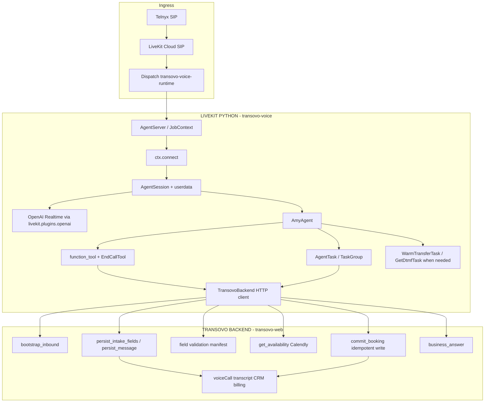
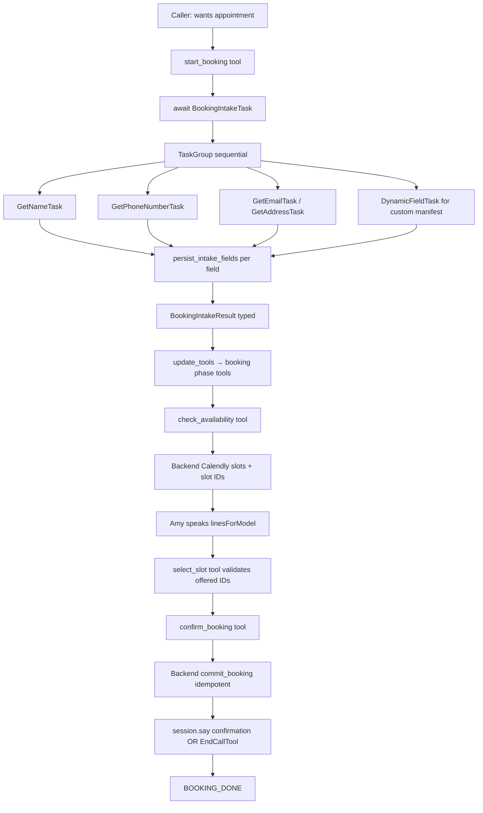

# Python Voice Runtime — Native LiveKit Architecture Audit

**Status:** Audit complete — refactor in progress  
**Date:** 2026-08-16  
**Scope:** Inbound generic receptionist (`runtime_profile=generic_receptionist`) via `transovo-voice` worker  
**Rule:** Use LiveKit Agents Python natively; keep custom code only for Transovo business logic and backend persistence.

**References researched:**

| Source | Path / URL |
|--------|------------|
| LiveKit Agents SDK (1.6.x) | `/agent/repos/agents/livekit-agents/` |
| Front Desk example | `examples/frontdesk/agent.py` |
| Hotel receptionist (BookRoomTask) | `examples/hotel_receptionist/` |
| Survey (TaskGroup tests) | `examples/survey/agent.py`, `test_survey_agent.py` |
| Healthcare (TaskGroup, transfer, EndCall) | `examples/healthcare/agent.py` |
| Warm transfer | `examples/warm-transfer/warm_transfer.py` |
| Telephony / DTMF / IVR | `examples/telephony/` |
| Beta workflows | `livekit/agents/beta/workflows/` (`GetNameTask`, `TaskGroup`, `WarmTransferTask`, `GetDtmfTask`) |
| EndCallTool | `livekit/agents/beta/tools/end_call.py` |
| AgentSession lifecycle | `livekit/agents/voice/agent_session.py` |
| Transovo Python runtime | `voice-runtime-python/transovo_voice/` |
| Transovo TS legacy (do not port) | `voice-runtime/src/frontdesk/receptionist/` |

---

## Executive summary

The current Python runtime is already **much thinner** than the TypeScript collection orchestration layer. Legacy constructs (`awaitingFieldAnswer`, `responseOwner`, `force_record_current_field`, `collectionPromptedFieldId`) exist only in **TypeScript** — they were deliberately **not ported**.

However, the Python runtime still has **structural debt** from early port decisions:

1. **Booking intake + availability run inside one long `start_booking` tool call** — blocks the tool executor, unlike hotel `BookRoomTask` / healthcare `profile_authenticator` patterns.
2. **`opportunistic_prefill` + `extract_fields` HTTP** — reimplements multi-field extraction the TS stack needed; native tasks + `session.history` + hotel-style “scan conversation” instructions are the LiveKit path.
3. **No `EndCallTool`, `WarmTransferTask`, or dynamic `update_tools`** — workflow enum exists but tool surface is static.
4. **Dead code** (`tasks/adapters.py`) — unused wrappers around SDK tasks.
5. **Message intake** incomplete — no backend persist, `MESSAGE_DONE` never reached.
6. **Thin automated tests** — no `AgentSession.run()` flow tests like survey/frontdesk.

**Target:** Less code, more LiveKit-native tasks/tools, backend remains authority for validation, slots, and commits.

---

## Full call pipeline (SIP → termination)

```
Telnyx PSTN
  → Telnyx SIP trunk / TeXML or SIP URI
  → LiveKit Cloud SIP ingress
  → Dispatch rule → agent_name: transovo-voice-runtime
  → JobContext (room, participant, metadata)
  → transovo_voice.main entrypoint
  → run_inbound_session
      → bootstrap_inbound (HTTP → transovo-web)
      → AgentSession + OpenAI Realtime
      → AmyAgent.on_enter (greeting)
      → [conversation]
      → tools / AgentTasks
      → HTTP internal API (persist, availability, commit)
  → participant disconnect → session shutdown → job shutdown callback
  → transcript / call record (backend)
```

---

## Component audit table

| CURRENT COMPONENT | CURRENT IMPLEMENTATION | LIVEKIT PYTHON NATIVE ALTERNATIVE | OFFICIAL EXAMPLE / DOC | ACTION | REASON | MIGRATION RISK |
|-------------------|------------------------|-----------------------------------|------------------------|--------|--------|----------------|
| Worker process | `AgentServer` + `cli.run_app` in `main.py` | Same — SDK owns worker | All examples | **KEEP** | Already native | Low |
| Job entry | `@server.rtc_session` entrypoint | Same | `examples/frontdesk/agent.py` | **KEEP** | Native | Low |
| Outbound skip | Early return if metadata contains `outbound` | Same until Python outbound ships | `main.py` | **KEEP** | Product scope | Low |
| Participant wait | `ctx.wait_for_participant()` | Same | Telephony examples | **KEEP** | Native | Low |
| Room connect | `ctx.connect()` before `session.start` | Same | `hotel_receptionist/agent.py`, `frontdesk/agent.py` | **KEEP** | Fixed in PR #209 | Low |
| Bootstrap / config | HTTP `bootstrap_inbound` → `SessionUserData` | N/A — Transovo tenant config | — | **KEEP (C)** | Business authority in TS | Low |
| Internal API client | `TransovoBackend` httpx | N/A — HTTP bridge | — | **KEEP (D)** | Persistence boundary | Low |
| Backend shutdown | `ctx.add_shutdown_callback` closes httpx | `ctx.add_shutdown_callback` | `survey/agent.py` | **KEEP** | Native lifecycle hook | Low |
| OpenAI Realtime | `livekit.plugins.openai.realtime.RealtimeModel` | Same | `examples/primitives/room_stats.py`, `voice_agents/otel_trace.py` | **KEEP** | Official plugin | Low |
| Semantic VAD | `SemanticVad(create_response=True)` | Same | OpenAI Realtime plugin | **KEEP** | Native turn detection | Low |
| Custom `create_response` toggling | **Not present in Python** | SDK + SemanticVad | — | **N/A** | Already removed | — |
| `responseOwner` / `generationMutex` | **Not present in Python** | AgentSession owns generation | — | **N/A** | TS legacy only | — |
| AgentSession | `AgentSession(llm, userdata=ud)` | Same | All voice examples | **KEEP** | Authoritative session object | Low |
| Session state duplication | `SessionUserData` + `WorkflowState` enum | `session.userdata` for transient; no duplicate audio/speech state | Healthcare `Userdata` dataclass | **SIMPLIFY** | Keep workflow enum; drop redundant flags over time | Medium |
| Amy agent | `AmyAgent(Agent)` + `on_enter` greeting | Same | `SurveyAgent`, `FrontDeskAgent` | **KEEP** | Native Agent subclass | Low |
| Compiled instructions | `ud.compiled_prompt` on Agent | `Agent(instructions=...)` | All examples | **KEEP (C)** | Transovo config | Low |
| Tool definitions | `@function_tool` in `tools.py` | Same | `function_tool` everywhere | **KEEP** | Native | Low |
| Static tool surface (5 tools always) | All tools registered at Agent init | `await agent.update_tools([...])` per workflow phase | `healthcare/agent.py` | **REPLACE** | Model only sees legal tools per state | Medium |
| `start_booking` runs intake + availability inline | Single tool: TaskGroup then `get_availability` | `await BookingIntakeTask(...)` then separate `check_availability` tool | `hotel_receptionist/book_room.py`, `healthcare profile_authenticator` | **REPLACE** | Shorter tool calls; native AgentTask handoff | **High** |
| Booking intake orchestration | `run_booking_intake_task_group()` in `workflows/booking_intake.py` | `BookingIntakeTask(AgentTask)` wrapping `TaskGroup` | `BookRoomTask`, healthcare `TaskGroup` | **REPLACE** | Hotel production pattern | Medium |
| TaskGroup chat context | `session.history` passed as `chat_ctx` | `self.chat_ctx` on Agent or `session.history` | `healthcare/agent.py:596`, `agent_session.py:765` | **KEEP** | Correct 1.6.x API | Low |
| `summarize_chat_ctx=False` | Explicit on TaskGroup | Default or `speech_only(chat_ctx)` for sub-tasks | `hotel_receptionist/context.py` | **KEEP** | Avoids extra LLM summarize pass | Low |
| GetNameTask | Direct SDK in TaskGroup | Same + `verify_spelling`, `extra_instructions` | `beta/workflows/name.py`, hotel `open_name_dialog` | **KEEP / ENHANCE** | Use full SDK features (spelling, phonetic) | Low |
| GetPhoneNumberTask | Direct SDK in TaskGroup | Same | `beta/workflows/phone_number.py`, healthcare | **KEEP** | Native | Low |
| GetEmailTask | Direct SDK in TaskGroup | Same | frontdesk `GetEmailTask` handoff | **KEEP** | Native | Low |
| GetAddressTask | Direct SDK in TaskGroup | Same | beta workflows | **KEEP** | Native | Low |
| `DynamicFieldTask` | Custom `AgentTask` + `record_field_value` | Smallest custom AgentTask for manifest fields | `data_capture_sim/agent.py` (confirmation pattern) | **KEEP (C)** | No SDK task for arbitrary manifest | Low |
| `tasks/adapters.py` Transovo*Task | Unused wrappers | Direct SDK tasks (already used) | — | **REMOVE** | Dead code | Low |
| `on_enter` monkey-patch for telemetry | `_wrap_task_with_started_log` | TaskGroup `on_task_completed` only | survey `on_task_completed` | **SIMPLIFY** | Telemetry in callback | Low |
| Opportunistic prefill | `user_input_transcribed` → `extract_fields` HTTP | Conversation in `chat_ctx`; tasks scan history; optional ANI prefill | hotel `BookRoomTask` instructions | **REMOVE** | TS workaround; reduces HTTP + race | Medium |
| `extract_fields` backend action | TS `extractDeterministicFieldsFromUtterance` | Remove from hot path; keep API for optional offline use | — | **SIMPLIFY** | Not needed if tasks own collection | Medium |
| ANI phone prefill | `_prefill_caller_phone` in inbound | Same — business rule, not LLM | — | **KEEP (C)** | Transovo ANI → manifest | Low |
| Field persist on capture | Async `persist_intake_fields` fire-and-forget | Same pattern; consider `ctx.disallow_interruptions` before commit only | frontdesk after email capture | **KEEP (D)** | Durability via backend | Low |
| Semantic validation | Backend `validateReceptionistFieldValue` on persist | Same — authoritative | — | **KEEP (C)** | LLM values not trusted | Low |
| Workflow state machine | `WorkflowState` enum + `ud.workflow` in tools | Enum for **business legality** only; not per-utterance generation | Healthcare scheduling phases | **SIMPLIFY** | Governs tools/tasks, not speech | Medium |
| `intake_active` flag | Blocks opportunistic prefill | Remove with opportunistic prefill | — | **REMOVE** | Coupled to legacy prefill | Low |
| Availability lookup | `get_availability` HTTP → Calendly via TS | Tool calls backend; LiveKit speaks structured lines | frontdesk `list_available_slots` (in-process calendar) | **KEEP (D)** | Provider in backend | Low |
| Slot presentation | Return `linesForModel` to tool result | Model speaks naturally from structured text | frontdesk | **KEEP** | No custom TTS layer | Low |
| Slot selection | `select_slot(slot_id)` validates offered set | Same + authoritative slot IDs | — | **KEEP (C)** | Deterministic | Low |
| Booking commit | `confirm_booking` → HTTP `commit_booking` | Same; `session.say(confirmationSpeech)` | frontdesk `schedule_appointment` | **KEEP (D)** | Provider write in backend | **High** |
| `BOOKING_CONFIRMED_ALREADY_SPOKEN` hack | String suppresses model re-speak | `session.say` + `ctx.disallow_interruptions()` or EndCallTool flow | frontdesk `disallow_interruptions` | **SIMPLIFY** | Native interruption control | Medium |
| Session disconnect during commit | Backend must complete write regardless | Idempotent commit + job-level persistence | — | **KEEP (D)** — verify tests | Critical invariant | **High** |
| FAQ | `get_business_answer` HTTP | Same — RAG in backend | — | **KEEP (C/D)** | Transovo knowledge | Low |
| Message intake | TaskGroup via `take_message` | Same TaskGroup; add `persist_message` backend action | — | **REPLACE** | Incomplete today | Medium |
| Transfer | `WorkflowState.TRANSFER` — no implementation | `WarmTransferTask` + policy tool | `warm-transfer/warm_transfer.py`, healthcare | **REPLACE** | Native SIP warm transfer | Medium |
| End call | Participant disconnect closes session | `EndCallTool(delete_room=True)` | `healthcare/agent.py`, `basic_agent.py` | **REPLACE** | Native graceful end | Low |
| DTMF | Not implemented | `GetDtmfTask` | `telephony/basic_dtmf_agent.py`, bank-ivr | **ADD (later)** | Only if product needs IVR | Low |
| Cancel / reschedule | Enum only | New tools + backend actions | hotel `cancel_room_booking` | **ADD (later)** | Product scope | Medium |
| Transcript persistence | Backend via bootstrap `voiceCall` + metadata | LiveKit session history live; persist on shutdown via backend | frontdesk `on_session_end` | **KEEP (D)** | Durable record in TS | Medium |
| Telemetry | `log_event` JSON | Supplement with `session.usage`, SDK events | survey `log_usage` shutdown callback | **ENHANCE** | Native metrics + Transovo logs | Low |
| Real-estate / outbound profiles | Hard gate → return early | Keep `VOICE_RUNTIME_IMPL=typescript` | — | **KEEP** | Separate runtimes | Low |
| Testing | 6 unit tests (field mapping, backend URL) | `AgentSession.run()`, mock backend, survey delays | `survey/test_survey_agent.py`, `frontdesk/test_agent.py` | **REPLACE** | Mandatory per requirements | Medium |

**Legend:** KEEP = retain as-is; REPLACE = restructure around LiveKit; SIMPLIFY = reduce custom logic; REMOVE = delete; ADD = new native capability.

---

## Legacy construct search (Python runtime)

| Legacy concept | In Python? | Verdict |
|----------------|------------|---------|
| `awaitingFieldAnswer` | No | — |
| `activeField` / `activeFieldId` | No | — |
| `force_record_current_field` | No | — |
| `collectionPromptedFieldId` | No | — |
| `collectionFieldPhase` | No | — |
| `responseOwner` | No | — |
| `generationMutex` | No | — |
| `create_response` toggling | No (always True) | — |
| Duplicate live chat contexts | No — uses `session.history` | — |
| Custom tool schema sync | No | — |
| **Opportunistic prefill + extract_fields** | **Yes** | **Remove** — TS-era multi-field extraction |
| **Long synchronous `start_booking`** | **Yes** | **Replace** with AgentTask |
| **Static tool list** | **Yes** | **Replace** with `update_tools` |
| **BOOKING_CONFIRMED_ALREADY_SPOKEN** | **Yes** | **Simplify** |
| **Dead adapters.py** | **Yes** | **Remove** |
| **intake_active flag** | **Yes** | **Remove** with prefill |

---

## Proposed final architecture

### Voice stack diagram



### Booking pipeline diagram



### Tool architecture (dynamic by phase)

| Phase | Tools exposed (`update_tools`) |
|-------|--------------------------------|
| IDLE / FAQ | `start_booking`, `take_message`, `get_business_answer`, `transfer_to_human`, `end_call` |
| BOOKING_INTAKE | *(none on Amy — BookingIntakeTask owns session)* |
| BOOKING_SELECT | `select_slot`, `get_business_answer`, `end_call` |
| BOOKING_CONFIRM | `confirm_booking`, `select_slot` (change mind), `end_call` |
| BOOKING_DONE | `take_message`, `transfer_to_human`, `end_call` |
| MESSAGE_INTAKE | *(MessageIntakeTask)* |
| TRANSFER | `WarmTransferTask` via tool, then shutdown |

### Task architecture

| Task | Type | Purpose |
|------|------|---------|
| `BookingIntakeTask` | `AgentTask[BookingIntakeResult]` | Wraps manifest-driven `TaskGroup`; returns typed result |
| `MessageIntakeTask` | `AgentTask` | Same TaskGroup with `purpose=message` |
| SDK `GetNameTask` etc. | Beta workflow tasks | Inside TaskGroup — not reimplemented |
| `DynamicFieldTask` | Custom `AgentTask` | Manifest fields without SDK equivalent |

### Transfer architecture

- **Policy:** Transovo backend / compiled config supplies transfer destinations and hours rules.
- **Execution:** `WarmTransferTask(sip_trunk_id, sip_call_to, chat_ctx=session.history)` from healthcare/warm-transfer examples.
- **Fallback:** `take_message` if transfer disallowed or fails.

### Context architecture

- **Live:** `session.history` / `Agent.chat_ctx` — single coherent context.
- **Task handoff:** Pass `chat_ctx` into `AgentTask` and `TaskGroup`; use `speech_only()` when sub-task should not see tool noise (hotel pattern).
- **Durable:** Backend persists fields + final transcript on `voiceCall` — not Python process memory.

---

## Refactor phases (incremental)

| Phase | Work | Risk |
|-------|------|------|
| **0** | This audit + tests scaffold | Low |
| **1** | Remove dead code; `BookingIntakeTask`; split `start_booking` from availability; `EndCallTool` | Medium |
| **2** | `update_tools` per workflow phase; remove opportunistic prefill | Medium |
| **3** | `WarmTransferTask`; message persist; `emit_event` telemetry | Medium |
| **4** | `AgentSession.run()` test suite (booking flow + disconnect-during-commit) | Medium |
| **5** | Delete TS collection path after 5–10 production smoke calls | High |
| **6** | Cancel/reschedule, DTMF if product requires | Medium |

---

## Test coverage plan

| Test | Pattern | Priority |
|------|---------|----------|
| Greeting on enter | `sess.run()` after start | P0 |
| Booking intent → BookingIntakeTask | mock backend | P0 |
| Name / phone / email via TaskGroup | survey isolation tests | P0 |
| Custom manifest field | DynamicFieldTask | P1 |
| Availability after intake complete | mock slots | P0 |
| Slot selection invalid ID rejected | tool error | P0 |
| Commit idempotent | mock backend | P0 |
| **Commit succeeds if session dies immediately after** | shutdown session mid-request | **P0 critical** |
| Transfer tool invokes WarmTransferTask | mock SIP env | P1 |
| End call | EndCallTool | P1 |
| Caller correction mid-intake | TaskGroup regression | P1 |

Reference: `examples/survey/test_survey_agent.py` (`_TASK_TRANSITION_DELAY`, `sess.history.items`).

---

## Intentionally custom (cannot remove)

1. **HTTP internal API** — Calendly, Prisma, SMS, tenant isolation.
2. **Manifest-driven field manifest** — per-tenant `DynamicFieldTask` + backend validation.
3. **Workflow invariants** — offered slot set, confirm-before-commit, idempotent commit.
4. **ANI prefill** — business rule mapping caller ID to phone field.
5. **`compiled_prompt` / greeting** — Transovo wizard output.
6. **Profile gate** — real-estate/outbound stay on TS worker until migrated.

---

## Official examples per design decision

| Decision | Reference |
|----------|-----------|
| AgentServer thin entry | `examples/hotel_receptionist/agent.py` |
| `ctx.connect` before `session.start` | `examples/frontdesk/agent.py:331` |
| Agent `on_enter` greeting | `examples/survey/agent.py` IntroTask |
| TaskGroup intake | `examples/healthcare/agent.py` `profile_authenticator` |
| Book flow as AgentTask | `examples/hotel_receptionist/book_room.py` |
| GetNameTask with spelling | `livekit/agents/beta/workflows/name.py` |
| `update_tools` dynamic surface | `examples/healthcare/agent.py` |
| `EndCallTool` | `examples/healthcare/agent.py`, `beta/tools/end_call.py` |
| `WarmTransferTask` | `examples/warm-transfer/warm_transfer.py` |
| `disallow_interruptions` before write | `examples/frontdesk/agent.py` |
| OpenAI Realtime plugin | `livekit.plugins.openai.realtime.RealtimeModel` |
| Testing | `examples/survey/test_survey_agent.py`, `frontdesk/test_agent.py` |

---

## Remaining custom voice infrastructure (post-refactor target)

| Component | Why it stays |
|-----------|--------------|
| `TransovoBackend` | HTTP bridge to business authority |
| `SessionUserData` + workflow enum | Transient runtime + business phase gates |
| `DynamicFieldTask` | No SDK task for arbitrary manifest fields |
| `telemetry.log_event` | Cross-service structured logging |
| `boot_probe.py` | Deploy health validation |
| `realtime_config.py` | Env-driven Realtime model config (plugin wrapper, not raw WS) |

**Target line count:** Python voice package should shrink (remove adapters, prefill path, inline booking tool bloat) while test file count grows.
