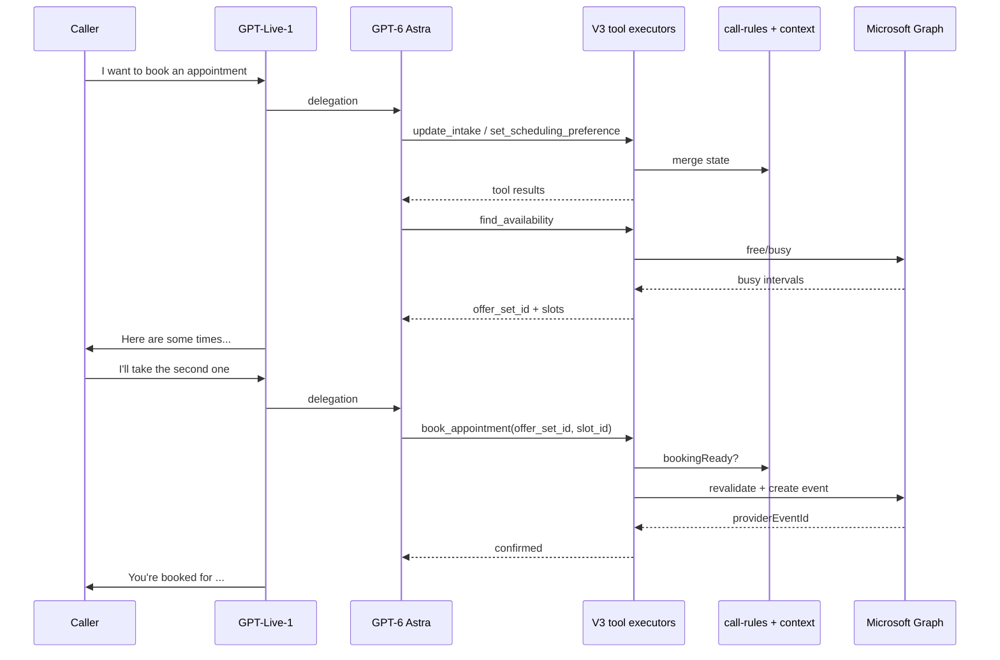

# Voice V3 — Booking flow: customer intent to confirmed appointment

Step-by-step map of **Voice V3 production booking** from the moment the caller says they want an appointment until the appointment is **actually** on the calendar.

**Sources:** `docs/voice-v3/BOOKING-PIPELINE-RUNTIME-PATH.md`, `docs/voice-v3/BOOKING.md`, and live code under `src/lib/voice-v3/`. This is **not** Voice V2 booking tools and **not** the Appointment Reminders SMS path.

---

## Architecture you need in your head first

Voice V3 on PSTN is **two models + typed tools**, not one LLM that regex-parses customer text:

| Layer | Role |
|--------|------|
| **GPT-Live-1 (“Amy”)** | Talks on the phone (greeting, ack, offers times in natural language). |
| **GPT-6 Astra (delegated Responses)** | Reasons over the turn and **calls function tools** (`update_intake`, `set_scheduling_preference`, `find_availability`, `book_appointment`, …). |
| **Deterministic executors** | Validate tool args, merge into `VoiceV3CallContext`, run rules, call Microsoft Graph, idempotency, persistence. |

Official cross-tool order is in `src/lib/voice-v3/prompts/astra-cross-tool-instructions.ts`:

**`update_intake` (facts as needed) → `set_scheduling_preference` (date/time semantics) → `find_availability` → caller accepts a slot → `book_appointment`.**

Nothing is “booked” in product terms until **`BOOKING_CONFIRMED`** and the `book_appointment` tool returns a verified success — not when the caller says “yes” and not when a tool is merely invoked.

**Important correction vs older docs:** `src/lib/voice-v3/intake/apply-caller-meaning.ts` is explicitly **“Legacy CallerMeaning merge for scripts/tests only — not on the production PSTN tool path.”** On production PSTN, meaning is expressed through **tool calls**, not a separate `emit_caller_meaning` pipeline (that name still appears in boundaries/docs from an earlier design).

---

## Phase 0 — Call lands (before “I want to book”)

1. **Telnyx / SIP → OpenAI** — `live.transport.incoming` hits `src/lib/voice-v3-basic/openai-live-webhook.ts`.
2. **Per-call runtime** — `createVoiceV3CallRuntime()` loads **`resolveVoiceV3AgentConfig()`** (published agent: calendar connection, intake fields, service, timezone, capabilities).
3. **Session accept** — `buildBasicLiveSessionAcceptParams()` configures Live with prompts + **Astra delegation** (backend model, instructions, **tool schemas** from `voice-tool-catalog.ts`).
4. **Sideband attaches** — `attachVoiceV3LiveSideband()` listens for audio, transcripts, and **`session.delegation.created` / `response.event`** (non-blocking).
5. **Greeting** — Amy speaks first (`requestInitialLiveGreeting`); caller audio is transcribed into a turn buffer.

Until the caller speaks about booking, no calendar tools run.

---

## Phase 1 — Caller: “I want to book an appointment” (interpretation, not booking)

6. **Caller speech** — Input transcript deltas accumulate (`caller-turn-buffer`, turn manager).
7. **Live delegates to Astra** — On a substantive turn, Live creates a delegation (`FRESH_DELEGATION_CREATED` / `ASTRA_DELEGATION_STARTED` in sideband logs).
8. **Astra decides tools (AI, not app regex)** — With prompts in `buildVoiceV3Prompts` + `buildAstraCrossToolInstructions`, the backend model chooses **zero or more** tools for that utterance. For a bare booking intent it typically:
   - Does **not** call `book_appointment` yet (no slot ids).
   - May call **`update_intake`** if configured fields are missing (name, phone, email, etc.).
   - May call **`set_scheduling_preference`** only if the caller already gave **structured** date/time semantics in that turn; otherwise Amy asks (“What day works?”) and a **later** delegation supplies `set_scheduling_preference`.
9. **Tool execution** — `handleDelegatedVoiceToolCall` → `executeVoiceTool` → per-tool `execute` (freshness/stale delegation guards apply).
10. **Tool results return to Astra** — `completeDelegatedFunctionCall` submits function output; Astra/Live continues; Amy speaks (clarifying questions, ack, or offered times after FIND).

**There is no automatic Graph write on “I want to book” alone.** Booking intent is steered into call state (e.g. `dialog.activeGoal` → `BOOK_APPOINTMENT` when scheduling tools run) via `mergeDialogActiveGoalFromTool`, not by scanning the transcript with app regex.

---

## Phase 2 — Establish *when* they want (scheduling preference)

11. **`set_scheduling_preference` (Astra tool)** — Args are a **Zod schema** (`schedulingMeaningZodObject`): things like `date_relation`, `weekday`, `daypart`, `exact_time`, etc. — the **model** fills these from natural language; the app does **not** regex-match “next Friday” in the SMS sense.
12. **Deterministic normalization** — `mergeSchedulingMeaningIntoContext` + scheduling normalizer resolve that into `ctx.scheduling.normalized` (business timezone, “today”, DST, etc.).
13. **Outcomes:**
    - **Clarification required** → tool returns `SCHEDULING_CLARIFICATION_REQUIRED`; Amy asks a targeted question.
    - **Success** → `SCHEDULING_PREFERENCE_SET`, `ready_for_availability_search: true`, often `activeGoal: BOOK_APPOINTMENT`.

**Rules engine** (`evaluateVoiceV3Rules` in `src/lib/voice-v3/state/call-rules.ts`) then knows: has scheduling preference, may find availability, not ready to book until a slot is selected.

---

## Phase 3 — Find real openings (read path)

14. **`find_availability` (Astra tool)** — Only after normalized preference exists (otherwise tool errors with `SCHEDULING_PREFERENCE_REQUIRED`).
15. **`dispatchFindAvailabilityIfRequired`** — Runs only when `rules.requiredAction === "FIND_AVAILABILITY"` (book goal, no authoritative slot yet, policy allows).
16. **Microsoft (or configured provider)** — `fetchVoiceV3BusyIntervals` → Graph free/busy for the search window.
17. **Slot generation** — `generateAvailabilitySlots` + business hours + duration → candidate slots; subtract busy.
18. **Offer set** — `buildAvailabilityOfferSet` → `offerSetId` + `slot_id` per slot; stored in `ctx.availability.activeOfferSet`.
19. **Amy gets facts to say** — `buildLiveAvailabilitySessionAppend` pushed via `session.thinking.append` / live context (so the **voice** model can offer real times, not invent them).
20. **Tool result to Astra** — `find_availability` returns JSON: `offer_set_id`, `slots[]` with `slot_id`, `local_start`, `display`.

Caller hears options; **still not booked.**

---

## Phase 4 — Caller picks a time (selection is still AI → tool args)

21. **Another delegation turn** — Caller says e.g. “the second one” or “3pm Friday.”
22. **Astra calls `book_appointment`** with:
    - `offer_set_id` — must match **active** offer set from step 20.
    - `slot_id` — must exist in that offer set.
    - `caller_verbal_confirmed` — if config requires explicit verbal confirm before commit.
23. **`book_appointment` tool (pre-commit checks)** — Binds selection into context, checks intake via `getMissingFieldsForOperation`, verbal confirmation policy, then `evaluateVoiceV3Rules` → must be **`bookingReady`**.

The app does **not** map “second one” with test-harness regex on production voice; **Astra** maps speech to the correct `slot_id` using the prior tool result + conversation.

---

## Phase 5 — Commit (write path) — “completely booked”

24. **`dispatchBookingIfRequired`** (inside `book_appointment` only) — When `bookingReady` and `requiredAction === "BOOK_APPOINTMENT"`.
25. **Booking attempt registry** — `bookingAttemptId`, idempotency per `schedulingGeneration|offerSetId|slotId`.
26. **Phase `BOOKING_REVALIDATING`** — Fresh busy check on the **selected** slot (`evaluateSlotRevalidation`) so Amy never confirms a slot that just got taken.
27. **If slot gone** — Failure, optional re-FIND; Amy must offer new times — **not** booked.
28. **Phase `BOOKING_CREATING`** — `buildCreateBookingRequest` (customer from intake, service, slot UTC, attempt id).
29. **Graph create** — `executeVoiceV3CreateBooking` → `executeMicrosoftCreateBooking` (uses `transactionId` = `bookingAttemptId` for idempotency).
30. **Success** — `BOOKING_CONFIRMED`, `markBookingConfirmed`, `registerDurableBooking`.
31. **Product persistence (async)** — `persistVoiceV3BookingAfterConfirmation` → `voiceAppointment` row, CRM hooks, call telemetry.
32. **Live context** — Booking confirmed append so Amy may say it’s confirmed **only after** step 30.
33. **Tool return** — `book_appointment` returns `confirmed` + `provider_event_id` / `display_time`; if Graph outcome uncertain → `BOOKING_OUTCOME_UNKNOWN` (no blind second create).

**Done** = Graph event exists + in-call state `BOOKING_CONFIRMED` + (typically) Postgres appointment row.

---

## What is *not* in this path

- **Voice V2** `calendar_availability` / wizard FIND-BOOK tools on the PSTN one-Amy path (frozen elsewhere).
- **Automatic booking** when rules say `bookingReady` **without** `book_appointment` — commit is **only** triggered from that tool’s executor.
- **Automatic FIND** without `find_availability` — FIND dispatch is invoked from that tool (or test hooks), not from a background regex on transcript.

---

## Contrast: Appointment Reminders SMS (target alignment)

AR reschedule today goes through **`handleAppointmentAIRequest`** (Luna): understanding agent → resolver → optional verifier → `commitArReschedule` / `provider-mutations`. Live E2E scripts may use **`autoFollowUp` / ordinal regex** — that is **test harness convenience**, not the Voice V3 model.

The product shape for AR should mirror **Voice V3’s pattern**:

- **AI** interprets each customer message and decides **which tool/mutation** to run.
- **Backend** owns calendar truth (Graph), slot lists, idempotency, and “confirmed” gates.
- **No** customer-text regex as the primary design for “Friday afternoon” → slot selection.

Microsoft Graph usage in AR should follow **`src/lib/calendar/ar-microsoft-primitives.ts`** and **`provider-mutations`** — reference V3 for how Graph commits work, not for invoking Voice V3 agent tools on the SMS path.

---

## Happy-path sequence (reference)



---

## Key code entry points

| Step | File / symbol |
|------|----------------|
| Webhook / accept | `src/lib/voice-v3-basic/openai-live-webhook.ts` |
| Live + Astra config | `src/lib/voice-v3-basic/live-session-config.ts` |
| Sideband / delegation events | `src/lib/voice-v3/live-sideband-session.ts` |
| Tool dispatch | `src/lib/voice-v3/tools/handle-delegated-voice-tools.ts` |
| Tool catalog | `src/lib/voice-v3/tools/voice-tool-catalog.ts` |
| Scheduling preference | `src/lib/voice-v3/tools/set-scheduling-preference-tool.ts` |
| Find | `src/lib/voice-v3/tools/find-availability-tool.ts`, `src/lib/voice-v3/calendar/find-dispatch.ts` |
| Book | `src/lib/voice-v3/tools/book-appointment-tool.ts`, `src/lib/voice-v3/calendar/book-dispatch.ts` |
| Rules | `src/lib/voice-v3/state/call-rules.ts` |
| Persist after confirm | `src/lib/voice-v3/calendar/persist-booking-after-confirmation.ts` |
| Cross-tool prompts | `src/lib/voice-v3/prompts/astra-cross-tool-instructions.ts` |

---

## Booking scene (locked product rule)

From `docs/voice-v3/BOOKING.md`:

```
FIND → OfferSet → PresentedOffer → SelectedSlot
→ intake complete → BOOKING_READY
→ fresh Microsoft busy revalidation (not stale OfferSet)
→ insertMicrosoftEvent (transactionId = bookingAttemptId)
→ BOOKING_CONFIRMED → Live may say "confirmed"
```

Nothing before `BOOKING_CONFIRMED` may be described as booked.
