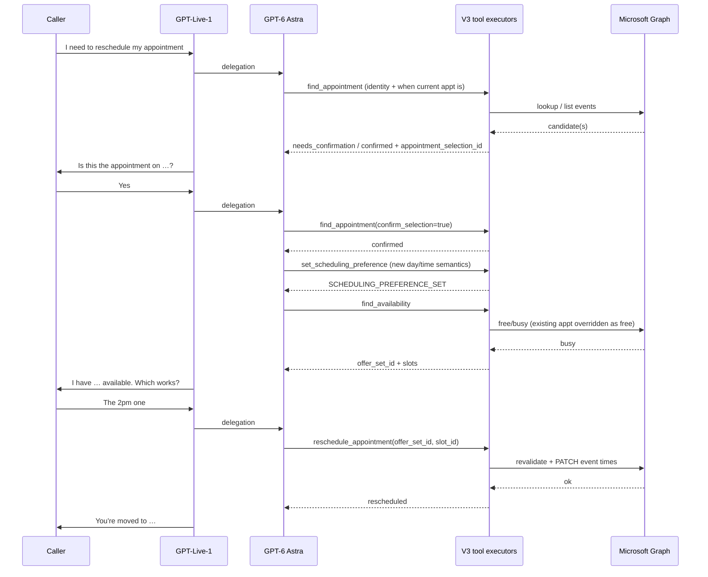

# Voice V3 — Reschedule flow: customer intent to confirmed move

Step-by-step map of **Voice V3 production reschedule** from the moment the caller says they want to **move an existing appointment** until the event is **actually updated** on the calendar.

**Sources:** `docs/voice-v3/BOOKING-PIPELINE-RUNTIME-PATH.md`, `docs/voice-v3/BOOKING.md`, `src/lib/voice-v3/prompts/astra-cross-tool-instructions.ts`, and live code under `src/lib/voice-v3/`. This is **not** Voice V2 booking tools and **not** Appointment Reminders SMS.

**Companion doc:** `docs/voice-v3/BOOKING-FLOW-CUSTOMER-INTENT-TO-CONFIRMED.md` (new appointment).

---

## How reschedule differs from new booking

| | **New book** | **Reschedule** |
|---|--------------|----------------|
| **Target** | Create a new Graph event | **Update** an existing event (`providerEventId`) |
| **First calendar read** | Free/busy for open slots | **`find_appointment`** — locate & verify the existing appointment |
| **Scheduling preference** | When the *new* visit should be | Same tool (`set_scheduling_preference`), but means *replacement* time |
| **Offer set** | Slots from busy calendar | Same `find_availability`, but slot generation **treats the current appointment time as free** (`freeBusyOverrides` on verified existing) so the same slot isn’t falsely blocked |
| **Commit tool** | `book_appointment` | **`reschedule_appointment`** |
| **Commit executor** | `executeMicrosoftCreateBooking` | **`executeMicrosoftUpdateBooking`** (patch event times) |
| **Done gate** | `BOOKING_CONFIRMED` | **`RESCHEDULE_CONFIRMED`** (`appointmentManagement.reschedule.phase`) |
| **Dialog goal** | `BOOK_APPOINTMENT` | **`RESCHEDULE_APPOINTMENT`** (required for reschedule-specific rules) |

Same runtime stack: **GPT-Live-1** speaks, **GPT-6 Astra** chooses **typed tools**, deterministic executors + Graph truth.

---

## Canonical tool order (production)

From `astra-cross-tool-instructions.ts`:

**`find_appointment` → `set_scheduling_preference` (new time semantics) → `find_availability` → caller accepts replacement slot → `reschedule_appointment`.**

Optional parallel/earlier: **`update_intake`** when the caller supplies name/phone/email needed for lookup.

Nothing is “rescheduled” in product terms until **`RESCHEDULE_CONFIRMED`** and the `reschedule_appointment` tool returns verified success — not when the caller says “yes” and not when a tool is merely invoked.

**Identifiers (never invented by the model):**

- **`appointment_selection_id`** — from `find_appointment` (not a raw Microsoft event id).
- **`offer_set_id` + `slot_id`** — from the latest successful `find_availability` for the current scheduling generation.

---

## Phase 0 — Call already in progress

Same as booking: PSTN → Live accept → `VoiceV3CallRuntime` + Astra delegation + sideband. Reschedule usually starts **after** greeting on a later caller turn (or after a booking on the same call — see “Post-book change” below).

No calendar mutation until the tool chain completes.

---

## Phase 1 — Caller: “I need to reschedule” (intent, not a move yet)

1. **Caller speech** → transcript / delegation to Astra (same as booking).
2. **Astra interprets reschedule intent** — should **not** call `reschedule_appointment` or `book_appointment` yet (no verified appointment, no replacement slot ids).
3. **Typical first tools:**
   - **`update_intake`** — if lookup needs name/phone/email not already in `ctx.intake.values`.
   - **`find_appointment`** — when the caller gives *any* useful identity or “when” the current appointment is (see Phase 2). May run in the same delegation turn as intake updates.
4. **Amy** — acknowledges, asks for missing discriminators (“What day is your current appointment?”) based on **tool results**, not app regex on the transcript.

**`dialog.activeGoal` should become `RESCHEDULE_APPOINTMENT`** for reschedule-specific rules (`evaluateVoiceV3Rules`). On the production **tool** path, goal alignment is driven by Astra following the reschedule workflow (and is explicitly set on **`reschedule_appointment`** when binding a slot). Cancel sets `CANCEL_APPOINTMENT` analogously in `cancel_appointment`. Do not assume a separate SMS-style regex router.

---

## Phase 2 — Find and verify the *existing* appointment (`find_appointment`)

5. **`find_appointment` (Astra tool)** — Args combine identity (name, phone, email, service, location) and **scheduling-meaning fields** for *when the existing appointment is* (`date_expression`, `weekday`, `exact_time`, etc.) — same schema family as `set_scheduling_preference`, but semantically “locate existing,” not “book new.”
6. **Merge with call state** — Phone/name/email fall back to intake; **inbound ANI** is applied automatically (`trustedAni`) — the model must not treat caller ID as the only key.
7. **`findExistingAppointment`** — Microsoft-backed lookup (`microsoftLookup: true`), progressive `lookupState`, verification rules.
8. **Tool outcomes (Astra reads these, Amy speaks):**
   - **`needs_more_information`** — `useful_discriminators` → ask only what helps narrow search.
   - **`ambiguous`** — multiple candidates with `selection_id` + display times → caller picks one.
   - **`needs_confirmation`** — single candidate found but policy requires confirm → `appointment_selection_id` + safe display.
   - **`confirmed`** — caller confirmed via **`confirm_selection: true`** + valid `appointment_selection_id`.
   - **`APPOINTMENT_NOT_FOUND` / `VERIFICATION_FAILED`** — recovery path; no reschedule commit.
9. **Verified state** — On confirm (or auto-verify when policy allows), `ctx.appointmentManagement.verifiedExisting` holds the authoritative **`ExistingAppointment`** (`providerEventId`, `providerCalendarId`, current `startUtc`/`endUtc`, `internalBookingId`, etc.). `lookupCompleted: true`.

**Still on the original calendar time** — no move yet.

---

## Phase 3 — Establish *new* time preference (replacement window)

10. **`set_scheduling_preference` (Astra tool)** — Structured scheduling meaning for **when they want to move to** (not intake fields).
11. **Deterministic normalization** — `mergeSchedulingMeaningIntoContext` → `ctx.scheduling.normalized` (business timezone, relative dates, etc.).
12. **Clarification** — Same as booking: tool may return `SCHEDULING_CLARIFICATION_REQUIRED`; Amy asks; caller answers; Astra calls again.
13. **Rules** — With `verifiedExisting` + normalized preference + `activeGoal === RESCHEDULE_APPOINTMENT`, `evaluateVoiceV3Rules` can set `requiredAction` to **`FIND_AVAILABILITY`** when no authoritative replacement slot is selected yet.

Note: `set_scheduling_preference`’s executor also steers **`BOOK_APPOINTMENT`** when semantic steering applies; the **prompt contract** still requires the reschedule tool chain after `find_appointment`. The reschedule commit path is gated on **verified existing** + **`reschedule_appointment`**, not `book_appointment`.

---

## Phase 4 — Find replacement openings (`find_availability`)

14. **`find_availability` (Astra tool)** — Same tool as new booking; requires normalized scheduling preference.
15. **`dispatchFindAvailabilityIfRequired`** — Graph free/busy → `generateAvailabilitySlots`.
16. **Reschedule-specific slot math** — If `appointmentManagement.verifiedExisting` is set, its interval is passed as **`freeBusyOverrides`** so the caller’s **current** appointment does not count as busy and block the same wall time incorrectly.
17. **Offer set** — `offerSetId` + `slot_id` list stored in `ctx.availability.activeOfferSet`; Live context append for Amy to offer **real** replacement times.
18. **Tool result** — `offer_set_id` + `slots[]` returned to Astra.

Caller hears replacement options; **event still at old time on Graph.**

---

## Phase 5 — Caller picks the replacement slot (AI → tool args)

19. **Delegation turn** — e.g. “Friday at 2” / “the first one.”
20. **Astra calls `reschedule_appointment`** with:
    - `appointment_selection_id` — optional if `verifiedExisting` already in state; must match if provided.
    - `offer_set_id` — active offer set from step 18.
    - `slot_id` — chosen slot from that offer set.
21. **Pre-commit checks in tool** — Resolve appointment; reject stale offer/slot; **`bindSlot`** updates context: `selection.selected`, `activeGoal: RESCHEDULE_APPOINTMENT`, reschedule phase **`RESCHEDULE_READY`**.

The model maps natural language to **`slot_id`** using prior `find_availability` output — not a production regex router.

---

## Phase 6 — Commit (write path) — “completely rescheduled”

22. **`dispatchRescheduleIfRequired`** (only from `reschedule_appointment` tool) — Runs when `rules.requiredAction === "RESCHEDULE_APPOINTMENT"` and `rescheduleReady` (verified existing + authoritative slot + intake satisfied for reschedule operation + no scheduling clarification blocking).
23. **`RESCHEDULE_REVALIDATING`** — Fresh Graph busy fetch on the **replacement** window; **`filterBusyForReschedule`** excludes the **old** appointment interval from blocking itself.
24. **`evaluateSlotRevalidation`** — Replacement slot must still be free. If not → **`RESCHEDULE_FAILED`**; Amy should re-offer (often re-`find_availability`).
25. **`RESCHEDULE_COMMITTING`** — `runAuthoritativeOperation` with attempt id.
26. **Graph update** — `validateMicrosoftAppointmentBeforeMutation` then **`executeMicrosoftUpdateBooking`** (patch `startUtc`/`endUtc` on existing `providerEventId`).
27. **Uncertain network** — May run **`reconcileMicrosoftRescheduleOutcome`** (compare Graph to requested times); may yield success without double patch.
28. **`RESCHEDULE_CONFIRMED`** — Update `verifiedExisting` times in context; **`updateDurableBookingTimes`** on in-call durable store; Live append (`buildLiveRescheduleConfirmedAppend`) so Amy may state the new time **only after** confirm.
29. **Tool return** — `rescheduled` + `provider_event_id` / `display_time`; failures → `RESCHEDULE_FAILED` or `RESCHEDULE_OUTCOME_UNKNOWN`.

**Done** = Graph event shows new start/end + in-call phase **`RESCHEDULE_CONFIRMED`** (+ durable booking times aligned). Unlike new book, this is an **update**, not a second event (same `providerEventId`).

---

## Optional orchestration: `dispatchAppointmentManagementIfRequired`

`src/lib/voice-v3/calendar/appointment-management-dispatch.ts` can chain lookup, FIND, and reschedule when `dialog.activeGoal` is `RESCHEDULE_APPOINTMENT` or `CANCEL_APPOINTMENT`. The **PSTN tool path** you care about for cert is still: **each Astra tool’s `execute` → `dispatchRescheduleIfRequired` / `dispatchFindAvailabilityIfRequired`**. The management dispatcher documents the intended rule ordering when goal + state are already set.

---

## Post-book change on the same call

If the caller **just booked** in this call and then asks to change time:

- Legacy **CallerMeaning** path can set **`postBookChangeRequested`** when `post_book_intent === CHANGE_CONFIRMED_APPOINTMENT` and `booking.confirmed` (`apply-caller-meaning.ts`, `BOOKING.md`).
- Production **tool** path still uses the same **`find_appointment` / reschedule** chain for an existing event (often the one just created, once it exists in lookup state).

Do not describe the appointment as “moved” until the reschedule commit succeeds.

---

## What is *not* in this path

- **`book_appointment`** — creates a **new** event; wrong tool for “move my existing appointment.”
- **Voice V2** FIND/BOOK wizard or Telnyx voice tools.
- **Automatic reschedule** when rules say ready **without** `reschedule_appointment` — commit is only triggered from that tool’s executor (same pattern as book).
- **Invented** `providerEventId`, timestamps, or slot ids.
- **Appointment Reminders SMS** (`handleAppointmentAIRequest` / Luna) — separate product; Graph reference only via `ar-microsoft-primitives` if you mirror behavior.

---

## Contrast: AR SMS reschedule (why Voice doc matters)

AR should mirror **this choreography**: agent turn → choose operation → structured backend (find appointment context, availability, commit patch/cancel). Test scripts that regex-match “the second one” are harness-only; Voice V3 expects **Astra** to pass **`slot_id`** into **`reschedule_appointment`**.

---

## Happy-path sequence (reference)



---

## Reschedule scene (locked product rule)

Analogous to booking in `docs/voice-v3/BOOKING.md`:

```
find_appointment → verifiedExisting
→ set_scheduling_preference (replacement semantics)
→ FIND → OfferSet → caller selects replacement slot
→ RESCHEDULE_REVALIDATING (fresh busy, exclude old event from false conflict)
→ PATCH Microsoft event (same providerEventId)
→ RESCHEDULE_CONFIRMED → Live may say "moved"
```

Nothing before **`RESCHEDULE_CONFIRMED`** may be described as rescheduled.

---

## Key code entry points

| Step | File / symbol |
|------|----------------|
| Cross-tool prompts | `src/lib/voice-v3/prompts/astra-cross-tool-instructions.ts` |
| Find existing | `src/lib/voice-v3/tools/find-appointment-tool.ts`, `find-existing-appointment.ts` |
| New time preference | `src/lib/voice-v3/tools/set-scheduling-preference-tool.ts` |
| Replacement slots | `src/lib/voice-v3/tools/find-availability-tool.ts`, `find-dispatch.ts` (`freeBusyOverrides`) |
| Commit tool | `src/lib/voice-v3/tools/reschedule-appointment-tool.ts` |
| Commit dispatch | `src/lib/voice-v3/calendar/reschedule-dispatch.ts` |
| Graph patch | `src/lib/voice-v3/calendar/microsoft/microsoft-update-booking.ts` |
| Rules / readiness | `src/lib/voice-v3/state/call-rules.ts` (`rescheduleReady`, `requiredAction`) |
| Management orchestration (goal-driven) | `src/lib/voice-v3/calendar/appointment-management-dispatch.ts` |
| Tool contracts | `src/lib/voice-v3/tools/astra-tool-contracts.ts` (`RESCHEDULE_APPOINTMENT_TOOL_DESCRIPTION`) |
